# Cloud-360 ER model

擷取自本機資料庫 `cloud360`（2026-11-22）。`public` 25 張表，`memory` 2 張表。`memory_records` 與 `memory_audit_events` 在 `memory` schema，其餘在 `public`。

關係用文字基數，貼上時才不會把 `|`、`{` 吃掉。`only one` 是恰好一，`zero or one` 是零或一，`zero or more` 是零或多。未寫刪除行為的外鍵是資料庫預設 `NO ACTION`。標籤 `NO FK` 是整數參照，catalog 裡沒有 `FOREIGN KEY`。欄位只標一個鍵：主鍵兼外鍵時，主鍵寫 `PK`，外鍵寫在註解。

```mermaid
erDiagram
  users only one -- zero or more role_authorization_requests : "user_id CASCADE"
  users only one -- zero or more projects : "owner_user_id"
  users only one -- zero or more project_members : "user_id"
  users zero or one -- zero or more project_members : "invited_by"
  users only one -- zero or more reselection_events : "promoted_user_id"
  users zero or one -- zero or more reselection_events : "previous_owner_user_id"
  users only one -- zero or more user_diagrams : "user_id"
  user_diagrams zero or one -- zero or more users : "last_opened SET NULL"
  users only one -- zero or more diagram_shares : "user_id"
  users only one -- zero or more user_diagram_chats : "user_id"
  users only one -- zero or more iac_saved_drafts : "user_id"
  users only one -- zero or more architecture_reviews : "created_by"
  users zero or one -- zero or more wa_lenses : "updated_by"
  users only one -- zero or more diagram_change_records : "actor_user_id"
  users only one -- zero or more system_requirement_fields : "updated_by"
  users only one -- zero or more estimate_sets : "owner_user_id CASCADE"
  users only one -- zero or more estimate_shares : "user_id CASCADE"
  users only one -- zero or more estimate_audit_events : "actor_user_id"
  users only one -- zero or more memory_records : "owner_user_id"
  users only one -- zero or more memory_audit_events : "actor_user_id"

  projects only one -- zero or more systems : "project_id RESTRICT"
  projects only one -- zero or more project_members : "project_id CASCADE"
  projects only one -- zero or more reselection_events : "project_id NO FK"
  systems zero or one -- zero or more user_diagrams : "system_id RESTRICT"
  systems only one -- zero or more system_requirement_fields : "system_id CASCADE"

  user_diagrams only one -- zero or more diagram_shares : "diagram_id"
  user_diagrams only one -- zero or more user_diagram_chats : "diagram_id CASCADE"
  user_diagrams only one -- zero or more iac_saved_drafts : "diagram_id CASCADE"
  user_diagrams zero or one -- zero or more architecture_reviews : "diagram_id CASCADE"
  user_diagrams only one -- zero or more diagram_change_records : "diagram_id CASCADE"
  user_diagrams only one -- zero or one archive_diagram_cost : "diagram_id CASCADE"
  user_diagrams only one -- zero or more archive_diagram_cost_line : "diagram_id CASCADE"
  user_diagrams only one -- zero or more archive_cost_audit_event : "diagram_id CASCADE"
  user_diagrams zero or one -- zero or more estimate_sets : "diagram_id NO FK"

  estimate_sets only one -- zero or more estimates : "estimate_set_id CASCADE"
  estimate_sets only one -- zero or one advice : "estimate_set_id CASCADE"
  estimate_sets only one -- zero or more estimate_shares : "estimate_set_id CASCADE"
  estimate_sets only one -- zero or more estimate_audit_events : "estimate_set_id CASCADE"
  estimates only one -- zero or more estimate_line_items : "estimate_id CASCADE"

  memory_records zero or one -- zero or more memory_audit_events : "memory_id NO FK"

  users {
    int id PK
    varchar username UK "NOT NULL"
    varchar password_hash "NOT NULL"
    varchar role "nullable"
    bool is_active "nullable default true"
    int last_opened_diagram_id FK "nullable ON DELETE SET NULL"
    timestamptz last_activity_at "nullable"
    varchar authorization_status "varchar32 nullable default approved"
  }

  role_authorization_requests {
    int id PK
    int user_id FK "NOT NULL ON DELETE CASCADE"
    varchar requested_role "varchar64 NOT NULL"
    varchar status "varchar32 NOT NULL"
    timestamptz created_at "nullable default now"
    timestamptz updated_at "nullable default now"
    varchar decided_by "varchar128 nullable"
    timestamptz decided_at "nullable"
    text note "nullable"
  }

  role_permissions {
    varchar role PK "varchar64"
    varchar story_id PK "varchar16"
    bool can_view "NOT NULL default false"
    bool can_edit "NOT NULL default false"
    bool can_review "NOT NULL default false"
    timestamptz updated_at "NOT NULL default now"
    varchar updated_by "varchar128 nullable"
  }

  projects {
    int id PK
    varchar name "varchar255 NOT NULL trim nonempty"
    int owner_user_id FK "NOT NULL"
    bool is_default "NOT NULL default false partial UQ per owner"
    timestamptz created_at "NOT NULL default now"
  }

  systems {
    int id PK
    int project_id FK "NOT NULL ON DELETE RESTRICT"
    varchar name "varchar255 NOT NULL trim nonempty"
    bool is_default "NOT NULL default false partial UQ per project"
    timestamptz created_at "NOT NULL default now"
  }

  project_members {
    int id PK
    int project_id FK "NOT NULL ON DELETE CASCADE UQ with user_id"
    int user_id FK "NOT NULL UQ with project_id"
    varchar role "varchar32 NOT NULL project_admin or member"
    timestamptz joined_at "NOT NULL default now"
    int invited_by FK "nullable"
  }

  reselection_events {
    int id PK
    int project_id "NOT NULL NO FK"
    varchar cause "varchar32 NOT NULL auto_reselection or manual_role_change"
    int promoted_user_id FK "NOT NULL"
    int previous_owner_user_id FK "nullable"
    varchar previous_role "varchar32 nullable"
    varchar new_role "varchar32 NOT NULL"
    timestamptz occurred_at "NOT NULL default now"
    timestamptz acknowledged_at "nullable"
  }

  system_requirement_fields {
    int id PK
    int system_id FK "NOT NULL ON DELETE CASCADE"
    varchar agent_group "varchar64 NOT NULL"
    varchar field_key "varchar64 NOT NULL UQ with system_id and agent_group"
    text value "nullable"
    timestamptz cleared_at "nullable requires value null"
    timestamptz updated_at "NOT NULL default now"
    int updated_by FK "NOT NULL"
    varchar updated_on_behalf_of "varchar64 nullable NO FK"
  }

  user_diagrams {
    int id PK
    int user_id FK "NOT NULL"
    varchar title "NOT NULL default unnamed"
    text xml_data "NOT NULL"
    timestamptz updated_at "nullable default now"
    int system_id FK "nullable ON DELETE RESTRICT"
  }

  diagram_shares {
    int user_id PK "FK users.id"
    int diagram_id PK "FK user_diagrams.id"
  }

  user_diagram_chats {
    int user_id PK "FK users.id"
    int diagram_id PK "FK user_diagrams.id ON DELETE CASCADE"
    text messages_json "NOT NULL default empty-array"
    timestamptz updated_at "nullable default now"
  }

  iac_saved_drafts {
    int user_id PK "FK users.id"
    int diagram_id PK "FK user_diagrams.id ON DELETE CASCADE"
    varchar draft_id "varchar64 NOT NULL"
    text files_json "NOT NULL"
    text advice_text "nullable"
    text scan_advice_text "nullable"
    text scan_json "nullable"
    timestamptz updated_at "nullable default now"
  }

  architecture_reviews {
    int id PK
    int diagram_id FK "nullable ON DELETE CASCADE"
    int created_by FK "NOT NULL"
    varchar provider "varchar16 NOT NULL default aws"
    varchar status "varchar32 NOT NULL default pending"
    int overall_score "nullable"
    text scores_json "nullable"
    text findings_json "nullable default empty-array"
    text suggestions_text "nullable"
    text error_message "nullable"
    varchar rule_pack_version "varchar64 nullable"
    text xml_snapshot "nullable"
    bool archived "NOT NULL default false"
    timestamptz created_at "nullable default now"
    timestamptz updated_at "nullable default now"
  }

  wa_lenses {
    int id PK
    varchar lens_id "varchar64 NOT NULL default cloud360-core-mvp"
    varchar provider "varchar16 NOT NULL default aws"
    bool is_active "NOT NULL default true"
    text body_json "NOT NULL"
    int updated_by FK "nullable"
    timestamptz created_at "nullable default now"
    timestamptz updated_at "nullable default now"
  }

  diagram_change_records {
    int id PK
    int diagram_id FK "NOT NULL ON DELETE CASCADE"
    varchar source "varchar32 NOT NULL only brain_orchestration"
    int actor_user_id FK "NOT NULL"
    text requirement_summary "NOT NULL trim nonempty"
    varchar requirement_label "varchar255 NOT NULL"
    timestamptz created_at "NOT NULL default now"
  }

  archive_diagram_cost {
    int diagram_id PK "FK user_diagrams.id ON DELETE CASCADE"
    varchar pricing_region "varchar64 nullable"
    numeric monthly_budget "numeric 12.2 nullable"
    timestamptz updated_at "NOT NULL default now"
  }

  archive_diagram_cost_line {
    int diagram_id PK "FK user_diagrams.id ON DELETE CASCADE"
    varchar mxcell_id PK "varchar128 NOT NULL"
    int hours "NOT NULL default 24"
    varchar sku_override "varchar128 nullable"
    numeric hourly_override "numeric 12.2 nullable"
    timestamptz updated_at "NOT NULL default now"
  }

  archive_cost_audit_event {
    int id PK
    int diagram_id FK "NOT NULL ON DELETE CASCADE"
    varchar field "varchar32 NOT NULL"
    varchar mxcell_id "varchar128 nullable"
    text old_value "nullable"
    text new_value "NOT NULL"
    varchar actor_username "varchar128 NOT NULL NO FK"
    timestamptz created_at "NOT NULL default now"
  }

  archive_pricing_cache {
    varchar cloud PK "varchar16"
    varchar sku PK "varchar128"
    varchar region PK "varchar64"
    numeric hourly "numeric 12.6 NOT NULL"
    timestamptz fetched_at "NOT NULL"
  }

  estimate_sets {
    int id PK
    int owner_user_id FK "NOT NULL ON DELETE CASCADE"
    timestamptz created_at "NOT NULL default now"
    int diagram_id "nullable NO FK"
    text note "nullable"
    text workload_context_json "nullable"
    bool is_saved "NOT NULL default false"
  }

  estimates {
    int id PK
    int estimate_set_id FK "NOT NULL ON DELETE CASCADE UQ with cloud"
    varchar cloud "varchar16 NOT NULL UQ with estimate_set_id"
    numeric stated_total "numeric 18.6 nullable"
    varchar currency "varchar16 nullable"
    int parsed_line_count "NOT NULL default 0"
    int unparsed_line_count "NOT NULL default 0"
    varchar source_format "varchar8 NOT NULL"
  }

  estimate_line_items {
    int id PK
    int estimate_id FK "NOT NULL ON DELETE CASCADE"
    int ordinal "NOT NULL"
    text item_name "nullable"
    text spec "nullable"
    text spec_description "nullable"
    numeric quantity "numeric 18.6 nullable"
    numeric amount "numeric 18.6 nullable"
    varchar currency "varchar16 nullable"
    varchar parse_status "varchar32 NOT NULL"
    text raw_text "NOT NULL"
  }

  estimate_shares {
    int estimate_set_id PK "FK estimate_sets.id ON DELETE CASCADE"
    int user_id PK "FK users.id ON DELETE CASCADE"
    timestamptz shared_at "NOT NULL default now"
  }

  estimate_audit_events {
    int id PK
    int actor_user_id FK "NOT NULL"
    int estimate_set_id FK "NOT NULL ON DELETE CASCADE"
    varchar event_type "varchar64 NOT NULL"
    timestamptz occurred_at "NOT NULL default now"
    varchar cloud "varchar16 nullable"
    int parsed_line_count "nullable"
    int unparsed_line_count "nullable"
  }

  advice {
    int estimate_set_id PK "FK estimate_sets.id ON DELETE CASCADE"
    varchar status "varchar32 NOT NULL default generating"
    text saving_text "nullable"
    text comparison_text "nullable"
    text quality_text "nullable"
    text unavailable_reasons_json "nullable"
    timestamptz started_at "nullable"
    timestamptz completed_at "nullable"
  }

  memory_records {
    int id PK
    varchar kind "varchar16 NOT NULL semantic or procedure or episodic"
    int owner_user_id FK "NOT NULL"
    varchar visibility_scope "varchar32 NOT NULL"
    text content "NOT NULL trim nonempty"
    vector embedding "vector1024 nullable HNSW cosine"
    varchar embedding_model "varchar64 NOT NULL"
    timestamptz created_at "NOT NULL default now"
    timestamptz expires_at "nullable required when kind is episodic"
  }

  memory_audit_events {
    int id PK
    int memory_id "NOT NULL NO FK"
    int actor_user_id FK "NOT NULL"
    varchar action "varchar32 NOT NULL deleted_by_user or purged_by_retention or scope_changed"
    varchar previous_scope "varchar32 nullable"
    varchar new_scope "varchar32 nullable"
    timestamptz occurred_at "NOT NULL default now"
  }
```

## 圖沒有寫進去的部分

上面 27 張表的欄位都在。下面是圖放不進 Mermaid、或 SQL 來源檔沒有寫的約束。

### 部分唯一索引

每個擁有者最多一個預設專案，每個專案最多一個預設系統。非預設列不受這兩條限制。

- `projects`：`UNIQUE (owner_user_id) WHERE is_default`
- `systems`：`UNIQUE (project_id) WHERE is_default`

`reselection_events` 另有一個非唯一索引，條件是 `acknowledged_at IS NULL`。它不限制一個人能有幾筆未確認改選。

### 圖上為了能貼上而改寫的字面值

- `user_diagrams.title` 的預設值是 `未命名架構圖`
- `user_diagram_chats.messages_json` 與 `architecture_reviews.findings_json` 的預設值是 `[]`
- 時間欄的預設值是 `now()`

### `schema_rbac.sql` 沒有、本機資料庫有

這四項由 `backend/database.py` 在啟動時補上，重跑 `schema_rbac.sql` 不會建立它們。

| 物件 | 補丁 | 與 SQL 檔的差異 |
|---|---|---|
| `users.authorization_status` | `_ensure_j5_schema` | `VARCHAR(32)`，預設 `approved`，欄位可空 |
| `users.role` 可空 | 同一補丁的 `DROP NOT NULL` | `schema_rbac.sql` 把 `role` 寫成 `NOT NULL` |
| `role_authorization_requests` | 同一補丁的 `CREATE TABLE` | 整張表不在 `schema_rbac.sql` |
| `iac_saved_drafts` | `_ensure_iac_draft_schema` | 整張表不在 `schema_rbac.sql` |

`schema.sql` 是精簡核心，檔頭已指向 `schema_rbac.sql`。它沒有授權狀態、專案階層、估價、記憶與 IaC 這些表。
