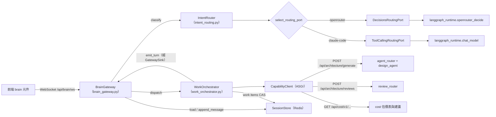
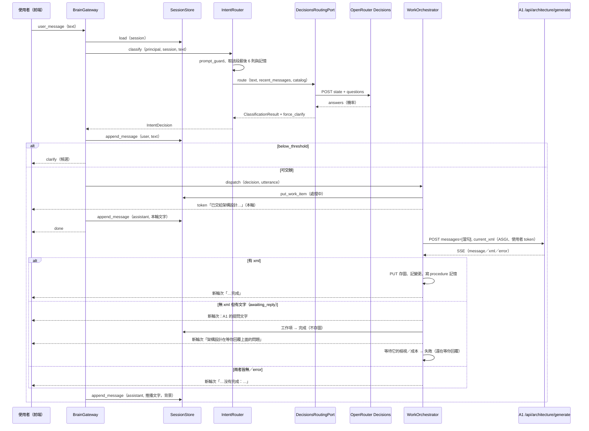
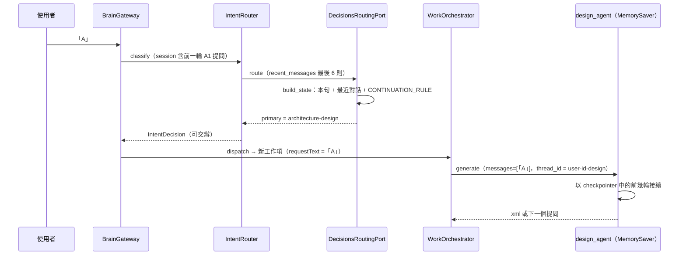

# 架構 — cloud-360

> 新鮮度：2026-11-22 Full rescan（廣度）＋ partial（深度）。**大腦路由與工作編排**一節為〔實讀〕；其餘為〔盤點〕。覆蓋分佈見 `reverse-engineering-timestamp.md`。

## Architecture Analysis

### System Overview

單一 FastAPI 後端（`backend/main.py`）＋ React SPA（`frontend/`），PostgreSQL 為主資料庫、Redis 承載大腦的工作階段與工作項，LLM 經 OpenRouter（部署）或本機 `claude` CLI（開發）。另有一個獨立行程 `mcp_bridge`。〔盤點〕

### Architectural Style

模組化單體（modular monolith）：所有業務 router 掛在同一個 FastAPI app；大腦以**同進程 ASGI 傳輸**呼叫自己的 HTTP 端點（`work_orchestrator_capabilities.py:244-252`），使每次呼叫完整走過既有授權 dependency。〔實讀〕大腦連線登錄與限流在行程記憶體內，`brain_gateway.py` 檔頭明訂**單一行程假設**（多 worker 會讓扇出靜默失效）。〔實讀〕

### Component Relationships

文字替代：前端以 WebSocket 連到 `BrainGateway`。閘道呼叫 `IntentRouter.classify`，後者依 `LLM_PROVIDER` 選一個路由 port（部署用 Decisions API、本機用工具呼叫），兩者都經 `langgraph_runtime` 出站。判讀成功後閘道呼叫 `WorkOrchestrator.dispatch`，編排層以 `CapabilityClient` 經同進程 ASGI 呼叫 A1／A3／C1 的既有 HTTP 端點。對話歷程與工作項都存在 Redis 的 `SessionStore`；編排層的結果經 `GatewaySink.emit_turn` 推回前端並寫回歷程。

### Data Flow

- **對話歷程**：每段（`shared`／`workspace`／`assessment`）一份訊息列（`role`、`text`），存 Redis，TTL 24 小時。使用者訊息在 `classify` **之後**寫入（`brain_gateway.py:1424`），系統回覆於回合結束（`_end_turn`，`:1311-1321`）或背景推播（`emit_turn` → `append_assistant_background`，`:595-597`、`:1906-1910`）寫入。〔實讀〕
- **路由輸入**：`fetch_routing_context` 從**已載入**的 session 取該段最後 6 則與作業對象，記憶經 `MemoryFacade` 取 5 筆（`intent_routing.py:252-282`）。〔實讀〕
- **工作項**：建立時存原句前 2000 字（`requestText`），以 `dispatchStage` 做比對後寫入（CAS）。〔實讀〕
- **架構設計記憶**：LangGraph `MemorySaver`，`thread_id=f"user-{id}-design"`（`agent_router.py:153`、`design_agent.py:262`），**行程內**。〔實讀（design_agent）／盤點（agent_router）〕

### Key Design Decisions

| 決策 | 證據 | 影響 |
|---|---|---|
| 路由 port 唯一選擇點，依 `LLM_PROVIDER` | `intent_routing_port.py:584-605` | 部署與本機走不同 LLM 形狀，結果同形（`ClassificationResult`） |
| Decisions 路徑以機率轉槽位，多意圖依固定先後（設計→評核→成本）排序 | `intent_routing_decisions.py:330-411` | 保證「先改圖、再估／評」 |
| 每輪最多 1 次模型呼叫、重試 0、硬逾時（由設定驅動） | `intent_routing_port.py:24-27`、`CallBudget` | 失敗直接回使用者，不 fallback |
| 編排層不呼叫 LLM、不直呼能力 service，一律帶使用者 token 走 HTTP | `work_orchestrator.py` 檔頭禁令 1、2 | 授權不被繞過 |
| A1 無 xml 但有文字 → `awaiting_reply`（本 intent 新增） | `work_orchestrator_capabilities.py:158-159`、`work_orchestrator.py:1097-1116` | 多輪問答不再被記為失敗 |
| Decisions `state` 帶最近 6 則對話＋`CONTINUATION_RULE`（本 intent 新增） | `intent_routing_decisions.py` diff、`intent_routing_port.py:562-567` | 簡短回覆可判讀為延續 |

### Improvement Opportunities

詳見 `code-quality-assessment.md` 的技術債清單（ADR-0024 量測失效、復原掃描無法區分「等你回覆」、行程內對話記憶）。

## Interaction Diagrams

### 交易一：使用者在大腦輸入一句話 → 交辦架構設計 → 結果回推〔實讀〕

文字替代：(1) 閘道載入 session、呼叫 `IntentRouter.classify`；路由層先過 `prompt_guard`，再取該段最後 6 則對話與記憶，經 Decisions port 送一次請求給 OpenRouter，把機率轉成槽位並得到 `IntentDecision`。(2) 閘道才把使用者這句寫進歷程。(3) 低於門檻就送反問；否則交給 `WorkOrchestrator.dispatch`，它建工作項、在本輪回一句「已交給…」後閘道結束本輪。(4) 背景執行時編排層以使用者 token 經 ASGI 呼叫 A1，收齊 SSE 後由 `judge_a1` 判定：有圖就存圖並推「完成」；沒有圖但有文字就把提問推給使用者、工作項記為完成並提示直接回覆，等待它的工作項以「還在等你回覆」結束；都沒有就推失敗。(5) 推播文字由閘道在背景寫回該段歷程，成為下一輪路由的參考。

### 交易二：使用者只回「A」→ 延續架構設計（本 intent 的修正路徑）〔實讀〕

文字替代：使用者只回「A」時，閘道載入的 session 已含前一輪架構設計的提問（背景寫回的助理訊息）。Decisions port 把本句、最近 6 則對話與延續規則一起放進 `state`，模型因此把它判為架構設計。編排層另開新工作項，只把「A」送給 A1；A1 的 design agent 以 per-user 的 `thread_id` 從行程內 `MemorySaver` 取回前幾輪並接續。**這條接續鏈依賴行程內記憶，重啟後斷開**（見 `code-quality-assessment.md`）。
