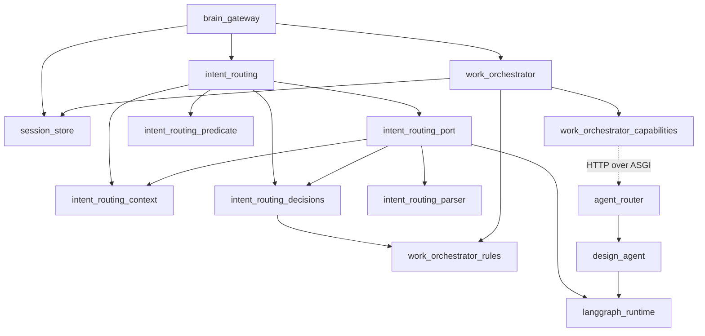

# 相依關係 — cloud-360

> 新鮮度：2026-11-22。套件版本清單只寫在 `technology-stack.md`，本檔不重複。內部依賴圖為〔實讀〕（深讀範圍內的 import）；其餘為〔盤點〕。

## 外部相依（風險面）

| 依賴 | 被誰用 | 失敗時 | 證據 |
|---|---|---|---|
| OpenRouter Decisions API（`/api/alpha/decisions`） | `routing-ports` → `openrouter_decide` | 分型為 `LlmUnavailable`／`LlmBudgetExceeded`／`MalformedRouting`，閘道以 error 結束本輪；**無 fallback 模型**；`alpha` 路徑無穩定性承諾 | 實讀 |
| `OPENROUTER_API_KEY` | `langgraph_runtime._require_openrouter_api_key` | `RuntimeAuthError`，刻意不轉型 | 實讀 |
| Redis | `SessionStore`、`WorkOrchestrator`（工作項 CAS） | `SessionBackendUnavailable`；路由層對 session 讀取失敗**不降級** | 實讀（編排、路由）／盤點（store） |
| 記憶（`MemoryFacade` → PostgreSQL＋嵌入） | `intent-router`（唯讀）、`work-orchestrator`（寫 procedure） | 路由降級為不帶記憶；寫入失敗只記 log | 實讀 |
| LangGraph `MemorySaver`（行程內） | `design-agent` | 重啟即遺失架構設計的多輪記憶 | 實讀 |

## 內部相依圖（大腦範圍）〔實讀〕

文字替代：閘道依賴路由、編排與 session store。路由依賴 port、context、decisions、predicate；port 再依賴 decisions、context、parser 與 `langgraph_runtime`（唯一出站）。`intent_routing_decisions` 從 `work_orchestrator_rules` 取能力顯示名稱（單一來源）——這是路由層對編排層規則模組的**唯一**反向 import。編排層依賴 rules、capabilities 與 session store；capabilities 經 ASGI HTTP（非 import）呼叫 `agent_router`，後者呼叫 `design_agent`，再經 `langgraph_runtime` 出站。

## 刻意不存在的依賴（由檔頭禁令與測試鎖住）〔實讀檔頭；測試本身〔盤點〕〕

- 路由層不 import `session_store`、`fastapi`／`starlette` 請求型別、`httpx`（`intent_routing.py` 檔頭）。
- 編排層不 import 既有能力的 service 層、不 import `main`（`work_orchestrator.py` 檔頭；`test_work_orchestrator_boundaries.py`）。
- `backend` 行程不 import `mcp_bridge`（`requirements.txt` 註解；`test_mcp_bridge_static.py`）。

## 建置期相依〔盤點〕

`openapi.json` ← `backend/scripts/dump_openapi.py`；`ws-contract.json` ← `dump_ws_contract.py`；前端 `src/types/api.d.ts`、`ws-contract.d.ts` 由 `openapi-typescript` 產生，CI 以 `--check` 擋漂移。
