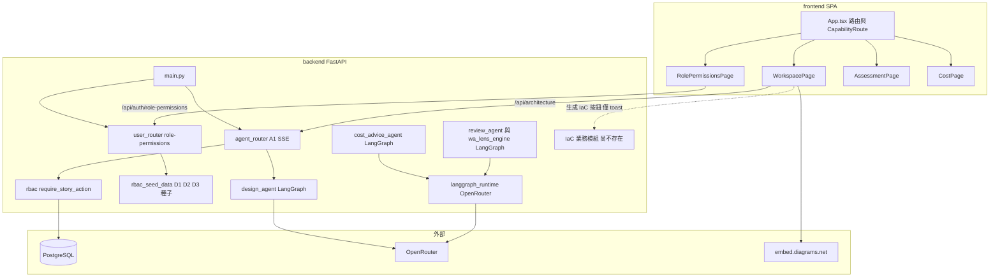
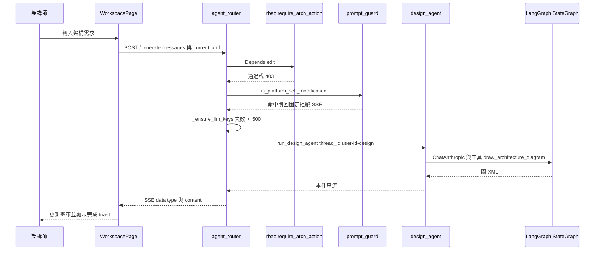
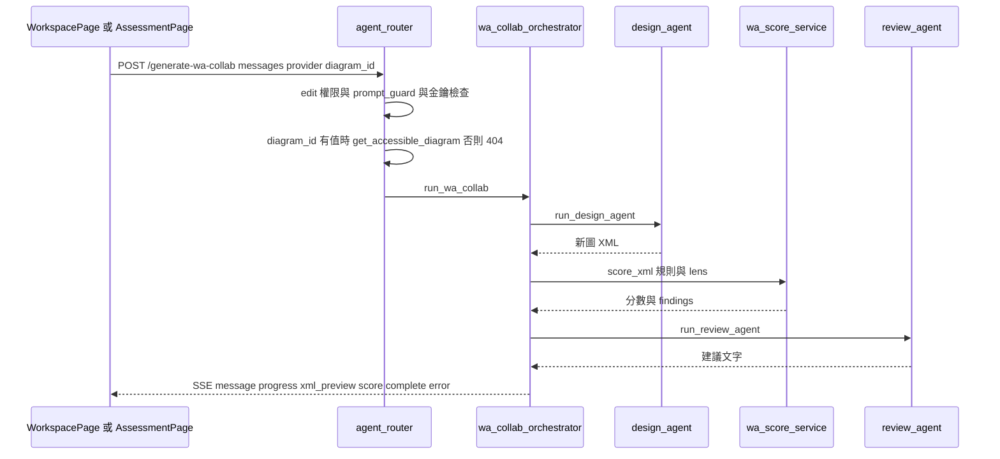
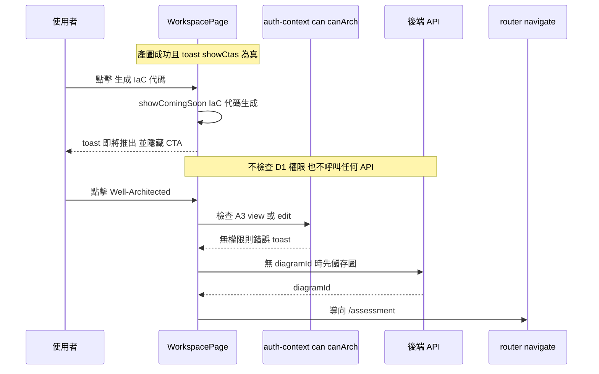
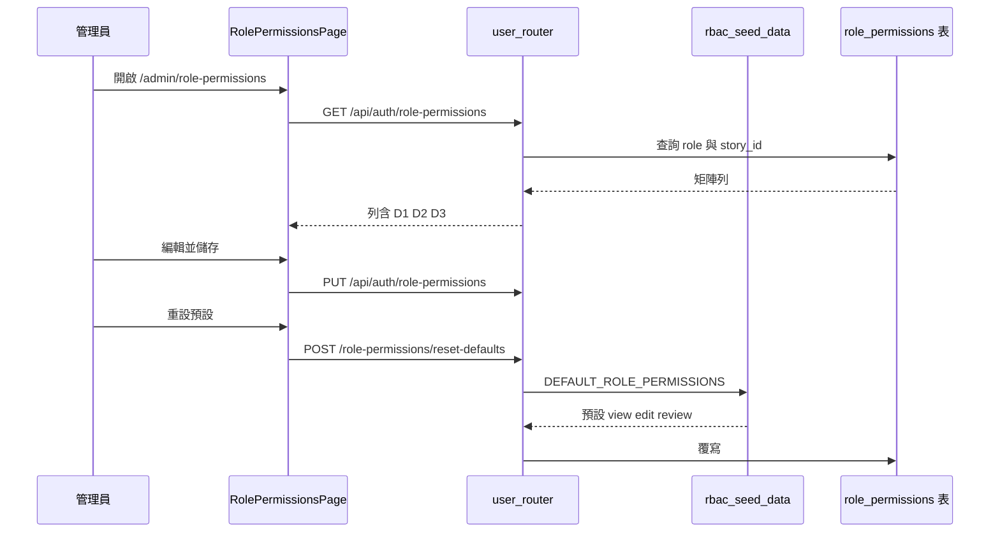
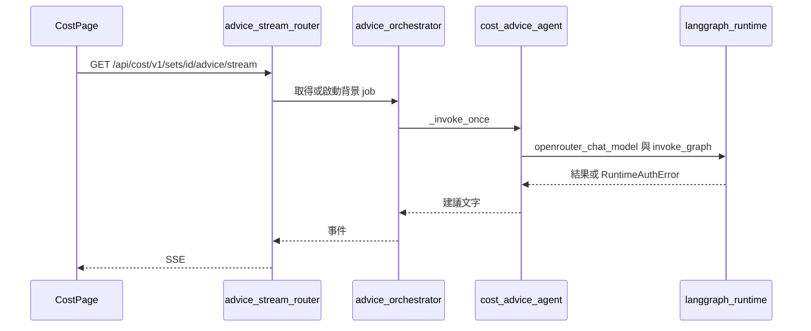

# 系統架構（Architecture）

> Reverse Engineering 合成產物｜repo `cloud`｜掃描日 2026-11-05｜HEAD `0bffc82`｜intent `261105-d-iac-generation`｜mode **Focused merge（STALE）**
> 每個 Mermaid 區塊都附文字 fallback。證據標籤：`[實讀]`＝本輪 analyzed.paths 實讀；`[抽查]`＝architect 本輪 grep／head／目錄列表；`[繼承]`＝前一輪散文未複驗。
> 本輪更新：Story D（IaC）相關表面、agent 框架現況（前一輪「Review／Lens＝SDK」已被 HEAD 取代）、互動圖。

## 架構風格

**模組化單體（Modular Monolith）＋ SPA 前端**：

- 單一 FastAPI process 掛載 router（`backend/main.py` L52–58）：`agent_router`／`review_router`／`lens_router` → `/api/architecture`；`user_router` → `/api/auth`；`collab_router` → `/api/collab`；`estimate_intake_router`／`advice_stream_router` → `/api/cost/v1`。**無** `/api/iac*` 前綴 [實讀]。
- 單一 PostgreSQL；部署整包上線。[繼承]
- **Agent 執行層已統一於 LangGraph**：Design＝`StateGraph`＋`ChatAnthropic`（經 `llm_provider` 的 `ANTHROPIC_*` 映射）；Review／Lens／Cost advice＝`StateGraph`＋`langgraph_runtime.openrouter_chat_model`（OpenAI-compatible）。兩條 OpenRouter 適配仍**平行**存在 [抽查：`design_agent` L9／L16／L121；`review_agent` L133–181；`wa_lens_engine` L541–614；`cost_advice_agent` L139–156；`langgraph_runtime` L71 實讀]。

## 元件關係總覽

**文字 fallback**：Workspace 經 `/api/architecture/generate`、`/generate-wa-collab` 進入 `agent_router`（權限 `require_arch_action("edit")`），後者呼叫 `design_agent`（LangGraph）。權限頁讀寫 `/api/auth/role-permissions`，矩陣預設值來自 `rbac_seed_data`，授權依賴 `rbac.require_story_action`／`require_arch_action`。Review／Lens／Cost advice 經 `langgraph_runtime` 連 OpenRouter。IaC 業務模組、router、頁面皆**不存在**；Workspace「生成 IaC 代碼」按鈕只彈 Coming Soon toast（虛線）。

## `backend/cost/` 結構（⚠ 前一輪圖已過時）

前一輪圖描繪 `cost_router → cost_service → {cost_calculator, sku_mapper, *_calculator_runner, …}`。HEAD 目錄列表中這些檔案**皆不存在** [抽查]；現行有 `estimate_intake_router`→`estimate_intake_service`（`estimate_parser`／`estimate_readers`／`estimate_validator`／`estimate_audit`／`estimate_access`）與 `advice_stream_router`→`advice_orchestrator`→`cost_advice_agent`，另有 `pricing_client`／`pricing_azure`／`pricing_gcp`／`pricing_sdk`。內部邊本輪**未讀**，不重畫；細節待 C 柱相關 intent 重掃。

## 互動圖（Interaction Diagrams）

### 交易一：A1 Design 產圖 SSE（`POST /api/architecture/generate`）[實讀 agent_router／抽查 design_agent]

**文字 fallback**：`/generate` 先過架構編輯權（A1／A2／A4 共用 `require_arch_action("edit")`）與平台自改預檢（命中則不呼叫 LLM，回固定拒絕訊息後 `complete`），再確認 LLM 金鑰，最後以 `design_agent` 的事件迴圈轉 SSE。請求 body `{messages, current_xml?}`；SSE 為 `data: {type, content}`。OpenAPI 對此 SSE 的 200 schema 為空物件，契約只存在於模組 docstring。

### 交易二：A1↔A3 WA collab SSE（`POST /api/architecture/generate-wa-collab`）[實讀 agent_router；下游 orchestrator 為 繼承／抽查]

**文字 fallback**：Workspace 實際產圖走此端點（A1↔A3），目標無 HIGH_RISK 且分數 ≥ 80、最多 2 輪（docstring）。SSE 事件型別：`message`／`progress`／`xml_preview`／`score`／`complete`／`error`。`wa_score_service` 與 `review_agent`／`wa_lens_engine` 現為 LangGraph＋`openrouter_chat_model` [抽查]；前一輪圖中的 `ClaudeSDKClient` 已移除。

### 交易三：Workspace 完成 toast 的「生成 IaC 代碼」與「Well-Architected」CTA（Story D 現況）[實讀]

**文字 fallback**：兩顆 CTA 同列。IaC 按鈕純前端 stub，無權限檢查、無網路呼叫；WA 按鈕檢查 A3 權限、必要時先存圖再導向 `/assessment`。D 柱要落地時，此處是前端第一個替換點。

### 交易四：角色權限矩陣讀寫（D1／D2／D3 種子所在流程）[實讀]

**文字 fallback**：權限頁以 `STORY_FEATURE_LABELS`／`PILLAR_LABELS` 顯示 D 柱，後端 `STORY_IDS` 由種子衍生（`sorted({row[1] ...})`）。新增 D 端點時，`require_story_action("D1", "edit")` 讀同一張表。重設預設會覆寫矩陣（`project.md` 對 seed 變更的 schema／DEPLOY 同步規則適用）。

### 交易五（模式參考）：C 建議 SSE［僅 skimmed，非 D 範圍］

**文字 fallback**：此為 developer 淺層所見的「背景 job＋SSE」形狀，列為 D 柱的**可複用候選**，並非定案；內部事件細節未讀，下游採用前須回頭精讀。

## 資料流與持久化（摘要）

- DDL 雙軌：`schema_rbac.sql`（空 volume）與 `database.py` `_ensure_*_schema()`（既有環境）。[繼承]
- 與 D 相關的持久化：**僅** `role_permissions`（含 D1／D2／D3 種子）；無 IaC 產出物、掃描結果、secret 處理紀錄的表。[實讀 seed／抽查：無相關 router]
- Design：`MemorySaver` 進程內記憶體、全域 `_progress_queue` 非 thread-safe 多租戶隔離。[繼承；本輪 design_agent 僅 grep]

## 關鍵設計決策與其後果

| 決策 | 位置 | 後果 |
|---|---|---|
| Agent 層以 LangGraph 為主 | `design_agent`／`review_agent`／`wa_lens_engine`／`cost_advice_agent` | 映像不再需要 Node／`claude` CLI（Dockerfile 頂註）[抽查] |
| `langgraph_runtime` 與 `llm_provider` 並存 | 兩個 OpenRouter 適配 | Design 走 `ChatAnthropic`＋`ANTHROPIC_*`；其餘走 `ChatOpenAI`＋`OPENROUTER_API_KEY` |
| 權限矩陣先於功能 | `rbac_seed_data`／權限頁標籤 | D 柱「看得到、設得了、用不了」 |
| 授權掛載樣板 `require_story_action(story, action)` | `rbac.py` L255 | 新端點以 Depends 即可掛權；尚無 handler 掛 D* [實讀 dev 報告／抽查] |
| OpenAPI／前端型別 CI drift | `dump_openapi`／`gen:types` | 端點變更須同 PR 重產 |
| 平台自改預檢 | `prompt_guard` 於 `/generate*` | D 的 LLM 路徑須沿用此預檢（`project.md` Mandated） |

## 架構強化機會（與 D 相關）

1. 新增 D 柱時採三層形狀：`*_router` → service → 不讀 DB 的純函式核心（IaC generator／scanner 為 ADR-0006 PBT 落點）。
2. D1／D2／D3 預設各一 agent；底座優先 `langgraph_runtime`＋OpenRouter，避免再增 Claude-SDK-only 或 Anthropic-only 路徑。
3. SSE 契約目前只存在 docstring（OpenAPI 200 schema 為空物件）；若 D 沿用 SSE，宜在 docstring 寫明事件型別，並評估是否補型別。
4. 收斂雙 OpenRouter 適配（`llm_provider` Anthropic-compat vs `langgraph_runtime` OpenAI-compat）仍是獨立議題。
5. 其餘（DDL 單一來源、god modules）見 `code-quality-assessment.md`。
