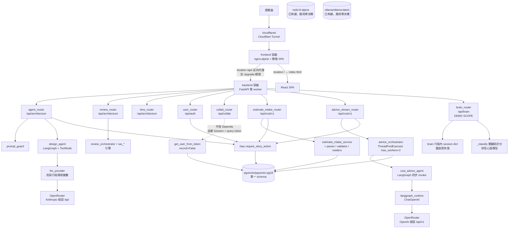
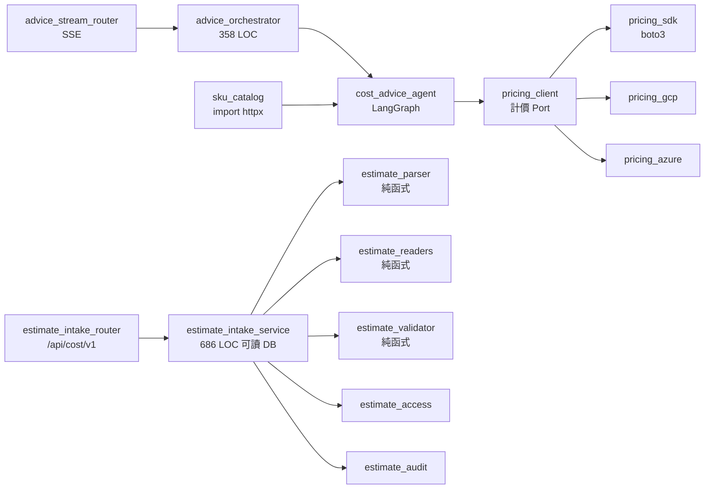
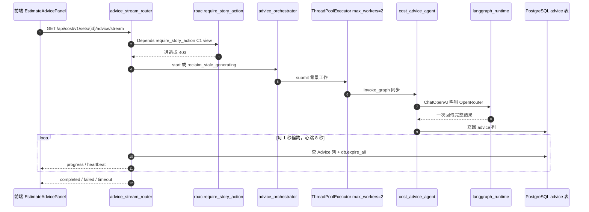
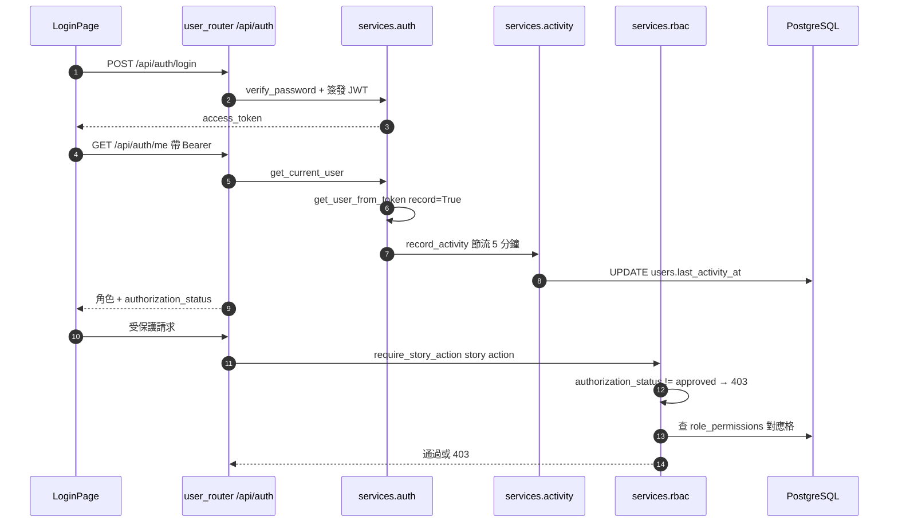
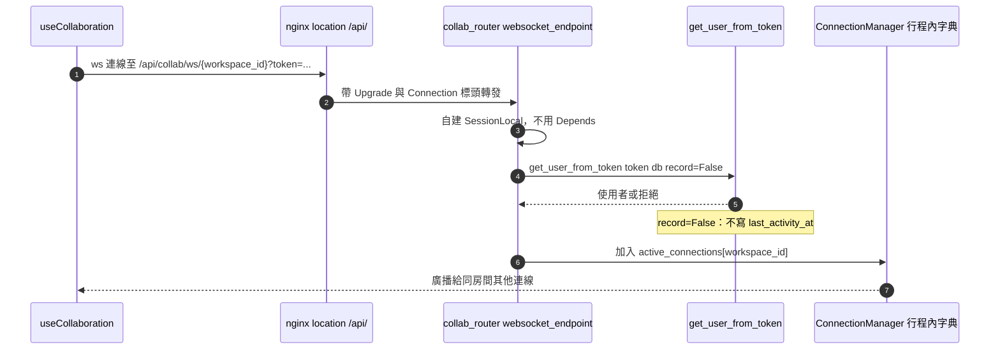

# Architecture — Cloud-360

> **基準**：`34aeef3`（2026-10-02）、branch `danniel/docs/orchestration-brain-ideation`。
> **新鮮度等級與證據標記的定義在 `reverse-engineering-timestamp.md`**；本檔每節標 A／B／C／D／E。
> 本檔由 `codekb/cloud-360@2026-09-22` 與 `codekb/cloud@2026-10-01` 合併而成，並加入本輪新發現。

---

## Architecture Analysis

### System Overview 〔B〕

Cloud-360 是**兩層單體（backend 單體 ＋ frontend SPA）**的多雲架構平台。
後端把 A1／A3／A4／C1／J\* 五條能力線**加上一支 demo-scope 的大腦 gateway**，
全部收在**同一個 FastAPI 行程**內，以 **8 條 `include_router`** 掛在 **6 個 URL prefix** 下
`[讀]` `backend/main.py:54–63`。

**部署堆疊本輪已由 4 個服務增為 6 個** `[跑]`（以程式解析 `deploy/docker-compose.deploy.yml`
的區塊結構）：`db`（`:35`）、`backend`（`:79`）、`redis`（`:157`）、`ollama`（`:270`）、
`frontend`（`:311`）、`cloudflared`（`:333`），另 2 個 network（`edge`／`internal`）
與 3 個 volume（`db_pg18`／`redis_aof`／`ollama_models`）。

> **這一項同時推翻兩份 store。** `cloud-360/architecture.md` 寫「部署堆疊為 4 個服務……
> **無訊息佇列、無快取層、無 Redis**」`[承:cloud-360@2026-09-22]`，其「約束八」更把 Redis
> 稱為「全新的第 5 個服務」。在 HEAD 上 **Redis 與 Ollama 都已經在堆疊裡**，
> 由 commit `7ce1bee`（2026-09-27，`功能(brain-infra): Redis 與 Ollama 兩個服務、
> PG 18＋pgvector、部署期資料面與 ACL 探測`）帶進來 `[跑]` `git log`。詳見「約束八」。

### Architectural Style 〔B〕

**Modular monolith（模組化單體）＋ SPA 前端**，證據：

- 單一 FastAPI `app`（`main.py:31`，`title="Cloud-360 API"`），8 個 router 全部
  `include_router` 進同一個 process `[讀]` `main.py:54–63`。
- 單一 `DATABASE_URL` 連線字串、單一 SQLAlchemy `Base`，**全樹無 `CREATE SCHEMA`、
  無 `search_path` 設定、無 `__table_args__ = {"schema": ...}`** `[承:cloud-360@2026-09-22]`〔C〕。
- `backend/Dockerfile` 的 `CMD` 無 `--workers`，故為**單 worker 單行程** `[讀]`（本輪全檔讀過）。
- **資料庫映像已由 `postgres:16-alpine` 換成 `pgvector/pgvector:pg18`** `[讀]`
  `deploy/docker-compose.deploy.yml:40`——即 PG 主版號 16 → 18 且帶 pgvector 擴充。

### Component Relationships 〔B〕



<!-- Text fallback: 瀏覽器經 cloudflared 進入 frontend 容器（nginx）。nginx 的 location /api/ 反向代理到 backend 容器並帶 Upgrade 標頭（WebSocket 可用）；location / 回傳 SPA。backend 單一 FastAPI 行程掛 8 個 router：agent_router／review_router／lens_router 在 /api/architecture，user_router 在 /api/auth，collab_router 在 /api/collab，estimate_intake_router 與 advice_stream_router 在 /api/cost/v1，brain_router 在 /api/brain（DEMO SCOPE）。agent_router 走 prompt_guard 與 design_agent（LangGraph ＋ ToolNode，非子行程）；review_router 走 review_orchestrator 與 wa_* 引擎；estimate_intake_router 走 estimate_intake_service 與解析器群；advice_stream_router 走 advice_orchestrator（ThreadPoolExecutor max_workers=2）再到 cost_advice_agent（LangGraph 同步 invoke）；brain_router 用行程內 session dict（重啟即失憶）與 _classify 關鍵詞計分（不是信心值模型）。除 collab_router 外的 router 授權皆經 rbac.require_story_action；collab_router 的 WebSocket 不用 Depends，改自建 SessionLocal 並從 query string 取 token 呼叫 get_user_from_token(record=False)。LLM 全部走 LangGraph ＋ OpenRouter，但有兩個不同的 base URL：llm_provider 走 Anthropic 相容的 /api，langgraph_runtime 走 OpenAI 相容的 /api/v1。所有持久化落在單一 PostgreSQL（映像為 pgvector/pgvector:pg18）的單一 schema。堆疊另含 redis:8-alpine 與 ollama/ollama:latest 兩個服務，兩者都已佈建但應用程式碼目前零消費。 -->

### Data Flow 〔B〕

1. **認證**：登入 → JWT → 前端 **36 處**手寫 `Authorization: Bearer` 標頭 `[算]`（本輪重算）。
   URL 一律經 `src/config/api.ts` 的 `apiUrl()` / `wsUrl()` `[承:cloud-360@2026-09-22]`〔C〕。
   前端 `fetch(` 共 **62 處、分佈 15 支檔** `[算]`（本輪重算）。
2. **授權**：`require_story_action(story, action)` 為 FastAPI dependency，
   先擋 `authorization_status`，再查 `role_permissions` 表 `[承:cloud-360@2026-09-22]` `rbac.py:255–280`〔C〕。
3. **活動記錄**：`get_user_from_token` 預設 `record=True`，經 `activity.record_activity`
   以 5 分鐘節流更新 `users.last_activity_at` `[承:cloud-360@2026-09-22]`〔C〕。
4. **持久化**：**13 個 ORM 模型 ＋ 1 個 association table**（`diagram_shares`）`[跑]`
   本輪以程式解析 `models.py` 的 `__tablename__`：`users`、`role_authorization_requests`、
   `user_diagrams`、`user_diagram_chats`、`architecture_reviews`、`wa_lenses`、
   `role_permissions`、`estimate_sets`、`estimates`、`estimate_line_items`、
   `estimate_shares`、`estimate_audit_events`、`advice`。
   **`projects`／`systems`／`diagram_change_records` 三表不在 ORM 內**（見下文）。
5. **Schema 演進**：`Base.metadata.create_all` 只建新表，既有表的 ALTER 由 `init_db()` 的
   **7 支** `_ensure_*` 補丁承擔 `[讀]` `database.py:85–96`。**第 7 支的順序與其餘六支相反**，見「約束六」。

### Key Design Decisions 〔B〕

| 決定 | 證據 | 後果 | 等級 |
|---|---|---|---|
| 授權全部掛在 dependency 層，service 層不再檢查角色 | `estimate_intake_router.py:52,82,95,108,123,132,142,152,163`、`advice_stream_router.py:165` `[承:cloud-360@2026-09-22]` | **同進程直呼 service 函式會完整繞過 RBAC**；`estimate_intake_service.py` 內無第二道角色檢查（`estimate_access.py:29` 的 `can_view_set` 是 row-level 可見性，不是 role-level） | C |
| API 契約以 `openapi.json` 為單一真實來源，雙向閘門 | `ci.yml:280` 後端 dump `--check`；`ci.yml:198` 前端 `check:types` `[算]` | 新 REST 端點必須在同一個 PR 重 dump 規格並重產 `api.d.ts` | A |
| **WS 契約以 `ws-contract.json` 為單一真實來源，另有雙向閘門** | `ci.yml:291` `dump_ws_contract.py --check`；`ci.yml:210` `check:ws-types` `[算]` | **本輪新發現**；詳見「約束二」 | A |
| `fastapi==0.111.0`、`pydantic==2.13.4` 精確釘選 | `requirements.txt` 註解自述理由 `[讀]` | 為了讓 OpenAPI dump 位元決定性；升版即可能讓漂移閘門誤報。**版本與 extra 皆與兩份 store 記載不同**（見 `technology-stack.md`） | A |
| `VITE_API_BASE_URL` 是**建置期** build arg | `deploy/docker-compose.deploy.yml:71–73`、`frontend/Dockerfile:12–15` `[承:cloud-360@2026-09-22]` | 改對外 URL 必須重建 frontend image，不是改環境變數 | C |
| **backend image 已移除 Node 22 與 `claude` CLI** | `backend/Dockerfile` 全檔 `[讀]`：`python:3.12-slim` ＋ `curl`／`ca-certificates`，無 Node、無 npm；檔頭逐字「LLM paths (A1 Design / A3 Review / Lens / cost advice) use LangGraph + OpenRouter HTTP clients — no Claude Code CLI / Node runtime in the image.」。另新增非 root `appuser`（uid 10001）與 `HEALTHCHECK` | **推翻兩份 store** 的「image 內含 Node／CLI」與「CLI 缺席會在請求時失敗」。LLM 失敗模式已改為 HTTP 層 | A |
| 單 worker 假設 | `backend/Dockerfile` 的 `CMD` 無 `--workers` `[讀]` | 多處行程內狀態容器因此成立（見「約束四」） | A |
| **PG 18 ＋ pgvector** | `deploy/docker-compose.deploy.yml:40` `image: pgvector/pgvector:pg18` `[讀]`；`database.py:199–231` 的 `_ensure_vector_extension()` 執行 `CREATE EXTENSION IF NOT EXISTS vector` | 向量記憶的資料面前置條件已就緒；但**尚無任何 `vector` 欄位**——該函式的 docstring（`:214–217`）逐字說明失敗不在此拋出，真正的大聲失敗留給 `U5` 的 `vector(1024)` 欄位落地之後的 `create_all()` | A |

### Improvement Opportunities 〔A／B〕

1. **把 `design_agent` 的 `_progress_queue` 換成 per-request 鍵 ＋ 鎖**——
   這不是「水平擴充時才壞」的改善項，而是**單一行程內兩個並行請求就會壞**的缺陷，
   且 **repo 內已有正解可照抄**（`cost/advice_orchestrator.py:22–26,61–82`）。見「約束四」。
2. 把 `advice_orchestrator` 的 job 狀態與 `collab_router` 的連線字典外部化，解除單 worker 假設
   ——**Redis 已在堆疊裡**（`7ce1bee`），這一項的基礎設施阻礙已消失，剩下的是應用端接線。
3. 收斂兩個 OpenRouter 入口對「base URL」與「預設模型名稱」的兩份物化（見「約束九」）。
4. 為 backend 補上 linter／type checker（三者皆無；`code-quality-assessment.md` T-5 正是其後果）。
5. **為 `/api/collab/ws/{workspace_id}` 補上契約宣告**——`ws-contract.json` 目前**只涵蓋大腦**
   （`[跑]` `grep -c collab ws-contract.json` → **0**），既有的共編 WS 仍是零閘門。

---

## `backend/cost/` 內部結構 〔A〕



<!-- Text fallback: estimate_intake_router（/api/cost/v1）呼叫 estimate_intake_service（686 LOC，可讀 DB）；advice_stream_router（SSE）呼叫 advice_orchestrator（358 LOC），後者呼叫 cost_advice_agent（LangGraph）。service 層扇出到三支純函式模組（estimate_parser、estimate_readers、estimate_validator）以及 estimate_access 與 estimate_audit。cost_advice_agent 經 pricing_client（計價 Port）取價，pricing_client 下接 pricing_sdk（boto3）、pricing_gcp、pricing_azure。sku_catalog 自己 import httpx，它不在純函式三支之內。 -->

**純函式層的實際範圍是三支**，由 CI 以 AST 遞移追 import 強制 `[跑:link1]`
`python3 scripts/validate_cost_calculator_boundary.py`（exit 0）：
`estimate_parser.py`、`estimate_readers.py`、`estimate_validator.py`。
`sku_catalog.py:18` 的 `import httpx` **不違反**，因為它不在這三支之內。

> **`cloud/` 前一輪的 cost 內部結構圖已整段作廢。** 它畫的是
> `cost_router` → `cost_service` → `cost_calculator`／`sku_mapper`／`price_cache`／
> `diagram_extractor`／`azure_calculator_runner`／`gcp_calculator_runner`
> `[承:cloud@2026-10-01]`——**這些模組在 HEAD 上都不存在**。C1 的舊實作已退役
> （`schema_rbac.sql:191–217` 的四張 `archive_*` 表是它的遺骸），現行實作是上圖的 21 支模組。
> 本檔**刻意不保留**那張舊圖，因為保留它會讓下游誤以為兩套實作並存。

---

## Interaction Diagrams

### 交易一：C1 估價建議的產生與串流 〔C〕



<!-- Text fallback: 前端對 advice_stream_router 發出 GET /api/cost/v1/sets/{id}/advice/stream。該端點以 FastAPI dependency require_story_action("C1","view") 授權，通過或 403。接著呼叫 advice_orchestrator 啟動或回收停滯工作，orchestrator 把工作 submit 進 ThreadPoolExecutor（max_workers=2），工作執行緒呼叫 cost_advice_agent 的 invoke_graph——同步 invoke，不是 astream——agent 透過 langgraph_runtime 的 ChatOpenAI 呼叫 OpenRouter，一次回傳完整結果並寫回 advice 資料表。同時 SSE router 以每秒一輪的 while 迴圈查詢 advice 列並 expire_all，送出 progress 或 heartbeat（心跳 8 秒），最後送出 completed、failed 或 timeout。全程沒有任何 token 級增量。 -->

**這張圖對本 intent 的意義**（〔C〕，本輪未複驗行號）：C1 的「串流」是 **DB 輪詢的狀態事件**，
事件型別只有 `progress`／`completed`／`failed`／`timeout`／`heartbeat` 五種
`[承:cloud-360@2026-09-22]` `advice_stream_router.py:81–158`，心跳 `HEARTBEAT_SECONDS = 8.0`（`:25`），
逾時 `TIMEOUT = timedelta(minutes=5)`（`advice_orchestrator.py:19`）。
真正的 LLM 呼叫是 `cost_advice_agent.py:156` 的 `invoke_graph(...)`——**同步 `invoke`，不是 `astream`**。
**大腦要「逐字轉送」成本查詢進度時，來源端沒有逐字可轉。**
（本輪 `[讀]` 複驗的只有 `advice_stream_router.py:173` 的 `media_type="text/event-stream"`。）

### 交易二：登入與 RBAC 判定鏈 〔C〕



<!-- Text fallback: 前端 LoginPage 對 /api/auth/login 送出帳密，user_router 交給 services.auth 驗證並簽發 JWT。前端以 Bearer 呼叫 /api/auth/me，auth 的 get_current_user 走 get_user_from_token（record=True），順帶呼叫 services.activity 的 record_activity，以 5 分鐘節流更新 users.last_activity_at。之後每個受保護請求經 rbac.require_story_action：先檢查 authorization_status 是否為 approved，不是就直接 403；是則查 role_permissions 表對應的（角色, story）格，決定通過或 403。 -->

**本輪複驗的數字** `[跑]`：`CANONICAL_ROLES` **11 個角色**、
`DEFAULT_ROLE_PERMISSIONS` **308 列**（以 Python 直接 import 兩個模組計算）。

### 交易三：A4 共編的 WebSocket 握手 〔B〕

> **標題更正**：`cloud-360/` 的原標題為「**既有唯一 WS 前例**」`[承:cloud-360@2026-09-22]`。
> **「唯一」在 HEAD 上已不成立**——WS 現有 **2 條** `[跑]` `grep -rn '@router.websocket' backend/`：
> `collab_router.py:266`（`/api/collab/ws/{workspace_id}`）與
> `brain_router.py:238`（`/api/brain/ws`）。下圖是**兩條之中較早的那條**。



<!-- Text fallback: 前端 useCollaboration 對 /api/collab/ws/{workspace_id}?token=... 建立 WebSocket。nginx 的 location /api/ 帶 Upgrade 與 Connection 標頭轉發。collab_router 的 websocket_endpoint 不使用 FastAPI Depends，而是自建 SessionLocal，從 query string 取 token，呼叫 get_user_from_token(token, db, record=False)。record=False 使這條路徑跳過 last_activity_at 的寫入。認證通過後把連線加入 ConnectionManager 的行程內字典 active_connections，並向同房間其他連線廣播。 -->

### 交易四：大腦 demo gateway 的握手 〔B〕

**握手形狀與交易三不同，且較嚴謹**（來源為 `brain_router.py:1–31` 的 docstring `[讀]`，
函式骨架 `[算]`；**455 行的本體未讀**）：

| 面向 | `/api/collab/ws/{workspace_id}`（交易三） | `/api/brain/ws`（本交易） |
|---|---|---|
| token 位置 | **query string**（`?token=...`） | **`Sec-WebSocket-Protocol` 標頭** |
| 活動時間 | `record=False`（不寫） | `record=True`（**會寫**） |
| 版本協商 | 無 | `hello {v}` → `ready {protocolVersion}`；不符以 **4400** 關閉並帶 expected／received |
| 訊息封包 | 無宣告型別 | `{v, type, turnId, payload}`，`v` 字面值 `1` |
| 契約閘門 | **零** | **兩道**（見「約束二」） |

> **這條 WS 把交易三的兩個既知風險都避開了**（token 不進 access log、活動時間會更新）。
> 但它是 **demo scope**（下節），`U13` 落地時整支取代——**不要把它的握手當成已核可的設計，
> 也不要以為那兩個風險已經系統性解決**：`collab_router` 那條仍是舊形狀。

---

## 本輪新發現：大腦 demo-scope 垂直切片已存在且正在運行 〔A〕

> **這一節是本輪最重要的發現，兩份 store 都沒有它。**
> 本 intent 的正式單元 `U11`／`U13`／`U14` **還沒開始**，而 repo 裡**已經有一支
> 自稱 demo-scope 的大腦 WS gateway 在跑**。下游若不知道它存在，會往兩個方向各錯一次：
> 把這件工作當成 greenfield，或反過來當成已經做完了。**兩者都錯。**

### 落地的五個檔（LOC 與位元數皆本輪實算）

| 檔 | 大小 | 落地 commit | 日期 |
|---|---|---|---|
| `backend/services/brain_router.py` | **455** LOC `[跑]` | `f9c5bda` `功能(brain): demo-scope 的大腦垂直切片，供今晚展示用` | 2026-09-28 |
| `backend/services/brain_ws_contract.py` | **783** LOC `[跑]` | `c619c3f` `功能(brain-ws-contract): WS 訊息型別契約與兩道 CI 型別閘門` | 2026-09-28 |
| `backend/services/hierarchy_migration.py` | **496** LOC `[跑]` | `9e14145` `功能(hierarchy-data): projects／systems／diagram_change_records 三表與一次性遷移` | 2026-09-28 |
| `frontend/src/pages/BrainPage.tsx` | **403** LOC `[跑]` | 在 `5fd8f14..HEAD` 的變更清單內 | — |
| `ws-contract.json`（repo 根） | **31,012** bytes `[跑]` `wc -c` | `c619c3f` | 2026-09-28 |

> **一處數字更正**：link 1 把 `ws-contract.json` 報為 24,252 bytes。
> **HEAD 上是 31,012 bytes**（本輪 `wc -c` 與 Python 讀檔長度兩種方式一致）。
> link 1 量到的應是 `5fd8f14` 當時的版本。

### 它自己說它不是什麼

`brain_router.py:1–31` 的模組 docstring 逐字自述「**DEMO SCOPE，非 `U13` 的正式交付**」、
「為了**今晚的成果展示**而寫的最小垂直切片，**不屬於任何已核可的 AI-DLC 工作單元**」`[讀]`。

**刻意實作的**（docstring 自述來源為 `brain-ws-contract` 已完成的 functional-design）：
訊息封包 `{v, type, turnId, payload}`；握手走 `Sec-WebSocket-Protocol` ＋ `record=True`；
版本協商 `hello`／`ready`／4400；九種伺服器訊息裡的 `ready`／`token`／`clarify`／
`work_items`／`done`／`error`；六種客戶端訊息裡的 `hello`／`user_message`／
`select_clarify_candidate`／`set_work_target`；終止語意（零內容不得以 `done` 結束，
一律走 `error(EMPTY_RESPONSE)`）；`error.code` 的封閉四值。

**刻意沒實作的**（docstring 逐字，附它自己指派的正式單元）：

| 沒做的 | 它用什麼頂著 | 指派給 |
|---|---|---|
| Redis session 持久化 | **行程內 dict，重啟即失憶**（沿用 `K-12` 的「單一後端行程」假設） | `U10 session-store` |
| 真正的意圖路由與信心值模型 | **關鍵詞計分**（`_classify`，`:116`） | `U11` |
| 專案／系統／架構圖三層階層 | — | `U7 hierarchy-service` |
| 三層記憶 | — | `U5`／`U8`／`U9` |
| `cost_card`／`sharing_mode` 兩種訊息、多連線扇出、`correct_work_item` | — | — |
| `ws-contract.json` 與型別檔的兩道 CI 漂移閘門 | — | `U2` 的 code-generation |

### 三件必須一起傳給下游的事

1. **它存在且已掛載**：`main.py:7` 的 import ＋ `main.py:63` 的
   `app.include_router(brain_router, prefix="/api/brain")` `[讀]`；
   WS 端點在 `brain_router.py:238` `@router.websocket("/ws")`，即 **`/api/brain/ws`**；
   前端入口在 `frontend/src/App.tsx:88` 的 `/brain` 路由 `[讀:link1]`。
2. **它不是 `U13`**：`U11`／`U13`／`U14` 仍未開始。
3. **正式交付方式是整支取代，不是逐段改寫**（docstring 逐字：「`U13` 落地時**整支取代本檔**」）。
   **所以不要把 `_classify` 的關鍵詞計分當成「信心值模型已有雛形」**
   ——那正是 `OQ-10` 在質疑的東西。

**移除方式**：docstring 與 `main.py:62` 的註解都寫「刪 `brain_router.py` 並移除下面兩行」，
但 `:63` 之後只有**一行** `include_router`；**第二處是 `main.py:7` 的 import** `[讀]`。
這是個小矛盾，不影響可移除性，但移除時別漏掉 `:7`。

### 關於那兩道「留給 `U2`」的閘門——它們已經在跑了 〔A〕

docstring 把「`ws-contract.json` 與型別檔的兩道 CI 漂移閘門」列為沒做、指派給 `U2`。
**但閘門本身已經在 CI 裡**（由 `c619c3f` 一併帶進來）`[算]` `.github/workflows/ci.yml`：

- `:210` `npm run check:ws-types`（frontend job）
- `:291` `python scripts/dump_ws_contract.py --check`（backend job）

**兩件事不要混成一句**：閘門存在（事實），而 `brain_router.py` **自己不受那兩道閘門約束**
（它是 router，閘門管的是 `brain_ws_contract.py` 的型別定義與其衍生檔）。
docstring 想說的是後者。詳見「約束二」。

---

## 本輪新發現：階層三表已在 schema，但不在 ORM／router／service 〔A〕

`[跑]` `grep -n "CREATE TABLE IF NOT EXISTS" schema_rbac.sql`：

| 行 | 表 |
|---|---|
| `:327` | `projects`（`owner_user_id` 在 **`:330`**：`INTEGER NOT NULL REFERENCES users (id)`，**無 `ON DELETE` 子句**）`[讀]` `:327–334` |
| `:349` | `systems` |
| `:393` | `diagram_change_records` |

另 `:373` `ALTER TABLE user_diagrams ADD COLUMN IF NOT EXISTS system_id INTEGER;`，
`:382` 的 FK、`:388` 的索引、`:390` 的 `COMMENT ON COLUMN` `[算]`。

**但這三表不在 ORM**：`[跑]` 以程式解析 `backend/models.py` 的 13 個 `__tablename__`，
`projects`／`systems`／`diagram_change_records` **皆不在內**。

**也幾乎不在應用程式碼內**：`[跑:link1]` `grep -rln "system_id" backend/ --include='*.py'`
→ 僅 4 檔（`tests/test_hierarchy_migration.py`、`services/hierarchy_migration.py`、
`scripts/run_hierarchy_migration.py`、`services/brain_router.py`）。
**即：schema ＋ 一次性遷移已落地，但 ORM model、router、service 都還沒消費它**
——除了那支 demo。

> **這推翻一條上游前提。** `project.md` 記載 intent-capture 當時查到
> 「`schema_rbac.sql` 只有 users→user_diagrams，backend 全樹 `system_id` 命中 0 次」。
> **那在當時為真，在 HEAD 上已不為真。** 邊界必須寫清楚，否則下游會在兩個方向各錯一次：
> **有的是** schema ＋ migration ＋ migration 測試；**還沒有的是** ORM model、router、service。

`DEPLOY.md` 已同步（`project.md` 的 blocking 規則本輪**已被遵守**）`[讀]` `DEPLOY.md:224,303–419`，
其中三項從該檔讀到、對本 intent 重要的設計事實：

1. `user_diagrams.system_id` 是**歸屬的權威來源**；`user_id` 只回答「誰建的」，不回答歸屬。
2. FK 一律 `ON DELETE RESTRICT`——刪除 System 時**拒絕刪除**，不是把 `system_id` 設 NULL。
3. `diagram_change_records` **本輪只寫不讀**（沒有任何讀取端），保存期 90 天，
   **但清除機制尚未落地——這張表實際上不會被清除**（`DEPLOY.md:310` 逐字）。

`[跑:link1]` 遷移測試本輪跑綠，輸出印出 `users_processed = 1`／`default_pairs_created = 1`／
`diagrams_assigned = 1` 與「終檢通過：`user_diagrams` 中 `system_id IS NULL` 的列數為 0（`AC9.1.4`）」。

---

## 架構約束（給下游 stage 的檢查清單）

### 約束一：WebSocket 必須掛在 `/api/` 之下 〔C〕

`frontend/nginx.conf:16–32` **只有** `location /api/` 帶 `proxy_set_header Upgrade`
與 `Connection $connection_upgrade` `[承:cloud-360@2026-09-22]`；`$connection_upgrade` 的 `map`
是在 `frontend/Dockerfile:21–23` 以 `printf` 寫進 `/etc/nginx/conf.d/upgrade-map.conf` 的。
`deploy/cloudflared/config.yml:17–18` 已為 WS 設 `tcpKeepAlive: 30s`。
**`location /` 走 `try_files … /index.html`，WS 握手落在那裡會直接拿到 HTML。**
網路路徑已通，但位置不可自由選。

**本輪的新實例** `[算]`：兩條 WS 都遵守了這條約束——`/api/collab/ws/{workspace_id}`
與 `/api/brain/ws`（後者是 `prefix="/api/brain"` ＋ `@router.websocket("/ws")`）。

### 約束二：WS 契約閘門的覆蓋**不是零，但也不是全** 〔A〕

> **這一條整段改寫。** `cloud-360/` 的原文標題為「**新 WebSocket 契約沒有任何機械閘門**」
> `[承:cloud-360@2026-09-22]`，並據此論證「本 intent 規劃的新 WebSocket **一道契約閘門都不過**」。
> **那在 HEAD 上已不正確。** 本輪實查的狀況比較細，而細節剛好改變結論。

**成立的部分**（仍然為真）`[跑]`：以 Python 解析 `openapi.json` 得 **42 path**，
兩條 WS **都不在內**——FastAPI 不登錄 websocket route。故
`dump_openapi.py --check` 與 `npm run check:types` 兩道閘門對 WebSocket **確實完全無效**。

**不成立的部分**（本輪新事實）：**另有一條獨立的 WS 契約鏈，且有兩道 CI 閘門** `[算]`：

```
brain_ws_contract.py（783 LOC，Pydantic 型別定義）
   │ backend/scripts/dump_ws_contract.py
   ▼
ws-contract.json（repo 根，31,012 bytes，帶一層 OpenAPI 外殼 paths:{}）
   │ npm run gen:ws-types（openapi-typescript 7.13.0）
   ▼
frontend/src/types/ws-contract.d.ts
```

| 閘門 | 位置 | 擋什麼 |
|---|---|---|
| `python scripts/dump_ws_contract.py --check` | `ci.yml:291`（backend job） | 契約模組改了但 `ws-contract.json` 沒重 dump |
| `npm run check:ws-types` | `ci.yml:210`（frontend job） | `ws-contract.json` 改了但前端型別檔沒重產 |

測試層另有 `backend/tests/test_dump_ws_contract.py` 與 `test_ws_contract.py`（兩者皆含 `@given` `[算]`）。

**但覆蓋範圍有一個明確的洞** `[跑]` `grep -c "collab" ws-contract.json` → **0**。
即：**`ws-contract.json` 只涵蓋大腦的訊息型別，完全不涵蓋 `/api/collab/ws/{workspace_id}`。**
既有的共編 WS 仍是**零契約閘門**。

`dump_ws_contract.py:1–40` 的 docstring 逐字說明了三件值得傳下去的設計決定 `[讀]`：
1. **刻意不 import `main`**——應用任何 import 失敗都不會讓本閘門連帶紅燈，紅燈只代表契約漂移；
   也因此不需要 DB 樁（對照 `dump_openapi.py:36` 需要 `sys.modules.setdefault("psycopg", MagicMock())`）。
2. **規格檔刻意放 repo 根而非 `frontend/public/`**——nginx `root /usr/share/nginx/html` ＋
   Vite 會把 `public/` 原樣複製進 `dist/`，放那裡等於把**完整的訊息地圖**（九種伺服器訊息、
   六種客戶端訊息與全部 payload 欄位，即大腦的內部協定與能力邊界）對未認證訪客公開。
   **連帶禁止**：不得把該規格檔 import 進前端程式碼（型別檔只有型別、不產生執行期程式碼，故不是洩漏面）。
3. **fail-closed**：規格檔不存在、契約模組 import 失敗、任一斷言失敗，三者皆 exit 非 0，
   且**刻意不以 try/except 包住契約模組的 import**。

### 約束三：WebSocket 可能靜默停止更新「最後活動時間」——但新的那條沒有 〔B〕

`collab_router.py:257` 呼叫 `get_user_from_token(..., record=False)` `[承:cloud-360@2026-09-22]`，
跳過 `auth.py:80–83` 的 `record_activity`。**若以 WS 為主要互動通道且照抄這個形狀，
`users.last_activity_at` 這個既有能力會對該通道的使用者靜默失效**——沒有錯誤訊息、沒有紅燈。
另：token 放在 query string 會進 nginx／cloudflared 的 access log
（對應 ADR-0006 的 audit logging 與 network exposure 兩個面向）。

**本輪的更新** `[讀]` `brain_router.py:1–31` docstring：**大腦的 demo gateway 兩個都避開了**
——token 走 `Sec-WebSocket-Protocol` 而非 query string、且 `record=True`。
**但這不代表問題已系統性解決**：`collab_router` 那條仍是舊形狀，而 demo gateway 會被整支取代，
`U13` 必須自己重新做對這兩件事。

### 約束四：行程內共享狀態——其中一個是**單行程內就會壞**的缺陷 〔A〕

> **這一條把兩份 store 的兩件事分開。** `cloud-360/` 的「單行程假設」講的是
> **多 worker／多副本化時會壞**；本輪查出的 `design_agent._progress_queue` 是
> **單一行程內兩個並行請求就會壞**。**兩者並立，不要合併成一條。**

| 位置 | 容器 | 保護 | 壞的門檻 | 等級 |
|---|---|---|---|---|
| `design_agent.py:31` | `_progress_queue`（**單槽**） | **無** | **兩個重疊請求** | A |
| `design_agent.py:32` | `_last_xml`（**單槽**） | **無** | 同上（外部可觀察後果本輪未實測） | A |
| `design_agent.py:169` | `memory = MemorySaver()`（模組層單例） | 以 `thread_id` 分隔 | `wa_collab_orchestrator.py:79` **未傳 `thread_id`** → 全體共用 `"default-thread"` | A |
| `collab_router.py:58–59` | `ConnectionManager.active_connections` | — | 多 worker | C |
| `advice_orchestrator.py:21–26` | `_executor`／`_progress`／`_inflight` | `threading.Lock` ✅ | 多 worker | A（`:1–82` 實讀） |
| `pricing_client.py:29` | 磁碟快取 `backend/cost/.pricing_offer_cache/` | — | 多副本 | C |
| `brain_router.py:87` | `_session_for(user_id)` 背後的行程內 dict | docstring 自述「重啟即失憶」 | 重啟／多 worker | B（只讀 docstring） |

#### `_progress_queue` 的缺陷：逐行證據與兩種危害 〔A〕

`[跑:link1]` `grep -n "_progress_queue" backend/services/design_agent.py` → 13 處，逐段複驗：

| 行 | 程式 | 角色 |
|---|---|---|
| `:31` | `_progress_queue: asyncio.Queue[dict[str, str]] \| None = None` | **模組層宣告**（檔案最外層） |
| `:176` | `global _progress_queue, _last_xml` | `run_design_agent` 宣告改寫全域 |
| `:183` | `_progress_queue = asyncio.Queue()` | **每個請求重新指派同一個模組全域** |
| `:203`／`:211` | `async for q_event in _drain_progress(_progress_queue):` | 串流迴圈讀**當下的**模組全域 |
| `:218` | `_progress_queue = None`（在 `finally:` 內） | **先結束者把它設回 `None`** |
| `:81–82`／`:84–85`／`:96–97`／`:101–102` | `if _progress_queue is not None:` → `await _progress_queue.put({...})` | 工具端（`@tool` at `:64`）的 4 處寫入 |

**關鍵**：工具函式（`:78–104`）**沒有**宣告 `global`、也**沒有**把 queue 當參數傳入
——它每次解析**當下的**模組全域；入口的 `:203`／`:211` 同理（`:176` 的 `global` 讓那個名字
綁到模組全域，不是區域快照）。**兩端都讀「最後一個被建立的 queue」。**

設 A、B 兩個請求重疊，B 晚於 A 進入 `:183`：

- **危害一 — 跨使用者內容錯送。** B 覆寫全域後，A 的工具執行到 `:97` 會 `put` 到 **B 的 queue**，
  而 A 的串流迴圈 `:203` 也讀 **B 的 queue**。實際後果是
  **使用者 A 收到使用者 B 產生的架構圖 XML**（或反之，取決於誰的工具先完成）。
  **這不是「看不到進度」，是內容錯送。**
- **危害二 — 事件靜默丟棄。** 誰先走到 `:218` 的 `finally` 就把全域設成 `None`；
  之後另一個請求的工具寫入全部撞上 `if ... is not None:` 守衛 → 條件為假 → `put` 被跳過
  → **沒有例外、沒有 log、沒有任何痕跡**。`progress`／`xml`／`error` 三類一律消失
  ——**`error` 也在內**：連「出錯了」這件事都送不出去。

**兩個生產呼叫點都可達** `[跑:link1]` `grep -rn "run_design_agent" backend/`：
`agent_router.py:125`（每個 HTTP 請求一次，包在 `StreamingResponse`）、
`wa_collab_orchestrator.py:79`（A4 共編路徑）。

**`thread_id` 不是解法** `[讀:link1]`：`agent_router.py:125` 傳的
`thread_id=f"user-{current_user.id}-design"` 只進到 `:198` 的
`config = {"configurable": {"thread_id": thread_id}}` 再給 `graph.astream(...)`
——**它餵的是 LangGraph checkpointer（`MemorySaver`，`:169`），與 `_progress_queue` 毫無關係。**
把 `thread_id` 做對不會修掉這個缺陷（而且 `wa_collab_orchestrator.py:79` 根本沒傳）。

**repo 內已有正解，不需要發明** `[讀:link1]` `backend/cost/advice_orchestrator.py:1–82`：

| 行 | 程式 |
|---|---|
| `:22` | `_executor_lock = threading.Lock()` |
| `:23` | `_progress: dict[int, dict[str, Any]] = {}` ← **以 `set_id` 為鍵的字典，不是單槽** |
| `:24` | `_progress_lock = threading.Lock()` |
| `:61–72` | `set_progress(set_id, **fields)` → `with _progress_lock:` 內讀改寫 |
| `:75–77` | `get_progress(set_id)` → `with _progress_lock: return dict(...)`（**回傳副本**） |
| `:80–82` | `clear_progress(set_id)` → `with _progress_lock: _progress.pop(set_id, None)` |

即 **per-job 鍵 ＋ 鎖保護 ＋ 三個封裝好的存取函式（寫／讀／清），且讀取回傳副本**。
修法是把 `design_agent.py` 的單槽換成同樣的形狀。
（注意 `advice_orchestrator` 用 `threading.Lock` 因為它走 `ThreadPoolExecutor`；
`design_agent` 是純 async，對應的是 `asyncio.Lock` 或在單一 event loop 下免鎖的 dict
——**這個取捨留給設計站，本 codekb 不預選。**）

**對本 intent 的意義**：此缺陷已登錄為上游約束 `C-R3`，是能力 1 與能力 8 的實作前置條件。

### 約束五：LangGraph runtime 已支援串流，只是沒人用 〔C〕

`langgraph_runtime.py:133–149` 有 `astream_graph`，但**全樹零消費者**
`[承:cloud-360@2026-09-22]`（grep 僅命中定義檔與 `test_langgraph_runtime.py`）。
**「既有 runtime 不能串流」是錯的說法**，不可拿來當自建第二個 runtime 的理由。
成立的理由是「避免與 C1 的同步 `invoke` 契約互相牽制」。

### 約束六：新資料模型無法靠 `schema_rbac.sql` 上線——但階層三表已經用另一條路上線了 〔B〕

`schema_rbac.sql` 只在**空 data volume** 上執行（`deploy/docker-compose.deploy.yml:21–23`
的註解逐字說明）`[承:cloud-360@2026-09-22]`，且**裸的 `DELETE FROM role_permissions;`
在 `:443`** `[跑]`（`cloud-360/` 記的 L319 已位移）——對既有 staging 重跑會抹掉管理者的人工調整。

既有環境的演進路徑是 `backend/database.py` 的 `_ensure_*` 補丁，本輪實查為 **7 支** `[讀]` `:85–96`：

```
_ensure_vector_extension()      ← :199，U1 brain-infra，必須早於 create_all
Base.metadata.create_all(...)
_ensure_a4_schema()             ← :234
_ensure_j5_schema()             ← :262
_ensure_a3_schema()             ← :309
_ensure_cost_schema()           ← :379
_ensure_estimate_intake_schema()← :435
_ensure_last_activity_schema()  ← :563
```

> **第 7 支的順序與其餘六支相反，而且這是刻意的。** `init_db()` 的註解逐字：
> 「U1：**必須早於 `create_all`**，方向與下面六支 `_ensure_*` 相反。理由見該函式的 docstring；
> 順序寫錯的後果是**啟動失敗**，不是延後修復」`[讀]`。
> 該函式 docstring（`:200–217`）說明：`vector` 型別不存在時，任何宣告 `vector` 欄位的表
> 在 `create_all()` 就會以 `type "vector" does not exist` 失敗；而**失敗不在此拋出**
> ——沒有 pgvector 的伺服器上只記 warning，真正的大聲失敗留給 `U5` 的 `vector(1024)` 欄位落地之後。

**而階層三表走的是第三條路**：既不靠 `schema_rbac.sql`（那只管空 volume），也不靠 `_ensure_*`，
而是獨立的 `backend/scripts/run_hierarchy_migration.py` ＋ `hierarchy_migration.py` 的
`_ensure_hierarchy_schema(db)`（`:269`）＋ `migrate_hierarchy(db)`（`:204`）＋
終檢 `_assert_no_unassigned_diagrams(db)`（`:477`）`[算]`。
**這是本 repo 第一個「有終檢斷言的一次性遷移」前例**，`DEPLOY.md:303–419` 有完整執行與回復程序。

### 約束七：獨立 schema 在本 repo 零前例、且現有測試基礎設施無法驗證 〔B〕

全樹無 `CREATE SCHEMA`、無 `search_path` `[承:cloud-360@2026-09-22]`；`DATABASE_URL` 為單一連線字串。
測試路徑以 `tests/helpers.py` 換掉驅動、改走 **in-memory SQLite**，
而 **SQLite 沒有 PostgreSQL 的 schema 概念**。本 intent 的「同一資料庫、獨立 schema」因此
**既無前例、也無測試路徑**——這是下游必須正面處理的驗證缺口，不是實作細節。

**本輪的更新** `[讀]` `backend/tests/helpers.py:1–25`：驅動樁**已改**。現在是
**條件式**地 stub `psycopg`（v3）而非無條件 stub `psycopg2`：

```
if importlib.util.find_spec("psycopg") is None:
    _psycopg_stub = MagicMock()
    _psycopg_stub.__version__ = "3.2.0"        # dialect 建構時會對它跑 re.match 取版號
    sys.modules.setdefault("psycopg", _psycopg_stub)
```

結論不變（仍是 in-memory SQLite、仍無 schema 概念），但**引用這條時不要再寫 `psycopg2`**
——`psycopg2` 已不在相依裡。`team.md` 的 Testing Posture 逐字記載那個舊 mock，**該句已過時**
（本 codekb 只記載落差，不改規則檔）。

### 約束八：Redis **不是**全新的第 5 個服務——它已經在堆疊裡了 〔A〕

> **這一條整段改寫，方向與原文相反。** `cloud-360/` 原文：「現有 deploy stack 為 4 個服務。
> **加第 5 個時**，新環境變數必須在同一個 PR 內讓 `render-env.sh` 寫它、`.env.example` 列它，
> 否則 `validate_env_contract.py` 紅燈」`[承:cloud-360@2026-09-22]`。
> **那件工作已經做完了**，由 commit `7ce1bee`（2026-09-27）完成。

**已經就緒的** `[讀]`／`[跑]`：

| 項目 | 現況 | 證據 |
|---|---|---|
| `redis` 服務 | `image: redis:8-alpine`，**無 `ports:`**（只在 `internal` 網路上以 `redis` 名稱可達）；AOF volume `redis_aof`；`redis-server` CLI 旗標帶 `maxmemory`／policy；healthcheck `redis-cli ping \| grep -q PONG` | `deploy/docker-compose.deploy.yml:157–259` `[讀]` 區塊結構與註解 |
| `ollama` 服務 | `image: ollama/ollama:latest`，volume `ollama_models` | `:270–281` `[讀]` |
| `db` 升級 | `pgvector/pgvector:pg18`（PG 16 → 18 ＋ pgvector） | `:40` `[讀]` |
| `REDIS_URL` | `render-env.sh:121` 已寫 `REDIS_URL=redis://redis:6379/0` | `[讀]` |
| 部署範本 | `deploy/.env.example:94–124` 列 `REDIS_URL`／`REDIS_USER`／`REDIS_PASSWORD`／`OLLAMA_BASE_URL`／`OLLAMA_EMBED_MODEL`，且註解逐字說明「這七個之中**只有 `REDIS_PASSWORD` 是憑證**」 | `[讀]` |
| dev 範本 | `backend/.env.example:101–124` 列同一組，值為 `localhost` 版本 | `[讀]` |
| 自動化承載 | `backend/tests/test_render_env_redis.py`（契約 `K-01` 要求 `REDIS_URL` 的主機名須為 compose 內部服務名） | `[算]` 只讀 5 行 |
| 本機文件 | `LOCAL-DEV.md:23` 把 Redis 列為「大腦編排的 session 還原」的硬依賴；`:78` 要求 `redis-cli ping` 回 PONG | `[讀]` |

**還沒就緒的**（這是 `U10` 的真正起點）`[跑]`：

- `backend/requirements.txt` **無 `redis` 套件**（18 項宣告逐項核對，零命中）。
- backend **應用程式碼零 import**：`grep -rn "import redis\|from redis\|redis\.asyncio\|REDIS_URL" backend/ --include='*.py'`
  的唯一命中是 `backend/tests/test_render_env_redis.py`（那是**部署設定的契約測試**，不是客戶端）。
- Ollama 同理：`OLLAMA_BASE_URL`／`OLLAMA_EMBED_MODEL` 只出現在同一支測試裡。

> **所以 `U10`／記憶相關單元的起點是「接線」，不是「建服務」。** 環境契約的 blocking 工作
> （`render-env.sh` ＋ 兩份 `.env.example`）**已完成**；剩下的是新增 Python 套件依賴
> （而 backend 無 lockfile，見 `technology-stack.md`）與寫客戶端。
> **把這一項讀成「要先加第 5 個服務」會重做一遍已經做完的工作。**

仍然有效的硬性條款 `[承:cloud-360@2026-09-22]`：`render-env.sh:59–69` 會拒絕任何含 `$` 的憑證值
（compose 會對 `--env-file` 的值做內插而無聲截斷），要求改用 `openssl rand -hex 32`。

### 約束九：兩個 OpenRouter 入口，base URL 不一致 〔A／B〕

> **這一條的框架改了。** 兩份 store 都把它寫成「兩套**不同技術棧**的客戶端並存
> （`claude-agent-sdk` ＋ CLI 子行程 vs `langchain_openai`）」，並據此說大腦自建會是「第三份」。
> **技術棧已經統一了**——`claude_agent_sdk` 全樹零 import（下節）。
> 剩下的分歧**不是框架，是設定值**。

`[跑]` `grep -rn "claude_agent_sdk\|claude-agent-sdk" backend/ --include='*.py'` → **零個實際 import**。
5 處命中全是字串：
- `backend/tests/test_a3_langgraph_migration.py:7`（規格註解）、**`:33`／`:40` 兩個
  `self.assertNotIn("claude_agent_sdk", source)` 斷言它不得回來**
- `backend/services/langgraph_runtime.py:3`、`backend/services/llm_provider.py:8`（註解在講歷史）

`[讀]` `backend/services/review_agent.py:1–12`，模組 docstring 逐字：
**「`review_agent.py` — A3 Review Agent（LangGraph + OpenRouter）」**，
「串流：model／graph messages stream → SSE `suggestion_delta`」，
imports 為 `from services.llm_provider import ...`。

**→ 這推翻 `cloud/` store 最明確的兩項** `[承:cloud@2026-10-01]`：
1. 「Design＝LangGraph；**Review／Lens＝Claude Agent SDK**」——Review 已是 LangGraph
   （commit `b4f0cdc`，2026-10-01，`重構(a3): Assessment Review/Lens 改走 LangGraph 並修正串流 state`）。
2. 「缺 `langchain-openai`／**`claude-agent-sdk` pin**」——`claude-agent-sdk` 已**不在
   `requirements.txt`**，談不上缺 pin；`langchain-openai` **在**且無 pin。

`cloud/` 是較新的 store，但**它在這一項上是錯的**，因為它的掃描 commit `5fd8f14` 早於 `b4f0cdc`。

**實際剩下的分歧**（兩支模組各自寫死，無測試鎖住一致）`[讀:link1]`：

| 模組 | base URL | 預設模型 |
|---|---|---|
| `llm_provider.py` | `https://openrouter.ai/api`（Anthropic 相容，`:49`） | `:52–54`（`google/gemini-3.7-flash` ×2、`google/gemini-2.5-flash` ×1） |
| `langgraph_runtime.py` | `https://openrouter.ai/api/v1`（OpenAI 相容，`:16`） | `:17` `google/gemini-3.7-flash` |

**一個有 `/v1` 一個沒有。** 耦合風險仍在：`llm_provider.configure_provider_env()`
**改寫整個行程的環境變數**，且在 `main.py:29`（模組層）與 `main.py:48–52`（startup）
各呼叫一次 `[讀]`；`langgraph_runtime` 讀的是 `OPENROUTER_API_KEY`，目前不受影響
——但兩者共用同一個行程環境。

### 約束十：`backend/` 內新增模組可能誤觸兩支 import 邊界 validator 〔B〕

| Validator | 禁止內容 | 本輪 |
|---|---|---|
| `scripts/validate_cost_calculator_boundary.py` | `estimate_parser` / `estimate_validator` / `estimate_readers` **及其遞移 import 的同套件模組**不得出現 `httpx｜requests｜sqlalchemy｜fastapi`（AST 遞移追 import，`:15–24`） | `[跑:link1]` exit 0，三支逐一 OK |
| `scripts/validate_pricing_lookup_boundary.py` | 4 支 intake 寫入路徑模組不得 import `pricing_client`／`pricing_sdk`（`:20–31`）；**掃全 `backend/`** 禁止白名單（8 支 `cost/pricing_*` ＋ `cost/config.py`）以外的模組硬編 3 個計價 host（`:33–48`） | `[跑:link1]` exit 0（`intake=4 modules; survival=9`） |

兩者都在 CI 的 `repo-contract` job 阻擋（`ci.yml:162`／`:167` `[算]`）。
**第二支掃全 `backend/`**——大腦的新模組若在任何字串裡提到計價 host 就會紅燈。

### 約束十一：授權的繞過面在同進程呼叫 〔C〕

C1 的授權**全部**掛在 FastAPI dependency 層，**service 層沒有第二道角色檢查**
`[承:cloud-360@2026-09-22]`。**直接推論**：大腦以 HTTP 攜帶使用者 token 呼叫 `/api/cost/v1`
是**唯一**能保留 C1 角色授權的呼叫方式；**同進程直呼 service 函式會整個繞過
`require_story_action`，而現有程式碼裡沒有任何備援會補上那一層。**
（`estimate_access.py:29` 的 `can_view_set` 只做擁有者／被分享者的 row-level 過濾，不是 role-level。）

### 約束十二：`MCP` 這個字在本 repo 已被佔用，語意是 RBAC story `H3` 〔A〕

`[跑]` `grep -rni "mcp" backend/ --include='*.py'`（排除 `__pycache__`）→ **命中數 1**：

```
backend/services/user_router.py:85:    "H3": "MCP／Skill 生命週期",
```

`[讀:link1]` 該行上下文（`:80–92`）落在一個 `story_id → 中文顯示名`的字典裡，
鄰居是 `"G1": "CSPM 持續合規"`、`"H1": "內部 API 註冊"`、`"H2": "Agent 存取邊界"`、
`"J3a": "使用者設定"`；緊接其後是 `CATALOG_EXCLUDED_STORIES = frozenset({"J1"})`。
**這是 RBAC 權限矩陣的 story 標籤（權限頁上那一欄的顯示名），不是任何實作。**

**repo 內零 MCP 基礎設施** `[讀]`：`backend/requirements.txt` 18 項宣告中無任何 MCP 相關套件；
無 MCP server／client 的檔名、模組或類別。

**現行「agent 對 LLM 暴露工具」的唯一機制是同進程的 LangChain `@tool` ＋ LangGraph `ToolNode`**
`[讀:link1]` `design_agent.py:9–12`（`StateGraph`／`START`／`END`／`add_messages`／`MemorySaver`／
`ToolNode`）、`:15`（`from langchain_core.tools import tool`）、`:64`（`@tool` 裝飾器）、
`:111`（`tool_node = ToolNode(tools)`）——**同一個 Python 物件圖，沒有任何跨進程協定。**

> **為什麼這件事要寫在架構約束裡**：上游 `[F16]`=B（取代 `[S13]`=A）要求**真的導入
> MCP server ＋ client、跑獨立進程**。起點是：零套件（要新增依賴，而 backend 無 lockfile）、
> 零跨進程 agent 通道（獨立進程是全新形狀）、**而 `MCP` 這個字已經在 repo 裡有另一個意思**。
> 下一個人 grep `MCP` 命中 `user_router.py:85` 就會得到「已經有了」的反向結論
> ——這正是 `project.md` 已記過的那條教訓（grep 命中名稱不等於該能力存在）的同型陷阱。

---

## 架構強化機會（彙整）

1. **`design_agent._progress_queue` 換 per-request 鍵 ＋ 鎖**（約束四；正解已在 repo 內）。
2. **把 `collab_router` 的連線字典與 `advice_orchestrator` 的 job 狀態移到 Redis**
   ——Redis 已在堆疊（約束八），阻礙只剩應用端接線。
3. **為 `/api/collab/ws/{workspace_id}` 補契約**——WS 契約鏈已有基礎設施（約束二），
   把既有那條也納進 `ws-contract.json` 的邊際成本遠低於從零建。
4. **收斂兩個 OpenRouter base URL 與預設模型名稱的兩份物化**（約束九）。
5. **為 backend 補 linter／type checker**（`code-quality-assessment.md` T-5 是其後果）。
6. **`diagram_change_records` 的 90 天清除機制**——表已存在、只寫不讀、
   `DEPLOY.md:310` 逐字承認清除未落地；而 `project.md` 禁止以 repo 內程式承載無人值守排程，
   故承載形式本身是個待決設計問題。
