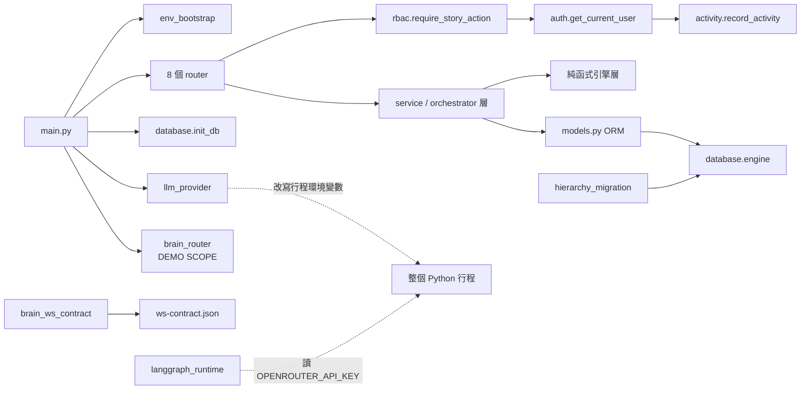

# Dependencies — Cloud-360

> **基準**：`34aeef3`（2026-10-02）。**新鮮度等級與證據標記的定義在 `reverse-engineering-timestamp.md`**。
> **套件版本清單不在本檔重複**，見 `technology-stack.md`；本檔記載的是**耦合關係**
> ——誰依賴誰、依賴透過什麼機制成立、斷掉時會怎麼失敗。
> 由 `codekb/cloud-360@2026-09-22` 與 `codekb/cloud@2026-10-01` 合併。

---

## 外部執行期依賴（非套件）〔A／C〕

| 依賴 | 用途 | 失敗模式 | 等級 |
|---|---|---|---|
| **OpenRouter** | **唯一的 LLM provider**（`llm_provider.py:42–43` 的有效值只剩一個）。兩個客戶端共用它 | 兩條路徑各自失敗，錯誤形狀不同（`RuntimeAuthError` 是 domain error、不是 HTTP） | A |
| **PostgreSQL** | 全部持久化，單一 `DATABASE_URL`；映像已升 `pgvector/pgvector:pg18` | 啟動補丁失敗只留 warning，應用照常啟動（T-2） | A |
| **Redis** | **大腦 session 還原（`LOCAL-DEV.md:23` 逐字）** | **目前無應用端消費者，故無執行期失敗模式**——但服務起來就佔資源、要維護 `REDIS_PASSWORD` | A |
| **Ollama** | **embedding（`OLLAMA_EMBED_MODEL=bge-m3`）** | 同上，應用零消費 | A |
| **n8n webhook** | 架構圖 icon 取得 | 曾因 `N8N_USER`／`N8N_PASSWORD` 未被寫入 `deploy/.env` 而**靜默退回灰底佔位圖** | 規則層 |
| **Cloudflare Tunnel** | staging 對外唯一入口，已為 WS 設 `tcpKeepAlive: 30s` | — | C |
| **embed.diagrams.net** | 前端 draw.io iframe | — | C |
| **雲端目錄價端點** | C1 的 `pricing_client`（agent 按需查價，結果只寫入建議文字、不回寫明細） | — | C |
| **Kiwi TCMS**（`tcms.danniel.cc`） | 測案同步，由 `scripts/tcms_*.py` 觸發 | `~/.tcms.conf` 不存在時**不得靜默跳過** | 規則層 |
| **GitHub Actions ＋ self-hosted runner** | CI 與 CD | `deploy.yml` 綁 `[self-hosted, linux, x64, cloud360]` 標籤 | C |

> **`claude` CLI 子行程已不再是依賴** 〔A〕。兩份 store 都把它列為外部執行期依賴，
> 並寫「缺席時在**請求時**失敗，不是建置時」。
> `[跑:link1]` `grep -rn "create_subprocess_exec\|Popen\|subprocess" backend/` → **零個實際呼叫**
> （5 處命中全是 docstring／註解字串）；`[讀]` `backend/Dockerfile` 已無 Node、無該 CLI。
> **LLM 的失敗模式已改為 HTTP 層。**

---

## 建置期耦合（皆為真實存在的耦合，非套件圖）〔A／C〕

| 依賴邊 | 機制 | 斷掉的後果 | 等級 |
|---|---|---|---|
| `openapi.json` ↔ `frontend/src/types/api.d.ts` | 兩道互補的漂移閘門：`ci.yml:280`（後端 `dump_openapi.py --check`）、`ci.yml:198`（前端 `check:types`） | 規格與程式或型別檔不同步即 CI 紅燈 | A |
| **`brain_ws_contract.py` ↔ `ws-contract.json` ↔ `ws-contract.d.ts`** | **同形狀的第二條鏈**：`ci.yml:291`（`dump_ws_contract.py --check`）、`ci.yml:210`（`check:ws-types`） | 同上。**另含 `BR4.4` 斷言**：產生的 `.d.ts` 必須保留 `WorkItem.sideEffect` 兩個 sentinel 值的 JSDoc | A |
| `fastapi`／`pydantic` 精確釘選 → **兩個** dump | 版本變動會改變 dump 的位元輸出 | 升版即可能讓**兩道**漂移閘門誤報；`dump_ws_contract.py` 的 docstring 逐字要求升版時同一個 PR 內重新 dump 並 commit | A |
| `backend` → `schema_rbac.sql` | compose 以 `../schema_rbac.sql:/docker-entrypoint-initdb.d/01-schema_rbac.sql:ro` 掛進 postgres | **僅在空 data volume 上執行**；既有環境完全不會跑到它 | C |
| **`hierarchy_migration.py` → 階層三表** | **第三條 DDL 路徑**：既不走 `schema_rbac.sql`（空 volume）也不走 `_ensure_*`（init_db），而是獨立的 `run_hierarchy_migration.py` ＋ `_ensure_hierarchy_schema(db)`（`:269`）＋ 終檢（`:477`） | 不跑它 → `user_diagrams.system_id` 為 NULL；終檢斷言 `AC9.1.4` 會抓到 | A |
| `frontend` → `PUBLIC_URL` | `VITE_API_BASE_URL` 是**建置期** build arg，Vite 內聯 | 改對外 URL 必須**重建 image**，不是改環境變數 | C |
| `deploy/.env` ← `render-env.sh` | **唯一產生點**；`deploy.yml` 的 deploy 與 rollback 兩個 job 都呼叫它 | 任一 job 自行 `cat > deploy/.env` 即違反 blocking 規則 | C |
| **`ws-contract.json` 的位置 → 資訊暴露面** | 規格檔刻意放 repo 根；若落入 `frontend/public/`，Vite 會原樣複製進 `dist/`、nginx 原樣服務 | **整份大腦訊息地圖（九種伺服器訊息、六種客戶端訊息與全部 payload 欄位）對未認證訪客公開**。連帶禁止把它 import 進前端程式碼 | A |
| `dist/` 不得含 spec | `ci.yml:224` 以 `find dist -name 'openapi*'` 擋 | **這一步是什麼在阻止未來的某次編輯悄悄撤銷上述佈局** | A |

---

## 環境設定的三個分離範圍（blocking 規則，`validate_env_contract.py` 在 CI 執行）〔A／C〕

| 範圍 | 設定來源 | 消費者 |
|---|---|---|
| 本機 dev | `backend/.env`、`frontend/.env`（範本 `*.env.example`） | bare-metal uvicorn ＋ vite |
| CI 測試 | `deploy/docker-compose.test.yml`（值全內嵌且有預設） | `ui-regression` 短生命週期 stack |
| 部署 | `deploy/.env`（**唯一產生點**為 `deploy/render-env.sh`，範本 `deploy/.env.example`） | `deploy/docker-compose.deploy.yml` |

三項硬性條款 〔C〕：

1. `deploy.yml` 的 deploy 與 rollback **兩個 job 都必須呼叫 `render-env.sh`**，
   不得任一 job 自行寫 `deploy/.env`（此規則的由來：兩個 job 原本各有一份逐字重複的 heredoc）。
2. **新增 compose 消費的變數時，同一個 PR 必須讓 `render-env.sh` 寫它、
   `deploy/.env.example` 列它。** 失敗模式無聲：無 fallback 的變數缺值時只會變成空字串，
   服務照常啟動但功能降級（實例：`N8N_USER`／`N8N_PASSWORD` 從未被寫入，
   導致每次部署的架構圖 icons 都靜默退回灰底佔位圖）。
3. **憑證不得含 `$`**：compose 會對 `--env-file` 的值做內插而**無聲截斷**
   （`ab$cd` 變成 `ab`，資料庫因此以遠弱於預期的密碼運行且無任何錯誤）；
   `render-env.sh:59–69` 已對此擋下並要求改用 `openssl rand -hex 32`。

### 本輪的新變數（第 2 條已被遵守）〔A〕

`[讀]` 本輪實查，`7ce1bee` 新增的七個變數**兩端都齊**：

| 變數 | `render-env.sh` | `deploy/.env.example` | `backend/.env.example` |
|---|---|---|---|
| `REDIS_URL` | ✅ `:121` `redis://redis:6379/0` | ✅ `:101` | ✅ `:101`（`localhost` 版） |
| `REDIS_USER` | ✅ | ✅ `:105` `cloud360` | ✅ `:106` |
| `REDIS_PASSWORD` | ✅ | ✅ `:111` | ✅ `:109` |
| `OLLAMA_BASE_URL` | ✅ | ✅ `:120` `http://ollama:11434` | ✅ `:122`（`localhost` 版） |
| `OLLAMA_EMBED_MODEL` | ✅ | ✅ `:124` `bge-m3` | ✅ `:124` |

`deploy/.env.example:94` 的註解逐字：「這七個之中**只有 `REDIS_PASSWORD` 是憑證**；
其餘六個是字面值，由……」`[讀]`。
另有 `backend/tests/test_render_env_redis.py` 鎖住契約 `K-01`
（`REDIS_URL` 的主機名須為 compose 內部服務名，且須以 `redis://` 開頭）`[算]`。

> **這是一個正面事實，值得記下**：blocking 規則本輪**被遵守了**。
> `LOCAL-DEV.md` 也同步列了 Redis 為硬依賴（`:23`／`:78`）。

---

## 內部跨模組依賴（重點邊）〔B〕

<!-- Text fallback: main.py 依賴 env_bootstrap、llm_provider、database.init_db 與 8 個 router（其中 brain_router 是 DEMO SCOPE）。router 依賴 rbac.require_story_action，後者依賴 auth.get_current_user，後者依賴 activity.record_activity。router 也依賴 service／orchestrator 層，該層依賴純函式引擎層與 models.py 的 ORM，ORM 依賴 database.engine。hierarchy_migration 直接用 database.engine，不經 ORM（因為階層三表不在 models.py）。brain_ws_contract 的產出是 ws-contract.json，它不被任何 router import。額外一條虛線耦合：llm_provider 會改寫整個 Python 行程的環境變數，而 langgraph_runtime 從同一個行程環境讀 OPENROUTER_API_KEY——兩者共用同一份行程狀態。 -->

**跨套件方向** 〔C〕：`backend/main.py` → `backend/cost/` → `backend/services/`；
`services` **不** import `cost.*`。本輪未反證。

### 本輪新增的三條邊 〔A〕

| 來源 | 目標 | 機制 | 備註 |
|---|---|---|---|
| `main.py:7` ＋ `:63` | `brain_router` | import ＋ `include_router(prefix="/api/brain")` | **移除 demo 要動這兩處**；`:62` 的註解寫「下面兩行」會誤導成只找 `:63` 之後 |
| `brain_ws_contract.py` | `ws-contract.json` → `ws-contract.d.ts` | `dump_ws_contract.py`（**刻意不 import `main`**） | 故契約閘門的紅燈只代表契約漂移，不受應用 import 失敗連帶影響 |
| `hierarchy_migration.py` | 階層三表 | 直接用 engine／session，**不經 ORM** | 因為三表**不在 `models.py`** 的 13 個 `__tablename__` 內 `[跑]` |

**`brain_router.py` 不被任何既有模組 import** 〔B〕（docstring 自述；
本輪未以 grep 獨立複驗反向引用）——這是它「整支可移除」的結構前提。

---

## 兩個 OpenRouter 入口（修訂版：不是兩套技術棧）〔A〕

> **這一節改寫兩份 store 的同名內容。** 兩者都把它寫成「兩套**不同技術棧**並存
> （`claude-agent-sdk` ＋ CLI 子行程 vs `langchain_openai`）」，並據此說大腦自建會是「第三份」。
> **技術棧已經統一了**：`claude_agent_sdk` 全樹零 import `[跑]`，
> 且 `test_a3_langgraph_migration.py:33,40` 有兩個 `assertNotIn` 斷言它不得回來。

| 路徑 | 技術鏈 | 消費者 | base URL 寫在 | 預設模型寫在 |
|---|---|---|---|---|
| A | LangGraph → `langchain_anthropic.ChatAnthropic`（Anthropic 相容） | `design_agent`、`review_agent`、lens 相關模組 | `llm_provider.py:49` → `https://openrouter.ai/api` | `llm_provider.py:52–54` |
| B | LangGraph → `langchain_openai.ChatOpenAI`（OpenAI 相容） | `cost/cost_advice_agent.py:132–162` | `langgraph_runtime.py:16` → `https://openrouter.ai/api/v1` | `langgraph_runtime.py:17` |

**剩下的分歧是設定值，而不是框架**：

1. **兩個 base URL 不同（一個有 `/v1` 一個沒有），而且是兩支不同模組各自寫死的。**
2. **預設模型名稱兩份物化，無任何測試鎖住一致。**

這正是 `team.md`「單一真實來源」規則關切的形狀。

**具體耦合風險** 〔A／C〕：`llm_provider.configure_provider_env()` 會**改寫整個行程的環境變數**
（把 `ANTHROPIC_API_KEY` 設為空字串、`setdefault` `ANTHROPIC_BASE_URL`），
且它在 `main.py:29`（模組層）與 `main.py:48–52`（startup）各呼叫一次 `[讀]`，
另在**每個** A1／A3 請求被呼叫（`agent_router.py:74`）〔C〕。
`langgraph_runtime.py:61–68` 讀的是 `OPENROUTER_API_KEY`，目前不受影響
——**但兩者共用同一個行程環境，新增第三份客戶端時這個耦合必須被明寫。**

---

## MCP：目前沒有任何依賴可以沿用 〔A〕

| 查證 | 方法 | 結果 |
|---|---|---|
| `requirements.txt` 有無 MCP 套件 | `[讀]` 18 項逐項 ＋ `[跑]` 程式解析 | **零** |
| 有無 MCP server／client 程式 | `[跑]` `grep -rni "mcp" backend/ --include='*.py'` | **命中數 1**，且是 `user_router.py:85` 的 RBAC story 標籤 `"H3": "MCP／Skill 生命週期"` |
| 現行的工具暴露機制 | `[讀:link1]` `design_agent.py:9–12,15,64,111` | **同進程 LangChain `@tool` ＋ LangGraph `ToolNode`**，沒有任何跨進程協定 |

> **`MCP` 這個字在本 repo 已被佔用，語意是 RBAC story `H3`。** 這必須寫在依賴面，
> 因為「有沒有 MCP 依賴」是最可能被 grep 誤答的問題之一
> ——下一個人 grep `MCP` 命中 `user_router.py:85` 就會得到「已經有了」的反向結論。
>
> 上游 `[F16]`=B（取代 `[S13]`=A）要求**真的導入 MCP server ＋ client、跑獨立進程**。
> 依賴面的起點是：**新增套件**（而 backend 無 lockfile，新增依賴即新增一條
> 各環境解析結果可能不同的邊）＋**全新的跨進程通道形狀**。

---

## Redis／Ollama：基礎設施已就緒，依賴尚未建立 〔A〕

| 層 | 狀態 | 證據 |
|---|---|---|
| 服務 | ✅ `redis:8-alpine`（`:157–259`）、`ollama/ollama:latest`（`:270–281`） | `[讀]` |
| 網路可達性 | ✅ 皆**無 `ports:`**，只在 `internal` 網路上以服務名可達 | `[讀]` compose `:4` 註解 |
| 持久化 | ✅ `redis_aof`、`ollama_models` 兩個 volume | `[讀]` |
| healthcheck | ✅ `redis-cli ping \| grep -q PONG` | `[讀]` `:259` |
| 環境變數 | ✅ 七個，`render-env.sh` ＋ 兩份範本齊備 | `[讀]` |
| 環境契約測試 | ✅ `test_render_env_redis.py`（`K-01`） | `[算]` |
| 本機文件 | ✅ `LOCAL-DEV.md:23,78,237` | `[讀]` |
| **Python 套件** | ❌ **`requirements.txt` 無 `redis`** | `[跑]` |
| **應用程式碼** | ❌ **零 import**（唯一命中是上述那支部署設定契約測試） | `[跑]` |
| **DB 向量欄位** | ❌ pgvector 擴充已建，但**全樹尚無任何 `vector` 欄位** | `[讀]` `database.py:200–217` docstring 自述 |

> **所以相關單元的依賴工作是「新增套件 ＋ 寫客戶端」，不是「加服務 ＋ 補環境變數」。**
> `cloud-360/architecture.md` 約束八的原文會讓人去重做已經完成的那一半。

---

## CI 阻擋的 import 邊界（新模組必須先確認不會誤觸）〔B〕

| Validator | 禁止內容 | 掃描方式 | 本輪 |
|---|---|---|---|
| `scripts/validate_cost_calculator_boundary.py` | `estimate_parser` / `estimate_validator` / `estimate_readers` **及其遞移 import 的同套件模組**不得出現 `httpx｜requests｜sqlalchemy｜fastapi` | **AST 遞移追 import**（`:15–24`） | `[跑:link1]` exit 0，三支逐一 OK |
| `scripts/validate_pricing_lookup_boundary.py` | 4 支 intake 寫入路徑模組不得 import `pricing_client`／`pricing_sdk`（`:20–31`）；**掃全 `backend/`** 禁止白名單（8 支 `cost/pricing_*` ＋ `cost/config.py`）以外的模組硬編 3 個計價 host（`:33–48`） | **掃全 `backend/` 字串** | `[跑:link1]` exit 0（`intake=4 modules; survival=9`） |

兩者都在 CI 的 `repo-contract` job 阻擋（`ci.yml:162`／`:167`）。
**第二支掃全 `backend/`**——大腦的新模組若在任何字串裡提到計價 host 就會紅燈。

---

## 依賴面的已知風險 〔A／C／D〕

1. **backend 無 lockfile** 〔A〕：18 項宣告中 **14 項未 pin** `[跑]`；
   CI／Docker build／staging 部署三處各自解析當下最新版，可能彼此不同。
   **本 intent 要新增 MCP 套件與 `redis` 客戶端，會把這個曝光面擴大。**
   對照組：frontend 有已 commit 的 `package-lock.json` ＋ `npm ci`。
2. **兩個映像用 `latest` tag** 〔A〕：`cloudflare/cloudflared:latest`、
   **`ollama/ollama:latest`**（本輪新增的那一個）——上游變動會直接進部署。
   對照：`pgvector/pgvector:pg18` 與 `redis:8-alpine` 皆有主版號釘選
   （compose `:274` 的註解自己點出這個對照）`[讀]`。
3. **權限清單多份物化，無一致性測試** 〔C〕：正本 `rbac.py:23–35` 的 `CANONICAL_ROLES`
   （11 角色，本輪 `[跑]` 複驗）；副本為 `auth.py:108–112` 的 11 個手寫字串 allowlist、
   `user_router.py::ROLE_DISPLAY_NAMES`、`frontend/src/pages/AdminPage.tsx::AVAILABLE_ROLES`、
   `schema_rbac.sql` 的 308 列 INSERT（與 `rbac_seed_data.py::DEFAULT_ROLE_PERMISSIONS`
   互為兩份；本輪 `[跑]` 複驗後者為 308 列）。
   `rbac_seed_data.py` 檔頭自述「由 `schema_rbac.sql` 產生（勿手改；改 SQL 後重跑產生腳本）」，
   而**該產生腳本不在 `scripts/` 內**——本輪 `[跑]` 複驗 `scripts/` 的 10 支清單，
   確認**仍無**該腳本。**此宣稱目前無對應檔案。**
4. **階層三表有三條 DDL 真相源、且不在 ORM** 〔A〕：
   `schema_rbac.sql`（空 volume）、`_ensure_hierarchy_schema`（既有環境）、
   而 `models.py` 完全沒有它們。任何 router／service 要讀這三表，
   得先決定補 ORM model 還是走 raw SQL，兩者都要處理「測試走 in-memory SQLite」這一層。
5. **`diagram_change_records` 只寫不讀且不會被清除** 〔A〕：`DEPLOY.md:310` 逐字
   「本輪只寫不讀（沒有任何讀取端）」、「保存期 90 天……**但清除機制本輪尚未落地
   ——這張表實際上不會被清除**」。而 `project.md` 禁止以 repo 內程式承載無人值守排程，
   故**承載形式本身是待決設計問題，不是待寫的程式**。
6. **Secret 掃描的作用域小於規則所宣稱** 〔D〕：`validate_no_obvious_secrets()`
   只讀 `contract_files()`（repo 層必要檔 ＋ baseline record 必要檔 ＋ audit shard）
   ——`backend/`、`frontend/`、`deploy/`、`schema_rbac.sql`、任何 `.env.example`
   **都不在其中**。**本輪未複驗**。
7. **`cloud/` 的「`backend/cost/` 內部與八類掛鉤」整表未承接** 〔D〕：
   它描述的是已退役的 C1 舊實作（`cost_router`／`cost_service`／`cost_calculator`／
   `sku_mapper`／`price_cache`／Calculator runner），**那些模組在 HEAD 上都不存在**。
   現行 `backend/cost/` 的 21 支與其邊界在 `architecture.md`／`code-structure.md`。
   要查舊實作請直接開 `codekb/cloud-360/` 或更早的 record。
