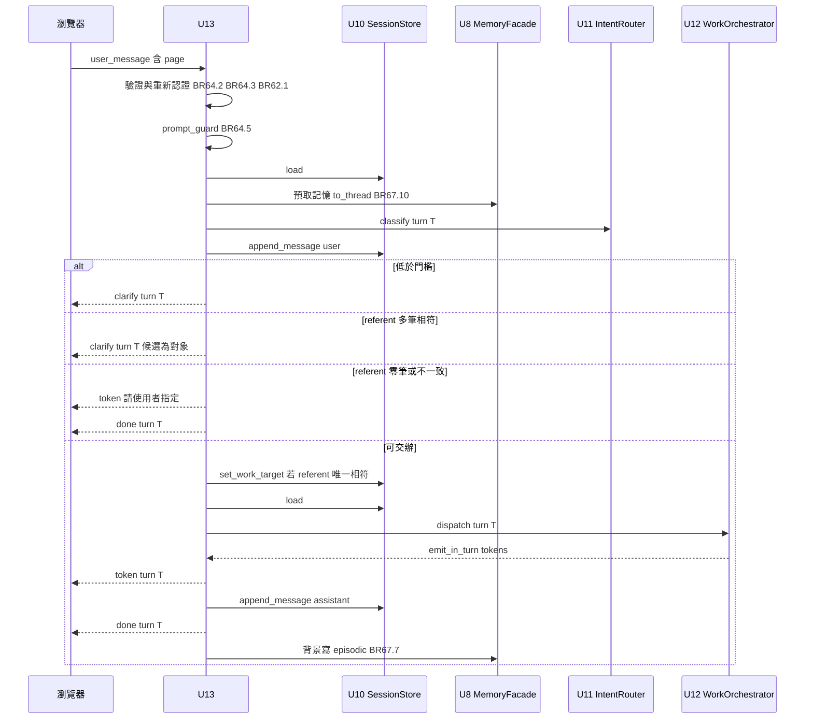
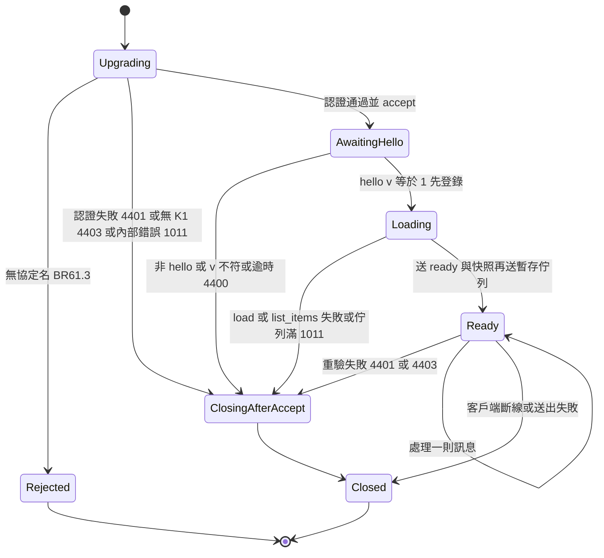
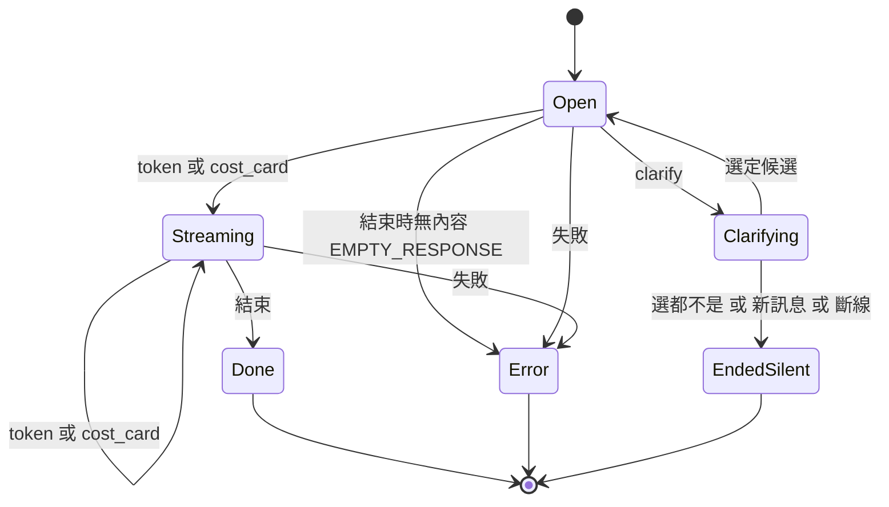

# Functional Spec — `U13 brain-gateway`

> 工作流程與狀態機的正式來源。資料形狀以 `entities.md` 為準、決策邏輯以 `rules.md` 為準（53 條，`BR61.1`–`BR67.12`）。
> 本站四題定案：`[GW1]`=A（客戶端帶 `cloud360.brain.v1` 與 `bearer.<jwt>`，伺服器只回送前者）、`[GW2]`=A（先送終止
> 事件，episodic 記憶背景寫入、失敗只記 WARNING）、`[GW3]`=A（握手期 Redis 不可用 → 1011；握手結束後 → 該輪
> `error(INTERNAL_ERROR)`、連線保留）、`[GW4]`=A（`user_message` 增加 `page` 欄位）。問題檔第一節「上游已定案」逐條遵守，
> 本檔不重開。引用他單元的規則一律寫成「`U<n>` 的規則 x.y」。
>
> **修訂 1（2026-10-12）**：依 `reviews/review-01.md` 的 R-01～R-12 修正；使用者裁決 R-02 為 `Deferred` 並回報上游。
> 逐項對應見 §十二。
>
> **修訂 2（2026-10-12T22:45Z）**：依 `reviews/review-02.md` 的 R-01～R-07 修正（未新增提問、未新增 LLM 呼叫）。逐項對應見 §十三。

## 一、單元邊界

| 項目 | 內容 |
|---|---|
| 擁有 | `/api/brain/ws` 端點、握手認證、版本協商、連線登錄與扇出、turnId 鑄造與終止語意、`select_clarify_candidate` 的輪次驗證、referent 的解析與無法解析時的處置、`U12` 的 sink 實作、注入 `U11` 的記憶預取轉接器、錯誤對應、episodic 記憶的寫入時機 |
| 不擁有 | 訊息型別（`U2`；本單元提出增量，見 §十一）、意圖判讀（`U11`）、工作項與能力呼叫（`U12`）、session 狀態與段（`U10`）、作業對象授權（`U7`）、記憶的授權與嵌入（`U8`）、進度通道（`U22`，`BR67.8`） |
| 消費者 | `U14 entry-page-ui`（瀏覽器，`K-12`） |
| 呼叫的同進程元件 | `SessionStore`（`K-09`）、`IntentRouter`（`K-10`）、`WorkOrchestrator`（`K-11`）、`HierarchyFacade`（`K-07`）、`MemoryFacade`（`K-08`）、`auth.get_user_from_token`、`rbac.user_can`、`hierarchy_facade.mint_principal` |
| 部署 | embedded，同一 FastAPI 行程；**單一行程假設**（`BR63.1`） |
| 新增模組（建議檔名） | `backend/services/brain_gateway.py`（WebSocket handler、登錄、sink、轉接器）、`backend/services/brain_gateway_rules.py`（純函式：子協定解析、session key、段解析、終止狀態機、錯誤對應） |
| 修改 | `main.py` 的 startup hook（建立閘道元件，`BR67.11`）；`U2` 的 `brain_ws_contract.py` 與其兩個衍生物、`backend/scripts/dump_ws_contract.py` 的白名單（§十一，契約追認後） |
| 移除 | `backend/services/brain_router.py`；`main.py:7`、`main.py:110-112` |

## 二、介面

### 2.1 對外（`K-12`）

| 項目 | 值 |
|---|---|
| 路徑 | `wss://cloud360.danniel.cc/api/brain/ws` |
| 請求子協定 | `Sec-WebSocket-Protocol: cloud360.brain.v1, bearer.<jwt>`（順序不限；`[GW1]`=A；協定名為契約增量 C-1） |
| 回應子協定 | `cloud360.brain.v1`（**只此一個**；`BR61.4`） |
| 首則訊息 | `{v:1, type:"hello", payload:{v:1}}`，10 秒內；載入成功後回 `ready{protocolVersion:1}` |
| 關閉碼 | 4401 認證失敗或 token 到期／4403 無 `K1`／4400 版本不相容（reason `expected=1 received=<n|invalid>`）／1011 內部錯誤 |
| 未提供 `cloud360.brain.v1` | 不 accept（HTTP 403），`BR61.3` |

### 2.2 純函式（`brain_gateway_rules.py`，PBT 的落點）

| 函式 | 簽章 | 規則 |
|---|---|---|
| `parse_subprotocol_offer` | `(header: str) -> SubprotocolOffer` | `BR61.2` |
| `session_key_for`／`user_id_from_session_key` | `(int) -> str`／`(str) -> int` | `BR62.3` |
| `resolve_segment` | `(page: str, page_modes: Mapping[str,str]) -> str` | `BR62.5` |
| `TurnLedger` | `open()`／`clarify()`／`content(kind)`／`finish() -> "done"|"EMPTY_RESPONSE"`／`end_silent()`／`allows(kind) -> bool` | `BR64.7` |
| `error_for` | `(exc: BaseException) -> tuple[code, message]` | `BR67.1` |
| `match_referent` | `(referent: str, catalog: TargetCatalog, selected_project_id: int|None) -> Unique | Many | None` | `BR64.9`、`BR64.11` |
| `scan_targets_in_utterance` | `(utterance: str, catalog: TargetCatalog) -> list[target]` | `BR64.13` |

### 2.3 交給 `U12` 的 sink（`GatewaySink`）

| 方法 | 行為 | 規則 |
|---|---|---|
| `emit_session(WorkItemsPayload)` | 扇出給該 key 全部存活連線，turnId null | `BR65.2`、`BR63.3` |
| `emit_in_turn(turn_id, [TokenPayload])` | 只送進 `originTurn` 且該輪未終止；每則 token 各自一個訊框立即送出；標記有內容 | `BR65.2` |
| `emit_turn([TokenPayload|CostCardPayload])` | 新 turnId，送給該 key 全部存活連線，每條連線依序內容 → `done`；段已知時內容寫入該段歷程 | `BR65.3`、`BR65.5` |

### 2.4 注入 `U11` 的記憶轉接器（本單元擁有，`BR67.10`）

`IntentRouter(memory_facade=<轉接器>)`。轉接器只有 `search(principal, query, kinds, limit)` 一個方法，**內部無 I/O**，只讀
`contextvars.ContextVar` 中的 `MemoryPrefetch`（`entities.md`）。預取在 `await classify` 之前於專用的有界記憶執行器上完成（`BR67.12`，等待上限 3 秒、失敗即熔斷 30 秒）；
不符或失敗時拋例外，由 `U11` 依其既有設計降級為不帶記憶分類（`intent_routing.py:192-235`）。

### 2.5 對同進程元件的呼叫一覽

| 呼叫 | 時機 | 執行方式 |
|---|---|---|
| `get_user_from_token(token, db, record=…)` ＋ `user_can(K1, view)` ＋ `mint_principal` | 握手、每則客戶端訊息（`record=True`）、每 60 秒背景重驗（`record=False`） | 一次 `to_thread`、同一個 DB session 內完成三者 |
| `SessionStore.load` | 連線建立（ready 之前）；分類前；交辦前重讀 | `to_thread` |
| `SessionStore.append_message` | 使用者訊息（分類之後；攔截命中除外）、本輪回覆、段已知的推播 | `to_thread` |
| `SessionStore.set_sharing_mode`／`set_work_target` | 對應客戶端訊息；referent 唯一相符；target 反問選定 | `to_thread`；`hierarchy_facade` 為每次開 DB session 的轉接器 |
| `SessionStore.load_work_items` | 呼叫 `correct` 前取該工作項的段 | `to_thread` |
| `MemoryFacade.search` | 分類前預取 | 記憶執行器（`BR67.12`），等待上限 3 秒 |
| `IntentRouter.classify(principal, session, text, turn_id=T)` | 每則 user_message | `await`；依段選三個實例之一 |
| `WorkOrchestrator.dispatch`／`correct`／`list_items` | 交辦／更正／連線建立 | `await` |
| `HierarchyFacade.list_projects` ＋ 每個專案的 `list_systems` | 對象目錄（`BR64.12`）：referent 解析、反問選定後的原句掃描 | 一次 `to_thread`、同一 DB session；專案上限 50 |
| `MemoryFacade.write(principal, "episodic", content)` | 有交辦的使用者輪次 `done` 之後 | 背景 task，記憶執行器（`BR67.12`），等待上限 15 秒 |

## 三、工作流程（正式來源）

### GW-W1 握手與連線建立

**握手在 `ready` 送出時結束**（`BR61.7`）。

1. 讀 `Sec-WebSocket-Protocol`，`parse_subprotocol_offer`（`BR61.2`）。**不讀 query string**。
2. 無 `cloud360.brain.v1` → `close()`（未 accept，HTTP 403），結束（`BR61.3`）。
3. 無 bearer 項 → `accept(subprotocol="cloud360.brain.v1")` → `close(4401)`（`BR61.5`）。
4. 一次 `to_thread`（同一 DB session）：`get_user_from_token(record=True)` → `user_can(K1, view)` → `mint_principal`；
   `HTTPException` → accept → 4401；`K1` 為假 → accept → 4403；其他例外或 `app.state` 無閘道元件 → accept → 1011。
5. `accept(subprotocol="cloud360.brain.v1")`。**至此之前伺服器未讀任何訊框、未寫任何 session 狀態。**
6. 等首則訊框（10 秒）；`BR61.8` 判定，不相容 → 4400。
7. `session_key_for(user.id)`；**先以 phase=loading 登錄**（`BR63.1`）——此後該 key 的扇出與推播進入本連線的暫存佇列（`BR63.6`）。
8. `to_thread load`；`await list_items`（`BR62.4`）。任何例外（含 `SessionBackendUnavailable`）→ 自登錄移除、丟棄佇列、1011
   （仍在握手內，`[GW3]`=A 前半）。
9. 送 `ready`——**握手結束**。只對本連線推送快照：`sharing_mode`×2、`work_target`×（存在段數，`load` 回 None 時為 1）、
   `work_items`；**再依序送出暫存佇列**；phase 改為 ready；啟動 60 秒背景重驗（`BR62.6`）。此後的任何
   `SessionBackendUnavailable` 依 `BR67.2` 處置。

**為何先登錄再讀取**（review-02 R-03）：若先讀後登錄，讀取與登錄之間另一分頁的 `set_work_target` 或 `U12` 的推送看不到本連線，
客戶端停在舊快照直到下一次狀態改變。先登錄則那段期間的扇出必進佇列；三種狀態訊息都是整份狀態、佇列依產生順序送出，故每一類
「最後收到的那一則」必為最新（`BR63.2` 的排序保證）。測試：在 `load` 與 `list_items` 之間注入一次 `set_work_target`，斷言新連線
最後收到的 `work_target` 為新值。

### GW-W2 一則 `user_message`

文字 fallback：瀏覽器送帶 `page` 的 `user_message` → `U13` 驗證格式與長度並重新認證 → 過 `prompt_guard`（命中則送固定拒絕
token 與 `done` 後結束，不寫歷程、不呼叫 LLM）→ 讀 session → 以 `to_thread` 預取記憶 → 以本輪 turnId 呼叫 `classify` →
以使用者角色寫入該段歷程 → 依判定分四路：低於門檻送 `clarify` 等待選擇；referent 多筆相符送以對象為候選的 `clarify`；
referent 零筆相符或多個意圖指向不同對象送固定句型請使用者指定並 `done`；可交辦時若 referent 唯一相符先更新作業對象，重讀
session 後呼叫 `dispatch`，`U12` 經 `emit_in_turn` 送出建立訊息、`U13` 逐則轉送為 `token` → 以助理角色寫入回覆 → 送 `done`
→ 在背景寫一筆 episodic 記憶。

步驟細則（對應 `BR64.6`）：

| # | 動作 | 失敗時 | 規則 |
|---|---|---|---|
| 1 | 兩步驗證（含 `page` 必填）；空白或超過 4000 字；重新認證並鑄造 principal | `error(INVALID_REQUEST)`；401／403 → 4401；`K1` 假 → 4403；其他 → `error(INTERNAL_ERROR)`，連線保留 | `BR64.2`、`BR64.3`、`BR62.1` |
| 2 | 鑄造 turnId T；作廢舊的 `PendingClarify`（舊輪 `ended_silent`） | — | `BR64.1`、`BR64.8` |
| 3 | `prompt_guard` 命中 → `token(REFUSAL_MESSAGE)` → `done` | — | `BR64.5` |
| 4 | `resolve_segment(page, pageModes)`；`load`；預取記憶 | `SessionBackendUnavailable` → `error(INTERNAL_ERROR)`；預取失敗只使 `U11` 降級 | `BR62.5`、`BR67.10`、`BR67.2` |
| 5 | `classify` | `PlatformSelfModificationRefused` → 同第 3 步；四種路由失敗 → 先完成第 6 步再 `error(INTERNAL_ERROR)` | `BR67.1` |
| 6 | `append_message(user)` | `SessionMessageTooLong` → `error(INVALID_REQUEST)`；`SessionBackendUnavailable` → `error(INTERNAL_ERROR)` | `BR64.6` |
| 7a | `below_threshold` → `clarify` ＋ `PendingClarify(kind=intent)` | 候選為空 → `error(INTERNAL_ERROR)` | `BR64.8` |
| 7b | 有 referent → 取對象目錄（`BR64.12`）；不唯一 → `clarify(kind=target)` 或固定句型 ＋ `done`，**不交辦** | `HierarchyForbidden` → `error(UNAUTHORIZED)`；目錄取得失敗 → `error(INTERNAL_ERROR)` | `BR64.12`、`BR64.11` |
| 7c | referent 唯一相符（含脈絡列未選定、系統名在目錄中唯一）→ `set_work_target` ＋ 扇出；重讀；`dispatch`；referent 皆為 null → 直接交辦 | `ValueError` → `error(INTERNAL_ERROR)` | `BR64.9`、`BR67.1` |
| 8 | 有內容 → `append_message(assistant)`（失敗只記 WARNING）→ `done`；無內容 → `error(EMPTY_RESPONSE)` | — | `BR64.7`、`BR64.10` |
| 9 | `done` 之後背景寫 episodic | WARNING | `BR67.7` |

### GW-W3 `select_clarify_candidate`

| 情況 | 處置 |
|---|---|
| 本連線沒有 `PendingClarify` | 新 turnId，`error(INVALID_REQUEST)` |
| `candidateId` 不在 `PendingClarify.candidates` | `error(INVALID_REQUEST, turnId=T)`，清除 |
| `kind=intent`、`candidateId` 在集合內 | 以該候選組 `IntentDecision`；**取對象目錄並以 `PendingClarify.utterance` 掃描對象**（`BR64.13`）：無命中 → 依當前作業對象交辦；恰一個 → 依 `BR64.9` 更新後交辦；多個 → `BR64.11` (a) 或 (c)。全程沿用 turnId T（`AC1.2.2` 的傳輸面） |
| `kind=target`、`candidateId` 在集合內 | `set_work_target(targets[candidateId])` ＋ 扇出 `work_target`；重讀；以 `PendingClarify.decision` 交辦，沿用 turnId T |
| `candidateId` 為 null | 輪 T `ended_silent`；**不送** `work_target`、`work_items`、任何終止事件（`AC1.2.3`） |

### GW-W4 `set_work_target`／`set_sharing_mode`／`correct_work_item`

見 `BR66.1`–`BR66.3`。成功時不送任何輪次訊息（只有狀態訊息扇出，或由 `U12` 經 sink 開伺服器輪次）；失敗時以新
turnId 送單則 `error`。`correct` 之前先 `load_work_items` 取該工作項的段，供 sink 寫歷程（`BR65.5`）。

### GW-W5 背景推播（`US7.1`）

`U12` 的背景工作完成、失敗、逾時或被停掉 → `emit_session(work_items)` 扇出 ＋ `emit_turn([token…, cost_card?])`。
`U13` 鑄造新 turnId，對 `registry[session_key]` 每條存活連線依序送內容與 `done`。session key 由交辦者的 user id 推導，
故**只有交辦者本人的連線**收到（`AC7.1.1`／`AC7.1.3`）；失敗與逾時的句型由 `U12` 產生並原樣轉送（`AC7.1.2`）。
段已知（dispatch、correct 的 sink）時，推播的 token 文字在背景寫入該段歷程（`BR65.5`）；復原掃描（`list_items`）的推播段不明，
不寫。無存活連線則丟棄；使用者下次連線時由 `list_items` 看到終態（`BR63.5`）。

### GW-W6 斷線、重連與重驗

斷線 → 自登錄移除、停止背景重驗；該連線未終止的輪次不補送（`K-12` `on_drop`）。`U12` 的背景工作繼續，sink 改送其餘連線
（`BR65.1`）。重連 → GW-W1 全程重跑，同一 session key、同一 Redis 狀態。背景重驗（`BR62.6`）每 60 秒一次，失效即 4401／4403。

### GW-W7 行程啟動

`main.py` 既有 startup hook 的順序為 `configure_provider_env` → `configure_embedding_env` → `configure_session_env` →
`configure_intent_routing_env` → `init_db`（`main.py:55-77`）。閘道元件插在 `configure_intent_routing_env` **之後**、`init_db` **之前**
（`BR67.11`），依序：

| # | 元件 | 設定來源 | 失敗語意 |
|---|---|---|---|
| 1 | Redis client：`build_redis_client(REDIS_URL, user=REDIS_USER, password=REDIS_PASSWORD)` | 三個環境變數（已存在於 `backend/.env.example:101-109`、`deploy/.env.example:101-111`、`render-env.sh`、兩份 compose） | 缺值或 `REDIS_USER=default` → 啟動失敗；**不在啟動時連線**（F-29），Redis 暫時不可用不阻止啟動 |
| 2 | `RedisGateway`、`SessionStore` | `BRAIN_SESSION_HISTORY_MAX`（已由 `configure_session_env` 驗過） | — |
| 3 | 記憶執行器（4 條執行緒）與預取轉接器 | 無 | — |
| 4 | 三個 `IntentRouter` | `BRAIN_ROUTER_*`（建構子呼叫 `resolve_routing_config`，故在 `configure_intent_routing_env` 之後） | 門檻缺值 → 啟動失敗（與既有 hook 同形） |
| 5 | `WorkOrchestrator(app, session_store)` | 無 | — |
| 6 | 連線登錄 | 無 | — |

全部存於 `app.state.brain_gateway`；shutdown 時關閉記憶執行器。只建立一次，不需互斥；請求路徑上不延遲建立。本單元**不新增環境
變數**，故無 `LOCAL-DEV.md` 同步義務；實作時若須新增，同一 PR 同步 `LOCAL-DEV.md`（`project.md` 規則）。測試以
`with TestClient(app)` 觸發 startup，或直接注入 `app.state.brain_gateway`。

## 四、狀態機

### 4.1 連線

文字 fallback：升級中 →（無 `cloud360.brain.v1`）拒絕；→（認證失敗、無 `K1`、內部錯誤）accept 後立即以 4401／4403／1011 關閉；
→（通過）等待 hello。等待 hello →（非 hello、版本不符、10 秒逾時）4400 關閉；→（`v=1`）先以載入中狀態登錄，進入載入中。
載入中 →（`load` 或 `list_items` 失敗、或暫存佇列超過 256 則）移出登錄並 1011 關閉；→（成功）送 `ready`、快照、暫存佇列，握手結束，
進入就緒。就緒 → 逐則處理訊息；→（每則訊息或每 60 秒的重驗失敗）4401／4403 關閉；→（斷線或送出失敗）關閉並移出登錄。
登錄中的連線只有「載入中」與「就緒」兩種；載入中的連線不直接收訊息，只收進暫存佇列。

### 4.2 一輪（`TurnLedger`，純狀態機）

文字 fallback：開啟 →（送出非空白 token 或 cost_card）串流中；開啟 →（送出 clarify，含意圖反問與對象反問）反問中。反問中 →
（選定候選）回到開啟並沿用同一 turnId；反問中 →（選「都不是」、收到新訊息或斷線）安靜結束，不送任何終止事件。串流中 →（結束）
`done`。開啟 →（結束時無內容）`error(EMPTY_RESPONSE)`；開啟或串流中 →（失敗）`error`。`done`、`error`、安靜結束為三個終態，
進入後一律拒絕放行任何輪次訊息。

**不變量（PBT 性質三）**：對任意操作序列，(a) 終止事件總數 ≤ 1；(b) 終態之後 `allows(*)` 恆為假；(c) `finish()` 回
`done` 若且唯若之前至少一次 `content`；(d) `clarify` 不使 `finish()` 回 `done`。

## 五、上游交接逐條判定

在 `construction/` 全樹 grep `U13`／`brain-gateway`（排除本目錄、`reviews/`、`memory.md`、`.dispatch-brief`、`.plan-head`）得
378 行，其中屬「指派給 `U13` 的義務」者逐條判定如下；其餘為敘述性提及（消費端清單、信任邊界說明、拓樸圖），不構成義務。

| # | 來源 | 義務 | 判定 | 落點 |
|---|---|---|---|---|
| H-1 | `work-orchestrator` code-summary.md §七第 1 點 | 握手時保留 token、只在記憶體、以 `bearer_token=` 傳入 | **承接** | `BR62.2` |
| H-2 | 同上第 2 點 | 以 app 建構，每行程一個 | **承接**（於 startup hook） | `BR67.6`、`BR67.11` |
| H-3 | 同上第 3 點、`OPEN-WO12-3` | 傳 `utterance`／`segment_id`／`turn_id`／`sink`；**交辦前依 referent 更新作業對象** | **承接**：在使用者可見的對象目錄（含脈絡列未選定時）中唯一相符才更新（`BR64.9`、`BR64.12`）；不唯一時**不交辦**、改走反問或請求指定（`BR64.11`）；反問選定後以原句掃描對象（`BR64.13`）——`U12` 不讀 referent，不能把失敗分支交給它 | `BR64.6`、`BR64.9`、`BR64.11`、`BR64.12`、`BR64.13` |
| H-4 | 同上第 4 點 | 實作 sink 三方法、包成 `WsEnvelope`、`emit_turn` 產生 turnId 以 `done` 終止 | **承接** | `BR65.1`–`BR65.5` |
| H-5 | 同上第 5 點 | `dispatch` 回傳後送 `done`；`ValueError` 走失效路徑 | **承接** | `BR64.7`、`BR67.1` |
| H-6 | 同上第 6 點 | 連線與重連時呼叫 `list_items` | **承接**（在 ready 之前） | `BR61.7`、`BR63.2` |
| H-7 | 同上第 7 點 | `correct`；`WorkItemNotFound` → `INVALID_REQUEST` | **承接** | `BR66.3` |
| H-8 | 同上第 8 點 | `CapabilityCallFailed` 不會被拋出 | **承接**（不為它寫分支；若仍出現，落入 `BR67.1` 的其餘類） | `BR67.1` |
| H-9 | `work-orchestrator` code-summary.md:176-180（R-05） | store 同步呼叫在事件迴圈上，交 `U13` 決定 | **部分承接**：本單元自己的呼叫一律 `to_thread`；`U12` 內部呼叫不包裝，列具名殘留 | `BR67.5`；`OPEN-GW13-4` |
| H-10 | `session-store` functional-spec.md W1 第 1、2、5、6 步 | 推導 key、`load`、預設狀態、逐鍵逐段推送 | **承接**（第 5 步「建立」以「不寫入、以預設狀態推送」實現，因 `K-09` 無 create） | `BR62.3`、`BR62.4`、`BR63.2` |
| H-11 | 同上 W2 第 2、3 步 | 解析該頁讀哪一段、以段識別 `append_message` | **承接**，依賴契約增量 C-2（`[GW4]`=A） | `BR62.5`；§十一 |
| H-12 | 同上 W3 第 2、7 步；W4 第 4 步；W5 第 2 步 | 以頁面識別 `set_sharing_mode`、扇出、推送重入段 | **承接**，依賴 C-3／C-4／C-6 | `BR66.2`；§十一 |
| H-13 | 同上 W6 第 2、8 步 | principal ＋ 段識別 `set_work_target`、扇出 | **承接**，依賴 C-4／C-5 | `BR66.1`；§十一 |
| H-14 | 同上 §六 `D-S10-1`（`ADR-0020`）承接站之一為 `U13` 的 code-generation | `K-02` 四個 payload 加 `scope`／`segment` | **承接**：逐欄定義見 §十一；`ADR-0020` 的撰寫與核可為本單元 code-generation 的前置關卡 | §十一；`OPEN-GW13-1` |
| H-15 | `session-store` code-summary.md:150 第 3 項 | `meta.userId` 無寫入端，Owner 為 `U13` | **不承接寫入**：`K-09` 介面無寫入方法；改以純函式反推，全樹無讀取端；列入 §十一的契約追認 | `BR62.3`；`OPEN-GW13-3` |
| H-16 | `session-store` reliability-requirements.md:64 | `SessionBackendUnavailable` 的呈現 | **承接**（`[GW3]`=A，分界為 ready） | `BR61.7`、`BR67.2` |
| H-17 | `intent-router` code-summary.md:254 | 一個行程一個 `IntentRouter`，不在 handler 內建構 | **承接並偏離字面**：三個（每段一個），理由見 `OPEN-GW13-2` | `BR67.6` |
| H-18 | `intent-router` nfr-design logical-components.md:91；reliability-requirements.md:57 | `SessionBackendUnavailable`／模型失敗由 `U13` 以 `error` 終止該輪 | **承接** | `BR67.1`、`BR67.2` |
| H-19 | `intent_routing_errors.py:84-101` | `PlatformSelfModificationRefused` → 送訊息並以 `done` 結束 | **承接** | `BR64.5` |
| H-20 | `intent-router` performance-requirements.md:87 | 交接膠水時間的預算分配 → `U13` 的 `nfr-requirements` | **不在本站**（`nfr-requirements` 為 CONDITIONAL；若被 skip，轉 `U13` 的 `code-generation`，判定 skip 者須重新提交使用者） | `OPEN-GW13-9` |
| H-21 | `intent-router` infrastructure-design cicd-pipeline.md:142-165（`I-1`） | 空 `OPENROUTER_API_KEY` 使入口頁每輪失敗 | **不在本站**（`infrastructure-design` 為 CONDITIONAL，同上 skip 風險）；本站只定行為：每輪 `error(INTERNAL_ERROR)` | `BR67.1`；`OPEN-GW13-7` |
| H-22 | `memory-service` rules.md:305-313（`U8` 的規則 7.1）；nfr-design logical-components.md:55（`D8-7`） | 每輪結束寫 episodic；失敗時對話是否失敗由 `U13` 決定 | **承接**，`[GW2]`=A；並**收窄**為只寫使用者輪次中以 `done` 結束且非攔截者 | `BR67.7`；§八 `D-3` |
| H-23 | `memory-service` observability-design.md:105-118（`D8-6`）；`brain-infra` monitoring-design.md:115 | correlation id 由 `U13` 產生 | **部分承接**：turnId 即關聯鍵，傳給 `classify` 與 `dispatch`、寫進本單元 log；預取既然在本單元執行，預取的 log 帶 turnId，但 `MemoryFacade.search` 自身的 log 仍無此欄 | `BR64.1`、`BR67.10`；`OPEN-GW13-8` |
| H-24 | `progress-channel` functional-spec.md:33-38；rules.md:22；security-design.md S-5 | `U13` 鑄造 `request_key`、串流中與結束後各 drain | **不承接**：唯一生產者經 `agent_router` 呼叫；`agent_router` 鑄造鍵（`agent_router.py:131`）、open（`:138`）、把鍵傳入 `run_design_agent`（`:154`），**drain 發生在 `run_design_agent` 內**，最後由 `agent_router` close（`:162`）。本單元無事件來源。`K-18` 把 `drain` 的 `consumed_by` 寫成 `[U13]` 為不實，列契約追認 | `BR67.8`；`OPEN-GW13-12` |
| H-25 | `progress-channel` gate-findings-consolidated.md:99 | 入口端要不要接 `DuplicateChannelKey` | **不適用**（本單元不 open） | `BR67.8` |
| H-26 | `brain-ws-contract` code-summary.md:324（H-3） | 原始 dict 轉換 | **承接** | `BR64.2` |
| H-27 | `brain-ws-contract` security-requirements.md:276 | 偷帶 turnId → `error(INVALID_REQUEST)` | **承接** | `BR64.2` |
| H-28 | `brain-ws-contract` security-requirements.md:296（`U2` 的規則 2.9） | `error.message` 不含實作細節 | **承接** | `BR67.1` |
| H-29 | `brain-ws-contract` functional-spec.md:269-272 | `AC8.1.1`–`AC8.1.4` 的執行期落點 | **承接**；`AC8.1.1` 依使用者裁決為 `Deferred` | traceability；`OPEN-GW13-15` |
| H-30 | `brain-ws-contract` functional-spec.md:356-359 | 關閉碼、端點路徑、`expected`／`received`、子協定格式無漂移閘門 | **承接**：以 `TestClient.websocket_connect` 斷言四項（code-generation 的測試）；子協定名改由 C-1 進契約後受漂移閘門保護 | `BR61.1`、`BR61.8`、`BR67.4`；§十一 |
| H-31 | `membership-service` rules.md:55、:74；`K-16` `identity_passing` | 自行保存 principal 並逐次傳入 | **承接**（且逐則重鑄） | `BR62.1` |
| H-32 | `requirement-field-service` code-summary.md §「給 U21 與 U13」 | 代寫一律帶 `on_behalf_of`；清空用 `clear_field` | **目前不適用**：`U11` 的可路由能力沒有需求欄位寫入，本單元沒有呼叫 `K-17` 的流程；`K-17` 的 `consumed_by` 列契約追認 | `OPEN-GW13-12` |
| H-33 | `session-store` nfr-design reliability-design.md:27 | 限流屬 `U13` | **不在本站設計**：只有輸入長度上限（`BR64.3`）；連線數與訊息頻率限制列開放項 | `OPEN-GW13-13` |
| H-34 | `brain-ws-contract` nfr-design security-design.md:111；code-generation-plan.md:33 | 移除 DEMO（前端 demo 頁的排序約束） | **承接後端那一半**；前端 demo 頁屬 `U14`，見同批次約束 | `BR61.1`；`OPEN-GW13-10` |

## 六、已查證事實（逐一開檔核對，2026-10-12）

| # | 事實 | 出處 |
|---|---|---|
| F-1 | DEMO 握手把 token 回送進回應標頭 | `brain_router.py:275` `accept(subprotocol=f"bearer.{token}")` |
| F-2 | DEMO 在 accept 之前呼叫 `close(4401)`——Starlette 對未 accept 的 close 回 HTTP 403，客戶端看不到 4401 | `brain_router.py:257`、`:265` |
| F-3 | `get_user_from_token` 在帳號停用時拋 403 `HTTPException`，`record=True` 時呼叫 `record_activity` | `auth.py:58-84` |
| F-4 | `user_can` 對未核准帳號回 False | `rbac.py:151-153` |
| F-5 | `Principal` 只能經 `mint_principal` 鑄造 | `hierarchy_facade.py:109`、`:145` |
| F-6 | `IntentRouter` 的段在建構子固定，`classify` 無段參數 | `intent_routing.py:340`、`:390-396` |
| F-7 | `classify` 先過 `guard_hits`，命中拋 `PlatformSelfModificationRefused` | `intent_routing.py:435-448` |
| F-8 | 記憶檢索在 `classify` 內**同步**呼叫 `memory_facade.search`；嵌入走同步 `httpx.Client`，逾時預設 10 秒 | `intent_routing.py:217-225`；`embedding_port.py:125`、`:610` |
| F-9 | `dispatch` 在 `below_threshold` 時回空集合；段不存在、工作階段到期、不可路由能力拋 `ValueError`；只讀段的作業對象 | `work_orchestrator.py:242`、`:244-245`、`:249`、`:257` |
| F-10 | `uvicorn` 指令無 `--workers` 在 `backend/Dockerfile:30`；`K-12` 寫的 `:37` 已過時（事實成立、定位錯） | `backend/Dockerfile:30`；`contract-summary.md:936` |
| F-11 | `append_message` 拒絕超過 4000 字元並拋 `SessionMessageTooLong` | `session_store.py:113`、`:254-258` |
| F-12 | `meta.userId` 以 null 建立，`K-09` 無寫入方法；`session.user_id` 在 `U11`／`U12` 無讀取端（grep 零命中） | `session_store.py:495`、`:514-543` |
| F-13 | `SharingModePayload`／`SetSharingModePayload`／`WorkTargetPayload`／`SetWorkTargetPayload` 皆無 `scope`／`segment`；`UserMessagePayload` 只有 `text` | `brain_ws_contract.py:259-280`、`:350-355`、`:387-402` |
| F-14 | `agent_router` 鑄造 `request_key`、open、把鍵傳入 `run_design_agent`、close；drain 在 `run_design_agent` 內 | `agent_router.py:131`、`:138`、`:154`、`:162` |
| F-15 | `RedisGateway` 的重試上限 2 次、以 `time.sleep` 退避 | `redis_gateway.py:99`、`:306` |
| F-16 | 前端 demo 頁只帶 `bearer` 一個子協定 | `frontend/src/pages/BrainPage.tsx:98-100` |
| F-17 | nginx 的 `location /api/` 帶 Upgrade 標頭 | `frontend/nginx.conf:16-21` |
| F-18 | `U11` 的檢索只取 `semantic`／`procedure`、至多 5 筆，不含 `episodic` | `intent_routing.py:108`、`:113` |
| F-19 | 歷程的近期訊息與本句分別進入分類 prompt | `intent_routing.py:175-190`；`intent_routing_context.py:163`、`:182` |
| F-20 | `U12` 全檔不讀 referent（grep 0 命中） | `work_orchestrator.py`（整檔） |
| F-21 | JWT 預設 8 小時到期 | `auth.py:33` |
| F-22 | `record_activity` 會 commit；`SessionLocal` 為預設 `expire_on_commit` 的 sessionmaker | `activity.py:96`；`database.py:38` |
| F-23 | 既有 startup hook 已以「失敗即拋」驗證 session 與嵌入設定 | `main.py:55-70` |
| F-24 | 客戶端欄位白名單釘在 dump 腳本 | `backend/scripts/dump_ws_contract.py:108-116` |
| F-25 | 工作項的伺服器內部欄位含 `segmentId`，`_public` 不送出它 | `work_orchestrator.py:374`、`:162-172` |
| F-26 | `HierarchyFacade.list_projects` 只回請求者為擁有者的專案；`list_systems` 必須帶 `project_id` 且先確認擁有；facade 沒有跨專案查系統的方法 | `hierarchy_facade.py:275-288` |
| F-27 | 低於門檻時 `decide()` 回的 `intents` 必為空；公開的 `ClarifyCandidate` 只有 `id`／`label`／`capability`／`confidence`，不帶 referent | `intent_routing_predicate.py:263-275`；`intent_routing_types.py:183-195` |
| F-28 | startup hook 的順序：`configure_provider_env` → `configure_embedding_env` → `configure_session_env` → `configure_intent_routing_env` → `init_db` | `main.py:55-77` |
| F-29 | `build_redis_client` 要求 url、user、password，拒絕 `default` 使用者；只建 `ConnectionPool.from_url` 與 `Redis` 物件，**兩者皆延遲到第一個指令才連線** | `redis_gateway.py:510-536` |
| F-30 | `REDIS_URL`／`REDIS_USER`／`REDIS_PASSWORD` 已存在於兩份範本與部署設定 | `backend/.env.example:101-109`；`deploy/.env.example:101-111`；`deploy/docker-compose.deploy.yml:117-119` |
| F-31 | 既有契約測試以只含 `scheme` 與 `separator` 的方式構造 `WsSubprotocol`；逐型別樣本的 `sharing_mode`／`work_target`／`clarify` 不含新欄位 | `backend/tests/test_ws_contract.py:283`、`:288`、`:290`、`:61-62`、`:47` |

## 七、ADR-0006 四面向與 PBT

**逐格對照上游 `requirements.md:595-602` 的同名表（修訂 1 的 `:615-620` 亦四格皆「適用」）**：上游四格皆「適用」，本表四格皆
「適用」，**無一格相反**。

| 面向 | 判定 | 本單元的處置 |
|---|---|---|
| **IAM** | **適用** | 握手：token 驗證 ＋ `K1.view`（4401／4403），且在 accept 之前完成（`BR61.4`–`BR61.6`）；**每則訊息重新驗證並重鑄 principal**、閒置連線每 60 秒重驗（`BR62.1`、`BR62.6`），撤權或停用的外洩窗至多 60 秒；身分不得來自客戶端訊息（`BR64.2`）；作業對象授權委派 `U7`（`BR66.1`）；referent 解析只在使用者可見的專案與系統內比對（`BR64.9`）；token 只在記憶體（`BR62.2`）。殘留：`HierarchyFacade` 尚未讀 `is_approved`（`hierarchy_facade.py` 註解自承），本單元以 `K1` 判定擋在前面。referent 與原句的對象比對只經 `HierarchyFacade` 的列舉方法取得目錄、範圍為請求者擁有的專案（`BR64.12`），不直讀表 |
| **Encryption** | **適用** | 傳輸：對外 `wss` 經 Cloudflare Tunnel（`brain-infra` security-design.md:155 指名本單元擁有）；token 不進 URL、**不進回應標頭**（`[GW1]`=A）。tunnel 之內 cloudflared → nginx → backend 為主機內明文 ws，與既有 SSE 同形，不新增。靜態：本單元不持久化；episodic 與歷程內容含使用者原句，其靜態加密屬上游 `OQ-3`（`requirements.md:598`），本單元不新增手段 |
| **Network exposure** | **適用** | 本單元是本 intent 唯一新增的對外網路面（`K-12`）：掛在 `/api/` 之下（`BR61.1`）；query string 一律不讀，token 只在 query string 的握手一定被拒（兩種形狀，`BR61.5`）；未認證者不取得可讀寫的通道（`BR61.4` 的最小暴露面）；輸入長度上限（`BR64.3`）。殘留：訊框大小上限與連線頻率限制未設（`OPEN-GW13-13`）；cloudflared／nginx 是否透傳子協定標頭未實測（`OPEN-GW13-6`） |
| **Audit logging** | **適用** | `record=True` 在握手**與每則訊息**呼叫，使 `users.last_activity_at` 對長連線也持續更新；背景重驗刻意 `record=False`，閒置不算活動（`BR62.1`、`BR62.6`，`AC8.1.2`）；log 禁含 token、query string、對話內容、referent 與候選標籤（`BR67.3`）；關閉原因 ASCII 且不含 token（`BR67.4`） |

**PBT 判定**：`project.md` 的 hard constraint 落點為 IaC generator、cost calculator、agent routing。agent routing 的核心是
`U11`（已交付含 PBT），**本單元不是 hard constraint 的落點**——判定為 N/A（非豁免）。但本單元有七個純函式（§2.2），
其中五個有清楚的性質，**本站要求 code-generation 對它們寫 property-based 測試**：

| 性質 | 函式 |
|---|---|
| 一：t 取自**非空、不含逗號、無前後空白**的 RFC 7230 token 字元集（JWT 的 base64url 三段即屬此集），對任意項目順序與項目間任意空白，解析回 t；清單不含 `cloud360.brain.v1` 時 `hasProtocolName` 為假。**另以 example-based 案例**覆蓋「bearer 後為空字串」「只有空白」「整個標頭為空」→ bearerToken 不存在 | `parse_subprotocol_offer` |
| 二：`user_id_from_session_key(session_key_for(u)) == u`；單射 | `session_key_for` |
| 三：§4.2 的四條不變量 | `TurnLedger` |
| 四：`page == "entry"` ⇒ `shared`；回傳值 ∈ `{shared, page}` | `resolve_segment` |
| （example-based 即可）：每個已列例外對應到表內 code；`message` 恆不含 `str(exc)` | `error_for` |
| （example-based 即可）：唯一、多筆、零筆三種結果；casefold 與去空白；已選專案優先；**未選定且系統名在目錄中唯一 → 命中**（AC1.1.5 主情境） | `match_referent` |
| 五：目錄中任一長度 ≥ 2 的名稱 n，若 `casefold(n)` 是 `casefold(u)` 的子字串則 n 的對象在結果內；結果內每個對象的名稱都出現在 u 中 | `scan_targets_in_utterance` |

## 八、偏離、決定與開放項

### 8.1 本站做的決定（不在 GW1–GW4 內，揭露供核可）

| # | 決定 | 理由 |
|---|---|---|
| D-1 | 每則客戶端訊息重新驗證 token 並重鑄 principal；閒置連線每 60 秒重驗（`BR62.1`、`BR62.6`） | `K-12` 只要求握手時 `record=True`；逐則與週期驗證是**疊加**而非牴觸。**使用者可見的後果**：JWT 8 小時到期（F-21）後，下一則訊息或下一次背景重驗即以 4401 關閉，`U14` 須以重新登入或新 token 重連處理 |
| D-2 | prompt_guard 命中的文字不寫進歷程（`BR64.5`） | 歷程會成為下一輪分類 prompt 的一部分（F-19），寫進去等於讓攔截被繞過。`K-12` `on_user_message` 的「寫入歷程」因此對命中輪次不成立——這是收窄 |
| D-3 | episodic 只寫使用者輪次中以 `done` 結束且非攔截者（`BR67.7`） | `U8` 的規則 7.1 字面是「每輪對話結束」。`error`／安靜結束的輪次沒有可記住的內容；攔截命中的內容不該被長期保存；推播輪次已由 `U12` 寫 procedure。**這是對上游字面的收窄**，需追認 |
| D-4 | 三個 `IntentRouter` 實例（`BR67.6`） | 見 `OPEN-GW13-2` |
| D-5 | `hello` 逾時 10 秒、背景重驗 60 秒；關閉原因 ASCII 固定字串 | 上游無數值 |
| D-6 | 回覆文字與段已知的推播以 assistant 角色寫入歷程，超長截斷（`BR64.10`、`BR65.5`） | `K-12` 只說「寫入對話歷程」未定角色；不寫則下一輪看不到上一輪與背景工作的結果 |
| D-7 | 分類先於寫入使用者訊息（`BR64.6`） | 避免本句在 prompt 中出現兩次（F-19） |
| D-8 | referent 不唯一時不交辦：多筆走對象反問、零筆或不一致以固定句型請使用者指定（`BR64.11`） | 使用者裁決 R-01；`U12` 不讀 referent（F-20），交給它等於靜默對舊對象交辦 |
| D-9 | 對象目錄＝擁有者可見的全部專案及其系統，1＋N 次 facade 查詢，專案上限 50、不快取（`BR64.12`） | review-02 R-01：未選定時系統名稱必須能解析；facade 無跨專案方法（F-26） |
| D-10 | 反問選定意圖後以原句做名稱掃描（`BR64.13`），而非要求 `U11` 的候選帶 referent | 不改 `K-10` 契約即可關閉缺口；限制為代名詞與簡稱無法辨識，此時與高信心路徑一致地依當前作業對象交辦 |
| D-11 | hello 後即登錄、載入期間暫存佇列上限 256（`BR63.1`、`BR63.6`） | review-02 R-03 |
| D-12 | 記憶執行器 4 條執行緒、預取等待 3 秒、寫入等待 15 秒、熔斷 30 秒（`BR67.12`） | review-02 R-07；上游無數值 |
| D-13 | `BR64.11` (b)(c) 的請求指定句不寫 episodic（`BR67.7`） | 沒有交辦的輪次沒有可記住的工作；避免記憶被「找不到對象」污染 |

### 8.2 開放項

| # | 事項 | 承接 |
|---|---|---|
| `OPEN-GW13-1` | **契約追認（`K-02`／`K-12`／`K-09`／`K-16`／`K-17`／`K-18`）**：§十一的 C-1～C-7 欄位增量（`[GW1]`=A、`[GW4]`=A、`ADR-0020`、review-02 R-05 的 `ClarifyPayload.kind`），以及 `OPEN-GW13-12` 的三個 `consumed_by` 更正、`OPEN-GW13-3` 的 `meta.userId`、`emit_turn` 伺服器發起輪次的語意（`OPEN-WO12-1` 已列）。**撰寫者與關卡**：`inception/decisions/0020-*.md` 由 `U13` 的 `code-generation`（3.5，ALWAYS，位於游標之後）的 conductor 在提交計畫核可**之前**撰寫並取得使用者核可；核可之前 `BR61.2`（協定名部分）、`BR62.5`、`BR63.2`（兩則狀態訊息）、`BR63.3`、`BR66.1`、`BR66.2` 的實作狀態為 **blocked**。`U14` 須配合（§十一之四） | `ADR-0020`（使用者核可）→ `U13` code-generation |
| `OPEN-GW13-2` | `IntentRouter` 以建構子固定段（F-6），本單元建三個實例；偏離 `U11` code-summary 的「一個行程一個」字面，但保住其目的（每實例 TLS 握手只付一次）。乾淨的修法是 `U11` 的 `classify` 增加 `segment_id` 關鍵字參數 | `U11` 下一次修訂（非阻擋） |
| `OPEN-GW13-3` | `meta.userId` 無寫入端（F-12）；本單元不改 `K-09` 介面就寫不了。目前無讀取端，以 `user_id_from_session_key` 為替代。列入 `OPEN-GW13-1` 的追認：`K-09` 若要補需增方法 | `ADR-0020` 一併裁決 |
| `OPEN-GW13-4` | **（修訂 1 更正）** 原版宣稱「`U11` 的同步記憶檢索本單元無法移開」**不成立**——轉接器由本單元擁有，已以預取移開（`BR67.10`）。剩下唯一的具名殘留：`U12` 對 `SessionStore` 的同步呼叫（最壞約 3.3 秒，R-05），本單元無法在不改 `U12` 的前提下移開 | `build-and-test` 量測阻塞時間；`U12` 下一次修訂 |
| `OPEN-GW13-5` | referent 解析與原句掃描（`BR64.9`／`BR64.11`／`BR64.12`／`BR64.13`）為本站新定：casefold 精確相符（referent）或子字串（原句，名稱長度 ≥ 2）、只解析到專案或系統層、目錄專案上限 50 | 核可關卡追認 |
| `OPEN-GW13-6` | `OQ-8`：cloudflared 與 nginx 是否透傳 `Sec-WebSocket-Protocol`（請求與回應兩個方向）未實測 | `U13` 的 `infrastructure-design`（CONDITIONAL；若被 skip 轉 `build-and-test`，判定 skip 者須重新提交使用者） |
| `OPEN-GW13-7` | `I-1`：空 `OPENROUTER_API_KEY` 時入口頁每輪 `error(INTERNAL_ERROR)` | 同上（`infrastructure-design`，skip 風險同） |
| `OPEN-GW13-8` | `D8-6`：turnId 為關聯鍵；預取的 log 帶 turnId，但 `MemoryFacade.search` 自身的 log 無此欄 | `U13` 的 `nfr-design`（CONDITIONAL；skip 則轉 `code-generation`） |
| `OPEN-GW13-9` | 交接膠水時間的預算分配 | `U13` 的 `nfr-requirements`（CONDITIONAL；skip 則轉 `code-generation`，須重新提交使用者） |
| `OPEN-GW13-10` | **同批次約束**：刪除 DEMO 後端並改為要求 `cloud360.brain.v1`，前端 demo 頁（F-16）的握手即被拒（HTTP 403），且 C-2 使其 `user_message` 缺 `page`。deploy-on-merge 下，本單元與「改寫或移除 demo 頁」必須同一次部署 | `delivery-planning` 的 Bolt 確認／`U14` |
| `OPEN-GW13-11` | 推播只送到當下存活的連線（`BR63.5`）；使用者離線時通知不補送，`AC7.1.1` 的「收到推播」以「在線」為前提，離線者於重連時從 `work_items` 看到終態。復原掃描的推播不入歷程（`BR65.5`） | 核可關卡揭露 |
| `OPEN-GW13-12` | **契約 `consumed_by` 不實（修訂 1 具名化）**：① `K-18` 的 `ProgressChannel.drain` `consumed_by: [U13]`（`contract-summary.md:1891`）→ 改為「`agent_router` 經 `run_design_agent`」（既有程式，F-14）；② `K-16` 的 `resolve_project_role` `consumed_by: [U20, U13, U21]`（`:1659`）→ 移除 `U13`；③ `K-17` 的 `read_fields`／`write_field` `consumed_by: [U23, U13, U21]`（`:1820`、`:1831`）與 `clear_field` 的「呼叫端只有 `U13`／`U21`」（`:1841`）→ 移除 `U13`；④ `components.md:734-744` 的 `BrainGateway` 三條 `depends_on` 同步移除。本設計三者都不呼叫：契約沒有承載「可用動作」的訊息欄位、`U11` 沒有需求欄位寫入能力、進度通道由 `agent_router` 自管 | `OPEN-GW13-1` 的同一份追認（`ADR-0020`） |
| `OPEN-GW13-13` | 連線數、訊息頻率與訊框大小（uvicorn 預設 `ws_max_size` 16 MiB）未設限 | `nfr-requirements`／`infrastructure-design` |
| `OPEN-GW13-14` | `U2` 的規則 2.14 已記的可區分性缺陷（`candidateId: null` 一欄兩義）原樣繼承 | 上游追認（`U2` 已列） |
| `OPEN-GW13-16` | **可見範圍與 K-07 一致而非放寬**：對象目錄只含使用者為擁有者的專案（F-26）。以成員身分參與、但非擁有者的專案，其名稱無法被解析——而 `K-07` 的 `resolve_work_target` 目前也不允許把它設為作業對象，故兩者一致。若日後 `K-07` 開放成員可見，本單元的目錄須同步改用該方法 | `U7`／`U19` 的後續修訂（非阻擋） |
| `OPEN-GW13-15` | **`AC8.1.1` 為 `Deferred`（使用者裁決，回報上游）**：AC 要「回覆一個字一個字出來」，但本輪沒有逐字的內容來源——`U12` 的 `[WO1]`=A 不新增 LLM 呼叫，交辦當下只送一則固定句型（`work_orchestrator.py:262-276`）；A1 的說明文字因 ASGI 緩衝在產圖結束後以伺服器發起的輪次一次到達。「第一個 token 早於 `done`」對任何實作恆真，不構成驗證。傳輸層仍保留逐則送出的能力（`BR65.2`）。**須使用者二擇一**：改寫 `AC8.1.1` 的 Then（例如「交辦後立即出現第一則回覆，早於能力完成」），或追加串流的 LLM 回覆（會推翻 `[WO1]`=A，須回到 `U12` 重議）。本站**不新增任何 LLM 呼叫** | 使用者裁決（user-stories 已核可） |

## 九、送審前自檢（七項，修訂 2 重跑）

| # | 項目 | 結果 |
|---|---|---|
| 1 | **可達性** | 修訂 1 的各項維持。修訂 2 新增：`BR64.9` 第 2 步——脈絡列未選定、句中系統名在目錄中唯一（AC1.1.5 主情境），以兩個專案、其一含該系統構造；`BR64.12` 的上限分支——51 個專案的替身；`BR64.13` 三分——分類替身回 `below_threshold` 且原句含零個、一個、兩個目錄名稱；`BR63.6`——在 `load` 與 `list_items` 之間注入 `set_work_target` 或 `emit_session`；佇列滿——在載入中注入 257 則扇出；`BR67.12` 熔斷——慢嵌入替身逾時一次後下一則訊息不預取。`EMPTY_RESPONSE` 一般路徑不可達，保留為防禦 |
| 2 | **契約端點三問** | 新欄位：`Connection.pendingOutbound` 寫＝`BR63.6`、讀＝ready 時送出、清＝ready 或關閉；`TargetCatalog` 寫＝`BR64.12`、讀＝`BR64.9`／`BR64.11`／`BR64.13`、清＝當輪結束；`MemoryExecutor.breakerOpenUntil` 寫＝預取或寫入失敗、讀＝下一次預取或寫入、清＝成功或 30 秒後；`PendingClarify.utterance` 新增讀者 `BR64.13`。新方法：`scan_targets_in_utterance`、`build_target_catalog` 擁有＝本單元、呼叫＝`BR64.8`／`BR64.9`／`BR64.11`。新契約欄位 `ClarifyPayload.kind`（C-7）寫＝`BR64.8`／`BR64.11`、讀＝`U14`。既有缺口不變：`meta.userId` 寫端懸空（`OPEN-GW13-3`）；三份契約 `consumed_by` 不實（`OPEN-GW13-12`） |
| 3 | **引用逐字核對** | 修訂 2 新增的引用以腳本逐行印出核對：`hierarchy_facade.py:275-288`；`intent_routing_predicate.py:263-275`（首稿誤寫 `:264-275`，已改）；`intent_routing_types.py:183-195`；`main.py:55-77`；`redis_gateway.py:510-536`；`backend/.env.example:101-109`；`deploy/.env.example:101-111`；`docker-compose.deploy.yml:117-119`；`test_ws_contract.py:47`、`:61-62`、`:283`、`:288`、`:290` |
| 4 | **檔案集合一致性** | 四份產出＋問題檔齊備；問題檔已追加 Revision 2 段 |
| 5 | **跨檔傳播**（按事實、多種表達形式 grep 四檔） | 見 §九之一 |
| 6 | **可算的數字先算再寫** | 規則數以 YAML 解析實算 **53**（`BR61`×8、`BR62`×6、`BR63`×6、`BR64`×13、`BR65`×5、`BR66`×3、`BR67`×12）；traceability 交叉檢查（腳本實算）：coverage 的 OK 列 target 涵蓋 16 條、reverse 37 條、兩者無重疊、聯集 53、無懸空 id、reverse 無多餘 id；上游 AC 數 8（`US7.1`×3、`US8.1`×4，加上本輪納入的 `AC1.1.5`） |
| 7 | **ADR-0006 四面向 ＋ PBT** | 四面向皆「適用」，逐格對照上游 `requirements.md:595-602` 與 `:615-620` 無一格相反；IAM 格因 `BR64.12` 補記「目錄只經 facade、擁有者範圍」。PBT hard constraint 判 N/A（落點是 `U11`），對五個純函式要求 PBT（新增性質五） |

### 九之一、跨檔傳播掃查（修訂 2 改動的事實 × 表達形式）

| 改動的事實 | 表達形式（grep 用） | 四檔命中處（已逐一核對一致） |
|---|---|---|
| 未選定時系統名稱可解析 | `已選專案`／`未選定`／`BR64.12`／`目錄`／`AC1.1.5` | `rules.md` `BR64.6`、`BR64.9`、`BR64.11`、`BR64.12`；本檔 H-3、GW-W2 7b／7c、D-9、`OPEN-GW13-5`／`-16`、§七；`entities.md` `TargetCatalog`；`traceability.json` `AC1.1.5`；修訂 1 的舊比對順序敘述已自 `rules.md` 移除（本列為唯一引述處） |
| 反問選定後不帶舊對象 | `BR64.13`／`原句`／`掃描`／`referent=None` | `rules.md` `BR64.8`、`BR64.11`、`BR64.13`；本檔 GW-W3、D-10；`entities.md` `PendingClarify.utterance`；修訂 1 GW-W3 的舊敘述已移除（本列為唯一引述處） |
| hello 後即登錄、暫存佇列 | `loading`／`暫存`／`pendingOutbound`／`BR63.6`／`先登錄` | `rules.md` `BR61.7`、`BR63.1`、`BR63.2`、`BR63.6`；本檔 GW-W1、§4.1、D-11；`entities.md` `Connection`、`ConnectionRegistry`；修訂 1 §4.1 的舊敘述已移除 |
| ClarifyPayload 鑑別欄位 | `kind`／`C-7` | `rules.md` `BR64.8`、`BR64.11`；本檔 §十一、§九 第 2 列 |
| (b)(c) 不寫 episodic | `(b)(c)`／`不寫的輪次`／`D-13` | `rules.md` `BR64.11`、`BR67.7`；本檔 D-13、§2.5 |
| 專用記憶執行器 | `BR67.12`／`記憶執行器`／`MemoryExecutor`／`熔斷` | `rules.md` `BR67.5`、`BR67.7`、`BR67.10`、`BR67.11`、`BR67.12`；本檔 §2.4、§2.5、GW-W7、D-12；`entities.md` `MemoryExecutor`、`MemoryPrefetch` |
| startup 順序與 Redis 設定 | `configure_intent_routing_env`／`REDIS_URL`／`init_db`／`A-6` | `rules.md` `BR67.11`；本檔 GW-W7、F-28～F-30、A-6 |
| 規則數 53 | `53`／`49` | 本檔開頭與自檢 6 為 53；`rules.md` 修訂註記「49 → 53」；舊數 49 只出現在 `rules.md` 修訂註記與本列 |
| 他單元規則寫法 | `BR[0-9]+\.` 且非 `BR6[1-7]` | 四檔 0 命中 |

## 十、Assumptions

- **A-1** 單一後端行程（`K-12`；F-10）。多行程時扇出與推播靜默失效。
- **A-2** `ADR-0020`（§十一）在 `U13` code-generation 的計畫核可之前取得使用者核可；之前依賴它的規則為 blocked（`OPEN-GW13-1`）。
- **A-3** hello 逾時 10 秒、背景重驗 60 秒、暫存佇列 256 則、對象目錄 50 個專案、記憶執行器的四個數值（D-12）皆為本站選值，非上游數值。
- **A-4** `AC8.1.1` 不以「第一個 `token` 早於 `done`」宣稱滿足——那對任何實作恆真；依使用者裁決標 `Deferred`，見 `OPEN-GW13-15`。
- **A-5** `HierarchyFacade` 與 `MemoryFacade` 的轉接器每次呼叫開獨立 DB session，與 `U12` 的 `_facade_sync` 同形（`work_orchestrator.py:1015-1029`）。
- **A-6（修訂 2 改為已確認的事實，不再是假設）** Redis client 在啟動時不連線：`build_redis_client` 只建立 `ConnectionPool.from_url` 與 `Redis` 物件，兩者皆延遲到第一個指令才連線（F-29）。故 Redis 暫時不可用不阻止後端啟動，而在握手時以 1011 呈現。

## 十一、契約增量（逐欄定義，`ADR-0020` 的內容草案）

### 十一之一、欄位

**`WsSubprotocol.protocolName` 為何是模型欄位而非獨立常數**：`WsSubprotocol` 本來就是「格式描述模型」——伺服器從不構造它，
既有的 `scheme` 與 `separator` 也是同樣性質的必填字面值欄位（`brain_ws_contract.py:410-433`）。放進同一個模型，前端即可以
`Sub['protocolName']` 取值並受同一道漂移閘門與 `ADR-0019 §5` 的 lint 規則保護；另立常數則需要第二條閘門。必填（不給預設）的理由：
給預設值會使產生的 TypeScript 欄位變成可選，前端取到的型別多一個 `undefined`。

協定版本維持 `v: 1`：目前沒有已發布的客戶端（唯一的客戶端是 DEMO 頁，與本單元同批移除或改寫，`OPEN-GW13-10`），升版只會
增加協商成本而沒有相容對象。**`U14` 上線之後**，任何不相容的增量都必須升版。

| 代號 | 模型（`brain_ws_contract.py`） | 方向 | 新欄位 | 型別 | 必填 | 預設 | 合法值 | 舊客戶端缺欄位時 | 依賴它的規則 |
|---|---|---|---|---|---|---|---|---|---|
| C-1 | `WsSubprotocol`（`:410`） | 握手 | `protocolName` | `Literal["cloud360.brain.v1"]` | 是 | 無 | 僅此一值 | 客戶端未提供此子協定 → 未 accept 即拒絕（`BR61.3`） | `BR61.2`、`BR61.3`、`BR61.4` |
| C-2 | `UserMessagePayload`（`:350`） | 客→伺 | `page` | `Literal["entry","workspace","assessment"]` | 是 | **無**（不預設為 entry，避免靜默寫錯段） | 三值 | `WsClientEnvelope` 驗證失敗 → `error(INVALID_REQUEST)` | `BR62.5`、`BR64.2` |
| C-3 | `SharingModePayload`（`:259`） | 伺→客 | `scope` | `Literal["workspace","assessment"]` | 是 | 無 | 兩值（入口頁恆為共享，不需狀態訊息） | 不適用（伺服器產生）；舊客戶端需重產型別 | `BR63.2`、`BR63.3`、`BR66.2` |
| C-4 | `WorkTargetPayload`（`:267`） | 伺→客 | `segment` | `Literal["shared","workspace","assessment"]` | 是 | 無 | 三值 | 同上 | `BR63.2`、`BR63.3`、`BR66.1`、`BR66.2` |
| C-5 | `SetWorkTargetPayload`（`:395`） | 客→伺 | `segment` | `Literal["shared","workspace","assessment"]` | 是 | 無 | 三值 | `error(INVALID_REQUEST)` | `BR66.1` |
| C-7 | `ClarifyPayload`（`:214`） | 伺→客 | `kind` | `Literal["intent","target"]` | 是 | 無 | `intent`＝分類信心不足、候選是不同的解讀；`target`＝意圖已確定、候選是同名的不同對象 | 不適用（伺服器產生）；`U14` 以它決定候選的呈現（`target` 只顯示 `label`） | `BR64.8`、`BR64.11` |
| C-6 | `SetSharingModePayload`（`:387`） | 客→伺 | `scope` | `Literal["workspace","assessment"]` | 是 | 無 | 兩值 | `error(INVALID_REQUEST)` | `BR66.2` |

C-3～C-6 與 `session-store` functional-spec.md §六的 `ADR-0020` 最小改動集逐欄一致；C-1 來自 `[GW1]`=A；C-7 來自 review-02 R-05（反問的兩種形狀須可區分）；C-2 來自 `[GW4]`=A，
是 `ADR-0020` 原改動集漏列的第五個 payload。每個新欄位都要寫 `description`（前端型別檔靠它保留語意）。

### 十一之二、受影響的衍生物與閘門（依序）

1. 改 `backend/services/brain_ws_contract.py` 的六個模型。
2. 改 `backend/scripts/dump_ws_contract.py:108-116` 的 `CLIENT_FIELD_WHITELIST`：`UserMessagePayload` → `{"text","page"}`、
   `SetSharingModePayload` → `{"mode","scope"}`、`SetWorkTargetPayload` → `{"projectId","systemId","diagramId","segment"}`
   ——否則白名單斷言紅燈（這是它的設計目的）。
3. 於 `backend/` 執行 `python scripts/dump_ws_contract.py`，重產 repo 根的 `ws-contract.json`；CI 以 `--check` 斷言一致。
4. 於 `frontend/` 執行 `npm run gen:ws-types`，重產 `src/types/ws-contract.d.ts`；CI 以 `npm run check:ws-types` 斷言一致。
5. **既有測試必須同步修改的位置**（`backend/tests/test_ws_contract.py`，F-31）：
   - `:283` `WsSubprotocol(scheme=scheme, separator=separator)` → 加 `protocolName=protocol_name`，並在其上方以同檔既有的形狀取字面值：
     `protocol_literals = get_args(WsSubprotocol.model_fields["protocolName"].annotation)`、斷言長度 1、`protocol_name = protocol_literals[0]`；
   - `:288`、`:290` 兩個負向構造同樣補 `protocolName=protocol_name`，使它們只因被測的那一欄失敗；另加一個
     `protocolName=protocol_name + "x"` 的負向案例；
   - `:61` 的 `SHARING_MODE` 樣本加 `"scope": "workspace"`；`:62` 的 `WORK_TARGET` 樣本加 `"segment": "shared"`；`:47` 起的
     `CLARIFY` 樣本加 `"kind": "intent"`。
   `backend/tests/test_dump_ws_contract.py:187-205` 以 `SetWorkTargetPayload` 的欄位做刪欄測試，新增 `segment` 後仍成立，不需改。
6. 前端 demo 頁在步驟 4 之後 `tsc -b` 紅燈（缺 `page`）——與 `OPEN-GW13-10` 同批處理。

### 十一之三、撰寫者與關卡

`ADR-0020` 落在 `inception/decisions/`（`project.md` 的 ADR 落點規則），內容為本節 ＋ `OPEN-GW13-12` 的三個 `consumed_by` 更正 ＋
`OPEN-GW13-3`。由 `U13` 的 `code-generation` conductor 在計畫核可**之前**撰寫並取得使用者核可；`U2` 已交付，其模組改動由 `U13` 的
那一輪 code-generation 一併承載（`session-store` functional-spec.md §六把這個選擇留給下游，本站選定此路）。

### 十一之四、`U14` 的配合事項

建立連線帶兩個子協定且以型別取值（`ADR-0019 §5` 的 lint 規則禁止字面量）；每則 `user_message` 帶 `page`；依 `scope`／`segment`
過濾狀態訊息；收到 4401 時以重新登入或新 token 重連（D-1）。

## 十二、修訂 1 對照（`review-01`）

| ID | 處置 | 改動位置 |
|---|---|---|
| R-01（Major） | referent 不唯一時不交辦：多筆走對象反問、零筆或不一致以固定句型請使用者指定；更正「交由 U12 處理」的錯誤描述（`U12` 不讀 referent） | 新增 `BR64.11`；改寫 `BR64.8`、`BR64.9`；`entities.md` `PendingClarify`；GW-W2、GW-W3、H-3、D-8、F-20 |
| R-02（Major） | **使用者裁決**：`AC8.1.1` 改 `Deferred` 並回報上游；不加任何 LLM 呼叫；傳輸層保留逐則送出 | `traceability.json`；`OPEN-GW13-15`；A-4；`BR65.2` |
| R-03（Major） | 記憶檢索以 `to_thread` 預取、`ContextVar` 傳遞、轉接器內無 I/O；更正 `OPEN-GW13-4` 的錯誤主張 | 新增 `BR67.10`；改寫 `BR64.6`、`BR67.5`、`BR67.6`；`entities.md` `MemoryPrefetch`；§2.4、`OPEN-GW13-4` |
| R-04（Major） | 契約增量逐欄定義、衍生物與閘門、撰寫者與關卡、blocked 狀態 | 新增 §十一；`BR61.2`、`BR62.5`、`BR63.2`、`BR63.3`、`BR66.1`、`BR66.2` 引用 §十一；`OPEN-GW13-1` |
| R-05（Minor） | 握手在 ready 送出時結束；`load` 與 `list_items` 移到 ready 之前 | `BR61.7`、`BR61.8`、`BR62.4`、`BR63.1`、`BR63.2`、`BR67.2`；GW-W1；§4.1 |
| R-06（Minor） | 性質一的定義域收斂；空白與空 token 改為 example-based | `entities.md` `SubprotocolOffer`；§七 |
| R-07（Minor） | 閒置連線背景重驗、token 到期的關閉與使用者可見後果、重驗遇非認證例外不關閉、principal 在 DB session 存活期間鑄造 | 改寫 `BR62.1`、`BR61.4`；新增 `BR62.6`；`entities.md` `Connection`；D-1、F-21、F-22 |
| R-08（Minor） | 先讀 session 與分類，再寫使用者訊息 | `BR64.6`；GW-W2；D-7；F-19 |
| R-09（Minor） | 推播內容寫入所屬段歷程（段不明時不寫並揭露）；說明與 `BR64.10` 理由一致 | 新增 `BR65.5`；改寫 `BR65.3`；`entities.md` `GatewaySink`；GW-W5 |
| R-10（Minor） | 更正 H-24（drain 在 `run_design_agent` 內）；三個 `consumed_by` 具名列入契約追認 | H-24、`BR67.8`、`OPEN-GW13-12`、F-14 |
| R-11（Minor） | `AC8.1.3` 拆兩個案例（帶協定名無 bearer → 4401；不帶協定名 → 未 accept 拒絕）；更正 `BR61.5` 措辭 | `BR61.5`；`traceability.json` |
| R-12（Minor） | 元件改在 startup hook 建立，設定錯誤讓啟動失敗；不延遲建立、不需互斥 | 新增 `BR67.11`；GW-W7；F-23；A-6 |

## 十三、修訂 2 對照（`review-02`）

| ID | 處置 | 改動位置 |
|---|---|---|
| R-01（Major） | 系統名稱改在使用者可見的全部專案中解析：`list_projects` ＋ 每個專案 `list_systems`，同一 DB session、只經 facade、專案上限 50、不快取（facade 無跨專案方法，F-26）；已選專案時先比對該專案的系統。AC1.1.5 主情境（未選定、系統名唯一）可解析。`traceability.json` 把 `AC1.1.5` 納入 `upstream_ids` 並依實際覆蓋判定 | 新增 `BR64.12`；改寫 `BR64.9`、`BR64.6`、`BR64.11`；`entities.md` `TargetCatalog`；H-3、GW-W2、D-9、`OPEN-GW13-5`、新增 `OPEN-GW13-16`、§七 IAM 格；`traceability.json` |
| R-02（Major） | 反問選定意圖後以原句對目錄做名稱掃描：無命中依當前作業對象交辦、唯一走 `BR64.9`、多個走 `BR64.11`；不再以 `referent=None` 直接交辦。可達性：分類替身回 `below_threshold` 且原句含目錄名稱即可構造（§九 第 1 列） | 新增 `BR64.13`；改寫 `BR64.8`；`entities.md` `PendingClarify.utterance`；GW-W3、D-10、F-27 |
| R-03（Minor） | hello 後先以 loading 登錄再讀取；載入期間扇出進有界暫存佇列；ready 後先送快照再依序送佇列；寫明排序保證與測試 | 新增 `BR63.6`；改寫 `BR63.1`、`BR63.2`、`BR61.7`；`entities.md` `Connection`、`ConnectionRegistry`；GW-W1、§4.1、D-11 |
| R-04（Minor） | 列出 `test_ws_contract.py` 必須修改的五處與新增的 C-1 斷言寫法；說明 `protocolName` 為何是模型欄位且必填 | §十一之一、§十一之二 第 5 點；F-31 |
| R-05（Minor） | (a) 多意圖時候選 capability 取第一個意圖、全部意圖保存在 `PendingClarify.decision`、`U14` 以新欄位 `ClarifyPayload.kind` 區分；(b)(c) 改寫為可測的可觀察結果，並明定不寫 episodic | 改寫 `BR64.11`、`BR67.7`；新增契約增量 C-7；D-13 |
| R-06（Minor） | 寫明完整 startup 順序（`configure_intent_routing_env` 之後、`init_db` 之前）、Redis client 的三個環境變數與失敗語意；A-6 改為已確認事實；不新增環境變數故無 `LOCAL-DEV.md` 同步義務 | 改寫 `BR67.11`；GW-W7；F-28～F-30；A-6 |
| R-07（Minor） | 會呼叫嵌入的工作改走專用 4 條執行緒的執行器，預取等待 3 秒、寫入等待 15 秒、失敗熔斷 30 秒；補「慢嵌入並行時重驗與 load 仍在 1 秒內」的測試 | 新增 `BR67.12`；改寫 `BR67.10`、`BR67.7`、`BR67.5`；`entities.md` `MemoryExecutor`；§2.4、§2.5、D-12 |

