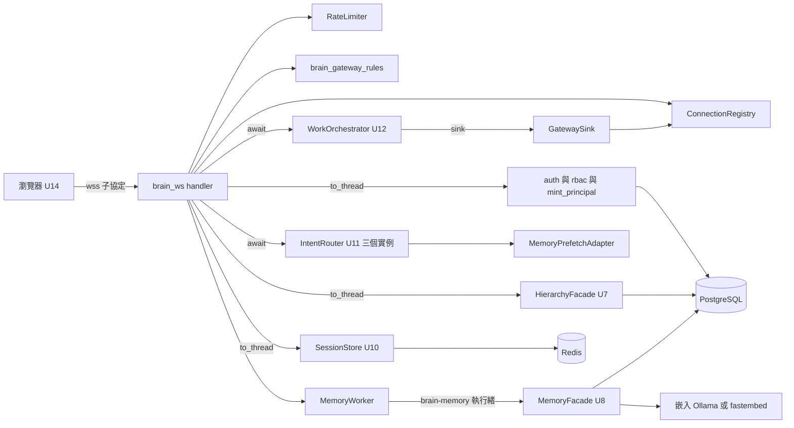

# 邏輯元件 — `U13 brain-gateway`

> 本檔是本站設計的元件總表、依賴圖、共享資源與爆炸半徑、`NFR13.39`–`NFR13.44` 的落點、帶入清單 1–17 的處置總表，以及本站
> 新增的開放項。

## 一、元件清單

| 元件 | 模組 | 職責 | 執行緒 | 失效範圍 |
|---|---|---|---|---|
| `brain_ws`（handler） | `backend/services/brain_gateway.py` | 佔位、握手、hello、載入、drain、接收迴圈、每輪流程 | 事件迴圈 | 單一連線 |
| `BrainGateway` | 同上 | 行程內唯一的組裝物件，掛在 `app.state.brain_gateway`；持有下列元件與 `GatewayTiming`、`session_factory` | — | 整個大腦端點 |
| `ConnectionRegistry` | 同上 | 全域／每 key 佔位計數、已登錄連線清單（`scalability-design.md` §一） | 迴圈獨佔 | 全部連線 |
| `Connection` | 同上 | token、principal、phase、`pending`、`send_lock`、`dead`、`overflowed`、`revalidate_task`、`PendingClarify` | 迴圈獨佔 | 單一連線 |
| `GatewaySink` | 同上 | `emit_session`／`emit_in_turn`／`emit_turn`（`U12` 呼叫） | 迴圈 | 單一 session key |
| `RateLimiter` | 同上 | 每 key、每連線滑動窗 | 迴圈獨佔 | 單一 key／連線 |
| `MemoryWorker` | 同上 | 專用執行器（4 執行緒）＋`BoundedSemaphore(4)`＋熔斷呼叫端 | 迴圈＋`brain-memory_*` | 記憶預取與 episodic（全部使用者共用） |
| `MemoryPrefetchAdapter` | 同上 | 注入 `U11` 的 `memory_facade`；只讀 `ContextVar`，無 I/O | 迴圈 | 單一輪 |
| `GatewayTiming` | 同上 | `monotonic`／`sleep`／`wait_for` 注入點 | — | — |
| 純函式與純狀態機 | `backend/services/brain_gateway_rules.py` | `parse_subprotocol_offer`、`session_key_for`、`resolve_segment`、`TurnLedger`、`error_for`、`match_referent`、`scan_targets_in_utterance`、`is_transient_memory_failure`、`BreakerState`、`norm` | 無 I/O | PBT 落點 |
| 啟動／關閉 | `backend/main.py` | startup 呼叫 `build_brain_gateway(app)`；新增 shutdown hook；移除 `brain_router` 兩處（`main.py:7`、`:111-112`） | — | 行程 |
| 契約增量 | `backend/services/brain_ws_contract.py` ＋ 衍生物 | C-1～C-7（`ADR-0020` 核可後） | — | `K-02`／`K-12` |

## 二、依賴與邊界

文字 fallback：瀏覽器以子協定連到 `brain_ws` handler。handler 使用行程內的 `ConnectionRegistry`、`RateLimiter` 與純函式模組；
以 `to_thread` 呼叫認證三連、`SessionStore`（再到 Redis）與 `HierarchyFacade`（再到 PostgreSQL）；以 `MemoryWorker` 的專用
執行緒呼叫 `MemoryFacade`（再到 PostgreSQL 與嵌入提供者）；以 `await` 呼叫三個 `IntentRouter` 實例（它們只經
`MemoryPrefetchAdapter` 讀預取結果）與 `WorkOrchestrator`；`WorkOrchestrator` 經 `GatewaySink` 把訊息送回登錄中的連線。

## 三、共享資源與爆炸半徑

| 共享資源 | 本單元的使用 | 爆炸半徑與上界 |
|---|---|---|
| 事件迴圈（同一 uvicorn 行程） | handler、sink、限流、熔斷皆在其上 | 本單元自身無同步 I/O（`performance-design.md` §三）；殘留：`U12` 對 `SessionStore` 的同步呼叫（`OPEN-GW13-4`，最壞約 3.3 秒，影響整個行程） |
| `asyncio.to_thread` 預設執行緒池 | 認證、session、目錄 | 與全後端共用；池大小 `min(32, CPU+4)`（Python 預設，依主機而定）。Redis 不可用時每次 `load` 佔一條執行緒至多約 3.3 秒；上界由頻率限制（每 key 20 則／分）與連線上限（200）間接給出 |
| `brain-memory` 執行器（4 條） | 預取、episodic | 只影響記憶；滿時跳過而不排隊（`performance-design.md` §3.2）；熔斷為全域，開啟 30 秒期間全部使用者分類不帶記憶 |
| SQLAlchemy 連線池 | `_auth_once`、`_build_catalog`、記憶 | 預設 5＋10（`backend/database.py:37` 未設參數）；每次為短交易 |
| Redis session key | 經 `SessionStore` | 單一使用者；TTL 與原子性屬 `U10` |
| 行程記憶體 | 登錄、暫存佇列、限流 deque | 連線 ≤ 200、每條暫存 ≤ 256 則、每 key deque ≤ 20、每連線 deque ≤ 120；單則 `work_items` 大小未量化（`OPEN-GW13-19`） |

## 四、技術選型的落點（`NFR13.39`–`NFR13.44`）

| id | 做法 | 檢查 |
|---|---|---|
| `NFR13.39` | 零新套件：`ThreadPoolExecutor`、`BoundedSemaphore`、`deque`、`ContextVar` 皆標準函式庫；`httpx`、`PyYAML`、`hypothesis` 已在 `requirements.txt` | `git diff backend/requirements.txt frontend/package.json` 無新增依賴行 |
| `NFR13.40` | 一切送出經 `Connection.send_direct(model)`，參數型別為 `brain_ws_contract` 的模型，以 `model_dump_json(by_alias=True)` 序列化；不接受 dict | `security-design.md` §六 檢查 2（無 `"type"` 鍵的 dict 字面）；送出替身對每則做 `WsEnvelope.model_validate` |
| `NFR13.41` | C-1～C-7 依 `functional-spec.md` §十一落地；`ADR-0020` 核可為前置關卡（`OPEN-GW13-1`），依賴它的規則在核可前不合併 | CI `dump_ws_contract.py --check`、`npm run check:ws-types` |
| `NFR13.42` | 五個 PBT 函式 ＋ 本站新增的兩個純狀態機（`BreakerState`、`RateLimiter.admit` 的窗性質，見 `reliability-design.md` §3.2、`scalability-design.md` §三）；性質五用 `reliability-design.md` §7.4 的版本 | 每函式至少一個 `@given`；突變靶見各節 |
| `NFR13.43` | 同一 PR 改寫 `LOCAL-DEV.md:23` 的 Redis 列、補啟動拒絕條件、改寫 `:79` 註解（帶入項 6） | `LOCAL-DEV.md` 內「session 相關功能不可用」0 次、含 `REDIS_USER=default` |
| `NFR13.44` | 全部數值為模組常數（本站新增 `SEND_TIMEOUT_SEC`、`EPISODIC_WAIT_SEC` 的算式亦然）；環境變數只讀三個 Redis 變數（在 `build_brain_gateway`） | AST：本單元 `os.environ`／`os.getenv` 的鍵集合 ⊆ {`REDIS_URL`,`REDIS_USER`,`REDIS_PASSWORD`}；`validate_env_contract.py` 綠 |

## 五、帶入清單 1–17 的處置（`../carried-review-items.md`）

| # | 項目 | 處置 | 落點 |
|---|---|---|---|
| 1 | 最長完整名稱比對、命中一律反問 | **本站定為設計** | `reliability-design.md` §7.2 |
| 2 | 性質五可失敗、同名處置統一 | **本站定為設計** | `reliability-design.md` §7.1、§7.3、§7.4 |
| 3 | 佇列取空到 ready 無 `await` | **本站定為設計**（順序測試留 code-generation） | `reliability-design.md` §六 |
| 4 | 專案超過 50 的句型 | **本站定為設計**；`traceability.json`（functional-design）`AC1.1.5` 註記的更新**留給 code-generation** | `reliability-design.md` §7.5 |
| 5 | 熔斷範圍、3 秒實測、執行器上限 | 熔斷範圍與執行器上限**本站定為設計**；3 秒的實測值**留給 code-generation**（本站定量測程序與算式） | `reliability-design.md` §三；`performance-design.md` §3.2、§四 |
| 6 | `LOCAL-DEV.md` 同步 | **留給 code-generation**（文字回補） | 本檔 §四 `NFR13.43` |
| 7 | 握手一開始即佔位、併發測試 | **本站定為設計**（資料結構、釋放時機、測試形狀） | `scalability-design.md` §一 |
| 8 | 熔斷認 `EmbeddingProviderUnavailable` 包裝的逾時／連線類；15 秒落差 | **本站定為設計** | `reliability-design.md` §3.1、§3.3 |
| 9 | 注入 clock／sleep | **本站定為設計**（並擴及 `wait_for`） | `reliability-design.md` §一 |
| 10 | `U14` 退避義務補進 functional-spec §十一之四 | **留給 code-generation**（文字回補；本站不改已核可的 functional-design） | — |
| 11 | 性質 (c) 排除不同專案的同名對象 | **本站定為設計** | `reliability-design.md` §7.2 步驟 3、§7.4 (c) |
| 12 | code-summary 列出取代關係 | **留給 code-generation**（文字回補）；本站新增的取代關係另見下表 §六 | — |
| 13 | 「專案太多」只在確實指名時出現 | **本站定為設計** | `reliability-design.md` §7.5 |
| 14 | P50 不可相加、量測落點明寫 | **本站定為設計**（各段獨立預算的表述）；上游 NFR 檔字面回補**留給 code-generation** | `performance-design.md` §一 |
| 15 | 在途上限以實際執行緒完成計數 | **本站定為設計** | `performance-design.md` §3.2 |
| 16 | 單行程守門另查 `WEB_CONCURRENCY`／`UVICORN_WORKERS` | **本站定為設計**（檢查範圍與方式）；測試實作留 code-generation | `reliability-design.md` §九 |
| 17 | 第 11 條連線關閉最舊者 | **出題待使用者裁決**：帶入清單的轉述（關閉最舊者）比審查 R-11 原文多走一步、與已核可 `[GWN1]`=A 字面衝突；殘留窗口的估算與「已斷線未清的登錄」的釋放機制本站定為設計 | `nfr-design-questions.md` `[GWND1]`；`scalability-design.md` §1.4、§1.5 |

## 六、本站對上游文字的取代關係（供 code-generation 寫進 `code-summary.md`）

| 上游 | 本站 | 性質 |
|---|---|---|
| `BR67.12`「任一次預取或寫入逾時或拋例外 → 開啟」 | 只認 §3.1 的暫時性例外（`NFR13.25` 已收窄，本站定義判定函式） | 收窄 |
| `BR67.12` episodic 等待 15 秒 | `EMBEDDING_TIMEOUT_SEC + 5.0`（預設值相同） | 推廣 |
| `BR64.13`「子字串」「同一專案下系統命中時專案名不另計」 | §7.2 的最長完整名稱與吸收規則 | 取代 |
| `NFR13.28` (c)「任兩個對象的名稱區間互不完全覆蓋」 | §7.4 (c)（排除同名、以「存在一個未被覆蓋的區間」表述） | 精確化 |
| `NFR13.1` 預算表的加總算式 | 各段獨立預算，不主張相加 | 表述更正 |
| `NFR13.17` 計數對象「登錄連線數」 | 佔位數（含正在認證的握手） | 擴大 |
| `NFR13.21` 判準 ① 的 `list_systems` 0 次 | 已選專案時另呼叫 1 次 `list_systems(selected)`（判準 ① 的前提是未選定，不衝突；判準 ② 由此成立） | 補明 |

## 七、本站新增的開放項

| # | 事項 | 承接 |
|---|---|---|
| `OPEN-GW13-17` | 原句掃描命中單一對象時也送 `clarify{kind:"target"}`（`NFR13.27`），候選只有一個；客戶端回 `candidateId: null` 即該輪 `ended_silent`。`U14` 必須在 `kind=="target"` 的反問上提供「不是這個」的回絕操作，否則使用者只能選唯一候選 | `U14`（配合事項，與帶入項 10 同批補進 functional-spec §十一之四） |
| `OPEN-GW13-18` | 本機預設 `fulltext` 使每個有交辦的輪次產生一筆 `episodic_write_failed` WARNING（`observability-design.md` §三） | 核可關卡揭露；若嫌吵，由 `U8` 在 `fulltext` 下提供明確的「不支援」例外以便本單元降為 DEBUG（非阻擋） |
| `OPEN-GW13-19` | 載入期暫存佇列的最壞記憶體未量化：單則 `work_items` 的大小由 `U12` 工作項數決定，上游無上限 | `build-and-test` 量測；或 `U12` 下一次修訂設工作項數上限 |
| `OPEN-GW13-20` | 熔斷判定依賴 `U6` 以 `raise … from exc` 保留 httpx 例外（`embedding_port.py:614-618`）。`U6` 若改成不帶 `__cause__`，熔斷將永不由嵌入逾時開啟（只剩本單元的 `TimeoutError`），且不會有任何測試因此失敗 | code-generation 加一條「契約測試」：以真實 `OllamaAdapter` 對不可達端點呼叫一次，斷言拋出的例外鏈含 `httpx` 連線類 |
| `OPEN-GW13-21` | `[GWND1]`：每 key 第 11 條連線的處置 | 使用者裁決（本站問題檔） |
