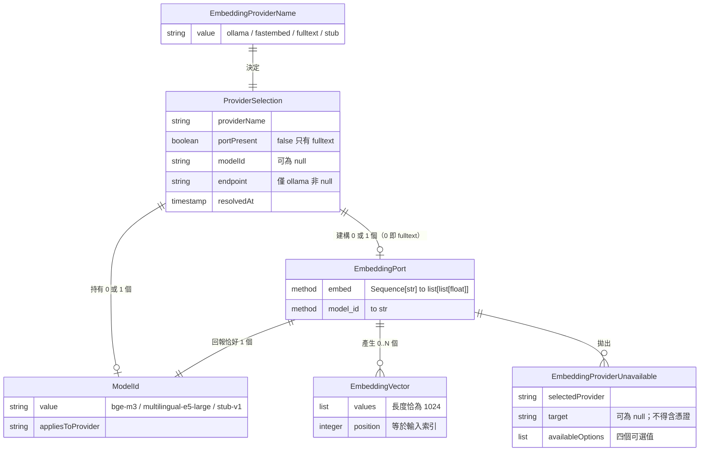

# Functional Specification — `U6 embedding-port`（`library`）

> 本檔是**工作流程與狀態機的真實來源**。
> 其中的 ER 圖由 `entities.md` 的 YAML **衍生**、規則摘要由 `rules.md` 的 YAML **衍生**
> ——兩者的真實來源在那兩個檔，本檔只是為了可讀性而重述。

## 〇、這個單元在做什麼

`U6 embedding-port` 交付一個 Port 與它的三個實作，讓 `U8 memory-service` 能把文字變成
1024 維向量、並取得該向量所屬的**向量空間身分**（`model_id`）。它是 `library`
——沒有獨立執行期、沒有端點、不讀 DB、不碰授權。

唯一指派給本單元的故事是 `US4.1`（`unit-of-work-story-map.md:111` 逐字「U6 embedding-port | `US4.1` | 1」），
而該故事的三條 AC **沒有一條能由本單元單獨滿足**——它與 `U5 memory-data`、
`U8 memory-service` 共享（`:52`）。這件事在 `traceability.json` 以 `Deferred` 如實表達，
不以 `OK` 虛報，見 §九。

## 一、工作流程（**本檔為真實來源**）

### W1 啟動時的提供者解析

| # | 步驟 | 失敗時 | 規則 |
|---|---|---|---|
| 1 | 讀 `EMBEDDING_PROVIDER` | 未設定或空字串 → **終止啟動**，訊息含「未設定」與四個合法值 | `BR1.1` |
| 2 | 驗值在 `{ollama, fastembed, fulltext, stub}` 內 | 不在集合內 → **終止啟動**，訊息含讀到的值與四個合法值 | `BR1.1` |
| 3 | 依提供者驗其必填變數：`ollama` → `OLLAMA_BASE_URL` 必填 | 缺值 → **終止啟動** | `BR1.3` |
| 4 | 若 `providerName == fulltext`：`portPresent = false`、`modelId = null`、回傳「無 Port」 | — | `BR1.4` |
| 5 | 否則建構該提供者的 Port 物件，**只讀設定、不發 HTTP、不載入模型** | — | `BR1.5` |
| 6 | 解析 `modelId`：`ollama` ← `OLLAMA_EMBED_MODEL`（預設 `bge-m3`）；`fastembed` ← `FASTEMBED_MODEL`（預設 `multilingual-e5-large`）；`stub` ← 固定 `stub-v1` | — | `BR3.1` |
| 7 | 記一條 INFO：providerName、modelId（或「無 Port（fulltext）」）、endpoint 主機與埠（**不含憑證**） | — | `BR7.1`、`BR7.2` |

**第 5 步是本流程最容易被寫錯的一步**，所以把理由放在這裡而不只放在規則裡：
啟動時探測看起來更安全，但 `deploy/docker-compose.test.yml:18` 逐字
「NO ollama. `EMBEDDING_PROVIDER` is `stub` instead」——CI 的短生命週期 stack
根本沒有 ollama 服務；而 `deploy/.env.example:123` 逐字「模型**不會**因為容器啟動就出現：
deploy.yml 會在 `up -d` 之後跑一次 `ollama pull`」——啟動探測會讓每次部署在模型就位前就紅燈，
然後觸發自動 rollback 與 revert PR。**兩條都是已查證的既有事實，不是推測。**

### W2 首次 `embed` 的可用性驗證

| # | 步驟 | 失敗時 | 規則 |
|---|---|---|---|
| 1 | 若 `texts` 為空 → 直接回 `[]`，**不**接觸外部 | — | `BR2.4` |
| 2 | `fastembed`：於函式內 `import fastembed`（lazy） | `ImportError` → 拋 `EmbeddingProviderUnavailable`，`target` 含模型名與 `pip install fastembed` | `BR4.3`、`BR6.1` |
| 3 | `ollama`：以既有 `httpx` 對 `endpoint` 發請求 | 連線失敗／模型未就緒 → 拋 `EmbeddingProviderUnavailable`，`target` 為 endpoint（去除 userinfo） | `BR4.1`、`BR4.4`、`BR6.2` |
| 4 | `stub`：以決定性演算法產生向量 | 不可能失敗（無外部依賴） | `BR2.3` |
| 5 | 任一元素失敗 → **整批**拋例外，不回部分結果、不以零向量填補 | — | `BR2.5` |
| 6 | 成功 → 回傳長度等於 `len(texts)`、每個恰 1024 維的 list | — | `BR2.1`、`BR2.2` |
| 7 | **不重試**；重試上限由呼叫方設定 | — | `BR2.6` |

例外的三個欄位皆為契約的一部分（`selectedProvider`、`target`、`availableOptions`），
其中 `availableOptions` 恆為四個可選值——那是 ADR-008「**列出可選值**」唯一可機械斷言的落點。

### W3 無 Port（`fulltext`）時呼叫方的分支

本單元在此流程中的角色只有一件事：**讓呼叫方拿不到 Port 物件**（`BR1.4`）。

| # | 步驟 | 誰負責 |
|---|---|---|
| 1 | 取得選擇器的回傳 → 空值 | 本單元交付 |
| 2 | 走全文檢索分支，不呼叫 `embed` | `U8`（本單元不涉入） |
| 3 | 寫入記憶時，向量欄位與 `embeddingModel` **同時**為 `NULL` | `U8`（`BR3.4`，見交接 `H-E2`） |

**這一列的第 3 步是本單元宣告、但由別人執行的不變量**——本 Port 不讀 DB，
所以它在本單元的測試裡驗不到。如實記於 `rules.md §三` 與 §九，不列為已覆蓋。

### W4 兩份清單的一致性檢查（測試期，非執行期）

`components.md:432-434` 把這件事逐字指派本站：「其一致性需要一個測試鎖住
——列為 `functional-design` 的注意事項」。

| # | 步驟 |
|---|---|
| 1 | 令 `I` = 每個 `portPresent` 實作在其**預設設定**下 `model_id()` 的值 |
| 2 | 令 `S` = `memory_records.embeddingModel` 的合法值集合 ＼ `{NULL}` |
| 3 | 斷言 `I ⊆ S` **且** `S ⊆ I`（即 `I == S`） |
| 4 | 任一側漂移 → 測試紅燈 |

**為什麼雙向**：只驗 `I ⊆ S` 會讓 `S` 裡多出一個沒有實作產生的值而不被發現
——那個多出來的值會在資料層看起來像一個合法的向量空間，而實際上沒有任何程式會寫入它。

## 二、狀態機

`ProviderSelection` 的生命週期（**本檔為真實來源**）：

```
                    ┌──────────────┐
                    │   未解析      │  行程啟動前
                    └──────┬───────┘
                           │ W1 步驟 1–3
              ┌────────────┴────────────┐
              │                         │
       驗證不通過                   驗證通過
              │                         │
              ▼                   ┌─────┴──────┐
      ┌───────────────┐           │            │
      │  啟動失敗      │   portPresent=false  portPresent=true
      │ （行程終止）   │           │            │
      └───────────────┘           ▼            ▼
                        ┌──────────────┐ ┌──────────────┐
                        │  已解析／無 Port │ │ 已解析／有 Port │
                        │  （fulltext）  │ │  （未驗可用性） │
                        └──────────────┘ └──────┬───────┘
                               終態                │ W2 首次 embed
                                        ┌─────────┴─────────┐
                                        ▼                   ▼
                                ┌──────────────┐    ┌──────────────┐
                                │  Port 已就緒  │    │  Port 不可用   │
                                │   （終態）    │    │ 拋 Unavailable │
                                └──────────────┘    └──────┬───────┘
                                        ▲                   │
                                        └───────────────────┘
                                          下次呼叫可再試
                                        （本 Port 不自動重試，BR2.6）
```

**四個狀態，三條說明**：

1. **「已解析／有 Port（未驗可用性）」是一個真實的狀態，不是過渡**——`[Q3]`=A 的直接後果。
   行程可以在這個狀態下服務其他請求（本單元不阻擋啟動），只有觸碰記憶寫入／檢索才會
   進到下一步。
2. **「Port 不可用」不是終態**：下一次呼叫會再試一次（`BR2.6` 說本 Port 不重試，
   指的是**單次呼叫內**不重試；呼叫方的下一次呼叫是新的一次）。
3. **「已解析／無 Port」是終態且沒有失敗分支**——`fulltext` 沒有任何外部依賴可失敗。

## 三、衍生視圖：實體關係圖

> **衍生自 `entities.md` 的 YAML，該檔為真實來源。**
> 本圖已以 Mermaid 驗證器實際渲染通過（非只做語法目視檢查）。



**文字 fallback**（Mermaid 無法顯示時）：

- `EmbeddingProviderName`（四個合法設定值）**決定** 恰好一個 `ProviderSelection`。
- `ProviderSelection` **建構** 0 或 1 個 `EmbeddingPort`——**0 的那個情形就是 `fulltext`**，
  這個 `0..1` 是本模型裡唯一的 0..1，而它承載的正是 `[Q1]`=A 的定案。
- `ProviderSelection` **持有** 0 或 1 個 `ModelId`（與上一條同進退）。
- `EmbeddingPort` **回報** 恰好 1 個 `ModelId`，**產生** 0..N 個 `EmbeddingVector`
  （0 即 `embed([])`），並可**拋出** `EmbeddingProviderUnavailable`。
- `EmbeddingVector` **不**連到 `ModelId`——向量不攜帶模型身分，配對是呼叫方的責任（`BR5.2`）。

## 四、衍生視圖：規則摘要

> **衍生自 `rules.md` 的 YAML，該檔為真實來源。** 完整條文見該檔。

| 群組 | 管什麼 | 條數 | 代表條文 |
|---|---|---|---|
| `BR1.x` | 提供者選擇與啟動驗證 | 6 | `BR1.4`（`fulltext` ⇒ 無 Port）、`BR1.5`（啟動不探測） |
| `BR2.x` | `embed` 的契約 | 7 | `BR2.2`（恰 1024 維）、`BR2.5`（全有或全無） |
| `BR3.x` | `model_id` 與兩份清單的一致性 | 6 | `BR3.3`（**雙向一致性**）、`BR3.5`（提供者名不得當 `model_id`） |
| `BR4.x` | 大聲失敗 | 4 | `BR4.1`（訊息含四個可選值、不得靜默降級） |
| `BR5.x` | 本 Port 保證什麼、**不**保證什麼 | 2 | `BR5.1`（跨模型不被比較**不**由本 Port 保證） |
| `BR6.x` | 依賴策略 | 3 | `BR6.1`（`fastembed` 選用、lazy import） |
| `BR7.x` | 可觀測性 | 2 | `BR7.1`（啟動記一條 INFO） |

## 五、Property-based 測試的性質（ADR-0006 hard constraint 落點）

K-06 的 `pbt_note` 逐字「ADR-0006 的 property-based hard constraint 落點之一」，
`unit-of-work.md:261` 亦逐字「`U6 embedding-port` 含 property-based」。
**本站的職責是把「哪些性質」寫死，而不是留給實作者想**。

| # | 性質 | 承載規則 | 可在 CI 驗的實作 |
|---|---|---|---|
| `P1` | ∀ `texts`：`len(embed(texts)) == len(texts)` | `BR2.1` | `stub` |
| `P2` | ∀ `texts`、∀ `v ∈ embed(texts)`：`len(v) == 1024` | `BR2.2` | `stub` |
| `P3` | ∀ `texts`：`embed(texts) == embed(texts)`（決定性） | `BR2.3` | `stub` |
| `P4` | ∀ `texts`、∀ `i`：`embed(texts)[i] == embed([texts[i]])[0]`（**分批不變性**） | `BR2.1` | `stub` |
| `P5` | ∀ 實作：`model_id()` ∈ `S` **且** `S ⊆ I`（雙向） | `BR3.3` | 全部三個（純設定推導，不需服務） |
| `P6` | `embed([]) == []` 且不發出外部呼叫 | `BR2.4` | `stub` |

**`P4` 是這六個裡最有價值的一個**：批次與單筆結果必須相同，否則 `U8` 一次 embed 多筆
記憶所得的向量，與日後逐筆重新 embed 所得的不一致——而那個不一致**在資料上不可偵測**
（兩者都是合法的 1024 維向量）。它也只有 property-based 測試能有效涵蓋，
example-based 挑幾個字串驗不出批次大小的影響。

### 這一節誠實的部分

`P1`–`P4`、`P6` 對 **`ollama` 與 `fastembed` 不可在 CI 驗證**——需要服務在位或模型已下載，
而 test stack 逐字「NO ollama」。**本站不以「已涵蓋」記錄它們**，列為覆蓋缺口（§九 `OQ-E2`）。
`P5` 是例外：它只讀設定與實作宣告，三個實作都驗得到。

## 六、計數（**由腳本實算，不手寫**）

以下數字由一支解析 `rules.md` YAML 區塊的腳本輸出，在本檔定稿後重跑並比對：

| 項目 | 數 |
|---|---|
| 規則總數 | **30** |
| ── `constraint` | 13 |
| ── `policy` | 14 |
| ── `validation` | 2 |
| ── `calculation` | 1 |
| ── `authorization` | **0** |
| 群組數（`BR1`–`BR7`） | 7 |
| 規則摘要表列數 | 30（與 id 集合相等） |
| 重複 id | 0 |
| 實體數 | 6 |
| PBT 性質數 | 6 |

**`authorization` 為 0 不是漏寫**：K-06 的 `behaviour_semantics.authorization_responsibility`
逐字「無——本 Port 不碰授權，亦不讀 DB」，而 `BR2.7` 把它寫成可 grep 斷言的形式。

## 七、ADR-0006 security baseline 四面向（**自檢第七項**）

`project.md ## Mandated` 逐字要求「對每一項變更檢查 ADR-0006 的四個面向」，且
「涉及 IAM／權限矩陣／網路暴露／稽核記錄的變更，須在該 stage 產出中明列 security 影響與處置，
不得僅以『已有 ADR-0006』帶過」。**逐項判定，不留空白**：

| 面向 | 判定 | 理由與處置 |
|---|---|---|
| **IAM** | **不適用** | 本單元零端點、零角色、零 story id、不讀 DB。K-06 `authorization_responsibility` 逐字「無」。`BR2.7` 把它寫成可機械斷言的禁令（本單元模組不得 import DB session 型別或 RBAC 判定函式，grep 須為零）。**此判定與上游一致**：`contract-summary.md` K-06 同欄逐字相同 |
| **Encryption** | **適用（一處）** | `ollama` 實作對 `OLLAMA_BASE_URL` 發 **明文 HTTP**（現值 `http://ollama:11434`）。緩解是網段隔離而非傳輸加密——K-01 的 validation 逐字「主機名須為 compose 內部服務名；**對外暴露面必須為零**」，且 `deploy/.env.example:119` 的註解逐字「它的 HTTP API 零認證，網段隔離是它唯一的存取控制」。**本站不改這個決定**（它屬 `U1`／部署層），但如實記載：若 ollama 服務日後被 publish port，明文傳輸與零認證會同時成為問題。另 `BR4.4`／`BR7.2` 禁止例外訊息與 log 帶 userinfo |
| **Network exposure** | **適用** | 本單元**不新增任何對外端點**，但它是 ollama 服務的**唯一**消費端——**此為推論，非逐字引用**（審查 `R-01`）：K-01 的 `images_and_services` 區塊裡 `- service: ollama`（`contract-summary.md:151-155`）**沒有** `consumed_by` 欄位，該欄位只掛在四個 env 變數上（`:124`／`:130`／`:136`／`:142` 皆為 `consumed_by: [U6]`）；再加上 K-06 的 `owner: U6` 與 `implementations` 含 `ollama`，才推得「唯一消費端」。故「該服務不得 publish port」這條約束的實際驗證落在本單元的交付上。`BR1.5`（啟動不探測）另有一個網路面的副效果：backend 的啟動路徑不產生對 ollama 的連線，故啟動期的攻擊面不變 |
| **Audit logging** | **適用（弱）** | `BR7.1` 要求啟動時記一條含 providerName／modelId／endpoint 主機的 INFO——沒有它，`embeddingModel` 分群出問題時無法回答「這個行程跑的是哪個模型」。`BR7.2` 禁止憑證入 log。**記憶層本身的稽核（誰、何時、改了什麼）屬 `U8`**，不在本單元 |

**PBT hard constraint**（`project.md` 的第二條 hard constraint，與上表並列）：
**適用，且本單元就是落點**——K-06 `pbt_note` 逐字。六個性質已於 §五寫死，不留給實作者判斷。

## 八、送審前自檢（七項，逐項報告）

`project.md ## Mandated` 要求派 reviewer 前跑完六項自檢並**逐項報告結果**；
`units-generation:da0f010a` 把「逐項對照 ADR-0006 四面向 ＋ PBT」加為第七項。

| # | 自檢項 | 結果 |
|---|---|---|
| 1 | **可達性**——每條「偵測 X 狀態」的規則先驗 X 可達 | **通過，且其中一條的可達性高於預期**。`BR1.1`（設定缺失／非法）：env 變數可不設定 → 可達。`BR4.1`（提供者不可用）：ollama 服務可停 → 可達。`BR4.3`（`fastembed` 未安裝）：**`[Q4]`=A 讓它成為預設狀態**（不在 `requirements.txt`）→ 不只可達，是常態。`BR3.3`（兩份清單漂移）：任一側改值 → 可達。`BR1.4`（`fulltext` ⇒ 無 Port）：`backend/.env.example:119` 的本機預設就是 `fulltext` → 可達且是本機常態 |
| 2 | **契約端點三問**（每個欄位誰寫／誰讀／誰清；每個方法誰擁有／誰呼叫）——**範圍是整個 stage 的全部產出** | **通過，一處刻意分裂、兩處具名交接**。六個實體的三問表在 `entities.md §二`。`ModelId` 的「誰寫」刻意分成兩半（本單元產生值、`U8` 寫入 DB），因為本 Port 不讀 DB——這不是缺口而是職責邊界，但它讓 `BR3.4` 的驗證落在 `U8`（`H-E2`）。兩個方法（`embed`／`model_id`）的擁有者是本單元、呼叫者是 `U8`（K-06 `consumers` 逐字），**無孤兒契約** |
| 3 | **引用逐字核對**——每個來源標籤開檔驗證，分開驗事實與驗定位 | **通過，查出並修正一處定位錯**。13 處行號引用全部以 `sed -n` 逐一開檔比對內容：`components.md:432/433/434`、`backend/.env.example:119`、`deploy/.env.example:96/114/116/123/126`、`docker-compose.test.yml:18`、`database.py:214/230`、`unit-of-work.md:42` **全部命中**。修正一處：初稿寫 `deploy/.env.example:123-124`，實際該句完整落在 `:123`，已改為 `:123` |
| 4 | **檔案集合一致性**——同類單元之間 diff 產出檔清單 | **通過**。本單元 `kind: library`，依 `produces_kinds` 應產出 `entities`／`rules`／`functional-spec`／`traceability` 四件（`frontend-components` 僅 `ui`）。與已交付的 `brain-ws-contract`（`spec`）、`rbac-story-ids`（`spec`）比對，三者的檔案集合相同，無缺件 |
| 5 | **跨檔傳播**——列出改動的**事實**（非字串），每個事實用它的幾種表達形式各 grep 一次 | **通過**。本單元是全新產出，無「改動既有事實」。但有兩個事實在三份產出中各有表達形式，已逐一核對：（a）`fulltext ⇒ 無 Port` 出現在 `entities.md` 的 `0..1` 關係、`rules.md` 的 `BR1.4`、本檔的 W1 第 4 步與 §三 fallback——四處一致；（b）`model_id` 值域三值出現在 `entities.md` 的 `allowed_values`、`rules.md` 的 `BR3.1`、本檔 §三 的 ER 圖欄位——三處一致 |
| 6 | **可算的數字先算再寫** | **通過**。§六 的全部數字由腳本解析 `rules.md` 的 YAML 區塊輸出（30／13／14／2／1／0／7／30／0），**定稿後重跑比對**。實體數 6 與 PBT 性質數 6 亦為實數 |
| 7 | **逐項對照 ADR-0006 四面向 ＋ PBT hard constraint** | **通過**，見 §七。四面向逐項判定（不適用 1／適用 3），無空白；PBT 判定為適用且本單元即落點，六個性質已寫死。**IAM 那一格已與上游 K-06 同欄逐字比對**（依 `user-stories:d0658da6` 的教訓：與上游相反的判定比沒跑更糟） |

## 九、Assumptions & Open Questions

| # | 內容 | 狀態 |
|---|---|---|
| `A-E1` | `memory_records` 的 schema 尚未落地，故擴充 `embeddingModel` 值域的遷移成本為零 | **已實測，非假設**：`grep -rn 'memory_records\|embeddingModel' schema_rbac.sql schema.sql backend/models.py` 零命中；`construction/memory-data/` 不存在 |
| `A-E2` | `OLLAMA_EMBED_MODEL` 與 `FASTEMBED_MODEL` 維持 K-01 的「可設定」語意（非枚舉） | 假設。`[Q2]` 重選的理由建立在它之上。若日後改為枚舉，`BR3.5` 仍成立但其急迫性下降 |
| `OQ-E1` | `memory_records.embeddingModel` 的 schema 端約束形式（建議：非空字串 ＋ 應用層 `BR3.3` 雙向測試，**不要**寫成封閉 `CHECK`） | 承接：`U5 memory-data`（`H-E1`）。**尚未執行**，`construction/memory-data/` 不存在 |
| `OQ-E2` | `P1`–`P4`、`P6` 對 `ollama`／`fastembed` **無 CI 驗證路徑** | **無自然承接站**。test stack 逐字無 ollama，而加一個「需要真服務」的 CI job 是基礎設施決策，不由本 library 單元夾帶（與 `team.md` 拒絕前端測試框架的理由同形）。屆時判定 skip 的 conductor 須重新提交使用者，不得靜默落空 |
| `OQ-E3` | 向量是否需要 L2 正規化 | 不在本單元。K-06 未要求，且度量選擇屬 `U8` 的檢索設計。**本站刻意不預選**（`BR2.2` 只管維度） |
| `OQ-E4` | K-06 的 `implementations: [ollama, fastembed, fulltext, stub]` 在 `[Q1]`=A 之下應讀作「三個實作 ＋ 一個停用狀態」 | 承接：`U8` 的 `functional-design`（消費形狀）。**該站為 `CONDITIONAL`（審查 `R-02`）**——`stage-graph.json` 的 condition 逐字「Skip if simple logic changes with no new business logic」，故它可能被 skip。**轉移目標**：`U8` 的 `code-generation`（`ALWAYS`）；**若 `U8` 的 `functional-design` 被 skip，屆時判定 skip 的 conductor 須把本項重新提交給使用者**，不得靜默落空（`project.md` 的 `approval-handoff:e4b6b5c2`）。若 contract 要維持四者齊平則須回 `contract-design` 修訂（`H-E3`）。**本站不回改 `contract-summary.md`** |
