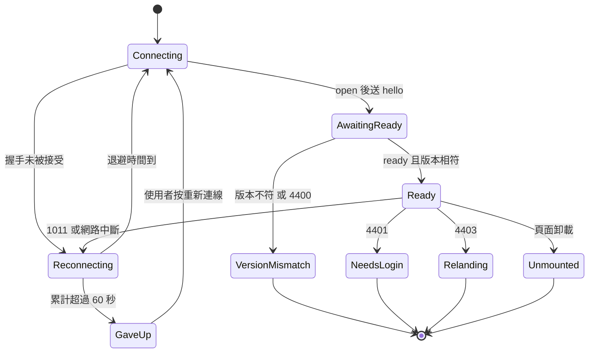

# Functional Spec — `U14 entry-page-ui`

> 建檔時間 2026-10-17T00:00:48Z；**修訂 1** 2026-10-17T01:51:41Z（皆以 `date -u` 取值）。
> 單元類型 `ui`（`unit-of-work.md:178`）。本檔是互動流程與狀態轉換的**正本**；規則正本在 `rules.md`
> （`BR91`–`BR98`，49 條），元件設計在 `frontend-components.md`。`entities.md` 不適用（`ui` 不在其
> `produces_kinds` 內）；本單元唯一的資料形狀變更是 §二之一的契約增量 C-8，其正本是 `U2` 的契約模組。
>
> **修訂 1 的來源**：第一輪審查 NOT-READY（4 Major、5 Minor），使用者裁決「重開、修進設計再審」；
> 另兩項使用者裁決（2026-10-17）：「最近的對話」移到另一個 intent；未歸屬系統的圖的名稱以 `U7` 新增唯讀方法取得。
> 逐項處置見 §十二。

## 零、上游來源（逐檔）

| 來源 | 用到什麼 |
|---|---|
| `inception/units-generation/unit-of-work.md:178-182` | 交付清單、驗證方式、依賴 |
| `inception/units-generation/unit-of-work-story-map.md:119` | 12 則故事 |
| `inception/user-stories/stories.md` | 47 條 AC（§十之一的實算） |
| `construction/deferred-ac-rulings.md:7-9` | `AC8.1.1`、`AC1.3.2`／`AC5.1.3`、`AC10.2.4` 的改寫 Then |
| `inception/refined-mockups/mockups.md` M0–M9、M16；`interaction-spec.md` | 畫面、狀態表、不變量 `INV-1`／`INV-3` |
| `ideation/rough-mockups/wireframes.md` §6、§19–§21 | 子頁面、Figma 關係、空狀態、最近的對話 |
| `inception/contract-design/contract-summary.md` K-02、K-12（`:911-917`）、K-13（`:1017-1060`） | 唯一通道、三頁各一條連線、掛載點與路由 |
| `frontend/src/types/ws-contract.d.ts` | 契約型別（`U2` 已交付） |
| `construction/brain-ws-contract/functional-design/rules.md:332-390` | 消費端規則 3.1–3.5 |
| `construction/brain-gateway/code-generation/code-summary.md:228-244` | `U13` 交接 11 項 |
| `construction/brain-gateway/functional-design/functional-spec.md:57-58`、`:452-457` | 輪次送達範圍；上線前不需升版的依據 |
| `construction/brain-gateway/infrastructure-design/cicd-pipeline.md:82-86` | CI 金鑰為空的後果 |
| `construction/work-orchestrator/functional-design/functional-spec.md:313` | `AC10.1.3` 的「取代」處置 |
| `construction/hierarchy-data/functional-design/traceability.json:18-20` | `AC9.1.2` 由 `U4` 承接 |
| `construction/memory-page-ui/code-generation/code-summary.md:89` | 記憶捷徑的共用判定 |
| `construction/session-store/nfr-requirements/nfr-requirements-questions.md:40-47`、`:83` | 「最近的對話」無主、24 小時 |
| `functional-design-questions.md` | `[EP1]`–`[EP6]` 全部為 A（2026-10-16T23:57:32Z）；EP2 的修訂 1 註記 |

## 一、這個單元要做什麼

1. **入口頁**（路由 `/`，`K1 view`）：頁首（含記憶捷徑）、脈絡列、常駐區、對話流（使用者原句、大腦訊息、
   反問候選、工作項清單、成本卡片）、輸入列、空狀態。
2. **落地與導覽**：`DefaultRedirect` 的 `K1` 判斷（`isPending` 之後、其他權限之前）、萬用路由、Sidebar「入口」項。
3. **兩個子頁面的掛載**：`/workspace` 與 `/assessment` 的脈絡列（含「改為獨立對話」）、「問大腦」面板（`[EP1]`=A）、
   頁面與作業對象的雙向同步（`[EP3]`=A，含就緒閘門與全部開圖／換圖／清除路徑）。
4. **對話紀錄 store**：應用程式層、記憶體、依段保存（`[EP4]`=A），含換頁卸載與 turnId 合併。
5. **契約增量 C-8**：`work_target` 帶三層名稱（`[EP2]`=A 與其修訂 1），改動 `U7`、`U2`、`U13` 三個單元。
6. **e2e**：兩層驗證，樁訊框由 `src` 之下的型別化建構器產生（`[EP6]`=A、審查 R-01）。

## 二、本站的定案及其後果

| 題 | 定案 | 後果（要改的程式） | 揭露 |
|---|---|---|---|
| `[EP1]`=A | 子頁面脈絡列下的「問大腦」面板；既有對話區不動 | 新元件；兩頁各一處掛載 | **偏離線框 §6 字面**（§八 D-1） |
| `[EP2]`=A（修訂 1 擴及 `U7`） | `work_target` 加三個名稱欄位，伺服器推送時以 `U7` 新方法帶出 | `U7` facade、`U2` 契約模組、`U13` 推送；ADR 草案（§二之一） | 重開三個已交付單元；名稱可能陳舊（`OPEN-EP14-16`） |
| `[EP3]`=A | 雙向同步，就緒後只判斷一次；之後以「選定的圖」狀態變化驅動回寫 | `WorkspacePage.tsx`、`AssessmentPage.tsx` 各加掛點 | 共享模式下子頁面換圖會改變入口頁的對象（設計意圖）；孤兒圖的 `AC2.2.1` 落空（`OPEN-EP14-17`） |
| `[EP4]`=A | App 層記憶體 store 依段保存 | 只有本單元 | 重新整理後對話區清空（§八 D-4） |
| `[EP5]`=A | 只做 A、C 兩張卡；「最近的對話」不做，移到另一 intent | 只有本單元 | **偏離線框 §20／§21**（§八 D-3） |
| `[EP6]`=A | 真實 stack ＋ `routeWebSocket` 兩層；樁訊框受 `tsc -b` 檢查 | 測試 ＋ `src/brain/testing/wsFrames.ts` | **偏離 `[US:U9]`=A 字面**（§八 D-2） |

### 二之一、契約增量 C-8：`work_target` 的三層名稱

**範圍：三個單元**——`U7`（新唯讀方法）、`U2`（契約欄位）、`U13`（推送）。提問時揭露的是「`U2`＋`U13`」；擴及 `U7`
是使用者 2026-10-17 的裁決（問題檔 EP2 的修訂 1 註記），不是本站自行擴大。

**1. 契約欄位**（`U2` 的 `brain_ws_contract.py` `WorkTargetPayload`，現行定義 `:282-302`）

| 欄位 | 型別 | 必填 | 預設 | 語意 |
|---|---|---|---|---|
| `projectName` | `str \| null` | 是（欄位必存在） | 無 | `projectId` 對應的名稱；`projectId` 為 null、查不到或查詢失敗時為 null |
| `systemName` | `str \| null` | 是 | 無 | 同上，對 `systemId` |
| `diagramName` | `str \| null` | 是 | 無 | 同上，對 `diagramId`；系統歸屬為 null 的圖亦有名稱 |

不給預設值：給預設會使產生的 TypeScript 欄位變成可選，前端多一個 `undefined`（`brain-gateway/functional-design/functional-spec.md:452-454`
對子協定欄位的同一理由）。

**2. `U7` 新增唯讀方法 `HierarchyFacade.describe_work_target`**

| 項目 | 定義 |
|---|---|
| 簽章 | `describe_work_target(principal, *, project_id=None, system_id=None, diagram_id=None) -> {"projectName", "systemName", "diagramName"}` |
| 授權 | 先 `_authorize(principal, "view")`（與同檔 `list_projects` 等方法相同）；`K2 view` 被撤銷時拋 `HierarchyForbidden`，由呼叫端處置 |
| 範圍 | 每個非 null 的識別碼各**一次主鍵查詢**，採與 `resolve_work_target` 相同的擁有者範圍（專案的 `owner_user_id`、系統所屬專案的擁有者、圖的 `user_id`；`hierarchy_service.py:89-96` 的判定形狀） |
| 查不到或不屬請求者 | 該層回 null，**不拋例外**——與 `resolve_work_target` 的「查不到即拋」不同，理由是顯示名稱不得讓寫入或連線失敗 |
| 孤兒圖 | 圖名直接取自圖的資料列，不經系統（這是使用者裁決要補的那一格） |
| 性質 | 唯讀、冪等、不寫稽核；服務層新增一個對應的純查詢函式 |
| 測試 | 自有三層 → 三個名稱；他人的專案／系統／圖 → 該層 null；孤兒圖 → `diagramName` 有值、其餘 null；`K2 view` 撤銷 → `HierarchyForbidden` |

選擇新方法而非組合既有的 `list_projects`／`list_systems`／`list_diagrams_of_system`（初版的寫法）：既有三者是全量列舉再過濾，
且孤兒圖查不到；另一個實測理由是 `U13` 的既有測試以假 facade 斷言 `list_systems` 的**呼叫次數**
（`tests/test_brain_gateway_turn.py:356` 的「list_systems 1 次」），名稱查詢若走 `list_systems` 會改變那些計數。

**3. `U13` 的改法**

| 位置 | 現況 | 改法 |
|---|---|---|
| 新增 `_names_for(principal, triples)` | — | `async`；一次 `asyncio.to_thread`、一個 DB session；對**去重後**的 (projectId, systemId, diagramId) 組合各呼叫一次 `describe_work_target`。**任何例外**（`HierarchyForbidden`、DB 例外、其他）→ 該組三個名稱皆 null，記一筆 WARNING `work_target_names_failed`（只記 connId 與例外類別名，符合既有 log 白名單），**不得往外拋** |
| `_work_target_envelope`（`brain_gateway.py:893-907`） | 同步，只組識別碼 | 仍為同步；新增 `names` 參數，由呼叫端傳入 |
| `_snapshot_envelopes`（`:869` 起，迴圈在 `:882-883`） | 同步，逐段呼叫 `_work_target_envelope` | 仍為同步；新增 `names_by_segment` 參數 |
| 握手快照（`:820-858`） | `load` 與 `list_items` 在同一個 try 內（`:822-829`），失敗即 1011（`except` 在 `:830`）；ready 與快照在第二個 try 內（`:840-853`，`except` 在 `:854`） | 在**第一個 try 之後、送 ready 之前**另呼叫 `_names_for`（最多 3 段，去重後通常 1 組）。因 `_names_for` 不拋例外，名稱查詢故障**不會**使握手 1011；故障時快照的名稱為 null，連線照常建立 |
| `_set_target_confirmed`（`:1301` 起，扇出在 `:1323`） | 寫入後扇出 | 寫入成功後 `await _names_for(conn.principal, [該段])`，再扇出 |
| `_on_set_work_target`（`:1403` 起，扇出在 `:1426`） | 同上 | 同上；寫入已成功，名稱失敗只使名稱為 null，扇出照常 |
| `_on_set_sharing_mode`（`:1428` 起，`fanout_many` 在 `:1445-1451`） | 扇出 sharing_mode ＋ 該段 work_target | 同上 |

名稱以觸發連線的 principal 查得；同一 session key 的全部連線屬同一使用者，可見範圍相同。每次推送 1 組、快照最多 3 組，每組最多 3 次主鍵查詢。

**4. 名稱的陳舊**：名稱不儲存，只在推送 `work_target` 時查。專案、系統或圖改名或刪除**不會**觸發推送，脈絡列顯示舊名直到下一次推送；
由於三頁各自一條連線，換頁或重新整理會重新收到快照。列為 `OPEN-EP14-16`。

**5. 協定版本維持 `v: 1`，與同批前置**：`brain-gateway/functional-design/functional-spec.md:456-457` 逐字「目前沒有已發布的客戶端
（唯一的客戶端是 DEMO 頁，與本單元同批移除或改寫，`OPEN-GW13-10`），升版只會增加協商成本而沒有相容對象。**`U14` 上線之後**，
任何不相容的增量都必須升版」。實測（2026-10-17）：`U13` 的 commit（`fa8ce42`）在本分支上、**尚未**進 `origin/ut`
（`origin/ut..HEAD` 共 89 個 commit），且示範後端已刪除（`backend/services/brain_router.py` 不存在）。
因此「同批」的依據是**同一分支、尚未合併**，不是保證。寫成可驗證的前置（code-generation 的合併前檢查，§八之三第 4 點）：
合併進 `ut` 的那一次，`origin/ut..HEAD` 必須同時含 `U13` 與 `U14` 的 commit，且 `ws-contract.json` 含 `projectName`。
**若 `U13` 先於 `U14` 進 `ut`**：C-8 必須隨 `U13` 一起出貨（前端此時沒有消費者，加欄位無害），否則 `U14` 上線時須升版——此條寫進 ADR。

**6. 落點與順序**：**本單元的 code-generation 一併承接**（先例：`U13` 的 code-generation 撰寫 `ADR-0020` 並改 `U2` 契約模組，
`brain-gateway/code-generation/code-generation-plan.md:28`）。順序：
① 撰寫 `<record>/inception/decisions/0022-*.md`（編號以撰寫當下目錄實況為準）並經人工核可（前置關卡）→
② `U7` 新方法與測試 → ③ `U2` 契約欄位、重跑規格 dump 與型別產生（兩道漂移閘門）→ ④ `U13` 改法與測試 → ⑤ 本單元前端。①–⑤ 同一次合併。

**7. ADR 草案要點**：Context＝`work_target` 只有識別碼、`U14` 唯一通道為 WS、畫面須顯示名稱、孤兒圖無既有讀法；
Decision＝本節第 1–3、5 點；Consequences＝`U7`／`U2`／`U13` 重開、每次推送多一組查詢、名稱可能陳舊、工作項標籤不受影響
（`OPEN-EP14-10`）；同批前置與「若 `U13` 先合併」的處置；Alternatives Rejected＝前端 HTTP（推翻 `contract-summary.md:916-917`）、
顯示識別碼、只從選單取名、組合既有列舉方法；Security＝同一 principal 與擁有者範圍、不擴大可見範圍、名稱不入 log。

**8. 需調整的既有測試**（實測 `grep`）

| 檔 | 位置 | 調整 |
|---|---|---|
| `tests/test_ws_contract.py` | `:69-74`（`_SERVER_PAYLOAD_SAMPLES` 的 `WORK_TARGET` 樣本）、`:320`（C-4 的最小樣本） | 補三個名稱欄位（null）；新增一案：缺任一名稱欄位即驗證失敗 |
| `tests/test_dump_ws_contract.py` | `:187`、`:205` 只碰 `SetWorkTargetPayload` | **不需改程式**；但已提交的 `ws-contract.json` 與 `ws-contract.d.ts` 須重產，否則漂移閘門紅燈 |
| `tests/brain_gateway_fakes.py` | 假 facade（`list_systems` 在 `:256`） | 新增 `describe_work_target` 的假實作（否則每次推送都走例外分支、名稱恆為 null） |
| `tests/test_brain_gateway_handshake.py` | `:198` 以 `boom` 取代 `_snapshot_envelopes` | 簽章改變不影響（`boom(*a, **k)`）；新增一案：`describe_work_target` 拋例外時握手仍完成、快照名稱為 null、log 有 `work_target_names_failed` |
| `tests/test_brain_gateway_turn.py` | `:356` 的 `list_systems` 次數、`:578` 的快照逐欄比對 | 不需改（名稱不走 `list_systems`；比對兩側皆含名稱）；新增一案：`set_work_target` 後扇出的 `work_target` 帶名稱 |
| `tests/test_brain_gateway_fanout.py` | `:283`、`:312`、`:315` 只比對 type 序列 | 不需改 |

## 三、畫面與路由

| 路由 | 元件 | 把關 | 本單元的改動 |
|---|---|---|---|
| `/`（`K1 view`） | `EntryPage` | `ProtectedRoute` ＋ `DefaultRedirect` 內的 `K1` 判斷（`BR91.1`） | 新增 |
| `/`（無 `K1`） | 既有瀑布 | 同上 | 不變（`BR91.2`） |
| `*` | `Navigate` 到 `/` | `ProtectedRoute` | 改（`BR91.3`） |
| `/workspace` | 既有 `WorkspacePage` ＋ `ContextBar` ＋ `SubpageBrainPanel` | 既有 `A1` | 掛載與同步掛點（`BR97.4`–`BR97.6`） |
| `/assessment` | 既有 `AssessmentPage` ＋ 同上 | 既有 `A3` | 同上 |
| Sidebar | 「入口」第一層獨立項置頂 | `K1 view` | 新增（`BR91.4`） |

加入「入口」後，全權限使用者的 Sidebar 可見列為 3 個群組標題 ＋ 入口 ＋ 專案 ＋ 我的記憶 ＝ **6**，未超過 7 項上限。

## 四、資料來源（全部經大腦連線，`BR98.5`）

| 方向 | 訊息 | 本單元的用途 | 規則 |
|---|---|---|---|
| 送 | `hello` | 握手 | `BR92.2` |
| 收 | `ready` | 核對 `protocolVersion` | `BR92.2` |
| 送 | `user_message{text, page}` | 送出需求 | `BR92.3` |
| 收 | `token`／`done`／`error` | 一則大腦訊息的內容與終止 | `BR93.1`–`BR93.3`、`BR93.7`、`BR92.6` |
| 收 | `clarify{kind, candidates}` | 反問 | `BR95.1`–`BR95.3` |
| 送 | `select_clarify_candidate{candidateId}` | 選定或回絕 | `BR95.4`、`BR95.5` |
| 收 | `work_items{items}` | 工作項集合（整份取代） | `BR94.1` |
| 送 | `correct_work_item{workItemId}` | 不是這個 | `BR94.4` |
| 收 | `cost_card` | 成本卡片 | `BR96.1` |
| 收 | `work_target{…, segment, 三個名稱}` | 脈絡列、首次對齊、提示 | `BR92.4`、`BR97.2`、`BR97.5` |
| 送 | `set_work_target{…, segment}` | 子頁面回寫、`U16` 選單 | `BR97.6`、`BR97.7` |
| 收 | `sharing_mode{mode, scope}` | 子頁面模式 | `BR92.4`、`BR97.3` |
| 送 | `set_sharing_mode{mode, scope}` | 改為獨立／切回共享 | `BR97.3` |

## 五、互動流程（numbered step sequences — 正本）

### W1. 落地
1. 使用者造訪 `/`。2. `isLoading` → 不渲染。3. `isPending` → `/waiting-approval`。4. `can('K1','view')` → 渲染 `EntryPage`。
5. 否則既有瀑布，最後 `/403`。（`BR91.1`、`BR91.2`）

### W2. 開啟入口頁
1. 掛載 → 開連線（`BR92.1`）→ 送 `hello` → 收 `ready` 並核對版本（`BR92.2`）。
2. 伺服器推送 `sharing_mode`（入口頁忽略）、各段的 `work_target`（只套用 `shared`）、`work_items`。
3. 共享段紀錄為空 → 顯示空狀態（`BR98.1`）；為空但作業對象或工作項非空 → 另顯示「先前的對話大腦仍記得…」一行（`BR93.4`）。
4. 輸入列在 ready 後啟用。

### W3. 說出需求並被交辦
1. 使用者送出 → 本地附加使用者原句、`awaitingReply=true`（`BR93.3`）、送 `user_message{page:"entry"}`。
2. 收到新 turnId 的 `token` → 新建大腦訊息並逐訊框附加（`BR93.1`）；turnId 已在 store → 合併進原訊息（`BR93.7`）。
3. 若伺服器更新作業對象 → 收 `work_target` → 脈絡列更新（`BR97.2`）。
4. 收 `work_items` → 常駐區與對話流同時出現工作項，對話流錨定在當下最後一則大腦訊息（`BR94.1`、`BR94.5`）。
5. 收 `done` → 該則定稿、播報（`BR93.6`）、`awaitingReply=false`。

### W4. 反問
1. 收 `clarify` → 依 `kind` 呈現（`BR95.1`／`BR95.2`），不顯示信心值。
2a. 選定 → 送 `select_clarify_candidate{id}`，該組 picking → 接 W3 第 2 步。
2b. 回絕 → 送 `candidateId:null`，該組停用、焦點回輸入列，脈絡列不變（`BR95.5`）。
2c. 直接輸入新句 → 舊組轉 stale，接 W3。

### W5. 逐項導回
1. 使用者按某項的「不是這個」→ 送 `correct_work_item`，該鈕停用（`BR94.4`）。
2. 收 `work_items` → 該項轉已停掉並依 `sideEffect` 說明；未依賴者不變；改交的新項出現（`BR94.3`、`BR94.5`）。

### W6. 成本問答
1. 同 W3；成本工作項為處理中，交辦當下的回覆照常顯示（`BR93.1`、`BR94.7`）。
2. 完成 → 收 `work_items`（轉完成）與伺服器發起輪次的 `cost_card` → 卡片附在其後（`BR96.1`、`BR93.5`；與 `AC10.1.3`「取代」的差異見 D-7）。
3. 逾時或失敗 → 工作項轉失敗並顯示不同的原因（`BR96.2`）；無權限 → 同路徑顯示權限說明（`BR96.4`）。
4. 全程不自動導航（`BR96.3`）。

### W7. 進入子頁面（含就緒閘門，審查 R-02）
1. 掛載脈絡列與「問大腦」面板（收合），開連線（`BR92.1`）；頁面自己的既有載入同時進行（`/workspace`：先 `fetchDiagrams` 再 bootstrap，`WorkspacePage.tsx:269-301`；`/assessment`：圖清單請求）。
2. 收 `sharing_mode{scope=本頁}` → 決定本頁所讀段（shared 或頁名）。
3. 收到本頁所讀段的 `work_target` → **立即**更新脈絡列；若頁面尚未就緒，把它存為 `pendingInitialTarget`（後到覆蓋先到），首次對齊旗標不消耗。
4. 頁面就緒（`bootstrapDone`；評核頁為「清單請求已結束」）→ 若已有 `pendingInitialTarget`（**快照先到**）立即做首次對齊；否則等首筆 `work_target`（**快照後到**）到達時做。
5. 首次對齊只做一次（`BR97.5` 的 (1)–(3)），之後旗標消耗：網址參數優先 → 自有且不同的目標圖則改開 → 否則交 W8 以目前開啟的圖回寫。
6. 之後的 `work_target` 只更新脈絡列；等於目前開啟的圖或等於本頁最近一次送出值（回聲）者不提示，其餘顯示「作業對象已改為 <名稱>」＋「開啟這張圖」。

### W8. 子頁面選定的圖改變（狀態驅動，審查 R-03）

| 路徑 | 位置 | 行為（`BR97.6`） |
|---|---|---|
| bootstrap 開上次的圖 | `WorkspacePage.tsx:282` | 首次對齊 (3) 的對象：自有且不等於目標 → 回寫 |
| 下拉改選 | `WorkspacePage.tsx:313`（`handleLoadDiagram`）；`AssessmentPage.tsx:1268` | 自有 → 回寫；非自有 → 說明、不送 |
| 儲存新圖 | `WorkspacePage.tsx:823`；`AssessmentPage.tsx:560`、`:743` | 新圖必為自有 → 回寫（新圖多為孤兒圖，見 `OPEN-EP14-17`） |
| 由 workspace 進 assessment | `WorkspacePage.tsx:441` → `AssessmentPage.tsx:238` 的 `urlDiagramId` | 首次對齊 (1)：網址參數優先，自有 → 回寫 |
| 新建空白畫布 | `WorkspacePage.tsx:333` | 不送；作業對象維持，顯示「目前畫布未存檔…」 |
| 刪除目前的圖 | `WorkspacePage.tsx:371`；`AssessmentPage.tsx:813` | 若被刪者等於作業對象的圖 → 送 `{projectId, systemId 取自目前 work_target, diagramId:null}`；否則不送 |

### W9. 改為獨立對話與切回
1. 按「改為獨立對話」→ 送 `set_sharing_mode{isolated, scope}`（`BR97.3`）。
2. 收 `sharing_mode` → 徽章改「獨立」，面板改顯示該頁段的紀錄（新段為空），脈絡列改顯示該段的 `work_target`（`BR97.8`）。
3. 面板送出的訊息帶 `page=本頁`（`BR92.3`）。
4. 按「切回共享對話」→ 同 1–2，面板改回共享段紀錄，與離開時相同。

### W10. 斷線、重連與換頁
1. 關閉碼分流（`BR92.5`）。2. 進行中的使用者輪次轉 interrupted，不自動重送（`BR92.7`）。
3. 重連成功 → hello／ready → 伺服器推送狀態覆蓋畫面；紀錄 store 保留。
4. **換頁（審查 R-05）**：頁面卸載的 cleanup 把本連線上未終止的輪次轉 interrupted（「你在回覆完成前離開了這一頁」，`BR93.7`）；
   新頁的連線若收到同一 turnId 的後續（伺服器發起的輪次送往全部存活連線，`brain-gateway/functional-design/functional-spec.md:58`），
   合併進原訊息並回到 streaming，不另建一則。

## 六、狀態機

### 六之一、連線（每頁一條）

文字 fallback：連線中 →（open，送 hello）等待 ready；連線中 →（握手未被接受）重連等待。等待 ready →（ready 且版本相符）可用；
等待 ready →（版本不符或 4400）版本不相容（終止、不重試）。可用 →（1011 或網路中斷）重連等待；重連等待 →（退避到）連線中；
重連等待 →（自第一次失敗起累計超過 60 秒）放棄，使用者按「重新連線」回到連線中。可用 →（4401）需重新登入（終止）；
可用 →（4403）重新落地（導 `/`，終止）；可用 →（頁面卸載）關閉（終止，未終止的輪次轉 interrupted）。

### 六之二、一則大腦訊息（以 turnId 為鍵，跨段唯一）

| 狀態 | 進入條件 | 離開 |
|---|---|---|
| streaming | 首見的 turnId 帶 `token` 或 `cost_card`；或 interrupted 的 turnId 又收到後續（`BR93.7`） | done／error／empty-stream／interrupted |
| done | 收到 `done` 且已有非空白內容或卡片 | 終態 |
| empty-stream | 收到 `done` 而無任何內容（防禦性，`BR93.2`） | 終態 |
| error | 收到 `error` | 終態 |
| interrupted | 連線關閉，**或頁面卸載**時尚未終止 | 同一 turnId 的後續到達 → streaming；使用者按重試 → 重送原句（新建一則） |

### 六之三、反問組

| 狀態 | 進入 | 離開 |
|---|---|---|
| default | 收到 `clarify` | 選定 → picking；回絕 → dismissed；新輸入 → stale |
| picking | 使用者選定 | 收到下一則訊息 → resolved |
| dismissed／stale／resolved | — | 終態（停用、淡化） |

### 六之四、脈絡列

| 狀態 | 條件 |
|---|---|
| connecting | 連線尚未 ready（骨架列） |
| no-object | 本頁所讀段的三個識別碼皆 null（「尚未選定」） |
| default | 至少一層非 null |
| independent | 子頁面且 `sharing_mode=isolated`（徽章「獨立」） |
| unavailable | 連線放棄或需重新登入（「無法載入作業對象」＋ 對應動作） |

`no-object` 的可達性：除首次使用外，session 24 小時到期亦使其可達（`ADR-005`，`session-store` 已核可）。

### 六之五、子頁面的首次對齊（`BR97.5`）

| 狀態 | 進入 | 離開 |
|---|---|---|
| waiting | 掛載 | 頁面就緒且有 pending → aligning；頁面就緒但無 pending → ready-no-target |
| ready-no-target | 就緒而尚無相符 work_target | 首筆相符 work_target → aligning |
| aligning | — | 做完 (1)–(3) 判斷 → aligned（旗標消耗） |
| aligned | — | 頁面卸載（旗標隨元件消失） |

## 七、衍生檢視

- **ER 圖**：不適用——`ui` 單元無 `entities.md`；C-8 的欄位正本在 `U2` 契約模組，`U7` 新方法的正本在 `U7` 的 facade（§二之一為摘要）。
- **規則摘要**：見 `rules.md` §三（八組 49 條）。

## 八、揭露事項與開放項

### 八之一、必須在關卡呈現的偏離（D）

| ID | 偏離 | 對照的已核可字面 | 理由 |
|---|---|---|---|
| D-1 | 子頁面是**兩個**對話面：既有設計對話 ＋「問大腦」面板 | 線框 §6（`wireframes.md:186-210`）只畫一個「對話」區，並寫「改為獨立對話後此區即脫離共享 session」 | `[EP1]`=A：照字面改接大腦需重寫兩個無測試保護的大頁面並危及 `AC8.1.4`；面板是唯一讓 `US3.1` 可觀察又不動 `A1` 的做法 |
| D-2 | e2e 打樁的是**伺服器**（`routeWebSocket`），不是 LLM；交辦類 AC 的真實鏈路（`U13 → U11 → U12`）不在 e2e 內 | `[US:U9]`=A（`stories.md:628-632`）「以既有的注入接縫打樁 LLM，讓 e2e……驗證行為（意圖被辨識、工作項被建立、狀態轉換正確）」 | `[EP6]`=A：後端沒有可切換的 LLM 樁（`cicd-pipeline.md:82-86`），補樁需重開 `U11` 且樁會隨正式映像出貨；後端交辦邏輯已由 `U11`／`U12`／`U13` 的 `TestClient` 驗證。樁與契約的漂移由 `src/brain/testing/wsFrames.ts` 受 `tsc -b` 檢查擋住（`BR98.4`）。**殘留**：「意圖被辨識」這一環在任何自動化層都只以替身驗證 |
| D-3 | 空狀態只有 A、C 兩張卡；不做「最近的對話」 | 線框 §20「八張能力卡」、§21／M16「最近的對話」 | `[EP5]`=A：大腦只能交辦三種能力（`intent_routing_types.py:50-54`）；最近的對話依使用者裁決移到另一 intent |
| D-4 | 重新整理、開新分頁、登出後畫面上的對話紀錄清空 | 無 AC 字面要求跨重新整理；`AC2.1.4` 的 Given 是 backend 重啟 | `[EP4]`=A：契約無歷程訊息，且不在瀏覽器儲存使用者原句 |
| D-5 | 成本卡片顯示三段文字與無法取價原因，不顯示總額與分項；連結文字以估價表編號具名 | `mockups.md` M3 的總額與分項、「連結具名該份估價」；`interaction-spec.md` 的 `brain-cost-card-total` | 已交付的 `CostCardPayload` 沒有這些欄位（`work_orchestrator.py:835-845`）；M3 的分項本身標為未查證（`mockups.md:548`） |
| D-6 | 意圖反問只顯示候選 `label`，不把 `capability` 譯成中文 | `U13` 交接第 5 項「`intent` 依候選的 label 與 capability」 | 避免前端複製能力名稱表（`team.md` 單一真實來源）；交接要防的「對象反問被畫成意圖選單」以兩種提示文字與回絕操作達成 |
| D-7 | 成本完成時，卡片**附在**該工作項之後，**不取代**原位置的進度表示 | `AC10.1.3`（`stories.md:489`）「該則進度訊息被**結構化卡片取代**」 | `CostCardPayload` 沒有 `workItemId`、`WorkItem` 沒有 `estimateSetId`，前端無從配對；`U12` 的已登錄處置（`work-orchestrator/functional-design/functional-spec.md:313`）逐字為「『取代』由 `U14` 以處理中標示轉完成＋卡片出現呈現」——本站照做，但它與 AC 字面不同，故列為偏離（審查 R-07）。要真正取代，需在契約加配對欄位 |

### 八之二、開放項

| ID | 事項 | 承接 |
|---|---|---|
| `OPEN-EP14-1` | 契約增量 C-8（§二之一）：ADR 撰寫與核可為本單元 code-generation 的前置關卡。**子項已裁決**（2026-10-17）：孤兒圖名稱以 `U7` 新增唯讀方法取得，範圍擴為 `U7`／`U2`／`U13` | 本單元 code-generation |
| `OPEN-EP14-2` | **「最近的對話」已裁決移到另一個 intent**（2026-10-17）：本 intent 不做。另開 intent 時須先定**對話的保存期限**（現行 session 24 小時，`session-store` 已核可）與**資料來源**（現行契約無對話清單、無「開新對話」訊息、無擁有單元） | 另開 intent 的候選需求 |
| `OPEN-EP14-3` | 伺服器發起輪次的 envelope 無段資訊；`BR93.5` 以接收頁目前讀取的段為落點（`BR93.7` 處理已在 store 的 turnId） | 下一次契約修訂（非阻擋） |
| `OPEN-EP14-4` | 契約無「這則 `user_message` 對應哪個 turnId」的關聯；`BR93.3` 以「任一輪終止」近似 | 下一次契約修訂（非阻擋） |
| `OPEN-EP14-5` | D-1 的關卡揭露 | 本站關卡 |
| `OPEN-EP14-6` | D-2 的關卡揭露；真實鏈路的交辦行為只能以 staging 的人工驗證或 `NFR1` 的量測路徑觀察 | 本站關卡；`tcms-test-cases` 覆蓋盤點時分桶並說明 |
| `OPEN-EP14-7` | D-3 的關卡揭露（六張卡不渲染） | 本站關卡 |
| `OPEN-EP14-8` | D-5 的關卡揭露 | 本站關卡 |
| `OPEN-EP14-9` | 別人分享的圖、或以成員身分可見的專案底下的圖，不能成為作業對象（擁有者範圍，`hierarchy_service.py:89-96`）；與 `U23` 放寬專案清單為「擁有者 ∪ 成員」不一致。本單元以說明文字呈現（`BR97.6` ②） | `U7` 的下一次修訂（非阻擋） |
| `OPEN-EP14-10` | 工作項標籤仍為「架構設計：架構圖 #12」（`work_orchestrator_rules.py:317-336`），C-8 不改它 | `U12` 的下一次修訂（非阻擋） |
| `OPEN-EP14-11` | 脈絡列展開態的「最後異動」無資料來源，本輪不顯示 | 無自然承接站（低價值，關卡揭露即可） |
| `OPEN-EP14-12` | 使用者在對話中**打字**說「不是這個」不會更正工作項（走一般分類）；`AC1.3.1` 以按鈕承載 | 關卡揭露 |
| `OPEN-EP14-13` | Cloudflare 兩跳的子協定透傳未實測（沿用 `OPEN-GW13-6`）；本單元 e2e 只涵蓋 nginx 一跳。部署後須實測入口頁可連線 | 部署後實測（`U13` 清單） |
| `OPEN-EP14-14` | D-6 的關卡揭露 | 本站關卡 |
| `OPEN-EP14-15` | 4401 時無 token 更新端點（`auth.py` 中 `refresh` 0 處），重新登入即清空對話紀錄（`BR93.4` 的 key 重設） | 關卡揭露 |
| `OPEN-EP14-16` | **名稱陳舊**（審查 R-04 (d)）：專案、系統、圖改名或刪除不觸發推送，脈絡列顯示舊名直到下一次推送（換頁、重新整理、對象變更） | 關卡揭露；若需即時，另開事件推送（非本 intent） |
| `OPEN-EP14-17` | **孤兒圖使 `AC2.2.1`「指向同一個系統」落空**（審查 R-03 (4)）：系統歸屬為 null 的圖回寫後，伺服器推導不出系統；脈絡列只顯示圖名。新建的圖多屬此類（`OPEN-H11`） | 關卡揭露；根治需新建圖時指派系統（`U7`／`U16` 的範圍，非本單元） |
| `OPEN-EP14-18` | D-7 的關卡揭露 | 本站關卡 |

### 八之三、交給本單元 code-generation 的清單

1. §二之一的 C-8 全部（ADR、`U7` 新方法、`U2` 欄位、`U13` 改法、§二之一第 8 點的測試調整、兩道漂移閘門）。
2. 前端：`App.tsx`（`DefaultRedirect`、`/`、`*`）、`Sidebar.tsx`（入口項）、新元件（見 `frontend-components.md`）、
   `WorkspacePage.tsx`／`AssessmentPage.tsx` 的掛載與同步掛點（就地沿用既有形狀，不夾帶重構；`AssessmentPage` 需新增「清單請求已結束」旗標）。
3. e2e：`frontend/tests/e2e/entry-page.spec.ts`（`BR98.4`），至少含：快照先到與後到各一案（`BR97.5`）、由 workspace 進 assessment 後入口頁脈絡列對象一致（`BR97.6`）、
   串流中換頁後同一輪不重複（`BR93.7`）、使用者自己開圖不出現「作業對象已改為」（`BR97.5`）；`src/brain/testing/wsFrames.ts`；
   突變驗證（契約欄位改名 → `npm run build` 紅）。既有 `regression.spec.ts` 必須保持綠燈。
4. **合併前檢查（可驗證，審查 R-09）**：合併進 `ut` 的那一次，`git log origin/ut..HEAD` 必須同時含 `U13` 與 `U14` 的 commit，
   且 `ws-contract.json` 含 `projectName`；不成立即停止並依 §二之一第 5 點處置。
5. 不觸發 `schema_rbac.sql`／`DEPLOY.md` 同步（無 DDL、無 seed 變更；`U7` 新方法為純查詢）；不新增環境變數。

## 九、ADR-0006 security baseline 與 PBT

### 九之一、四面向（逐格對照上游）

上游 `unit-of-work.md:245-252` 判定**四面向皆適用**，並只在 IAM 列點名 `U14`（「`K1` 置於 `DefaultRedirect` 瀑布之首，
皆不符者仍導 `/403`」）。本表四格皆判「適用」，與上游一致。

| 面向 | 判定 | 本單元的影響與處置 |
|---|---|---|
| **IAM** | **適用** | `K1` 判斷在 `isPending` 之後（`BR91.1`），對齊 `AC1.4.3` 的修正——上游 IAM 列的「瀑布之首」須讀為「權限判斷之首」；前端把關是**呈現**，真正的拒絕在 `U13`（握手 4403、每則訊息重驗）。不新增 story id、不改 seed。子頁面只回寫自己擁有的圖，伺服器端仍以擁有者範圍檢查（`BR97.6`）。`U7` 新方法先 `_authorize(view)` 再以擁有者範圍逐層查，他人資料回 null——**不擴大可見範圍**，也不因顯示而拋出可被用來探測存在性的不同結果（查不到與不屬於皆為 null） |
| **Encryption** | **適用** | 傳輸沿用 `U13` 的 `wss`；token 只在 `Sec-WebSocket-Protocol` 請求標頭、不進網址（`BR92.1`）。**靜態**：對話紀錄只在記憶體（`BR93.4`），刻意不寫瀏覽器儲存。C-8 不新增任何持久化（名稱不儲存） |
| **Network exposure** | **適用** | 本單元不新增對外端點；消費 `U13` 的唯一新增網路面。每分頁同時最多一條大腦連線，低於 `U13` 每人 10 條的上限；退避重連有上限且累計至少 60 秒（`BR92.5`）。本單元不新增 HTTP 呼叫（`BR98.5`）；`U7` 新方法只在進程內被 `U13` 呼叫，不新增路由 |
| **Audit logging** | **適用（本單元不新增稽核寫入）** | 活動時間由 `U13` 的 `record=True` 承擔（`AC8.1.2`）；子頁面回寫寫入的是 session 狀態，不屬稽核事件；`U7` 新方法唯讀不寫稽核。名稱查詢失敗的 log 只記 connId 與例外類別名，不記名稱或識別碼內容；瀏覽器主控台不記 token 與訊息內容（`BR92.8`） |

### 九之二、PBT hard constraint

**不適用**。ADR-0006 點名的三個核心模組（IaC generator、cost calculator、agent routing）本單元皆不觸及；C-8 改的是
`U13` 的推送、`U2` 的型別與 `U7` 的一個唯讀查詢，皆非 `U11` 的路由核心。前端沒有 unit 測試框架（`team.md` 的 D 不採），
本單元的純函式（工作項過濾、紀錄 store 的段切換與 turnId 合併、首次對齊的判斷）由 Playwright 以例子驗證。

## 十、七項自檢（送審前，修訂 1 現行）

| # | 項目 | 結果 |
|---|---|---|
| 1 | **可達性** | `empty-stream`：伺服器正常時不可達（`U13` 以 `EMPTY_RESPONSE` 取代零內容 `done`），保留理由為 `U2` 的規則 3.3，e2e 以 `routeWebSocket` 構造；`interrupted`：斷線**與換頁卸載**皆可達；interrupted → streaming：伺服器發起的輪次送往全部存活連線時可達（`functional-spec` 的 gateway 引用 `:58`），使用者輪次的後續只送原連線故不可達——規則仍需存在以免推播重複；`4403`、`4400`、`no-object`：同初版；「（無法顯示名稱）」：刪除後、他人資料、名稱查詢失敗可達（孤兒圖已由 `U7` 新方法補上，**不再**落此態）；首次對齊的 waiting → aligning：快照先到與後到兩條皆可達（`WorkspacePage.tsx:269-301` 的兩次 HTTP 先於或後於 WS 快照）；回聲抑制：使用者開圖 → 回寫 → 扇出回本頁，必然可達；`BR97.6` ③：刪除作業對象所指的圖可達；④：新建空白畫布可達 |
| 2 | **契約端點三問（整站）** | **新欄位** `projectName`／`systemName`／`diagramName`：寫＝`U13` 的 `_names_for`（經 `describe_work_target`）、讀＝`ContextBar` 與「作業對象已改為」提示、清＝不儲存（每次推送重查）。**新方法** `describe_work_target`：擁有者＝`U7`、呼叫者＝`U13` 的 `_names_for`（唯一）。**新方法** `_names_for`：擁有者＝`U13`、呼叫者＝握手快照與三個扇出點（共 4 處）。對話紀錄 store：寫＝訊息處理器、送出動作、卸載 cleanup（轉 interrupted）；讀＝入口頁對話流與子頁面面板；清＝使用者 key 改變（登出）與重新載入。turnId 對照：寫＝首見 turnId；讀＝`BR93.7` 合併；清＝同 store。工作項集合：寫＝`work_items`；讀＝常駐區與對話流；清＝伺服器（session 24 小時）。`awaitingReply`：寫＝送出；讀＝送出鈕；清＝任一輪終止、關閉、卸載。反問組：寫＝`clarify`；讀＝`ClarifyCandidates`；清＝選定／回絕／新輸入。`pendingInitialTarget`：寫＝就緒前的 `work_target`；讀＝首次對齊；清＝首次對齊完成或卸載。首次對齊旗標：寫＝對齊完成；讀＝`BR97.5`；清＝卸載。本頁最近一次送出值：寫＝`BR97.6` ①／③；讀＝回聲抑制；清＝卸載。評核頁「清單請求已結束」旗標：寫＝`fetchDiagrams` 的回呼；讀＝就緒閘門；清＝卸載。前端方法 `sendUserMessage`／`selectCandidate`／`correctWorkItem`／`setSharingMode`／`setWorkTarget`：擁有者 `useBrainConnection`，呼叫端見 `frontend-components.md` §三。**出現在少於兩處者逐一判定**：`setSharingMode`（只有子頁面脈絡列）＝內部方法、入口頁刻意不呼叫；`describe_work_target`（只有 `_names_for`）＝單一呼叫者的契約方法，非孤兒。**無孤兒** |
| 3 | **引用逐字核對** | 修訂 1 新增或改動的引用皆開檔核對內容與行號：`WorkspacePage.tsx:269-301`（bootstrap effect）、`:282`、`:297`（`setBootstrapDone(true)`）、`:304`（`handleLoadDiagram` 定義）、`:313`、`:333`、`:371`、`:441`、`:823`；`AssessmentPage.tsx:238`、`:560`、`:743`、`:813`、`:1268`；`brain_gateway.py:820-858`（其中 `:822-829`、`:830`、`:840-853`、`:854`）、`:869`、`:882-883`、`:893-907`、`:1301`、`:1323`、`:1403`、`:1426`、`:1428`、`:1445-1451`；`tests/test_ws_contract.py:69-74`、`:320`；`tests/test_dump_ws_contract.py:187`、`:205`；`tests/brain_gateway_fakes.py:256`；`tests/test_brain_gateway_handshake.py:198`；`tests/test_brain_gateway_turn.py:356`、`:578`；`tests/test_brain_gateway_fanout.py:283`、`:312`、`:315`；`work-orchestrator/functional-design/functional-spec.md:313`；`hierarchy-data/functional-design/traceability.json:18-20`；`brain-gateway/functional-design/functional-spec.md:57-58`、`:456-457`；`frontend/tsconfig.app.json:24`、`tsconfig.node.json:23`。初次寫入時 `handleLoadDiagram` 的定義行誤寫為 `:303`、bootstrap 範圍誤寫為 `:272-300`，已更正（審查員的 `:272-300` 指的是 bootstrap 函式本體，本檔改指整個 effect） |
| 4 | **檔案集合一致性** | 與 `project-pages-ui`／`member-pages-ui`／`memory-page-ui` 的 `functional-design/` 相同五份；無缺漏 |
| 5 | **跨檔傳播（按事實）** | ① 規則數 49：`rules.md` 檔頭修訂註記與 §三、本檔檔頭與 §七、`frontend-components.md` 檔頭；② AC 47、OK 43、N/A 4：`traceability.json`、§十之一；③ OPEN 18：§八之二；`rules.md`／`traceability.json`／`frontend-components.md` 引用的編號逐一核對存在；④ C-8 範圍「三個單元」：§二、§二之一、`rules.md` `BR97.2`、問題檔 EP2 修訂註記、`frontend-components.md` §六；⑤ 「最近的對話」的新去向：`rules.md` `BR98.2`、§八之一 D-3、§八之二 `OPEN-EP14-2`、`traceability.json` reverse、`frontend-components.md` §九；⑥ 偏離 D-7：`rules.md` `BR94.7`、`traceability.json` `AC10.1.3`、§八之一、§八之二 `OPEN-EP14-18`；⑦ 型別承載機制：`rules.md` `BR98.4`、§八之一 D-2、§八之三第 3 點、`frontend-components.md` §一與 §二。各以其表達形式 grep，初版殘留的「48 條」「15 項」「不新增 U7 方法」「於關卡重新提交」已清除 |
| 6 | **可算的數字先算再寫** | 見 §十之一；修訂後以 `grep`／`jq` 重算 |
| 7 | **ADR-0006 四面向 ＋ PBT** | 見 §九；修訂 1 補入 `U7` 新方法在四格的影響；四格與上游判定一致；PBT 判不適用並附理由 |

### 十之一、數字的取得方式

| 數字 | 值 | 取得方式 |
|---|---|---|
| AC 總數 | 47 | 對 `stories.md` 以 `AC[0-9]+\.[0-9]+\.[0-9]+` 取唯一值，過濾 12 則故事的前綴後計數 |
| `OK`／`N/A` | 43／4 | `jq` 計數 `traceability.json` 的 coverage；N/A 為 `AC1.2.4`、`AC8.1.2`、`AC9.1.2`、`AC9.1.4` |
| 規則數 | 49（5＋8＋7＋7＋5＋4＋8＋5） | `rules.md` 的 `^  - id: BR` 行計數，逐組計數 |
| 被 OK 列引用的規則／reverse | 33／16 | `jq` 取 OK 列 target 去重；reverse 列數；兩集合無交集、聯集為 49 |
| `GAP` | 0 | — |
| OPEN | 18 | 本檔 §八之二以 `^| \`OPEN-EP14-` 計數 |
| `_work_target_envelope` 呼叫點 | 4 | `grep -n "_work_target_envelope" brain_gateway.py` 扣除定義行 |
| Sidebar 可見列 | 6 | 3 個群組標題 ＋ 入口 ＋ 專案 ＋ 我的記憶 |

## 十一、交接與殘留

`U16`（B7，晚於本單元）以 `ContextBar` 的掛載點接入選單（`BR97.7`）；`U17` 以 `brain-*` testid 對入口頁執行 axe 掃描（`BR98.3`）。

## 十二、第一輪審查的逐項處置（修訂 1）

| ID | 處置 | 改動位置 | 與審查建議的差異 |
|---|---|---|---|
| R-01（Major） | 採審查建議的第二條路：樁訊框的建構器與情境序列放在 `src/brain/testing/wsFrames.ts`，由既有 `tsc -b` 檢查；編碼函式簽章收 `WsEnvelope`；spec 不得手寫訊框；突變驗證（欄位改名 → `npm run build` 紅） | `rules.md` `BR98.4`；§八之一 D-2；§八之三第 3 點；`frontend-components.md` §一、§二 | **不採**「新增 tests 用 tsconfig」：那會讓 5 支既有 e2e 進入型別檢查，需另加 `@playwright/test` 與 node 型別並處理其錯誤，與本單元無關的修正會混進同一個 PR；審查要求的「既有 e2e 冒錯的處置」因此不適用。殘留：spec 呼叫建構器時傳入的引數本身不受檢查（spec 不在 tsconfig 內），但欄位名與形狀全在建構器內，漂移仍會紅燈 |
| R-02（Major） | 就緒閘門、pending 暫存、旗標只在實際判斷後消耗、回聲抑制（等於目前圖或本頁最近送出值）；評核頁同理；快照先到與後到兩個 e2e | `rules.md` `BR97.5`；§五 W7；§六之五；§八之三第 3 點 | 無 |
| R-03（Major） | `BR97.6` 改為狀態驅動，逐一列出全部開圖／換圖／清除路徑與行為；刪除時送保留上兩層的 null；新建空白畫布不送；孤兒圖的 `AC2.2.1` 落空列 `OPEN-EP14-17`；workspace → assessment 的 e2e | `rules.md` `BR97.6`；§五 W8；§八之二；`traceability.json` `AC2.2.1` | 無 |
| R-04（Major） | 錯誤處置（`_names_for` 吞下全部例外 → null ＋ log，握手與扇出不受影響）、4 個呼叫點與快照改法、查詢去重、名稱陳舊列 `OPEN-EP14-16`、既有測試調整表 | §二之一第 2–4、8 點；`rules.md` `BR97.2` | 超出建議：依使用者裁決改用 `U7` 新方法（主鍵查詢），取代初版的全量列舉；附帶避開既有測試的呼叫次數斷言 |
| R-05（Minor） | 卸載轉 interrupted、turnId 跨段合併、e2e 一案 | `rules.md` 新增 `BR93.7`；§五 W10；§六之一、六之二 | 無 |
| R-06（Minor） | Provider 拆兩檔；登出清空改以使用者 id 作 key 重新掛載；WebSocket ref 只在 effect 與事件回呼內存取 | `rules.md` `BR93.4`；`frontend-components.md` §二、§四 | 無 |
| R-07（Minor） | 實讀 `work-orchestrator/functional-design/functional-spec.md:313` 確認處置；因契約無配對欄位不改設計，列偏離 D-7 與 `OPEN-EP14-18` | `rules.md` `BR94.7`；§八之一；`traceability.json` `AC10.1.3` | 採審查的第一條路（揭露）而非改設計，理由是契約無法配對 |
| R-08（Minor） | 實讀 `hierarchy-data/functional-design/traceability.json:18-20`：`U4` 已以 `OK` 承接 `AC9.1.2`，其 target 逐字含「故圖仍能開啟並編輯」；本單元維持 N/A 並在 note 指名 | `traceability.json` `AC9.1.2` | 採審查的第二條路 |
| R-09（Minor） | 實測 `U13` 尚未進 `ut`、與本單元同分支；同批改寫為可驗證的合併前檢查；ADR 寫入「若 `U13` 先合併」的處置 | §二之一第 5 點；§八之三第 4 點 | 無 |
