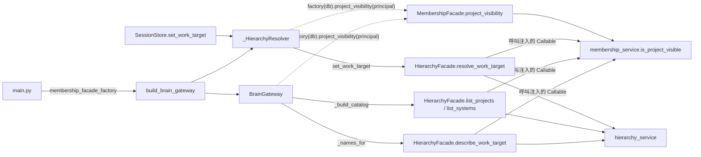

# Logical Components — `U14 entry-page-ui`

> 撰寫時間 2026-10-17T04:06:39Z（`date -u` 取值）。
>
> 把 `performance-design.md` 與 `security-design.md` 的設計落到**元件層級**：每一個新增或修改的方法的簽章、呼叫方向、失敗域。
> code-generation 以本檔 §一 為改動清單（C-8 的落點順序沿用上游 `functional-spec.md` §二之一第 6 點：ADR → `U7` → `U2` → `U13` → 前端，
> 同一次合併）。直接設定作業對象的守門依 `[EPD1]`=A 定案（2026-10-17T04:22:24Z）。本站未執行任何程式；行號皆於撰寫當下實讀。

## 零、上游來源

| 來源 | 用到什麼 |
|---|---|
| `../functional-design/functional-spec.md` §二之一 | C-8 的契約欄位（`U2`）、`describe_work_target` 原始簽章（`U7`）、`_names_for` 與四個呼叫點（`U13`）、需調整的既有測試表（第 8 點） |
| `../functional-design/frontend-components.md` §二、§三 | 檔案拆分、元件責任（本檔標出被本站改變的兩處：`BrainTranscriptKeyed` 刪除、turnId 對照改形） |
| `../nfr-requirements/tech-stack-decisions.md` | `NFR5.140`／`NFR5.141`、`NFR8.140`、`EPN-21`–`EPN-27` |
| `performance-design.md`、`security-design.md` | 本站的設計決定 |
| repo 實測 | `backend/main.py:84`；`brain_gateway.py:564-577`、`:593-622`（`BrainGateway.__init__`）、`:869-907`（快照與 `work_target` 封包）、`:1226-1243`、`:1301-1324`、`:1403-1426`、`:1428-1451`、`:1569-1598`；`brain_ws_contract.py:282-302`（`WorkTargetPayload`）；`hierarchy_facade.py:366-405`；`hierarchy_service.py:73-96`、`:291-323`；`tests/brain_gateway_fakes.py:234-268`、`:343-356`；`tests/test_brain_gateway_startup.py:60`；`tests/test_hierarchy_service.py:191`、`:199`、`:212-216`；`frontend/src/context/AuthContext.tsx`、`auth-context.ts`；`frontend/src/App.tsx:36-40`；`WorkspacePage.tsx:116-129`、`:152-164`、`:269-301`、`:304-321`；`AssessmentPage.tsx:187-193`、`:244-248`；`frontend/src/components/DrawioCanvas.tsx:11`（`DiagramSaveStatus`）；`eslint.config.js:42-66` |

## 一、元件與改動清單

### 一之一、後端

| 元件（單元） | 改動 | 簽章（新增或變更） | 呼叫者 | 設計依據 |
|---|---|---|---|---|
| `services/hierarchy_service.py`（`U7`） | 新增純查詢函式 | `describe_work_target(db, *, owner_user_id, project_id=None, system_id=None, diagram_id=None) -> WorkTargetNames`（`names: {"projectName","systemName","diagramName"}`、`owning_project_id: Optional[int]`）；系統層以 `systems` join `projects` 一條 SQL；不拋查不到 | `HierarchyFacade.describe_work_target` | security §二之一；performance §三之一 |
| `services/hierarchy_facade.py`（`U7`） | 新增方法 | `describe_work_target(principal, *, project_visible: Callable[[int], bool], project_id=None, system_id=None, diagram_id=None) -> dict`——`project_visible` 必填、無預設 | `BrainGateway._names_for`（唯一） | security §二 |
| 〃 | **變更**兩個列舉方法簽章 | `list_projects(principal, *, project_visible)`；`list_systems(principal, *, project_id, project_visible)`（不可見 → `HierarchyNotFound(PROJECT_NOT_FOUND_DETAIL)`） | `BrainGateway._build_catalog`（三處）；`test_hierarchy_service.py` 兩處補 `project_visible=ALWAYS_VISIBLE` | security §三 |
| 〃（`[EPD1]`=A） | **變更** | `resolve_work_target(principal, *, project_visible, project_id=None, system_id=None, diagram_id=None)`：明確指定且不可見 → `HierarchyNotFound`；由圖推導且不可見 → 只留圖 | `_HierarchyResolver`；`test_hierarchy_service.py:212-216` 三處補參數 | security §四 |
| `services/brain_ws_contract.py`（`U2`） | `WorkTargetPayload` 加三欄 | `projectName: Optional[str]`、`systemName`、`diagramName`——必存在、無預設（上游 §二之一第 1 點） | `_work_target_envelope` | `NFR5.140` |
| `ws-contract.json`、`frontend/src/types/ws-contract.d.ts` | 重 dump／重產 | — | 兩道漂移閘門 | `NFR5.140` |
| `services/brain_gateway.py`（`U13`） | `BrainGateway.__init__` 新增必填 kw | `membership_facade_factory: Callable[[Any], Any]`（無預設） | `build_brain_gateway`；`brain_gateway_fakes.py:343` | security §一之一 |
| 〃 | `build_brain_gateway` 新增必填 kw | `build_brain_gateway(app, *, membership_facade_factory)`；同一 factory 交給 `_HierarchyResolver` 與 `BrainGateway` | `main.py:84` | 同上 |
| 〃 | `_HierarchyResolver.__init__`（`[EPD1]`=A） | `(session_factory, facade_factory, membership_facade_factory)`；`resolve_work_target` 以 `project_visible=self._membership_facade_factory(db).project_visibility(principal)` 傳入 | `SessionStore`（經轉接器） | security §四 |
| 〃 | 新增 `_names_for` | `async _names_for(conn, triples: Sequence[Tuple[Optional[int], Optional[int], Optional[int]]]) -> Dict[triple, dict]`；去重、一次 `to_thread`、一個 session、全部例外吞下 ＋ `work_target_names_failed` | 握手（ready 之前）、`_set_target_confirmed`、`_on_set_work_target`、`_on_set_sharing_mode` | performance §三之二 |
| 〃 | `_work_target_envelope`、`_snapshot_envelopes` 加參數 | `_work_target_envelope(session, segment_id, names)`；`_snapshot_envelopes(session, items, names_by_segment)`；仍為同步 | 同上四處 | 上游 §二之一第 3 點 |
| 〃 | `_build_catalog` 三個呼叫點傳入判定 | `facade.list_projects(principal, project_visible=vis.project_visibility(principal))`，`vis = self.membership_facade_factory(db)`（同一 session） | — | security §三之一 |
| `main.py` | 組裝 | `build_brain_gateway(app, membership_facade_factory=membership_facade.MembershipFacade)`；`main.py` 已可 import `services.membership_facade`（`hierarchy_router.py` 先例） | — | security §一之一 |

**測試檔**（全在 `backend/tests/`，由既有 `unittest discover` 撿到，`EPN-24`）：

| 檔 | 新增或修改 | 內容 |
|---|---|---|
| `test_describe_work_target.py` | **新增** | security §二之三 (a)–(h)；performance §三之一 的語句數計數（`before_cursor_execute`，1 個與 50 個專案各一次，上界 5；`tearDown` 卸除監聽器，`EPN-23`） |
| `test_project_visibility_static.py` | 修改 | `GUARDED_READS` 集合、`S2`／`S3` 擴充、`S3` 例外清單一筆（security §五）；模組 docstring 的「五條」說明同步改寫 |
| `test_hierarchy_service.py` | 修改 | `:191`、`:199` 補 `project_visible=ALWAYS_VISIBLE`，另加 `:212-216` 三處（`[EPD1]`=A）；新增被移出者的 `list_projects`／`list_systems` 雙向案（security §三之二） |
| `brain_gateway_fakes.py` | 修改 | `FakeHierarchy` 新增 `describe_work_target`、`list_projects`／`list_systems`／`resolve_work_target` 接受並**套用** `project_visible`；新增 `FakeVisibility`（`invisible: set`、`factory(db)`、`project_visibility(principal)` 回 `lambda pid: pid not in invisible`）；`BrainGateway(...)` 傳 `membership_facade_factory=self.visibility.factory` |
| `test_brain_gateway_startup.py` | 修改 | `:60` 的 `side_effect=lambda app: ...` 改為 `lambda app, **kw: ...`（新增的必填關鍵字會讓原 lambda `TypeError`），並斷言 `kw["membership_facade_factory"]` 是 `MembershipFacade` |
| `test_brain_gateway_turn.py`、`test_brain_gateway_handshake.py` | 修改 | 上游 §二之一第 8 點的新增案 ＋ security §二之三 (b')、(f) ＋ §三之二 目錄案 ＋ §四 三案（`[EPD1]`=A） |
| `test_ws_contract.py` | 修改 | 上游 §二之一第 8 點（樣本補三欄、缺欄即失敗） |

**跨單元面**：本單元改到 `U7`（facade、service 與其測試）、`U2`（契約模組與兩份產生檔）、`U13`（閘道、fakes、四支測試）、`U23` 的靜態鎖檔。
既有斷言只因簽章新增關鍵字而補參數，不改任何期望值；code-summary 逐檔列出並註明「既有斷言未動」。

### 一之二、前端

| 檔 | 新增或修改 | 內容 | 設計依據 |
|---|---|---|---|
| `src/context/auth-context.ts` | 修改 | `AuthContextType` 加 `subscribeAuthBoundary` | security §六之一 |
| `src/context/AuthContext.tsx` | 修改 | 訂閱者 ref、`subscribeAuthBoundary`、`login()`／`logout()` 第一行通知 | 同上 |
| `src/App.tsx` | 修改 | `AuthProvider` → `BrainTranscriptProvider` → `BrowserRouter`（無 `key`）；`DefaultRedirect` 的 `K1`（`BR91.1`） | 同上 |
| `src/brain/BrainTranscriptContext.tsx` | **新增** | 只匯出 `BrainTranscriptProvider`（**不再有** `BrainTranscriptKeyed`）；訂閱邊界事件 | 同上 |
| `src/brain/brainTranscript.ts` | **新增** | context、型別、`useBrainTranscript`、reducer（`append`／`updateTurn`／`interruptOpenTurns`／`reset`）、`TRANSCRIPT_MAX_PER_SEGMENT = 500`；對照為 `turnSegment: Record<turnId, SegmentId>` | performance §二之二 |
| `src/brain/useBrainConnection.ts` | **新增** | 單一 effect 建連線；退避（`BASE`、`r ∈ [0.8,1]`、`Date.now()` 累計 60 秒）；終止碼；4403 → `refreshMe()` 至多一次、不導航 | performance §一；security §六之二 |
| `src/brain/useWorkspaceTargetSync.ts`、`useAssessmentTargetSync.ts` | **新增** | `onPageReady(snapshot)`、`markOrigin(origin)`、`onDiagramDeleted(id)`；ref：`pendingInitialTarget`、對齊旗標、`pendingEchoes`（≤ 8）、`openedBy`、頁面狀態鏡像；純函式 `decideInitialAlignment` | performance §四；security §六之三、§六之四 |
| `src/utils/unsavedWork.ts` | **新增** | `isCanvasDirty`、`hasUnsavedAssessmentWork` | security §六之三 |
| `src/pages/WorkspacePage.tsx` | 修改 | `handleCanvasExit` 改呼叫 `isCanvasDirty`（行為不變）；`fetchDiagrams` 回傳 `{ ok, list }`；bootstrap `finally` 呼叫 `onPageReady`；bootstrap／下拉處 `markOrigin`；大腦掛點只在 `can('K1','view')` 時掛載 | 同上 |
| `src/pages/AssessmentPage.tsx` | 修改 | 清單請求 `.then`／`.catch` 呼叫 `onPageReady({ diagrams, listOk })`；網址參數與下拉處 `markOrigin`；把 `hasUnsavedAssessmentWork(uploadedXml, optimizeDraft)` 交給掛點；`K1` 掛載條件同上 | 同上 |
| `src/pages/EntryPage.tsx`、`src/components/brain/*.tsx` | **新增** | 頁面與元件；`ContextBar` 的 `data-state`／`data-id`、空字串名稱「（未命名）」；`brain-transcript-truncated`；4403 提示文字 | performance §四；security §六之二、§六之四 |
| `src/brain/testing/wsFrames.ts` | **新增** | 建構器只收原始型別引數、先宣告具名 payload 型別再組 envelope；`encodeFrame` | security §六之六 |
| `eslint.config.js` | 修改 | 抽出 `WS_SUBPROTOCOL_RESTRICTIONS`；新增 `files: ['tests/**/*.ts']` 區塊（共用常數 ＋ 兩條訊框選擇器） | security §六之六 |
| `tests/e2e/entry-page*.spec.ts` | **新增** | 兩層 e2e（`EPN-24`）；本站新增的案例見 security §六 各節與 §七 | — |

### 一之三、不變的設定

`deploy/`、`*.env.example`、`backend/requirements.txt`、`frontend/package.json` 的依賴鍵集合、`.github/workflows/ci.yml` **零變更**（`NFR8.140`、`EPN-21`、`EPN-24`）。前端新增檔不含使用者訊息字數常數（`EPN-27`，正本
`session_store.py:113`；code-summary 以 `grep -rn "4000" frontend/src/brain frontend/src/components/brain frontend/src/utils/unsavedWork.ts` 為 0 回報）。

## 二、呼叫方向

<!-- Text fallback: main.py 把 MembershipFacade 類別以 membership_facade_factory 關鍵字交給 build_brain_gateway；build_brain_gateway
同時建出 BrainGateway 與 _HierarchyResolver，兩者都持有該 factory。BrainGateway 的 _names_for 呼叫 HierarchyFacade.describe_work_target，
_build_catalog 呼叫 HierarchyFacade.list_projects 與 list_systems；SessionStore.set_work_target 經 _HierarchyResolver 呼叫
HierarchyFacade.resolve_work_target（[EPD1]=A）。每次呼叫前，呼叫端以 factory(db).project_visibility(principal) 就地取得一個閉包
（虛線），以 project_visible 關鍵字傳入；HierarchyFacade 執行時呼叫該閉包，閉包在執行期指向 membership_service.is_project_visible。
HierarchyFacade 與 brain_gateway 的原始碼都不 import 任何成員關係符號；只有 main.py 知道 MembershipFacade。 -->

**靜態依賴與執行期呼叫的區別**：圖中指向 `membership_service` 的實線只存在於**執行期**（經注入的閉包）；`brain_gateway.py` 與
`hierarchy_facade.py` 的原始碼不 import membership 任何符號（`test_brain_gateway_limits.py:380-382` 與既有 grep 鎖維持綠燈），
唯一的靜態邊是 `main.py → services.membership_facade`。

## 三、失敗域與爆炸半徑

| 改動 | 若做錯，壞的是什麼 | 誰會發現 |
|---|---|---|
| `membership_facade_factory` 必填 | 漏傳 → 啟動 `TypeError`（fail-closed，整個後端起不來，不會靜默放行） | `test_brain_gateway_startup.py`；CI import smoke |
| `describe_work_target` 的 ③ | 漏判 → 被移出者看到名稱（裁決要關的洞） | security §二之三 (b)、M1 |
| `_names_for` 例外處置 | 外拋 → 握手 1011、扇出中斷（大腦對該使用者全面失效） | `test_brain_gateway_handshake.py` 的拋例外案（上游 §二之一第 8 點） |
| `list_projects`／`list_systems` | 漏判 → 目錄洩漏名稱並可設定目標 | security §三之二、M5 |
| 呼叫點傳恆真判定 | 守門形同虛設，**靜默** | 擴充後的 `S3`、M4 |
| `resolve_work_target`（`[EPD1]`=A） | 漏判 → 直接設定的路仍開；誤判 → 一般擁有者無法設定作業對象 | security §四 ①②③ |
| 對話清除事件 | 漏通知 → 下一位使用者看到前一位的對話（ADR-0006 資料隔離） | security §六之一 兩個 e2e、M9、M10 |
| 4403 處置 | 導航 → 子頁面無限迴圈並丟失畫布；不刷新 → 入口頁停在無法恢復的畫面 | security §六之二 三案、M11 |
| 未儲存判定 | 漏判 → 未存檔的畫布或上傳被無提示取代（資料遺失） | security §六之三、M12 |
| turnId 對照 | 用索引 → 截斷後 token 寫進錯的訊息 | `EPN-04` e2e |
| lint 區塊 | 只列新選擇器 → tests 目錄失去子協定規則；選擇器太寬 → 既有 spec 紅 | `npm run lint` 對既有 `member-pages.spec.ts` 保持綠 |

## 四、為什麼本單元不產出 scalability／reliability／observability

`produces_kinds` 把三份限定為 `[service]`，本單元為 `ui`（`unit-of-work.md:178`）。C-8 雖有後端改動，逐份確認後仍無獨立內容，與上游
`tech-stack-decisions.md` §三一致：擴展性面（語句數不隨資料量成長、每分頁一條連線）在 `performance-design.md` §三、§一之一；
可靠性面（名稱查詢失敗不阻斷、退避與終止碼、重連後覆蓋）在 `performance-design.md` §三之二、§一、§二之三；可觀測性面只有一筆白名單內的
WARNING（`security-design.md` §六之五）。本單元**不新增**進程、佇列、外部依賴或持久化。

## 五、合併前檢查（帶入項 functional-design `R-07`；沿用上游 `NFR5.141`）

只在**分支上、合併進 `ut` 之前**執行（squash-merge 之後 `origin/ut..HEAD` 不再成立）；任一不成立即停止合併並回報：

1. `git log --oneline origin/ut..HEAD` 同時含 `U13` 與 `U14` 的 commit；
2. `grep -c projectName ws-contract.json` ≥ 1；
3. `test -e backend/services/brain_router.py` 為假。

論證（取代上游 §二之一第 5 點不可滿足的「若 `U13` 先進 `ut`」分支）：本單元之前前端沒有任何大腦 WS 消費者，後端與前端同一次部署上線，
三個欄位的增量對 `v: 1` 安全、不需升版。

## 六、送審前自檢（七項；四份產出 ＋ 問題檔共用）

> 全部產出寫完後實算，指令與值並列；本站未執行任何測試。

| # | 自檢 | 結果 |
|---|---|---|
| 1 | **可達性** | (b) 被移出的建立者：以 ORM 構造「`owner_user_id`＝他、無他的成員列、另有一位成員」（上游自檢已驗）。`EPN-15a` 不經登出直接再登入：`LoginPage.tsx` 沒有「已登入即導走」（`:102-107`），以 `history.pushState` ＋ `popstate` 到 `/login` 可達且**不重新載入**；改用 `page.goto` 會重新載入使記憶體清空、測試恆綠——已在 security §六之一 寫明。4403 迴圈：`App.tsx:28` 在 `K1` 失效、`A1` 仍在時把 `/` 導回 `/workspace`，迴圈可達，故字面實作不可採。被限流的握手：`brain_gateway.py:743-746` 在 accept 前 `close()`，前端收到未被接受的握手，可達且歸「其他」。§六之三 的 `/workspace` 晚到：先拒握手、使用者編輯畫布（`saveStatus` 經 `:250` 變 `unsaved`）、再接受，可達。`openedBy='bootstrap'` 與「作業對象只到系統」：入口頁經 `U16` 選系統（diagramId null）後進 `/workspace`，bootstrap 開上次的圖（`:282`），可達 |
| 2 | **契約端點三問**（範圍：四份產出 ＋ 問題檔全部） | **`membership_facade_factory`**：寫＝`main.py:84`；讀＝`_names_for`、`_build_catalog`、`_HierarchyResolver`；清＝與閘道同生命週期。**`project_visible` 閉包**：產生＝各呼叫點就地 `project_visibility(principal)`；讀＝四個 facade 方法；清＝隨 session 的 `finally: db.close()`。**`subscribeAuthBoundary`**：擁有＝`AuthProvider`；呼叫（訂閱）＝`BrainTranscriptProvider`；通知＝`login()`／`logout()`；退訂＝effect cleanup。**`pendingEchoes`**：寫＝送出 `set_work_target`；讀＝收到 `work_target`；清＝收到回聲、超過 8 筆、每次 `ready`、卸載。**`openedBy`**：寫＝`markOrigin`（bootstrap、下拉、網址、首次對齊）；讀＝首次對齊 (3) 與 `BR97.6`；清＝隨元件卸載。**`turnSegment`**：寫＝`append` 帶 turnId；讀＝`updateTurn`；清＝`append` 擠掉最舊、`reset`。**`onPageReady`**：擁有＝兩個同步掛點；呼叫＝`WorkspacePage` bootstrap `finally`、`AssessmentPage` 清單 `.then`／`.catch`。**`refreshMe`**：既有，新呼叫者＝`useBrainConnection` 的 4403 分支（至多一次）。**`decideInitialAlignment`**：擁有＝`useWorkspaceTargetSync.ts`；呼叫＝兩個同步掛點的 `onmessage` 與 `onPageReady` 路徑。**`listOk`**：寫＝`fetchDiagrams` 回傳（workspace）／清單 `.then`（assessment）；讀＝首次對齊與回寫。出現在少於兩份產出的識別字逐一判定：`WS_SUBPROTOCOL_RESTRICTIONS`、`GUARDED_READS`、`FakeVisibility`、`TRANSCRIPT_MAX_PER_SEGMENT` 皆在 security 或 performance 定義、本檔清單引用，屬內部實作名，非孤兒契約 |
| 3 | **引用逐字核對（事實與定位分開驗）** | 逐一開檔核對內容與行號：`brain_gateway.py:130-155`、`:564-577`、`:738-741`（4403 先於限流）、`:743-746`、`:1226-1243`（`:1230`／`:1235`／`:1239`）、`:1290-1293`、`:1297-1298`、`:1301-1324`、`:1403-1426`、`:1569-1598`；`brain_gateway_rules.py:69-79`、`:85`、`:296-299`、`:475-479`、`:642-647`；`hierarchy_facade.py:107-108`、`:194-202`、`:366-379`、`:381-405`；`hierarchy_service.py:73-77`、`:80-86`、`:89-96`、`:291-323`（`:318-322`）；`membership_facade.py:518`、`:525-533`；`membership_service.py:367-379`；`rbac.py:124-132`；`session_store.py:387`；`redis_gateway.py:102-103`；`main.py:84`；`test_brain_gateway_limits.py:379-383`；`test_project_visibility_static.py:112`／`:135`／`:162`；`test_hierarchy_service.py:191`／`:199`；`brain_gateway_fakes.py:234`、`:343`；`helpers.py:103`；`AuthContext.tsx:51`、`:56-61`、`:63-68`、`:78`、`:82-93`、`:98`、`:106`；`auth-context.ts:29`；`App.tsx:24-34`；`WorkspacePage.tsx:116-129`（判定在 `:118-121`）、`:123`、`:152-164`、`:269-301`；`AssessmentPage.tsx:185-186`、`:246`、`:1262-1270`；`eslint.config.js:42-66`；`member-pages.spec.ts:573`；`node_modules/esquery/package.json:3`。**查出並更正六處**：`BrainGateway.__init__` 初寫 `:597-631`，實為 `:593-622`；`assert_system_owned_by` 初寫 `:80-85`，實為 `:80-86`；限流行號初寫 `:742-745`，實為 `:743-746`；唯一命中初寫 `:1286-1294`，實為 `:1290-1293`；`S2`／`S3` 初寫 `:117-161`，實為 `:112-160`；閉包初寫 `:527-532`，實為 `:525-533`。另：`redis_gateway.py:102` 逐字「每次互動續期」，問題檔 A 的殘留原寫「24 小時到期」，已補「閒置」與「每次互動續期」——事實修正，非措辭 |
| 4 | **檔案集合一致性** | 對照 `project-pages-ui/nfr-design/`（同為 `ui` 且有後端變更，不計 `reviews/`）：`logical-components`、`nfr-design-questions`、`performance-design`、`security-design`、`traceability.json` 五份——**相同** |
| 5 | **跨檔傳播（按事實）** | ①「每組 ≤ 5、快照 ≤ 15」：performance §三之一、security §十一、traceability `EPN-06`／`NFR3.141`；②「factory 注入、`main.py` 組裝」：問題檔 §一第 1 項、security §一、本檔 §一之一與 §二、traceability `EPN-11b`；③「4403 不導航、`refreshMe()` 至多一次、`K1` 掛載條件」：問題檔 §一第 3 項、performance §一之四與 §五、security §六之二、traceability `EPN-03`／`EPN-08`／`EPN-17`；④「清除綁事件、刪除 `BrainTranscriptKeyed`」：問題檔 §一第 4 項、security §六之一、本檔 §一之二、traceability `EPN-15`；⑤「turnId 對照只記段」：問題檔 §一第 5 項、performance §二之二、本檔 §一之二；⑥「抖動維持、支援 3 分頁」：問題檔 §一第 6 項、performance §一之三、security §十 第 6 項、traceability `EPN-02`；⑦「`[EPD1]`=A」的落點：security §四、§五、§七 M8，本檔 §一之一兩列；⑧ 目錄成本 2 ＋ 5N：performance §三之三、security §十 第 4 項 |
| 6 | **可算的數字先算再寫** | 握手次數：`r=1.0` 累計 1、3、7、15、30、45、60 → 7 ＋ 1 ＝ 8；`r=0.8` 累計 0.8、2.4、5.6、12、24、36、48、60 → 8 ＋ 1 ＝ 9；`⌊30/9⌋` ＝ 3。語句數：5 ＝ 1＋1＋1＋1＋1；3 × 5 ＝ 15；目錄 2 ＋ 3N（N＝50 → 152）、2 ＋ 5N（→ 252）。`S3` 讀取呼叫點下限 5 ＝ 1（`_names_for`）＋ 3（`_build_catalog`）＋ 1（`_HierarchyResolver`）。突變 15 條（security §七 M1–M15）。帶入項 15 ＝ functional-design 8 ＋ nfr-requirements 7（security §十一 表列 15 列）。`traceability.json` 由 `jq` 取得：`upstream_ids` 38（繼承子條 9 ＋ `EPN-*` 29），`coverage` 38 列皆 `OK` |
| 7 | **ADR-0006 四面向 ＋ PBT** | security §八逐格對照上游 §六：四格判定與上游**相同**（IAM 仍為「擴充」，範圍因 nfr-requirements `R-01` 裁決與 `[EPD1]`=A 擴大，方向不變）；PBT 不適用、與上游一致（security §九） |
