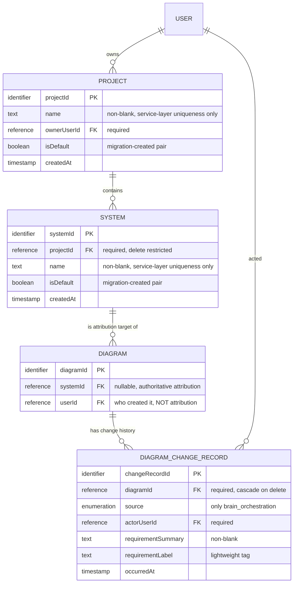

# 功能規格 — `U7 hierarchy-service`

> 本檔是**工作流程與狀態機的單一真實來源**（`entities.md` 管資料形狀、
> `rules.md` 管決策邏輯，兩者都表達不了「有序的行為」與「狀態轉換」）。
> 其中的 ER 圖與規則摘要是**衍生檢視**，源頭分別是 `entities.md` 與 `rules.md`。

## 〇、本單元是什麼

`U7 hierarchy-service` 交付「專案 → 系統 → 架構圖」階層上兩層的 HTTP 端點與其
授權。它**不擁有任何 DDL**——資料形狀屬 `U4 hierarchy-data`（已交付並登記完成）。
它擁有的是生命週期、授權強制點，以及把兩個使用者入口收斂成一條寫入路徑。

承載的故事：`US9.2`（建立專案與系統）。`US11.1` 的三條 AC 是**畫面**行為，
由 `U23 project-pages-ui` 承載；本單元只提供它們背後的寫入端與計數來源。

## 一、本階段新增、已核可 scope 尚未涵蓋的項目

**依 `project.md` 的規則逐處明標，不得當成既有能力 9 的自然延伸吸收。**

| 項目 | 來源 | 範圍狀態 | 要求回補 |
|---|---|---|---|
| `DiagramChangeRecord` **查詢**介面（`BR5.1`） | `[F2]`=A，解決 `DG-3` | **新增介面**。契約 K-07 的 `public_interface` 沒有讀取方法；但 K-07 的 `known_gap` 已逐字記載 `DG-3`，其 `landing` 指名本單元、其 `if_implemented` 已寫下實作條件——故這是**契約已預見的分支**，不是本站憑空擴張。仍不在 `unit-of-work.md:109` 的交付清單內 | `scope-document.md` 能力 9 |
| `DiagramChangeRecord` **寫入**（`BR5.2`） | — | **不是新增**。契約 K-07 的 `public_interface` 逐字已列 `HierarchyFacade.record_diagram_change`，`consumed_by: [U12]` | 不需要 |
| **衝突型例外 `HierarchyConflictError` ＋ 409 宣告**（`BR6.6`） | 審查 iteration 2 的 `R-17` | **對已核可契約 K-07 的擴充**。本檔四條規則（`BR3.2`／`BR4.2`／`BR4.3`／`BR4.4`）要求回「衝突」並附數量，而 K-07 的 `raises` **沒有**衝突型例外、其 OpenAPI 區塊**沒有** 409。兩者都是已核可產出，落差不是本站造成的，但承載方式必須由本站補上 | 契約 K-07 的 `raises` 與 OpenAPI 區塊 |
| **判定支援型查詢方法**（`BR6.4`） | `[F9]`=A（審查 `R-12`） | **不是新增能力，是把既有 `sync` 入邊的實際用途寫明**。`components.md:559-561`／`:618-620` 的 `U19`／`U20` interaction 早已逐字要求「驗證專案存在、讀取 ownerUserId」與「驗證系統存在、取得其所屬專案」；K-07 的 `public_interface` 沒有逐一列出這些方法，故本站補上其簽名約束（最小欄位、同進程、呼叫端自檢） | 契約 K-07 的 `public_interface`（建議補列） |

> **本表於 2026-10-06 更正。** 原表把寫入路徑也列為「本階段新增」，依據是
> `[F7]`=A。該判定**不成立**——寫入早在 K-07 就被契約化。錯誤的來源是我在
> Step 1 沒有讀 `contract-summary.md`（`functional-design.md` 的 `consumes`
> 把它標為 `required: false`，我因此跳過），直到 `upstream-coverage` sensor
> 回報它未被引用才追查到。詳見問題檔的 Supersession 註記。

## 二、與上游宣告的落差（實讀 `U4` 交付物後查出）

本站不以 `components.md` 的宣告為終局事實，而是實讀 `U4` 已交付的實體與相關程式。查出六處
（第 1–4 處為 `U4` 交付物的落差，第 5–6 處為已核可上游的內部不同步與引用錯誤）：

| # | 上游怎麼寫 | 實際交付的是什麼 | 後果 |
|---|---|---|---|
| 1 | `components.md` 的 `DiagramChangeRecord.attributes` 清單為 `[changeRecordId, diagramId, actorUserId, requirementSummary, requirementLabel, occurredAt]`——**沒有來源欄位** | 實體有一個**必填**的來源欄位，且其允許值集合**只有一個元素**（大腦編排） | 變更紀錄的寫入端在資料層就只能承載大腦這一條路徑。任何其他異動路徑要寫紀錄，須先擴充允許值——那是 `U4` 的 schema 變更。記為 `BR5.3` |
| 2 | `components.md` 用邏輯名 `occurredAt` | 交付的欄位名是建立時間戳 | 純命名落差，不影響語意。記於 `entities.md`，避免下游誤以為是兩個不同的時間 |
| 3 | `unit-of-work.md:250` 把變更紀錄列在 ADR-0006 的 **audit logging** 面下 | 其對架構圖的參照宣告為**級聯刪除**，且資料表註解逐字宣告保存期 **90 天**、而「執行清除的機制**不在本 repo**」 | 它不是永久稽核軌跡——被稽核的對象消失時紀錄一併消失，且最長只活 90 天。這與「稽核軌跡」的通常預期相反，故明寫為 `BR5.5` |
| 4 | `components.md` 把預設標記列為 `Project`／`System` 的一般屬性，未宣告任何寫入限制 | `U4` 的欄位註解逐字（`schema_rbac.sql:345`）「Written **ONLY** by `services/hierarchy_migration.py`; **not a user-editable attribute**」 | **它不是本單元可寫的欄位。** 本單元的建立路徑一律寫入「否」（`BR2.3`）、改名路徑不得改動它（`BR4.1`）；唯一寫「是」的是遷移程式，而遷移不屬本單元。下游若把它當成可設定的旗標會違反 `U4` 的宣告 |
| 5 | 契約 K-07 的**原始 yaml 區塊**把 `consumers.in_process` 列為 `[U10, U12]`、HTTP 消費端列為 `U16` | 同一份 `contract-summary.md` 的**消費端擴充表**（`:1551`）逐字把 K-07 的消費端擴充為 `U10`／`U12`／`U16` ＋ `U19`／`U20`／`U23`，而 `components.md` 實有**四條** `style: sync` 入邊（`:110-112`／`:156-158`／`:559-561`／`:618-620`） | **兩者不同步，本站以擴充表與 `components.md` 為準**（四個同進程呼叫端、兩個 HTTP 消費端）。這處落差是本單元兩個 Critical 的共同源頭：審查 iteration 1 的 `R-01`（`BR1.5` 只掃兩個呼叫端）與 iteration 2 的 `R-12`（`BR6.1` 的列範圍讓 `U19`／`U20` 的 interaction 不可實作）都來自只讀了原始 yaml 區塊 |
| 6 | 兩份已核可上游都把既有停用端點的行號寫成 `user_router.py:673`（`unit-of-work.md:446`、契約 `K-16` 的 `assert_can_deactivate` 的 `consumed_by`） | **該行號為錯。** `:673` 實為 `authorization_status=getattr(u, "authorization_status", "approved"),`；真正的 `target_user.is_active = request.is_active` 在 **`:682`**，端點 decorator `@router.put("/{user_id}/active", …)` 在 **`:644`** | **事實對、定位錯**——上游對該端點的敘述（它做的是 `UPDATE`、外鍵對 UPDATE 零效力、本檔據此限定 `OQ-H1` 的射程）**完全正確且不受影響**，錯的只有行號。本站已在自己的產出改引 `:682`／`:644`，依 `refined-mockups:c3` **不回改已核可的上游**。記在此以免下一個照 `:673` 去讀的人讀到無關的一行。本輪兩次審查都沒抓到它（iteration 2 複驗了 16 種引用，而 `user_router.py` 不在它的清單內） |

六處都不是本站可以修的（DDL 與其註解屬已登記完成的 `U4`；K-07 的兩處不同步與
`user_router.py` 的行號皆屬已核可上游），故一律記載而非改動。

## 三、工作流程（本檔為來源）

### W1 建立專案

1. 請求抵達建立專案端點。
2. 請求層 dependency 檢查 `K2` 權限（`BR1.1`）。不具權限即在此終止，
   且拒絕**經由既有路徑**產生（`AC9.2.3` 逐字要求）。
   例外型別為 `HierarchyForbidden(story_id='K2', action=…)`——**不是**
   `HTTPException`（契約 K-07 的 `on_denied`；審查 `R-09`）。
   — **本流程不需要 `BR6.5` 的擁有者檢查**：建立專案的擁有者依第 5 步就是請求者
   本人，沒有「別人的列」可碰。這是四條寫入路徑中唯一的例外，故在此寫明，
   以免被讀成漏寫。
3. 驗證名稱去空白後非空（`BR3.1`）。不合即 raise `HierarchyValidationError`。
4. 在同一擁有者範圍內檢查同名（`BR3.2`）。命中即 raise `HierarchyConflictError`，
   router 轉 **409**（`BR6.6`）。
   — **此處有已知空窗**：檢查與第 5 步之間，另一個併發請求可能寫入同名（`BR3.3`）。
5. 寫入一筆專案，預設標記為否（`BR2.3`），擁有者為請求者。
6. 回傳新專案。它自此出現在該使用者可選的作業對象中（`AC9.2.1`）。

### W2 建立系統

1. 請求抵達建立系統端點（**與 W1 不同的端點，但同為建立路徑的唯一寫入端**；
   見 `BR2.1` 與下方 §四）。
2. `K2` 權限檢查（`BR1.1`）。不通過 raise `HierarchyForbidden(story_id='K2', action=…)`
   ——**不是** `HTTPException`（`BR1.1`、契約 K-07 的 `on_denied`）。
3. **擁有者檢查（`BR6.5`）**：目標專案的 `ownerUserId` 不是請求者 → 回「查不到」。
   **`K2` 與本步兩者都要過**——`K2` 判「這個角色能不能做」，本步判「這一列是不是他的」。
   少了這一步，具 `K2` 者可在**他人的專案底下建立系統**（審查 `R-15`）。
4. 驗證目標專案存在（`BR2.2`）。不存在 raise `HierarchyNotFound`。
   **順序說明**：第 3 步與本步合併實作時，「不存在」與「不屬於你」必須回同一種
   結果，否則回應本身就是一個存在性預言機。
5. 驗證名稱非空（`BR3.1`，不合即 `HierarchyValidationError`）、同專案內無同名
   （`BR3.2` → `HierarchyConflictError` ＋ 409，見 `BR6.6`；同樣有 `BR3.3` 的空窗）。
6. 寫入一筆系統，預設標記為否（`BR2.3`）。
7. 回傳新系統。它歸屬於該專案，且可被選為作業對象（`AC9.2.2`）。
8. 該專案的系統計數由此 +1——`AC11.1.3`「0 變為 1」的資料來源即此（**畫面**由 `U23` 承載）。

### W3 解析作業對象（`SessionContext` 的消費路徑）

1. `SessionContext`（`U10`）需要驗證並解析三層識別。
2. **它以同進程呼叫 `HierarchyFacade.resolve_work_target`**，把已驗證的
   `principal` 作為第一個參數傳入（`BR1.2`；契約 K-07 的
   `consumers.in_process` 逐字列有 `U10`）。資源識別
   （`project_id`／`system_id`／`diagram_id`）為具名參數，不得藏在 payload 內。
3. facade 內執行 `K2` 判定（`BR1.1`）——**判定在這裡，不在 router**；
   router 與同進程呼叫端共用這一個入口。
4. 不通過時 raise `HierarchyForbidden(story_id='K2', action=…)`——
   **不是** HTTP 例外。router 層才把它轉成 403；同進程呼叫端自行處置。
5. **列範圍（`BR6.1`）**：解析的目標若不屬請求者，回「查不到」。
   少了這一步，`SessionContext` 可以把任何人的 `project_id`／`system_id`
   解析成合法的作業對象——而這是**同進程**路徑，
   **沒有任何 router 層會替它補上範圍檢查**。
   **此處只涵蓋使用者自己的解析路徑**；`U19`／`U20` 的存在驗證走 `BR6.4`
   （審查 `R-12`，`[F9]`=A），不套本步。
6. 通過時回傳解析結果。本操作**唯讀且冪等，可安全重試**（`BR2.4`）。

### W4 寫入變更紀錄（`WorkOrchestrator` 的消費路徑）

1. 架構圖被異動。
2. `WorkOrchestrator`（`U12`）**以同進程呼叫
   `HierarchyFacade.record_diagram_change(principal, diagram_id,
   requirement_summary, requirement_label)`**（`BR5.2`；K-07 註明
   「**U12 是 `DiagramChangeRecord` 的唯一寫入端**」）。
3. facade 內執行 `K2` 判定（`BR1.1`）。**授權未通過時不得執行受保護操作**
   ——判定與執行不得交錯，判定先於任何讀寫，失敗即中止（K-07 `hard_rule`）。
4. 驗證來源需求摘要非空（`BR5.4`）；來源值必須在允許值集合內（`BR5.3`）
   ——目前只有大腦編排一個值。
5. 寫入一列紀錄，帶行為者、摘要、標籤。
   本操作**非冪等（一次異動一列），不得重試**（`BR2.4`）。

### W5 查詢變更紀錄（`DG-3` 的落地）

1. 請求抵達查詢端點，帶標籤或系統作為條件。
2. `K2` 權限檢查（`BR1.1`）。不通過 raise `HierarchyForbidden`。
3. **列範圍過濾（`BR6.3`）**：只保留架構圖的 `user_id` 等於請求者的紀錄。
   **以擁有者判定，不上溯 `system`→`project`**——理由見第 4 步。
4. 以標籤查詢時直接比對標籤；**以系統查詢時須經架構圖上溯**
   （紀錄指向圖、圖指向系統，是間接關係——見 `entities.md`）。
   **此處有一個已查證的真實限制（審查 `R-13`）**：新建的架構圖**從未**被指派系統
   （`UserDiagram` 無對應屬性、三條建圖路徑皆走 ORM、唯一寫入者是不掛在啟動路徑上的
   遷移程式），故**以系統為條件查詢時，新圖的紀錄一律查不到**。
   以標籤查詢不受影響。缺口記為 `OPEN-H11`。
5. 回傳符合的紀錄。這讓 `[DD:E8]`=C 的理由「可用同一標籤搜尋它影響過哪些圖」
   第一次成真（`BR5.1`）——**但僅限標籤那一條路徑**；系統那一條在 `OPEN-H11`
   關閉前對新圖無效。
6. 回應不得被呈現為完整變更歷史（`BR6.3`、`U4` 的資料表註解
   `schema_rbac.sql:416`／`:418`）。

### W6 刪除

1. 刪除請求抵達。`K2` 權限檢查（`BR1.1`）。不通過 raise `HierarchyForbidden`。
2. **擁有者檢查（`BR6.5`）**：目標（或目標系統所屬專案）的 `ownerUserId` 不是
   請求者 → 回「查不到」。**這一步必須在第 3–5 步之前**——`BR4.2`／`BR4.3`／`BR4.4`
   **完全不涉及擁有者**（它們管預設標記與底下還有沒有東西），所以那三條擋不住
   「刪除他人的專案」。少了本步，具 `K2` 者可刪掉別人的專案與系統，
   且這是**破壞性**的，不可由讀取範圍限制擋下（審查 `R-15`）。
3. 若目標的預設標記為真 → 拒絕（`BR4.2`），raise `HierarchyConflictError`。
4. 若目標是專案且底下仍有系統 → raise `HierarchyConflictError`，
   訊息含剩餘系統數（`BR4.4`），router 轉 **409**（`BR6.6`）。
5. 若目標是系統且仍有架構圖歸屬於它 → raise `HierarchyConflictError`
   並說明還有幾張圖（`BR4.3`）。
6. 皆不命中才執行刪除。**任何情況都不級聯**——這正是 `DG-2` 的關閉方式。


### W7 列出可見的專案與系統（讀取路徑）

**本工作流程是審查 `R-02`（Critical）的處置。** K-07 的 OpenAPI 逐字寫
「列出使用者**可見**的專案」，而「可見」在本站原先的 22 條規則裡沒有任何定義。

1. 請求抵達 `get /api/hierarchy/projects`（或某專案的系統清單）。
2. `K2` 權限檢查（`BR1.1`）。**這一道只判「這個角色能不能做這件事」，
   不判「這一列是誰的」**——`K2` 是 `role_permissions` 層的全域角色權限
   （契約 K-03 逐字「11 個既有角色 × 2 個 story id」），**不帶列層範圍**。
3. **列層過濾（`BR6.1`）**：只回傳 `ownerUserId` 等於請求者的專案；
   列出某專案的系統時，先確認該專案屬於請求者，否則回「查不到」。
   **本步只適用於列舉型讀取**（本流程與 `W3` 的使用者路徑）。
   受信任同進程消費端（`U19`／`U20`）為做自己的授權判定而呼叫的**存在驗證與
   擁有者查詢走 `BR6.4`，不套本步的列範圍**——否則契約 `K-16`／`K-17`
   不可實作（審查 `R-12`，使用者裁決 `[F9]`=A）。`BR6.4` 以三道約束取代範圍過濾：
   只能同進程呼叫、只回傳最小欄位（存在性／擁有者 id／所屬專案 id，
   不回名稱不回清單故無法枚舉）、呼叫端必須自己完成授權判定。
   **本流程的端點不得以 `BR6.4` 的方法實作**（那會讓列範圍被整個繞過）。
4. 以識別碼直接解析他人的資源時一律回「查不到」而非「無權限」，
   不以錯誤碼洩漏該資源存在（`BR6.1`）。

> **這是本輪刻意的收窄，不是最終模型**（`BR6.2`）。被分享或以成員身分取得的
> 存取在本輪**看不到任何東西**；最終的可見範圍模型屬 `K-16`，
> 承接站為 `U19 membership-service`。不在本輪委由 `K-16` 的理由是依賴方向：
> `ProjectMembership`（`U19`）已 `depends_on` 本單元且 `style: sync`
> （`components.md:559-561`），反向呼叫會成環。

### W8 查詢變更紀錄的列範圍

`W5` 第 3 步的列範圍判定依 `BR6.3`，**以架構圖自身的擁有者
（`user_diagrams.user_id`，該欄 `NOT NULL`）為準，不上溯 `system`→`project`**。

**為什麼不上溯**（審查 iteration 2 的 `R-13`，Critical；使用者裁決 `[R-13]`=A）。
本站逐一實測，上溯路徑在本 repo 的現況下對**每一張新圖**都會斷掉：

| 實測項 | 結果 |
|---|---|
| `UserDiagram` 有沒有歸屬欄位的 ORM 屬性 | **沒有**。`backend/models.py:91-105` 只有 `id`／`user_id`／`title`／`xml_data`／`updated_at` 與兩個 relationship |
| 三條建圖路徑寫不寫它 | **都不寫**。`collab_router.py:517`、`review_router.py:131`／`:327` 全部以 ORM 建構，故一律留空 |
| 唯一的寫入者是誰、何時跑 | `hierarchy_migration.py:469-472` 的 raw `UPDATE … WHERE … IS NULL`；而 `hierarchy_migration.py:13` 逐字「**不掛在啟動路徑上**」，只有 `backend/scripts/run_hierarchy_migration.py` 會跑 |

**後果**：`AC9.1.4` 的「空歸屬列數為 0」只在遷移跑完的那一刻成立，
之後**每一張新建的圖都讓它再度不成立**——而大腦寫變更紀錄的對象正是新圖。
若沿用上溯判定，`W5`／`W8`（本單元唯一真正新增的交付物、也是 `DG-3` 的落點）
會對所有新圖的紀錄回傳空集合，**等於 `DG-3` 實際上沒有關閉**。

**可見性與歸屬刻意分開**：`system_id` 仍是**歸屬**的權威來源
（契約 K-04 `column_added` 逐字「為歸屬的權威來源，decisions.md ADR-002」），
本條只用擁有者判**可見性**。兩者是兩件事，不可互相替代。

**本單元修不了的那一半**：「新建的圖從未被指派系統」在建立路徑上，
而建立圖不是本單元的路徑（`collab_router`／`review_router` 屬既有模組，
且 `team.md` 明訂修改既有 router 不得夾帶重構，那兩支目前也沒有 HTTP 層測試保護）。
記為具名缺口 `OPEN-H11`，並明寫它讓 `W5` 的系統條件篩選對新圖無效。

回應另須滿足：不得被呈現為完整變更歷史（`U4` 的資料表註解逐字
（`schema_rbac.sql:416`／`:418`）「read source before presenting anything」、
「rows here are **NOT** a complete change history」）。

## 四、「兩個入口、一條寫入路徑」怎麼被保證

`components.md` 要求兩個使用者入口（脈絡列選單的表單、對話式建立的確認卡）
共用同一條寫入路徑，且「授權檢查、稽核紀錄與錯誤訊息各只有一份」。

`[F4]`=A 的做法：**每種建立各恰有一個端點**，兩個 UI 入口都打它；對話式建立由
大腦端轉成對同一端點的呼叫。唯一性因此是**可機械驗證的**（該資源的建立端點數
= 1），而不是靠紀律維持。

> 這裡的「一條寫入路徑」指**每一種資源**各一條：建立專案一條（W1）、建立系統
> 一條（W2）。它不是「全單元只有一個端點」。`unit-of-work.md:109` 的「建立路徑
> 的單一寫入端（兩個入口共用）」逐字講的是入口收斂，不是資源合併。

**此點已被契約化**：K-07 的 `single_write_path` 逐字為「兩個使用者入口（脈絡列
選單的表單、對話式建立的確認卡）共用 `create_*` 這一條寫入路徑，授權檢查、稽核
紀錄與錯誤訊息各只有一份（`interaction-spec.md INV-2`）」。故 `[F4]`=A 不是本站
的新決定，而是與既有契約一致的確認。

## 四之二、HTTP 表面（契約 K-07 的 OpenAPI 區塊）

K-07 把 HTTP 那一半寫成 OpenAPI。其消費端為 `U16 object-picker-ui` **與
`U23 project-pages-ui`**（`contract-summary.md:1551` 的 K-07 擴充表逐字把
`U19`／`U20`／`U23` 列為擴充後的消費端；上一版只寫 `U16`，審查 `R-01`）。
這些 path 會進 `openapi.json`，**因此受既有兩道漂移閘門保護——但保護範圍有限**：

> **閘門射程的限定（審查 `R-17`）。** 兩道閘門比對的是 **path 與 schema**，
> **不涵蓋狀態碼宣告**。`unit-of-work.md:447` 逐字：實測 `openapi.json` 的 55 個
> operation 宣告的狀態碼只有 `{200:53, 422:45, 201:1, 204:1}`，
> **非 2xx/422 的宣告數為 0**。故本檔四條衝突型規則（`BR3.2`／`BR4.2`／`BR4.3`／
> `BR4.4`）要求的 409 **不會**被任何閘門守住——route decorator 必須**顯式**宣告
> `responses={409: {...}}`，否則該契約不進 spec、前端產不出型別，而 CI 保持綠燈。
> 承載方式見 `BR6.6`，並已列入 §一 的範圍新增表。

| Path | 方法 | 對應工作流程 |
|---|---|---|
| `/api/hierarchy/projects` | `get`／`post` | `W7`（列出可見專案）／`W1` |
| `/api/hierarchy/projects/{projectId}/systems` | `get`／`post` | `W7`（列出該專案的系統）／`W2` |
| `/api/hierarchy/projects/{projectId}` | `delete` | W6（專案） |
| `/api/hierarchy/systems/{systemId}` | `delete` | W6（系統） |

### 四之二之一、本單元新增的第五個 path（`BR5.1`／`[F2]`=A）

| Path | 方法 | 查詢參數 | 回應 | 對應工作流程 |
|---|---|---|---|---|
| `/api/hierarchy/diagram-changes` | `get` | `label`（選填，字串比對）、`systemId`（選填，經圖上溯）；兩者皆空時回該使用者全部可見紀錄 | 紀錄陣列，每列含紀錄識別碼、架構圖識別碼、來源、行為者、需求摘要、標籤、時間戳 | `W5` ＋ `W8` |

三件必須被下游知道的事：

1. **它不在 K-07 的 OpenAPI 區塊內**，因為 K-07 的 `public_interface` 沒有讀取
   方法（`DG-3` 當時仍是具名缺口）。因此它**不自動受 §四之二 那兩道漂移閘門
   保護**——`openapi.json` 的 dump 要等它實作後才會含這個 path，而在那之前
   沒有任何機械檢查會發現它與本規格不符。
2. **它必須有 allow/deny 雙向 `TestClient` 測試**：`team.md` 的 B 規則
   （新增或修改 HTTP 端點需 `TestClient` 測試，斷言 status code 與欄位集合）
   與 A 規則的交叉要求。`project.md` 另逐字要求「第一個 C1 HTTP 端點落地時
   即使 seed 未改也須 allow/deny 雙向」——本單元的 `K2` 同理：
   有 `K2` → 2xx、無 `K2` → 403，缺一不可。再加 `BR6.1` 的列範圍測試：
   **他人的紀錄不得出現在回應中**。
3. **CI 的 OpenAPI drift 閘門會在它落地時要求同步重 dump `openapi.json`**
   （`ci.yml` 的 `backend/scripts/dump_openapi.py --check`）；
   漏 dump 即 CI 紅燈。這對本單元是好事——它讓這個 path 在落地**之後**
   取得與其他四個 path 相同的保護。

K-07 的實作注意逐字：「每個 router handler 只做『取身分 → 呼叫 facade →
轉譯例外』，**不得自行呼叫底層 service**（否則 facade 不再是唯一授權入口）」。

**缺口**：上表**沒有任何 `patch`／`put`**，而 `components.md` 的 `behaviour`
列了「改」、本檔 `BR4.1` 也允許預設組改名。改名在本輪的 HTTP 表面上**不可達**
（`BR4.5`、具名缺口 `OPEN-H5`）。

## 四之三、需求與故事的對應

本單元的行為源自 `requirements.md` 的兩條功能需求：

- **`FR9.5`**（該檔逐字標為「存取控制，本輪補」）：`projects` 與 `systems` 的
  讀、建立、修改、刪除一律經 `require_story_action`，且**建立路徑須被指名**。
  本檔以 `BR1.1`／`BR1.2`／`BR2.1` 承載。
  `requirements.md` 的 ADR-0006 IAM 列另逐字記載「**FR10.2**：大腦代呼叫成本能力
  一律走 HTTP 帶使用者 token，**不得**同進程繞過 `require_story_action`」
  ——**那一條管的是成本能力（C1），不是本單元**；本單元的同進程路徑由 K-07 的
  facade 模型保護，兩者不衝突。此處特別寫明，是因為兩句話形狀相近而結論相反，
  極易被下游誤引。
- **`FR11.1`**：使用者應能建立專案與系統，並在清單頁看到它們；首次使用時清單頁
  為空狀態。本單元承載其寫入側；**清單頁與空狀態屬 `U23`**。

`requirements.md` 另把「專案／系統的建立路徑，含其使用者可見面」列為回補項
**`N-7`**，逐字說明它「是一個全新的使用者可見面，不是能力 9 的自然延伸」。
`US9.2` 是它在故事層的落點，而 `unit-of-work-story-map.md` 把該故事指派給
本單元 ＋ `U16 object-picker-ui` ＋ `U3 rbac-story-ids` 三者共同承載；
該檔並逐字說明 `US11.1` 之所以列本單元，是因為「寫入端是既有 `hierarchy-service`
的系統建立端點」——本單元提供寫入端，畫面屬 `U23`。

## 五、狀態機

本單元的實體**沒有工作流程狀態欄位**（無草稿／發布／封存）。可被稱為狀態轉換的
只有兩處，且都由布林標記與參照存在性決定，而非一個狀態欄位：

### 專案與系統的生命週期

```
（不存在） --建立(W1/W2)--> 存在、非預設 --改名--> 存在、非預設
                                   |
                                   +--刪除(W6，且無子項)--> （不存在）

（不存在） --遷移(U4 擁有，非本單元)--> 存在、預設
                                   |
                                   +--改名(BR4.1)--> 存在、預設
                                   |
                                   +--刪除--> **不可達**（BR4.2 永遠拒絕）
```

**「存在、預設」是一個吸收狀態**：一旦是預設組，就不存在任何到「不存在」的轉換。
這是刻意的——預設系統被刪會讓既有架構圖的歸屬懸空，而「遷移後歸屬為空的架構圖
列數必須為 0」是已核可且已有測試保護的不變量。

### 架構圖的歸屬（本單元只讀不寫）

架構圖的歸屬參照由 `U4` 的遷移程序從空值轉為有值，之後本單元**不改變它**。
本單元對它的唯一義務是**不製造新的空值**——即 `BR4.3`（不刪仍有圖的系統）。

> **但這個狀態機不是封閉的（審查 iteration 2 的 `R-13`，已實測）。**
> 上述「空值 → 有值」的單向轉換只涵蓋**遷移當下已存在**的圖。
> **遷移之後新建的每一張圖都重新進入空值狀態且永不離開**：`UserDiagram`
> （`backend/models.py:91-105`）沒有歸屬欄位的 ORM 屬性，三條建圖路徑
> （`collab_router.py:517`、`review_router.py:131`／`:327`）全部走 ORM，
> 唯一的寫入者 `hierarchy_migration.py:469-472` 只被獨立腳本呼叫
> （該檔 `:13` 逐字「不掛在啟動路徑上」）。
> 故本節的狀態機應讀為「遷移一次性地清空存量，而流量持續補回」。
> `BR4.3` 擋的是本單元**自己**製造空值，擋不住建立路徑製造空值——
> 後者不在本單元的射程內，記為 `OPEN-H11`。

## 六、實體關係圖（衍生檢視）

> **源頭是 `entities.md` 的 ```yaml 區塊**，此處為可讀性而存在。
> 本圖已以 Mermaid 渲染器實際驗證語法通過，非僅目測。
> 下方附文字 fallback（`project.md` 要求 Mermaid 一律附）。



### 文字 fallback

- 一個**使用者**擁有零到多個**專案**；也可以是零到多筆**變更紀錄**的行為者。
- 一個**專案**包含零到多個**系統**。系統對專案的參照為必填，且**刪除受限**
  ——專案底下還有系統時刪不掉。
- 一個**系統**是零到多張**架構圖**的歸屬目標。架構圖對系統的參照**可為空**，
  但它是**歸屬的權威來源**；架構圖另有一個「誰建的」參照，那**不是**歸屬。
- 一張**架構圖**有零到多筆**變更紀錄**。紀錄對圖的參照為必填且**級聯刪除**
  ——圖沒了，它的變更紀錄也沒了。
- **變更紀錄到系統是間接關係**（經架構圖上溯），不是直接參照。

## 七、規則摘要（衍生檢視）

> 源頭是 `rules.md`。

| 群組 | 條數 | 管什麼 |
|---|---|---|
| `BR1.x` | 5 | 授權：唯一落點、禁同進程繞過、服務層無第二道檢查、principal 不可偽造、無繞過路徑 |
| `BR2.x` | 4 | 建立路徑的唯一性與前置條件、預設標記、冪等性 |
| `BR3.x` | 3 | 名稱非空白、衝突處置、唯一性的真實強度 |
| `BR4.x` | 5 | 刪除與預設組的可變性、改名在 HTTP 表面不可達 |
| `BR5.x` | 6 | 變更紀錄的讀寫端、來源限制、行為者取值、壽命與保存期 |
| `BR6.x` | 6 | 列舉型讀取的列範圍、其收窄宣告、變更紀錄的範圍與完整性、判定支援型查詢的三道替代約束、寫入面的擁有者檢查、衝突型拒絕的承載方式 |

合計 **29** 條（由腳本以 `yaml.safe_load` 解析 `rules.md` 的 yaml 區塊、取
`rules[].id` 實算，非 grep、非估計；逐群實算為 `BR1` 5／`BR2` 4／`BR3` 3／
`BR4` 5／`BR5` 6／`BR6` 6，與上表六列相符且和為 29）。

> **本表於 2026-10-06 兩度更正。** 第一版寫「`BR1.x` 3、`BR2.x` 3、**`BR3.x` 3**、
> `BR4.x` 4、`BR5.x` 5，合計 18」（五個數字相加確為 18；上一次的更正註記漏抄了
> `BR3.x` 那一項，使引用的四個數字只加到 15 ——審查 `R-19`），而當時 `rules.md`
> 實有 22 條：四條（`BR1.4`／`BR1.5`／`BR2.4`／`BR4.5`）在本表完全沒有落點，
> 審查 `R-03` 抓到。第二次更正（審查 iteration 2）新增 `BR6.4`–`BR6.6`
> 使總數成為 29。

## 七之二、契約具名缺口與相鄰契約的處置（審查 `R-06`）

| 上游具名項 | 它逐字說什麼 | 本站的處置 |
|---|---|---|
| **`DG-2`** | **`components.md:472` 逐字：「`Project`／`System` 被刪除時的 **cascade 行為未定**。刪一個 `System` 會讓 `user_diagrams.system_id` 與 `DiagramChangeRecord` 同時懸空；刪一個 `Project` 會讓其下所有 `System` 懸空」**，並於 `:488`（`H-7`）指派 `functional-design`——即本站 | **由本站關閉（cascade 那一面）。** `BR4.4`（專案底下仍有系統即拒絕，**不級聯**）＋`BR4.3`（系統底下仍有架構圖即拒絕）使兩種懸空都不可能發生。關閉的是「**遷移之後持續滿足**」那一面：契約 `K-04` 的 `migration.invariant`（`contract-summary.md:361`）只保證遷移當下為 0，而 `DG-2` 問的是刪除會不會在執行期把它打破——答案是不會，因為本單元一律拒絕而非級聯。**但另一面沒關**：新建的圖從未被指派系統（`BR6.3` 的 `source`、`OPEN-H11`），那是另一條讓同一個不變量被打破的路徑，不在 `DG-2` 的射程內 |
| **`[F6]`=A（預設組的可變性）** | **不是 `DG-2`。** 本表上一版把它誤標為 `DG-2`（審查 `R-06`）——`DG-2` 講的是 cascade，與預設組的可變性無關 | 由本站的 `[F6]`=A 定案「可改名、不可刪除」，落在 `BR4.1`／`BR4.2`。**關閉只到設計層**：改名在本輪的 HTTP 表面上不可達（`BR4.5`、`OPEN-H5`），故「可改名」目前只有同進程呼叫端能用到 |
| **`DG-3`** | 變更紀錄無讀取端 | 由本站關閉（`BR5.1`、`[F2]`=A、新增第五個 path） |
| **`K-03`** | 「11 個既有角色 × 2 個 story id」的 `role_permissions` 種子 | **不屬本單元**（`U3 rbac-story-ids`）。本站的依賴是**單向且唯讀**：`BR1.1` 的 `K2` 判定假設該 story id 已被種入。它是**全域角色權限、不帶任何列層範圍**——這正是 `BR6.1` 必須存在的理由（審查 `R-02`） |
| **`K-04`** | `require_story_action` 的既有 dependency 形狀 | **不屬本單元**（既有機制）。本站只規定 facade 如何**使用**它：判定落在 facade 內而非 router（`BR1.1`），且 facade 是唯一入口（`BR1.5`）。本站**不改** `require_story_action` 本身 |
| **`K-16`／`K-17`** | per-project 授權判定的唯一來源；兩層 facade 不得互相假設對方已檢查 | **不屬本單元**（`U19`）。本站的可見範圍收窄（`BR6.1`）是刻意比 `K-16` 更窄的過渡版，理由與依賴方向記於 `BR6.2` |

**`DG-1` 不屬本單元，且仍然開著。** 本表原本寫「`DG-1` 已由 `U4` 的交付物關閉」
——**該句為假，已刪除**（審查 iteration 2 的 `R-14`）。實際上 `DG-1` 是
`components.md:465`／`:472` 的**記憶稽核事件**缺口（`MemoryAuditEvent` 在其記憶被
90 天清除後的去向，`[RA:FR4.5]` 與 `[RA:FR4.7]` 兩條已核可需求在此互相拉扯），
歸屬 `MemoryStore`／`U5`／`U8`／`U9`，與本單元無關。
**寫下這句假宣稱的後果是具體的**：`bolt-plan.md:186` 逐字把 `DG-1` 列為
`U5`／`U8` 那個 Bolt 的**進入條件**，所以把它宣告為已關閉，會讓一個 Bolt 閘門
以假前提通過。錯因是我把 `DG-1` 與遷移不變量混為一談——後者其實是契約 `K-04` 的
`migration.invariant`（`contract-summary.md:361` 逐字「遷移後 `user_diagrams` 中
`system_id IS NULL` 的列數必須為 0」，`on_violation` 逐字「遷移程序必須**大聲失敗**」），
不是 `DG-1`。本單元關閉的是 `DG-2`（部分，見上表）與 `DG-3`。

## 七之三、ADR-0006 security baseline 四面向逐項判定

**`project.md` 逐字要求「對每一項變更檢查 ADR-0006 的四個面向」，且
「涉及 IAM／權限矩陣／網路暴露／稽核記錄的變更，須在該 stage 產出中明列
security 影響與處置，不得僅以『已有 ADR-0006』帶過」。** 本表為審查 `R-08`
的處置——原產出零命中 `ADR-0006`。

| 面向 | 判定 | 本單元的影響與處置 |
|---|---|---|
| **IAM／授權** | **適用（本單元的核心）** | 本單元是 `projects`／`systems`／變更紀錄的**唯一授權入口**（K-07 `sole_entry`）。處置：`BR1.1`（判定落在 facade，不在 router）、`BR1.2`（principal 為第一參數，禁藏 payload）、`BR1.4`（principal 不可偽造，型別層事實）、`BR1.5`（無繞過路徑，掃描四個同進程呼叫端）。**新增**：`BR6.1`（列舉型讀取的列層範圍）、`BR6.4`（判定支援型查詢的三道替代約束）、**`BR6.5`（寫入面的擁有者檢查）**——`K2` 不提供任何列層範圍，這是本輪查出的**實質 IAM 缺口**，不是形式項。<br>**本列於 2026-10-06 補上寫入面**（審查 `R-15`）：原文只描述讀取面，而 `BR6.1` 也只涵蓋讀取。`components.md` 的 `ProjectHierarchy.behaviour` 逐字涵蓋「讀、建立、修改、刪除」四者，寫入面缺了擁有者檢查**比讀取外洩更嚴重**——具 `K2` 者可在他人專案底下建立系統、或刪除他人的專案與系統，且 `BR4.2`／`BR4.3`／`BR4.4` 完全不涉及擁有者（它們管預設標記與底下還有沒有東西），擋不住這一類 |
| **Encryption** | **不適用** | 本單元不新增任何儲存體、不處理任何新的機敏欄位、不新增傳輸通道。三個實體的 DDL 屬 `U4`（已交付），其欄位皆為識別碼、名稱、時間戳與自由文字摘要。**無憑證、無 token、無金鑰落在本單元**。<br>**與上游判定的差異來自範圍，不是新證據**（審查 `R-08`）：`unit-of-work.md:248` 把 Encryption 判為**適用**、`:252` 逐字「**四面向皆適用，無不適用項**」，但其落點逐字為 `U5 memory-data`（episodic memory 的加密手段，`requirements.md` 的 `OQ-3`，指派 `nfr-design`）與 `U1 brain-infra`（Redis／Ollama 的連線憑證最小權限、值不得含 `$`）——**兩者都不在本單元內**。本表是 per-unit 範圍，故判不適用；上游那張表是 intent 範圍，故判適用。兩者不矛盾 |
| **Network exposure** | **適用（新增四＋一個 path）** | §四之二 的四個 path（K-07 的 OpenAPI）＋ §四之二之一 的第五個查詢 path。處置：五者皆經既有 FastAPI router 與既有認證層，**不新增任何對外進程邊界、不新增任何監聽埠**。與 `U1 brain-infra`（Redis 與 Ollama）／`U21 mcp-bridge`（獨立進程，僅供同主機連接）不同——那兩者才是新的進程邊界。`unit-of-work.md:249` 逐字把 `U13 brain-gateway` 的新 WebSocket 稱為「本 intent **唯一**新增的對外網路面」，與本單元一致：本單元的暴露面是**既有 API 表面的擴充**，不新增監聽埠、不新增進程。
**本列的兩個單元識別碼於 2026-10-06 更正**：原文誤寫「`U8`（Redis）／`U20`（MCP server）」，實為 `U1`（Redis 與 Ollama，見 `unit-of-work.md:249`）與 `U21`（`mcp-bridge`，`unit-of-work.md:309` 逐字「standalone（獨立進程，不在 FastAPI process 內；僅供同主機連接）」）；`U8` 是 `memory-service`、`U20` 是 `requirement-field-service`（embedded） |
| **Audit logging** | **適用，且本輪查出其強度低於上游預期** | `unit-of-work.md:250` 把變更紀錄列在本面向下。處置：`BR5.2`（唯一寫入端 `U12`）、`BR5.4`（摘要非空）、`BR5.6`（**行為者不得預設為 session 擁有者**——`U4` 欄位註解的逐字指派，本輪關閉 `OQ-H3` 的 facade 契約面）。**三項減損必須被下游知道**：① 級聯刪除（`BR5.5`）；② 保存期 90 天且**清除機制不在本 repo**（`BR5.5`）；③ 來源欄位只容納大腦編排一條路徑，經既有 A1 頁面的異動**不會留下紀錄**（`BR5.3`，`U4` 註解逐字（`schema_rbac.sql:418`）「rows here are NOT a complete change history」）。故它**不是**完整稽核軌跡，把它當成完整軌跡呈現會讓使用者誤以為「沒有紀錄＝沒被改過」（`BR6.3`） |

**PBT hard constraint 的判定（第七項自檢的另一半）**：`project.md ## Testing Posture`
逐字把 property-based testing 列為 hard constraint，適用對象為「IaC generator、
cost calculator、agent routing」三者（ADR-0017 §1–§2 另把 cost calculator 那一條
移錨至估價表解析器）。**本單元不屬其中任何一個**，且 `unit-of-work.md` 全檔對 `U7`
沒有任何 PBT 指派（本輪實測：`U7` 與 PBT／Hypothesis 的交集命中為 0；
相對地 `unit-of-work.md:448` 明確把 PBT 指派給 `U19` 的挑選函式）。
故 PBT 對本單元判為 **N/A，非豁免**。本單元的測試義務來自 `team.md` 的 A＋B 規則
（HTTP 端點的 allow/deny 雙向 `TestClient`）加上 `BR6.1` 的列範圍斷言——
三者都是 example-based 即足，因為它們驗的是授權與範圍的二元結果，不是數值性質。
**若日後把名稱正規化或可見範圍的判定抽成不讀 DB 的純函式，PBT 即由 N/A 轉為適用**
（那是 `project.md` 的 hard constraint 隨結構移轉的同一個機制，不是新規則）。

## 八、殘餘風險與已知限制（不美化）

1. **名稱唯一性在併發下不成立**（`BR3.3`）。`[F5]`=C 的已知代價。
   **名稱永遠不是鍵**，下游不得以名稱當識別。
2. **底層服務層沒有第二道授權檢查**（`BR1.3`）。判定只有一份，在 facade。
   整個授權強度依賴兩件事：`BR1.4`（principal 不可偽造，使「拿不到 principal
   就呼叫不了 facade」成為型別層事實）與 `BR1.5`（沒有單元繞過 facade 直呼底層
   service）。**`BR1.4` 關閉的是 K-07 具名 `residual_gap` 的一半**，另一半
   （`BR1.5`）**本單元無法自己驗證**——它約束的是**四個**同進程呼叫端
   `U10`／`U12`／`U19`／`U20`（`components.md:110-112`／`:156-158`／`:559-561`／
   `:618-620` 四條 `style: sync` 入邊），故記為 `OPEN-H2`。
   `BR1.5` 同時是 `OQ-N2`（`bolt-plan.md:108`，B1 進入條件）的答覆：加機制而非
   「只由 review 擋」。
   繞過一旦發生是**靜默的**：不會有錯誤，只會沒有檢查。
3. **變更紀錄不是永久稽核軌跡**（`BR5.5`，級聯刪除）。
4. **變更紀錄的來源欄位只容納一條路徑**（`BR5.3`）。非大腦路徑的圖異動
   無法寫紀錄。
5. **讀取的可見範圍是刻意收窄的過渡版**（`BR6.1`／`BR6.2`）。被分享或以成員
   身分取得的存取在本輪**看不到任何東西**。最終模型屬 `K-16`（`U19`），
   不在本輪委由它的理由是依賴方向會成環。`OQ-14` 未被回答的那一半
   （`requirements.md:795` 逐字「以及是否沿用 `diagram_shares` 形狀的多對多
   分享」）在此記為具名缺口。
6. **變更紀錄的保存期只有 90 天，而執行清除的機制不在本 repo**（`BR5.5`）。
   兩個後果：① 90 天前的紀錄查不到；② 清除機制既然不存在，實際行為是**紀錄
   一直累積**，與宣告的保存期不符——兩種偏差方向相反，下游不得假設任一方。
7. **本單元新增的第五個 path 在落地前不受任何漂移閘門保護**（§四之二之一）。
8. **`US11.1` 的三條 AC 本單元都不滿足**——它們是畫面行為，落在 `U23`。
   本單元只提供其背後的寫入端與計數來源。見 `traceability.json` 的 `Deferred` 列。
