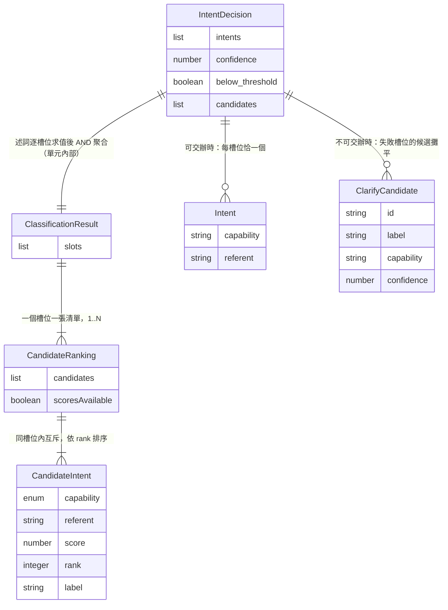

# Functional Specification — `U11 intent-router`

> **本檔是工作流程與狀態轉換的唯一真實來源。** `entities.md` 管資料形狀、
> `rules.md` 管決策邏輯。本檔另帶兩個**衍生**視圖（實體關係圖、規則摘要）。
>
> **修訂 1（審查 `review-01.md`，`VERDICT: NOT-READY`，六項發現）**：
> 六項全部接受，處置逐項見 **§八**。最大的一項是 `R-01`（Critical）——
> 原設計把「同一件事的互斥讀法」與「一句話裡並存的多件事」壓進同一張扁平
> 候選清單，使 `FR5.1` 的官方可測不變量在規則字面下會靜默只輸出一個意圖。

## 本檔服務的四則故事與其需求來源

`unit-of-work-story-map.md:116` 逐字把 `US1.1`／`US1.2`／`US5.1`／`US6.1` 指派給
`U11`。需求來源為 `requirements.md` 的 `FR1.1`／`FR1.3`／`FR1.5`／`FR1.6`／`FR1.7`、
`FR5.1`／`FR5.2`、`FR6.1`。元件層前身為 `components.md` 的 `IntentRouter`；
對外契約為 `contract-summary.md:745-800` 的 `K-10`；
單元邊界為 `unit-of-work.md:141`，其**自附的阻塞警語**為 `:143-154`、驗證方式與 PBT 註為 `:156-158`。

## 零、本站的一項定案與它的授權邊界

| 題 | 定案 | 一句話後果 |
|---|---|---|
| `[IR1]` | **A — 反問判定寫成「候選清單上的述詞」** | `can_single_out(ranking)` 是唯一判定點；`confidence < 0.7` 降為它在「候選帶分數」時的求值分支 |

**授權邊界（重要）**：`[IR1]`=A 改的是**本單元內部的純函式層**，
`K-10` 的 `IntentDecision` 欄位集合**不動**——本單元沒有任何改 `K-10` 的授權
（`U10` 改 `K-09` 是靠 `OQ-N4` 逐字授權，本單元沒有對應者）。
詳見 `entities.md` 的授權邊界表。

---

## 一、工作流程

### W1 — 一句明確輸入的完整路徑

| # | 執行者 | 動作 | 規則 |
|---|---|---|---|
| 1 | `U13` | 收到使用者訊息，以該連線的 principal 呼叫 `classify(principal, session, text)` | `BR7.2` |
| 2 | **本單元** | 先過 `prompt_guard` | `BR1.1` |
| 3 | **本單元** | 未命中 → 進入分類（**無快路徑**） | `BR2.1` |
| 4 | **本單元** | 依需要讀 `SessionContext` 的當前作業對象與**該段**歷程 | `BR5.1` |
| 5 | **本單元** | 組裝**最少上下文**的請求，呼叫模型 | `BR6.1`／`BR6.2` |
| 6 | **本單元** | 產出 `ClassificationResult`：**N 個槽位**，每槽位一張 `CandidateRanking`（依 `rank` 排序；`score` 可為 null）。單意圖輸入是 N=1 | `BR4.1`／`BR2.2`／`BR2.3` |
| 7 | **本單元** | 對**每一個槽位**分別求值 `can_single_out`，再做整句 AND 聚合 | `BR3.1`–`BR3.3`／`BR4.2` |
| 8 | **本單元** | 聚合為真 → `intents` **恰 `len(slots)` 個**（每槽位取 `rank == 1`）、`candidates` 為空 | `BR3.5`／**`BR4.4`** |
| 9 | `U13` | 轉交 `U12` 建立工作項 | `BR7.3`（本單元**不**建立） |

### W2 — `prompt_guard` 命中

| # | 執行者 | 動作 | 規則 |
|---|---|---|---|
| 1 | **本單元** | `prompt_guard` 命中 | `BR1.1` |
| 2 | **本單元** | **不呼叫任何 LLM**，回固定拒絕訊息 | `BR1.2`，**`AC1.1.3` 在此滿足** |
| 3 | `U13` | 該輪以**終止事件 `done`** 結束，不是 `error` | `BR1.3` |

**第 3 步容易被實作成 `error`**，因為「拒絕」聽起來像失敗。`K-10` 逐字說它是
「有內容的有效回覆」——系統**正確地**拒絕了，那不是故障。

### W3 — 判不出來 → 反問

| # | 執行者 | 動作 | 規則 |
|---|---|---|---|
| 1 | **本單元** | **任一槽位**的 `can_single_out` 為假 → 整句聚合為假 | `BR3.2`／`BR3.3`／`BR4.2` |
| 2 | **本單元** | `intents` 置空、`candidates` 填入**所有失敗槽位**的候選（攤平，`label` 寫明屬於哪一件事） | `BR3.5`、**`BR4.5`**、`EC4`／`EC8` |
| 3 | **本單元** | **不建立工作項、不產生任何結果** | `BR7.3`，**`AC1.2.1` 在此滿足** |
| 4 | `U13` | 送出 clarify 訊息，畫面列出候選 | `K-10` |

### W4 — 使用者選定候選

| # | 執行者 | 動作 | 規則 |
|---|---|---|---|
| 1 | 客戶端 | 以 `select_clarify_candidate` 回傳候選 id | `K-02`（`ADR-0019` 追認的第六個 type） |
| 2 | `U13` | 依該候選交辦 | **`AC1.2.2` 在此滿足**；流程回到 `W1` 第 9 步 |
| 3 | **本單元** | **不參與**——選定不需要再分類一次 | `BR2.1` 的「每一次**輸入**」指使用者的自然語言輸入，不含候選選取 |

**第 3 步是本站的判讀，值得寫明**：`BR2.1` 說「每一次入口頁輸入一律先過分類」。
把「選了一個候選」也算成一次輸入會導致重新分類，而候選已經是分類的產物——
那是一個迴圈。故本站讀 `BR2.1` 的「輸入」為**自然語言輸入**，並在此記下該判讀。

### W5 — 使用者選「都不是，我再講一次」

| # | 執行者 | 動作 | 規則 |
|---|---|---|---|
| 1 | 客戶端 | 選「都不是」 | — |
| 2 | `U13` | 回到輸入狀態；**脈絡列與作業對象不變** | **`AC1.2.3` 在此滿足** |
| 3 | **本單元** | **不參與**，且**不得**在反問被拒時修改作業對象 | **`BR7.4`**（修訂 1，審查 `R-05`）——本單元對 `SessionContext` 唯讀 |

### W6 — 多意圖

| # | 執行者 | 動作 | 規則 |
|---|---|---|---|
| 1 | **本單元** | 分類辨識出 N 個可分離意圖 → **N 個槽位**，每槽位一張自己的候選清單 | `BR4.1`、`EC6` |
| 2 | **本單元** | 述詞對**每一個槽位分別**求值 | `BR3.1`–`BR3.3` |
| 3 | **本單元** | 整句聚合 = 對全部槽位的 **AND** | `BR4.2` |
| 4 | **本單元** | 聚合為假 → 整句反問，**不交辦任何一個**；候選為失敗槽位的攤平 | `BR4.2`／`BR3.5`／`BR4.5` |
| 5 | **本單元** | 聚合為真 → 輸出 **恰 N 個** `Intent`（每槽位 `rank == 1`），**不附順序與依賴** | **`BR4.4`**／`BR4.3`，**`AC5.1.1` 在此滿足** |
| 6 | `U12` | 建立 N 個工作項，決定順序與 `等待中` 狀態 | **`AC5.1.2` 屬 `U12`** |

**第 3 步是本站新定的**：上游沒有說多意圖時述詞作用於整句還是逐槽位。
逐槽位各自交辦會讓畫面同時出現工作項與反問，而 `FR1.3` 的「不得產生**任何**結果」
支持整句判定。

**第 1 步與第 5 步是修訂 1 補的，而缺了它們會壞掉的方式很安靜。** 原設計只有
一張扁平的 `CandidateRanking`，而 `BR3.2` 的述詞只看 `candidates[0]`、`BR3.5`
只說「`intents` 非空」。把 `requirements.md:176` 逐字給的官方可測不變量代進去
——「改架構圖加 Redis 快取，然後估一下成本差額」，兩個意圖都明確、都高於門檻
——照原規則的字面，`intents` 只要非空就合規；而 `CandidateIntent` 當時被定義為
**互斥**候選，所以最直覺的實作是 `intents = [candidates[0]]`，**只輸出架構設計、
把估成本靜默丟掉**。使用者看到一個工作項，`AC5.1.1` 失敗，而 `US5.1` 在追溯表上
仍然標 `OK`。槽位層（`EC6`）與基數等式（`BR4.4`）就是為了讓這件事不靠實作者猜。

### W7 — 指涉詞解析

| # | 執行者 | 動作 | 規則 |
|---|---|---|---|
| 1 | **本單元** | 輸入含指涉詞（「那張圖」） | — |
| 2 | **本單元** | 以該 session **該段**的作業對象與歷程解析 | `BR5.1` |
| 3 | **本單元** | 輸入中直接點名對象時，**優先於** session 當前值 | `BR5.3`。**`AC1.1.5` 只滿足一半**——見 `OPEN-IR11-4` |
| 4 | **本單元** | 可唯一解析 → 填入 `referent` | — |
| 5 | **本單元** | 不可唯一解析 → `can_single_out` 為假，走 `W3` | `BR5.2`，**`AC6.1.2` 在此滿足** |
| 6 | **本單元** | 在獨立段中指涉共享段的產出 → **解析不到**（該段歷程不含它） | `BR5.1` ＋ `U10` 的 `BR3.2`；**第二個違反入口由 `BR5.5` 擋下**，`AC6.1.3` 在此滿足 |

**第 6 步原本看起來不需要本單元做任何額外判斷**——`U10` 的段隔離把「讀錯段」
這個入口結構性地擋掉了，本單元只要讀對段就自動成立。

**但本站查出它有第二個入口**，而上游沒有任何一條規則的字面擋得住：
本單元除了 session 歷程，還有**第二條讀取路徑**——經 `K-08` 的 `MemoryFacade`
讀記憶（`K-10` 的 `observable_side_effects` 逐字「讀記憶（唯讀）」）。
**記憶不分段**：它是長期、跨 session 的。若指涉詞解析可以查記憶，
獨立段就能解析到共享段的產出，而 `AC6.1.3` 這條**負向**驗收會**靜默失效**
——測試不會變紅，因為它斷言的是「解析不到」，而解析得到的那一次沒人在看。
`BR5.5` 為此而寫：記憶可用於理解偏好與術語，**不得用於決定 `referent` 指誰**。

### W8 — 模型失效或超出用量

| # | 執行者 | 動作 | 規則 |
|---|---|---|---|
| 1 | **本單元** | 模型不可用／超出上限 | `BR6.3` |
| 2 | **本單元** | raise `LlmUnavailable`／`LlmBudgetExceeded` 向上傳遞 | `BR8.2` |
| 3 | **本單元** | **不**回一個猜測的 `Intent`、**不**降級為「挑第一個」 | `BR8.2` |

**第 3 步要防的是最壞版本的失敗**：降級猜測不只違反 `FR1.3`，它比直接交辦錯誤
更糟——使用者連候選都看不到，無從察覺系統其實不知道。

---

## 二、狀態機：一輪判定的狀態

```
  received ──prompt_guard 命中──▶ refused ──▶（終止：done）
     │
     └──未命中──▶ classifying ──模型失效──▶ failed ──▶（終止：error）
                      │
                      ▼
                   slotted              （N 個槽位，各有一張候選清單）
                      │
                      ▼
            對每個槽位求值 can_single_out
                   ╱     ╲
      全部為真 ＝AND╱       ╲任一為假
                 ▼         ▼
            dispatchable  clarifying ──使用者選定──▶（回到 dispatchable，見 W4）
                 │                   └─使用者選「都不是」─▶（回到 received，見 W5）
                 ▼
            （交給 U12，恰 len(slots) 個 Intent）
```

- **`refused` 的終止事件是 `done` 不是 `error`**（`BR1.3`）——這是狀態機上最容易
  畫錯的一條邊。
- **`slotted` 是唯一能通往 `clarifying` 的狀態**：`failed` 不行（`BR2.4`：空清單
  是失敗不是反問）。把兩者接到同一個出口，會讓壞掉的分類器看起來像在謹慎發問。
- **求值分兩層，而兩層都畫在圖上是刻意的**：述詞 `can_single_out` 作用於
  **一個槽位**（`BR3.2`／`BR3.3`），整句判定是對全部槽位的 **AND**（`BR4.2`）。
  把它們合成一個節點會讓人以為述詞吃的是整句，而那正是 `R-01` 的來源。
- **`clarifying` 不是終端**：兩條出邊分別回到 `dispatchable`（`W4`）與 `received`
  （`W5`），且兩者都**不經過本單元**。
- **本單元不持有這個狀態**——它是一輪互動的概念狀態，持有者是 `U13`。
  本單元每次呼叫是無狀態的（`BR8.1`：`classify` 非冪等正因為它不帶狀態）。

---

## 三、衍生視圖：實體關係圖

> 衍生自 `entities.md`，該檔的 YAML 是真實來源。語法已以 Mermaid 實際算繪驗證通過。



**文字 fallback**：`ClassificationResult` 組合擁有 1 至 N 個 `CandidateRanking`
——**一個槽位一張**。每張 `CandidateRanking` 組合擁有 1 至 N 個 `CandidateIntent`，
依 `rank` 排序，**同一張之內互斥**。`IntentDecision` 由述詞對每個槽位求值、
再依 `BR4.2` AND 聚合而得——**這條關係只存在於本單元內部，`ClassificationResult`
不會送給 `U13`**。`IntentDecision` 含 0 至 N 個 `Intent`（可交辦時恰
`len(slots)` 個，`EC7`）與 0 至 N 個 `ClarifyCandidate`（不可交辦時為失敗槽位的
候選攤平，`EC8`），兩者**恰有一邊非空**（`EC4`／`EC5`）。

**兩層的差別是整張圖的重點**：`ClassificationResult → CandidateRanking` 是
**並存**（幾件事都要做），`CandidateRanking → CandidateIntent` 是**互斥**
（同一件事的幾種讀法，只能選一個）。原設計少了上面那一層，兩個軸壓在一起，
於是「輸出幾個 `Intent`」沒有規則可循——那是 `R-01`。

**圖上刻意沒有的**：`CandidateIntent` 與 `Intent` 之間**沒有**繼承邊——
`Intent` 是對外契約的形狀，`CandidateIntent` 是內部的候選形狀，兩者欄位相近
但生命週期與擁有者不同。轉換規則寫在 `EC7`（逐欄複製）而不是畫成一條邊，
因為「可以直接轉型」與「每槽位只取 `rank == 1` 的那一個」是兩回事。

---

## 四、衍生視圖：規則摘要

> 衍生自 `rules.md`。條數由該檔的腳本實算，本節只做導讀。

| 群組 | 它回答的問題 | 最容易被漏掉的那一條 |
|---|---|---|
| `BR1.x` 輸入前置 | 什麼時候不該呼叫模型 | `BR1.3`——拒絕訊息以 `done` 而非 `error` 結束 |
| `BR2.x` 分類與排序 | 分類產出什麼形狀 | `BR2.4`——空清單是**失敗**不是反問 |
| `BR3.x` 反問述詞 | 什麼時候反問 | `BR3.3`——無分數時的分支；少了它 `FR1.3` 靜默永不觸發 |
| `BR4.x` 多意圖 | 拆幾個、輸出幾個、誰決定順序 | **`BR4.4`**——`intents` 的**基數等式**。`BR4.2`（整句 AND）管「要不要交辦」，`BR4.4` 管「交辦幾個」，而原設計只有前者 |
| `BR5.x` 指涉詞 | 解析讀哪裡、解不出來怎麼辦 | `BR5.5`——**記憶不得用於解析指涉對象**；它是 `AC6.1.3` 的第二個違反入口，而上游沒有一條規則的字面擋得住 |
| `BR6.x` 成本 | 每輪花多少 | `BR6.3`——機制必須存在，**數值不在本站** |
| `BR7.x` 邊界 | 本單元不做什麼 | **`BR7.4`**——對 `SessionContext` 唯讀。`BR7.3`（不建立工作項）原先被誤當成它的依據，而那條字面完全沒提 `SessionContext`（審查 `R-05`） |
| `BR8.x` 冪等與失效 | 壞掉時怎麼辦 | `BR8.2`——**不降級猜測** |

---

## 五、ADR-0006 Security Baseline 四面向（第七項自檢）

| 面向 | 判定 | 本單元的落點 |
|---|---|---|
| **IAM** | **適用** | `BR7.1`（不自行判權）＋ `BR7.2`（principal 由參數傳入，不自取身分）。讀記憶經 `K-08` 的 `MemoryFacade`，授權由它承擔——本單元**不得**繞過它直接讀 `memory` schema |
| **Encryption** | **適用，且有本 intent 少見的增量** | 本單元是 `IntentRouter`，其 `external_dependencies` 含 **OpenRouter（third-party-api）**——**使用者的自然語言輸入會離開本平台**。`BR6.1` 的「最少上下文」因此不只是成本紀律，**也是資料外送的最小化**：附上整段對話歷程等於把更多個人內容送出去。本檔明記這一點，因為 `cost_discipline` 的原文只講成本 |
| **Network exposure** | **適用** | 本單元**不暴露**任何對外端點（`BR7.2`），但它**發起**一條對第三方 API 的外送連線。入站零增量、出站有增量——兩者分開陳述，不合併成「零增量」 |
| **Audit logging** | **適用** | ① `prompt_guard` 命中應可被觀測（它是安全事件），但**不得記錄觸發它的輸入文字**；② 本 repo 為 public、Actions log 公開可讀，而本單元處理的是使用者的自由文字——任何日誌都不得含 `text` 或候選的 `label`（後者由模型從輸入生成，可能複述輸入內容）。**第二點是本單元獨有的**：`U10` 的禁令只需涵蓋訊息內容，本單元還要涵蓋**模型對那些內容的複述** |

**四面向皆適用，無不適用項。**

### Property-based testing hard constraint：**本單元是 blocking，不是 N/A**

`ADR-0006` 逐字點名 **agent routing** 為 PBT hard constraint 的三個落點之一，
而本單元**就是** agent routing。`contract-summary.md:797-799` 的 `pbt_note` 逐字
指定受測對象為「門檻比較這個純函式」。

`[IR1]`=A 讓該純函式成為 `can_single_out(ranking, threshold)`，其 property 為：

| # | Property | 為什麼它對 `OQ-10` 的兩種結論都成立 |
|---|---|---|
| P1 | `can_single_out` 為假 ⇒ `intents` 空且 `candidates` 非空 | 不涉及分數 |
| P2 | `can_single_out` 為真 ⇒ `intents` 非空且 `candidates` 空 | 同上 |
| P3 | 候選數為 1 ⇒ `can_single_out` 為真 | 同上 |
| P4 | `scoresAvailable` 為真時，提高最高分不會使述詞由真變假（單調） | 只在有分數的分支求值 |
| P5 | 述詞對任何合法 ranking 都回傳布林值，不 raise | `BR8.3` |
| **P6** | **每個槽位都可單選 ⇒ `len(intents) == len(slots)`，且第 i 個取第 i 槽位 `rank == 1`** | 不涉及分數。**修訂 1 新增（`R-01`）** |
| **P7** | **任一槽位不可單選 ⇒ `intents` 為空，且 `candidates` 含每一個失敗槽位至少一個候選** | 不涉及分數。**修訂 1 新增（`R-01`）** |

**七條 property 中有六條不涉及分數**——這就是 `[IR1]`=A 的價值：
`OQ-10` 無論落在哪一邊，P1／P2／P3／P5／P6／P7 都不需要重寫，只有 P4 的前提會
變成空集合。若採 `[IR1]`=B（照字面寫 `confidence < threshold`），全部都要重寫，
而那正是 `pbt_note` 已經預告的後果。

**P6 與 P7 是修訂 1 對 `R-01` 的可執行形式。** `R-01` 之所以是 Critical，
不是因為設計寫錯了一句話，而是因為**當時沒有任何一條 property 碰得到它**：
P1／P2 只斷言 `intents` 空或非空，而「非空但少了一個」完全通過。P6 是一條等式，
它把 `FR5.1` 的官方可測不變量直接變成可被 Hypothesis 反覆打的斷言。

### 生成策略的一個要求（修訂 1，審查 `R-06`）

交給 `code-generation` 的 PBT 落點必須明寫：**`scoresAvailable` 要由
`st.booleans()` 之類的策略顯式驅動**，不能讓「分數存不存在」隨機浮現。
理由是 Hypothesis **不會**因為某個分支從未被抽到而報錯——若策略偏好生成帶分數的
候選，`BR3.3`（無分數分支）與 P3 可能長期零覆蓋而無人察覺，而 `BR3.3` 正是
`FR1.6` 逐字警告的「`FR1.3` 靜默永不觸發」的唯一防線。**同理，`len(slots)` 也要
顯式涵蓋 1 與 ≥2 兩種情形**，否則 P6／P7 只會在單槽位上被驗證，而 `R-01` 的
失敗情境恰好只在多槽位出現。

---

## 六、具名缺口

### `OPEN-IR11-1`：`EC3`／`BR5.4` 的「兩種 `null`」需要一個表達形式

「沒有指涉詞」與「有指涉詞但解析不出來」必須可區分，否則 `AC6.1.2` 不可構造。
本站**只鎖定不變量，不指定欄位形狀**（加一個旗標、用 sentinel、或拆成兩個欄位
都可以）。**承接**：`U11` 的 `code-generation`（3.5，**ALWAYS**，游標之後）。

### `OPEN-IR11-2`：`OQ-4`／`OQ-10` 仍未定案，且本站**刻意**設計成不依賴其結論

兩者的承接站為 `U11` 的 `nfr-requirements`（3.2），**即下一站**。本站查證
該站在本工作流程為 EXECUTE（已為 `brain-infra`／`memory-service`／`session-store`
等單元各跑過一輪），故 `requirements.md` 標注的「無自然承接站」**目前不成立**
——那條標注的轉移條件是「該站被 skip」。

**但有一件事要交代給下一站**：若 `OQ-10` 結論為「無可用信心訊號」，
`K-10` 的 `confidence` 欄位語意需要改寫。**該改寫需要像 `OQ-N4`
（`contract-summary.md:1433`）那樣的明文授權**，而目前沒有。下一站定案時須一併
處理授權問題，不能只回答技術問題。

> **修訂 1／`R-02`：上一段原本後面還跟著一句自我否定的話。** 它寫「本站已在
> `entities.md` 把它標為可為 null，但那是如實記載現況，不是契約變更」——而
> `entities.md` 當時把 `logical_type` 寫成 `number|null` 且 `required: true`，
> 那是一個**已定案的型別宣告**，不是「記載」。`entities.md` 自稱是本單元實體形狀
> 的唯一真實來源，`code-generation` 的實作者只會讀它。同一份產出一邊說「目前沒有
> 授權」、一邊行使那個授權，是本站自己打自己。已改為 `logical_type: float`
> ＋ `pending: true` ＋ `pending_owner`，型別照 `K-10` 原樣轉錄。

### `OPEN-IR11-3`：每輪模型呼叫次數／重試／用量上限的**數值**

`BR6.3` 已鎖定「機制必須存在且可設定」，數值由 `K-10` 的 `cost_discipline` 逐字
指派回補項 `N-18`。**承接**：`U11` 的 `nfr-requirements`（下一站）。

### `OPEN-IR11-4`：`AC1.1.5` 的「脈絡列更新為該系統」**沒有寫入端**，而且形狀也對不上

這是本站契約端點三問查出的缺口，**兩層都成立**：

**第一層——沒有寫入端。** `AC1.1.5` 的 Then 有兩個子句：
「脈絡列更新為該系統」與「工作項針對它建立」。後者由本單元的 `referent`
＋ `U12` 承載；**前者沒有任何已指派的機制**。`SessionStore.set_work_target`
的唯一驅動路徑是 `K-12` 的 **client→server `set_work_target` 訊息、由 `U13` 處理**
——那是使用者**手動在脈絡列選取**。而 `AC1.1.5` 的前提逐字是「脈絡列顯示
**尚未選定**」、使用者只打了一句話，**沒有任何人送出那則訊息**。

**第二層——即使指派了，形狀也對不上。** `set_work_target` 的參數是
`(session_key, principal, project_id, system_id, diagram_id)`——一組經 `K-07`
驗證的**三層識別**；而 `K-10` 的 `Intent.referent` 是 `str|None`，一個
**不透明字串**。從「訂單系統」這四個字到三層識別之間，**還缺一次名稱→識別碼的解析**，
而那件事在任何契約裡都沒有端點。

**本站刻意不指派**，理由與 `contract-design` 修 R-01 時記下的那條相同
（發現缺口時先問「上游已經把這件事交給誰了」，不要憑推論加一條拓樸邊）：

- 若落在 `U11`：名稱→三層識別要經 `K-07` 的 `HierarchyFacade`，但
  **DAG 裡沒有 `U11 → U7` 的邊**（`unit-of-work.md:160` 逐字只有 `U8`、`U10`）。
  新增一條邊必須送 `delivery-planning`（2.9，`ALWAYS`），否則 Bolt 序缺這條約束
  ——這正是 `FD8-1` 已經在做的事。
- 若落在 `U12`：它是 `K-09` 的消費端之一，呼叫 `set_work_target` 不需新邊；
  但名稱→識別碼的解析仍需 `K-07`，而 `U12` 也沒有 `→ U7` 的邊。
- 若落在 `U13`：它同時是 `K-09`、`K-10`、`K-07` 的消費端，**不需任何新邊**
  ——但它是否該在轉交 `U12` 之前先寫作業對象，是一個流程決定而非本單元的決定。

**承接**：`U12` 的 `functional-design`（3.1，`CONDITIONAL`、per-unit；
轉移目標為 `U12` 的 `code-generation`，3.5，`ALWAYS`）——與 `U10` 的
`OPEN-S10-1` 同一落點，因為兩者是**同一個缺口的兩面**：`OPEN-S10-1` 是
「第一輪產出的圖沒有寫入端」，本項是「句中點名的系統沒有寫入端」。
兩者都是「作業對象的唯一寫入端是使用者手動選取」這件事的後果。

> **本站因此把 `AC1.1.5` 記為 `GAP` 而非 `OK`**。`BR5.3` 確實讓本單元認出
> 句中的對象並優先於 session 當前值，但 Then 的另一個子句沒有機制——
> 記成 `OK` 會讓一條 **Must** 故事的 AC 在追溯表上看起來已覆蓋。

### `OPEN-IR11-5`：`BR5.5` 的禁令有一半無機械強制，且它**目前不可達**（修訂 1，審查 `R-03`）

`BR5.5` 禁止「用記憶決定 `referent` 指誰」、允許「用記憶理解偏好與術語」。
審查正確指出：這條界線原本沒有任何可被實作或測試區分的形式。修訂 1 分三層處理：

| 層 | 內容 | 狀態 |
|---|---|---|
| **可執行的那一半** | 呼叫 `MemoryFacade.search` 時 `kinds` **不得含「情節」記憶**，只傳語意／程序。簽章 `search(principal, query, kinds: Sequence[str], limit)` 見 `contract-summary.md:617-618`；三種記憶見 `components.md:179` | **已寫成 `BR5.5.logic_executable`**，可由一個斷言 `kinds` 實際傳值的測試擋住 |
| **殘留缺口** | 語意記憶是「事實」，原則上仍可能載有產出物名稱；而「理解術語」與「決定 `referent`」在**模型內部**不可區分 | **`residual_gap`**，比照 `contract-summary.md:1434` 的 `OQ-N2`（「決定不加機制是可以的，不追蹤它不行」） |
| **可達性** | `MemoryFacade.write` **沒有任何呼叫者**（`contract-summary.md:1432` 的 `OQ-N3`，Critical，仍開著），所以 `memory_records` 永不被填、`search` 永遠回空 | **`BR5.5` 現在擋不到任何真實資料，是前置護欄** |

**第三層是本輪自己補的，不在審查的要求裡**，而它改變了這條規則該怎麼被讀。
`project.md` 逐字要求「新增任何『偵測 X 狀態』的規則之前，先推導 X 是否可達
——不可達的規則是死碼，卻在文件上長得像已解決」。`BR5.5` 守的正是一條目前
不可達的路徑，所以**它現在就是死碼**。保留它的理由是 `OQ-N3` 關閉（補上記憶
寫入端）的那一刻路徑就變成可達，而屆時沒有人會回頭想起這條負向 AC。

**因此 `AC6.1.3` 在本輪維持 `OK`，但帶一個條件**：`OQ-N3` 定案時必須重新檢視它。
這一點與審查的 required action（「不要讓 `AC6.1.3` 維持 `OK`」）**部分不同**，
理由寫在 §八 的 `R-03` 列——摘要是：該 AC 的 Then 斷言「系統無法解析它」，
而目前系統**確實**無法透過記憶解析，不是因為紀律，是因為記憶是空的。

---

## 七、送審前自檢（六項＋第七項）逐項報告

| # | 自檢項 | 結果 |
|---|---|---|
| 1 | **可達性** | **通過，且查出一項**。`W3` 的 `clarifying` 狀態在 `OQ-10` 結論為「無信心訊號」時**是否可達**，取決於 `BR3.3` 存不存在——這正是 `FR1.6` 逐字警告的「靜默永不觸發」。`BR3.3` 的存在使它在兩種結論下都可達。另驗 `refused`：`AC1.1.3` 給了具體觸發輸入，可達。 |
| 2 | **契約端點三問**（誰寫／誰讀／誰清；誰擁有／誰呼叫） | **送審時報「查出 `OPEN-IR11-4`」，而審查查出它**漏了另一件更基本的事**（見下方「自檢的失效」）。原始報告：**逐欄：`CandidateRanking` 由本單元建立、由述詞讀、隨該輪結束消失（無持久化）；`IntentDecision` 由本單元建立、由 `U13` 讀、不持久化。方法面：`K-10` 只有一個公開方法 `classify`，呼叫者只有 `U13`（`K-10.consumers` 逐字）。本單元**不建立任何持久實體**，故無「誰清」懸空。**懸空的是 `referent` 的下游**：本單元寫它、`U12` 讀它以決定作用對象——但 `AC1.1.5` 另外要求它**寫回 session 的作業對象**，而那一端沒有呼叫者、且 `str` 對不上 `set_work_target` 要的三層識別。見 §六 `OPEN-IR11-4`。**這一問是靠「對本單元產出的每個欄位逐一追它的下游」查到的，不是靠印象**——`project.md` 逐字記著「寫入端是三問中最容易漏的一問」。 |
| 3 | **引用逐字核對**（事實與定位分開驗） | **通過，且自己查出一處錯誤並更正**。`unit-of-work.md` 的三處引用我原本寫成 `:137`／`:139-152`，開檔核對後實為 `:141`（交付）／`:143-154`（阻塞警語）／`:156-158`（驗證與 PBT 註）——**事實全對、定位全錯**，正是 `project.md` 逐字記過的那一類（內容對而行號錯的引用會通過任何只檢查內容的核對）。四個檔共四處已更正。其餘：`unit-of-work-story-map.md:116`、`contract-summary.md:745-800`（`K-10`）、`:797-799`（`pbt_note`）、`requirements.md` 的 `FR1.1`–`FR1.8`／`FR5.1`／`FR5.2`／`FR6.1`、`OQ-4`（`:785`）／`OQ-10`（`:791`）、`stories.md` 的四則故事與其 AC——逐一開檔核對事實與行號。 |
| 4 | **檔案集合一致性** | **通過**。與 `session-store`／`memory-service` 兩個 `service` kind 單元比對：四個 produces 齊備，無 `frontend-components.md`（本單元 kind 為 `service`）。 |
| 5 | **跨檔傳播**（按事實列舉） | **通過**。`[IR1]`=A 這個事實在本站有六種表達：`entities.md` 的授權邊界表、`CandidateRanking` 實體、`EC2`；`rules.md` 的 `BR3.1`–`BR3.3`、讀法表；本檔 §零、§三的 ER 圖與 fallback、§五的 PBT property 表。逐一開檔確認一致，**特別核對沒有任何一處把 `confidence < 0.7` 寫成規則本身**。 |
| 6 | **可算的數字先算再寫** | **通過**。`rules.md` 的條數、群組與類別分佈**全部由腳本自該檔 YAML 解析產生並直接寫入**；本檔不手寫任何條數。`traceability.json` 的 AC 計數同樣由腳本輸出。 |
| 7 | **hard constraint 逐項對照**（ADR-0006 四面向 ＋ PBT） | **通過**。見 §五：四格逐格填、無空白、無「不適用」；**PBT 判為 blocking 而非 N/A**——本單元就是 ADR-0006 點名的 agent routing，這與 `U10` 的 N/A 判定不同，不得沿用。 |

### 自檢的失效：六項＋第七項全綠，而審查找到一個 Critical

**`R-01` 落在自檢 2 的射程內，但我沒有問到那一題。** 自檢 2 我逐欄追了
`CandidateRanking`／`IntentDecision`／`referent` 的寫、讀、清，也追了
`classify` 的擁有者與呼叫者——**但我沒有追 `intents` 這個欄位的「值從哪來」**。
它在我的表上被當成「本單元建立、`U13` 讀」就結束了，而「建立幾個、每個取自哪裡」
才是它真正的契約內容。**「誰寫」這一問對 `list` 型欄位要多問一句：寫幾個。**
`project.md` 已經逐字記著「寫入端是三問中最容易漏的一問」，而這是它的一個新變形
——寫入端在（就是本單元），缺的是**寫入量的規則**。

**`R-05` 落在自檢 5（跨檔傳播）的射程內，也沒抓到。** 我在三份產出裡一致地寫
「本單元從不寫 `SessionContext`」，一致性檢查因此全綠——但那三處**引用的是同一條
不支持它的規則**（`BR7.3`）。自檢 5 驗的是「同一事實在各檔是否一致」，
**不驗「那個事實有沒有根據」**。一致地引用一條錯的依據，會完美通過一致性檢查。

**`R-02` 是我自己寫下「目前沒有授權」然後行使那個授權。** 兩句話隔了兩個檔案，
沒有任何一項自檢會把它們並排看。可執行的補強：凡在產出中寫下「本站沒有 X 的
授權」，就立刻 grep 全部產出有沒有在行使 X。

**`R-04`／`R-06` 是真實但較輕的缺口，`R-03` 的 (a) 成立、(b) 我部分不同意**
（見 §八）。六項裡有四項（`R-01`／`R-02`／`R-04`／`R-05`）是**自己查得到**的，
這與 `project.md` 記過的「一輪送審一輪 READY，不是不送審」那條的落差在於：
我的七項自檢**檢查的都是我寫下的東西**，沒有一項在問「我該寫而沒寫的是什麼」。

---

## 八、審查處置表（`review-01.md`，六項）

| ID | 嚴重度 | 判定 | 處置 |
|---|---|---|---|
| `R-01` | Critical | **接受** | 新增 `ClassificationResult`（槽位層）＋ `EC6`／`EC7`／`EC8`；`BR3.2`／`BR3.3` 的 `applies_to` 釐清為單一槽位；`BR4.1` 改述為槽位、`BR4.2` 改為對槽位的 AND 聚合；**新增 `BR4.4`（基數等式）與 `BR4.5`（候選攤平來源）**；新增 property `P6`／`P7`；`W1`／`W3`／`W6`、狀態機與 ER 圖同步改寫。**`K-10` 的 `data_shape` 未動一字**——槽位層完全在單元內部，`intents` 與 `candidates` 本來就是扁平清單 |
| `R-02` | Major | **接受** | `entities.md` 的 `IntentDecision.confidence` 由 `number\|null`／`required: true` 改為 `logical_type: float`（照 `K-10` 原樣轉錄）＋ `pending: true` ＋ `pending_owner: nfr-requirements`；`OPEN-IR11-2` 補記這次自相矛盾 |
| `R-03` | Major | **接受 (a)，(b) 部分不同意** | (a) 已補 `BR5.5.logic_executable`：`kinds` 不得含情節記憶（`contract-summary.md:617-618` 的簽章）。(b) 審查要求「不要讓 `AC6.1.3` 維持 `OK`」，**本站維持 `OK` 並附條件**：該 AC 的 Then 斷言「系統無法解析它」，而 `MemoryFacade.write` **沒有任何呼叫者**（`OQ-N3`，Critical，仍開著），記憶永遠是空的——目前系統**確實**解析不到，不是靠紀律。把它改成 `GAP` 會讓一個**不可達**的風險與 `AC1.1.5` 那個**真實且今天就存在**的缺口在表上等重。改為：`residual_gap` 比照 `OQ-N2` 如實記載 ＋ `reachability` 欄寫明它現在是死碼 ＋ `OPEN-IR11-5` 明訂「`OQ-N3` 定案時 `AC6.1.3` 必須重新檢視」 |
| `R-04` | Major | **接受** | `traceability.json` 的 `US6.1` 由 `OK` 改為 `Deferred`，與 `U10` 對齊；並在 `note` 寫出彙總規則本身（故事層級狀態取其**最弱**的那條 AC，不取多數） |
| `R-05` | Major | **接受** | 新增 `BR7.4`：本單元不得呼叫 `SessionStore` 的任何寫入方法，來源為 `components.md:323` 的唯讀邊宣告；`W5` 第 3 步與 `traceability.json` 的 `AC1.2.3.note` 改引用 `BR7.4` |
| `R-06` | Minor | **接受** | §五 新增「生成策略的一個要求」：`scoresAvailable` 須由 `st.booleans()` 顯式驅動；順帶把同一個理由套到 `len(slots)`（1 與 ≥2 都要涵蓋），否則 `P6`／`P7` 只會在單槽位被驗證 |

**審查本身的一處小瑕疵，如實記下但不影響結論**：`R-03` 引用
`contract-summary.md:613` 為 `MemoryFacade.search` 的簽章，實為 `:617-618`
（`:613` 是另一個方法的 `returns` 行）；`R-05` 引用 `:697`（實為 `:688` 的
`consumers` 行）、`R-02` 引用 `:759`（實為 `:761`）。**六處引用的事實全部查證為真**
，只有定位偏一到四行——與我自己本輪在 `unit-of-work.md` 上犯的是同一類。
已逐一開檔核對後才據以修改，沒有照單全收。
