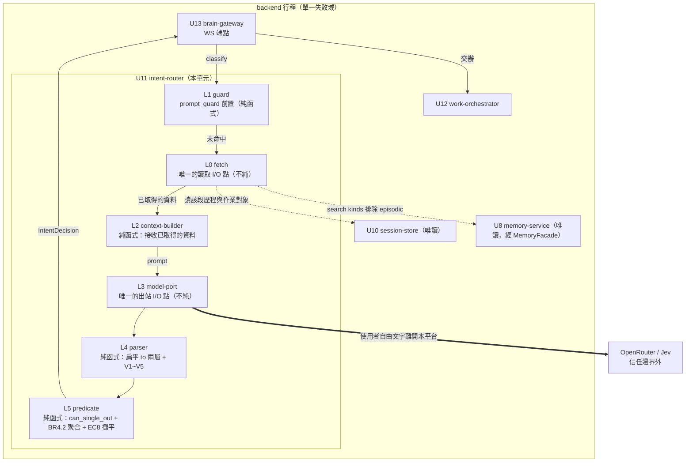

# Logical Components — `U11 intent-router`

> 本檔橋接 NFR 設計與 `Infrastructure Design`：給出**元件層級**的視圖，說明每個
> NFR 模式套在哪裡、失敗域怎麼切、爆炸半徑有多大。**不是部署拓樸**——本單元
> `in-process`，沒有自己的部署單位。

## 一、五層分解（本單元內部）

**文字 fallback**：`U13` 以 `classify` 進入本單元的 **L1 guard**（純函式）；命中
`prompt_guard` 即終止（回固定拒絕訊息、以 `done` 結束）。未命中進 **L0 fetch**
——**本單元唯一的讀取 I/O 點**：它唯讀地從 `U10` 取該段的作業對象與歷程、
從 `U8` 經 `MemoryFacade` 取語意／程序記憶（`kinds` 排除 episodic）。
取得的資料傳給 **L2 context-builder**，**它是純函式**：接收已取得的資料、
組出 prompt，自己不做任何 I/O。**L3 model-port** 是**唯一的出站 I/O 點**，
以 `router_chat_model` 建 client、包進單節點 `StateGraph`，發出唯一一次呼叫到
OpenRouter／Jev——**這是整張圖上唯一跨越信任邊界的邊**。**L4 parser**（純函式）
把扁平的 `candidates[]` 依 `slot` 還原成兩層並跑 V-1～V-5 驗證。
**L5 predicate**（純函式）對每個槽位求 `can_single_out`、依 `BR4.2` AND 聚合、
並在不可交辦時依 `EC8` 攤平候選（見 `reliability-design.md` §二之二），
產出 `IntentDecision` 回給 `U13`；`U13` 再轉交 `U12`。
`U10`／`U8`／`U12` 與本單元**都在同一個 backend 行程內**。

> **修訂 1（審查 `R-01`，Critical）：原本的圖與 fallback 與 §二 的表格互相矛盾。**
> 原圖把兩條讀取邊的起點畫在 `CTX`（L2）、fallback 逐字寫「L2……它是純函式，
> **唯讀地從 `U10` 取**」，而 §二 的表格同時宣稱 L2「外部依賴：無（接收已取得的資料）」
> ——**同一份檔案對「誰呼叫 `SessionStore`／`MemoryFacade`」給出兩個互斥答案**，
> 而 `code-generation` 無從知道該信哪一份。處置：**保留 §二 的那一個**（L2 純函式、
> I/O 在外層），因為 `BR6.1`「最少上下文」能用**不需要 mock 的測試**驗證這件事
> 正是本單元測試策略的基礎；並新增一個顯式的 **L0 fetch** 層把 I/O 邊的起點改過去。
>
> **這正是 `project.md` 的 `domain-design:72ea0721` 記過的那個形狀**——「同一份檔內
> 的敘述與宣告自相矛盾，而六項自檢沒有一項在檢查它」。那條教訓說的是 `behaviour`
> 禁令對撞 `depends_on` 的入邊；本輪是**圖的邊**對撞**表格的欄**。同一個類別，
> 換一種載體。

## 二、五層各自的性質（這張表決定了測試怎麼寫）

| 層 | 純度 | 外部依賴 | 失敗型別 | 測試方式 |
|---|---|---|---|---|
| **L1 guard** | 純函式 | 無（`prompt_guard` 是既有純函式） | 不失敗（命中即正常終止） | 既有 `prompt_guard` 測試 ＋ 一條順序斷言（guard 在 L0／L3 之前） |
| **L0 fetch** | **不純**（唯一的讀取 I/O 點） | `U10` `SessionStore`（唯讀）、`U8` `MemoryFacade.search`（唯讀） | `SessionBackendUnavailable` 向上傳遞（`U10`）；`U8` 失敗時**降級**（`D-1`） | 替身兩個依賴；另斷言 `search` 的 `kinds` 引數（`NFR7.62`） |
| **L2 context-builder** | **純函式**（取得資料的 I/O 在它之外） | 無（接收已取得的資料） | 不失敗 | 直接測：給定輸入組出什麼 prompt；**斷言不含完整 `messageHistory`** |
| **L3 model-port** | **不純**（唯一的 I/O 點） | OpenRouter／Jev | `LlmUnavailable`／`LlmBudgetExceeded` | 替身：逾時、5xx、429、連線失敗四種 |
| **L4 parser** | **純函式** | 無 | `EmptyCandidates`／`MalformedRouting` | 直接測 V-1～V-5；畸形輸入逐一 |
| **L5 predicate** | **純函式** | 無 | **永不失敗**（`NFR3.71`） | **property-based（ADR-0006 的落點）** |

**這張表是本檔最有用的產出**：它說明為什麼 `ADR-0006` 的 PBT 落點是 L5 而不是
整個單元——**L5 是唯一一個輸入空間可被生成、且沒有 I/O 的層**。
而 L2 與 L4 雖然也是純函式，它們驗的是「組得對不對／解得對不對」，
用 example-based 更直接。

**L2 的純度是刻意設計的**：取資料的 I/O 放在它之外（呼叫端先取好再傳進來），
使「最少上下文」這條規則可以被一個不需要 mock 的測試驗證。

## 三、失敗域與爆炸半徑

| 問題 | 失敗域 | 爆炸半徑 | 是否隔離 |
|---|---|---|---|
| Jev 不可用 | **L3 以外全部正常** | 該輪失敗；**不影響其他使用者的其他輪次**（無共享狀態） | ✅ 無狀態＋零重試＋5 秒逾時 |
| Jev 回畸形輸出 | L4 擋下 | 同上 | ✅ V-1～V-5 |
| `U10` 不可用 | L2 取不到上下文 | 該輪失敗（`SessionBackendUnavailable` 由 `U10` 拋出） | ⚠️ **本單元不處理**——它向上傳遞，由 `U13` 終止該輪 |
| `U8` 不可用 | L2 取不到記憶 | **這一項需要一個決定，見下** | ⚠️ |
| backend 行程掛掉 | 整個行程 | 該行程服務中的全部連線 | ✅ 其他行程不受影響（無狀態、session 在 Redis） |

### `U8` 不可用時：本站的設計決定是**降級而非失敗**

**這是本檔唯一一處與「一律大聲失敗」不同的判斷，必須說清楚理由。**

記憶在本單元的用途是**理解偏好與術語**（`BR5.5`），不是解析 `referent` 的必要輸入
——`BR5.1` 逐字說指涉詞解析讀的是「`SessionContext` 的當前作業對象與**該段歷程**」。
記憶是加分項。

| 依賴 | 不可用時 | 理由 |
|---|---|---|
| `U10`（session） | **失敗** | 沒有該段歷程與作業對象，指涉詞解析不可能正確。猜測＝`BR8.2` 要防的那件事 |
| `U8`（記憶） | **降級**：不帶記憶繼續分類，並記一個觀測事件 | 它是加分項；因為拿不到術語解釋就讓整輪失敗，是用使用者的體驗去換一個不存在的正確性 |

**降級必須被觀測**：`RoutingObservation` 已補上 `memory_degraded: bool`
（`security-design.md` §二 與 `observability-design.md` §一**兩份定義都已同步**，
審查 `R-02`），且 `observability-design.md` §二 新增一條「記憶降級率」訊號。
否則「記憶永遠取不到」會變成一個無聲的長期降級，而那正是 `project.md` 記過的
`N8N_USER` 那類失敗（服務照常啟動、功能靜默降級）。

> **修訂 1（審查 `R-02`，Major）：這條補救原本只存在於本段的要求句裡。** 審查以
> `grep -c memory_degraded` 實測：全站**僅 1 處命中**（就是這一句），而
> `security-design.md` 與 `observability-design.md` 各自宣告的 `RoutingObservation`
> dataclass **都沒有這個欄位**——兩份都寫得像是定案的程式碼，`code-generation`
> 直接照抄就會漏掉它。**`D-1` 是本檔唯一偏離「一律大聲失敗」的判斷，而它的正當性
> 完全建立在「降級可被觀測」這一個條件上**——條件沒落地，判斷就沒有依據。已補。

> **這一條是本站新定的，上游沒有說。** 它直接影響 `code-generation` 的錯誤處理
> 分支，故寫在本檔而非留給實作者猜。

## 四、共享資源（本單元用到、但不擁有）

| 資源 | 擁有者 | 本單元的使用方式 | 約束 |
|---|---|---|---|
| Redis（session） | `U1`／`U10` | **唯讀**，經 `SessionStore` | `BR7.4`：不得呼叫任何寫入方法 |
| PostgreSQL（記憶） | `U1`／`U8` | **唯讀**，經 `MemoryFacade.search` | `NFR6.60`：不得繞過 facade；`NFR7.62`：`kinds` 排除 episodic |
| OpenRouter 帳戶額度 | 平台（`NFR9`） | 每輪 1 次呼叫 | 上限由 OpenRouter 後台承載，本 intent 不建計量 |
| backend 行程的 HTTP client 連線池 | 本單元的 factory | 重用，不每輪新建 | `performance-design.md` §二 P-4 的界線 |

## 五、給 `Infrastructure Design` 的三件事

| # | 內容 |
|---|---|
| 1 | **本單元不需要任何新的基礎設施元件**。無新容器、無新 port、無新 volume。它活在既有的 backend 容器內 |
| 2 | **但它新增五個環境變數**（`tech-stack-decisions.md` 的 `TS-4`），其中 `BRAIN_ROUTER_CONFIDENCE_THRESHOLD` **required 無預設、缺值即啟動失敗**。三處同步義務（`backend/.env.example`、`deploy/.env.example`、`deploy/render-env.sh`）由 `python3 scripts/validate_env_contract.py` 機械檢查 |
| 3 | **它新增一條出站連線**（backend → OpenRouter）。既有 stack 已有對外出站（A1／A3／C1 都打 OpenRouter），**故防火牆／egress 規則零增量**——但這一點要被確認而非假設，列為 `Infrastructure Design` 的查證項 |
