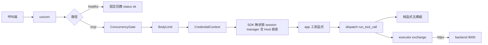

# 邏輯元件 — `U21 mcp-bridge`

> 本檔是本站設計的元件總表、依賴與層序、共享資源與爆炸半徑、`NFR21.37`–`NFR21.41` 的落點、帶入清單 21 項的處置總表、本站對上游
> 文字的取代關係，以及本站新增的開放項。各元件的設計細節在其餘五份產出；本檔只做對照，不重述。

## 一、元件清單

**模組配置的總原則**（收斂 `R-02`／`R-11`）：只有 `app.py` 與 `server.py` import `mcp`；`__init__.py` 為空；其餘模組都能在**沒有安裝
`mcp` 的直譯器**中 import。五個純函式模組另受 `NFR21.40` 的禁令（不 import `mcp`、`httpx`、`sqlalchemy`、`fastapi`）。

| 元件 | 模組（`backend/mcp_bridge/`） | 職責 | import `mcp`？ | import `httpx`？ | 失效範圍 |
|---|---|---|---|---|---|
| 套件 | `__init__.py` | 空檔 | 否 | 否 | — |
| 進入點 | `__main__.py` | 只有 `raise SystemExit(main(sys.argv[1:]))` | 否 | 否 | 進程 |
| `cli` | `cli.py` | `parse_args`（`--backend-url`、`--host` 預設 `127.0.0.1`、`--port` 預設 8080、`--max-concurrency` 預設 16）；`main(argv, *, config_dir)` | 否（驗證通過後才在函式內 import `server`） | 否 | 進程 |
| `startup` | `startup.py` | `load_and_validate(config_dir) -> LoadedConfig`；讀三份 JSON（本單元唯一的 `open(`）；`StartupConfigError(subject)` | 否 | 否 | 進程（致命） |
| `observability` | `observability.py` | `configure_logging`、`BridgeFormatter`、`normalize_agent`／`normalize_tool`、四種事件的記錄函式 | 否 | 否 | — |
| `limits` | `limits.py` | 五個具名常數、`BridgeLimits`、`derive_allowed_hosts(port)` | 否 | 否 | — |
| `guards` | `guards.py` | 三個 ASGI 中介層：`ConcurrencyGate`、`BodyLimit`、`CredentialContext`；`ContextVar` 定義 | 否 | 否 | 單一請求（閘門計數為單一實例） |
| `dispatch` | `dispatch.py` | `run_tool_call`：MB-W3 第 2–8 步、總攔截、恰一行 log、`asyncio.shield` 保護 backend 交換 | 否 | 否（`exchange` 以注入取得） | 單一工具呼叫 |
| `executor` | `executor.py` | `build_backend_client`（含拒收 cookie 的 jar、`Limits`、`Timeout`）、`exchange`、`read_bounded`、`classify_transport_error` | 否 | **是**（唯一） | 單一工具呼叫 |
| 純函式 ×5 | `generator.py`、`calls.py`、`outcomes.py`、`credentials.py`、`agents.py` | `functional-spec.md` 2.5；`map_outcome` 以 `ExchangeResult` 聯集為輸入 | 否 | 否 | 無 I/O；PBT 落點 |
| `app` | `app.py` | `create_app(*, backend_client, registry, tool_specs, allowed_hosts, limits=BridgeLimits())`：組裝中介層、`/healthz`、SDK 的無狀態 session manager（`json_response=True`、Host 檢查）、以 `validate_input=False` 註冊工具函式 | **是** | 否 | 整個 bridge |
| `server` | `server.py` | `serve(loaded, args)`：建 client、呼叫 `create_app`、以 `uvicorn.Config(access_log=False, log_config=None)` 起服務、記啟動 INFO | **是** | 否 | 進程 |
| 產生腳本 | `backend/scripts/gen_mcp_tools.py` | 寫出與 `--check`；只 import `mcp_bridge.generator` | 否 | 否 | CI |
| 測試輔助 | `backend/tests/mcp_topology.py`、`mcp_wire_client.py`、記錄包裝 | 路線宣告、兩種 `McpClientPort` 實作、`LogSource`、屏障 | 依路線 | 是 | 僅測試 |

可執行檢查：`backend/mcp_bridge/` 內 `^\s*(import|from)\s+mcp\b` 的命中檔案集合恰為 `{app.py, server.py}`；`import httpx` 的命中檔案集合恰為
`{executor.py}`；`__init__.py` 的非空白、非註解行為 0。

## 二、請求的層序與依賴

文字 fallback：呼叫端經 uvicorn 進入 bridge；路徑為 `/healthz` 時直接回固定的 `{"status":"ok"}`，不經任何閘門。路徑為 `/mcp` 時依序經
`ConcurrencyGate`（超額 503）、`BodyLimit`（超量 413）、`CredentialContext`（把標頭原值放入 `ContextVar`、結束時重設），再進入 SDK 的
無狀態 session manager（Host 檢查在此，不合者被 SDK 拒絕），由 `app.py` 的工具函式呼叫 `dispatch.run_tool_call`；後者使用五個純函式模組
做解析、驗證、組請求與結果映射，並經 `executor.exchange` 以 httpx 呼叫 backend 的 8000 埠。

**為何 `/healthz` 在全部閘門之外**：`NFR21.19` 要它恆回 ok、`NFR21.25` 要 backend 故障不影響存活判定；放在並行閘之內就重演 `R-01` 的第 3 個後果。

## 三、共享資源與爆炸半徑

| 共享資源 | 本單元的使用 | 爆炸半徑與上界 |
|---|---|---|
| bridge 進程的事件迴圈 | 全部請求 | 無同步 I/O（`performance-design.md` §二）；進行中請求 ≤ 16 |
| bridge 記憶體 | 請求與回應緩衝 | 請求相關上界 17825792 位元組（17 MiB，`scalability-design.md` §六）；常駐量未量測 |
| 對 backend 的 httpx 連線池 | 工具呼叫 | 上限＝並行上限 16（`performance-design.md` §四） |
| backend 的同步端點執行緒池（anyio 預設 40，套件預設值、**未實測**） | 三條需求欄位路由皆為同步 `def` | bridge 全滿時最多佔 16 條，留 24 條（60%）給其他流量（`NFR21.21` 的算式） |
| backend 的 DB 連線池 | 經 facade | 每次工具呼叫為一次短交易；上界同上（16） |
| compose `internal` 網段 | bridge 監聽 `0.0.0.0:8080` | 網段成員 4 → 5；`redis`／`ollama` 的可達來源 3 → 4；同網段任一容器可連 `/mcp`（`[G2]`=A 已接受，`R-03` 已確認）。重算落點 `infrastructure-design`（`OPEN-MB21-12`） |
| backend 映像 | 第一順位：`mcp` 進入 backend 映像（backend 進程不 import）；第二退路：`/opt/mcp-venv` | 供應鏈面多一個套件（`OPEN-MB21-15`，已揭露） |

**bridge 自身失效的影響**：本版無實際 client，影響為 0；日後為「agent 取用需求欄位失敗」，不影響 backend 與前端。**bridge 對 backend 的
最壞壓力**：並行 16、每次 ≤ 10 秒、不重試——由並行閘與逾時共同給出，與呼叫端行為無關。

## 四、技術選型的落點（`NFR21.37`–`NFR21.41`）

| 需求 | 落點 |
|---|---|
| `NFR21.37` `mcp` 精確釘選、選路寫進計畫 | `reliability-design.md` §6.3；路線宣告為 `mcp_topology.MCP_ROUTE` 一個常數。靜讀 `mcp 1.29.0` 的 `METADATA`：`starlette>=0.27`、`anyio>=4.5`、`httpx>=0.27.1,<1.0.0`、`uvicorn>=0.31.1`——**只是另一 clone 的參考**，`fastapi==0.111.0` 解析出的 Starlette 是否落在所釘版本的範圍內，以及 `sse-starlette` 的傳遞範圍，由 code-generation 第一步判定 |
| `NFR21.38` 新增直接依賴恰為 `mcp` | 兩條路線的計數口徑見 `reliability-design.md` §6.3 |
| `NFR21.39` PBT 決定性閘門 | **擇 (a)**：§六 的八個類別各自一個 `@given` 測試（帶入項 `R-14`）；每個測試各自斷言「成功分支至少出現一次」不再需要比例下限——成功類別本身就是其中兩個測試的生成目標 |
| `NFR21.40` 純函式禁令 | 本檔 §一 的總原則與可執行檢查（禁令範圍擴大到全部非 SDK 模組不 import `mcp`） |
| `NFR21.41` Dockerfile | 第一順位不改；第二退路見 `reliability-design.md` §6.3 |

## 五、帶入清單 21 項的處置（`../carried-review-items.md`）

| 來源 | 項 | 本站處置 | 落點 |
|---|---|---|---|
| functional-design | `R-11` 第二退路下整合測試不可執行 | **以設計收斂**：模組分層使非 SDK 檢查兩路線同處執行；第二退路的端到端拓樸、最小 client、CI 步驟、skip 禁令 | `reliability-design.md` §六 |
| functional-design | `R-12` 啟動是否讀 `allowlist.json` | **收斂，擇 (a)** | `reliability-design.md` §五 |
| functional-design | `R-13` `re.match` 放行換行 | **收斂**：`fullmatch` | `security-design.md` §四 |
| functional-design | `R-14` PBT 下限統計誤判 | **收斂，擇 (a)** | 本檔 §四 |
| functional-design | `R-15` `T-1` 交錯靠運氣 | **收斂**：屏障在記錄包裝，兩路線皆與測試同一事件迴圈 | `security-design.md` §一；`reliability-design.md` §6.2 |
| functional-design | `R-16` C-5 落點漏三類 | **維持帶入**：契約追認，非 NFR；由 code-generation 計畫核可前的 conductor 處理（`OPEN-MB21-6`） | — |
| functional-design | `R-17` `create_app` 簽名、`T-8` 無具名入口 | **收斂**：統一簽名（含本站新增的 `limits`）、具名入口 `cli.main`／`startup.load_and_validate` | `reliability-design.md` §五 |
| functional-design | `R-18` `--host` 預設 | **收斂**：`127.0.0.1`；compose 明列 `0.0.0.0` | `security-design.md` §二 |
| functional-design | `R-19` SDK 預先驗證繞過封閉表 | **收斂**：`validate_input=False`（依據為靜讀 SDK 原始碼）；版本無此開關時為完成阻擋條件 | `observability-design.md` §二 |
| functional-design | `R-20` `TransportFailure` 未定義；cookie jar 非原子 | **收斂**：恰四值的封閉枚舉與歸類表；拒收一切 cookie 的 jar（擇 (b)） | `reliability-design.md` §一；`security-design.md` §一 |
| functional-design | `R-21` 問題檔殘留 | **維持帶入**：conductor 已於帶入清單記明更正，非 NFR | — |
| nfr-requirements | `R-01` 並行上限誤用 `limit_concurrency` | **以設計收斂**：bridge 自己的 ASGI 並行閘，`/healthz` 豁免；偏離審查「只計 `tools/call`」並寫明理由 | `scalability-design.md` §一 |
| nfr-requirements | `R-02` 第二退路下測試不可執行 | **以設計收斂**（同 functional-design `R-11`）；`NFR21.38` 改寫計數口徑；skip 禁令擴及全部 | `reliability-design.md` §六 |
| nfr-requirements | `R-03` `OPEN-MB21-13` 的確認 | **已由使用者確認**（2026-10-14T23:02:07Z），本站照錄 | `security-design.md` §七 |
| nfr-requirements | `R-04` Host 清單與隨機埠；「零新增」措辭 | **收斂**：`derive_allowed_hosts(port)`；措辭改為「對外（edge、host）暴露面零新增」並寫明 `internal` 網段內的殘留 | `security-design.md` §二、§九 |
| nfr-requirements | `R-05` 算式 | **收斂**：請求端 12 位元組／字元、餘裕約 2.5 倍；回應端維持 6 並更正理由 | `scalability-design.md` §2.2、§3.3 |
| nfr-requirements | `R-06` tool 欄、413／503 零紀錄 | **收斂**：`tool` 正規化為已宣告名或 `unknown`；`request_rejected` WARNING；單行格式 | `observability-design.md` §一–§三 |
| nfr-requirements | `R-07` `NFR21.3` 非二元、量測不對稱 | **收斂**：二元條件改為「超過時裁決紀錄存在」；分段推導證明差值同形；抖動輸出格式 | `performance-design.md` §三 |
| nfr-requirements | `R-08` 對照表三處未落地 | **收斂**：(1) 簽名見 `R-17`；(2) 枚舉恰四值、`entities.md` 由 code-generation 增補；(3) `ResponseTooLarge` 經 `map_outcome`、`retryable: false` | `reliability-design.md` §一；`scalability-design.md` §3.2 |
| nfr-requirements | `R-09` 頻率後果、優雅關閉 | **收斂**：後果揭露；`stop_grace_period: 15s` 交接 | `scalability-design.md` §七；`reliability-design.md` §八 |
| nfr-requirements | `R-10` `NFR4` 標 OK 不一致 | **維持帶入**：屬上游 `nfr-requirements/traceability.json` 的標記，本站不改上游；本站的 `traceability.json` 只列 `NFR21.x`（同 `U13` 先例）。對齊說明：`NFR4` 對本單元應讀為 N/A（bridge 不承擔還原義務，只以無狀態保證不引入行程內狀態） | — |

計數：21 項中，以設計收斂 17 項、已由使用者確認 1 項（`R-03`）、維持帶入 3 項（`R-16`、`R-21`、`R-10`）。

## 六、本站對上游文字的取代關係（供 code-generation 寫進 `code-summary.md`）

| 上游 | 本站 | 性質 |
|---|---|---|
| `NFR21.21`「超過者由 uvicorn 回 HTTP 503」、以 `limit_concurrency` 構造 | 由 bridge 的 `ConcurrencyGate` 回 503 並記 WARNING；不設 `limit_concurrency`；判準 ①–⑤（`scalability-design.md` §1.3） | 取代（`R-01` 已核可方向） |
| `NFR21.26`「至少 `refused`、`timeout`、`dns`、`protocol`」 | 恰為這四值 | 收窄 |
| `NFR21.3`「未達標時由 `build-and-test` 的核可關卡裁決」 | 超過時裁決紀錄必須存在（二元） | 精確化 |
| `NFR21.30`／`NFR21.38`／`NFR21.41` 的第二退路敘述 | `reliability-design.md` §6.2–§6.3 的拓樸、CI 步驟與計數口徑 | 取代 |
| `BR78.2` 第二退路「拓樸改為子進程…斷言不變」 | 同上；斷言程式共用、client 實作依路線替換 | 精確化（functional-design `R-11` 已核可方向） |
| `BR78.1`「以官方 SDK 的 streamable HTTP client」 | 第一順位原樣；第二退路改為手寫最小 JSON-RPC client ＋ 一案 SDK 互通煙霧測試 | 第二退路下取代（functional-design `R-11` (4) 已核可方向） |
| `BR78.3`／`functional-spec.md` 2.5 的 `create_app` 參數 | 四個必填 ＋ `limits=BridgeLimits()` | 統一並增補（`R-17`） |
| `functional-spec.md` 2.5「`configure_logging()` 在 `app.py`」 | 移至 `observability.py` | 模組搬移（規則不變） |
| `functional-spec.md` MB-W1 第 2 步「載入 `generated_tools.json`、`agents.json`」 | 另載入 `allowlist.json` | 補明（`R-12` 擇 (a)，與 2.5 的 `validate_tool_specs(specs, allowlist)` 簽名一致） |
| `NFR21.16` ③「允許清單恰為 `mcp-bridge:8080`、`localhost:8080`、`127.0.0.1:8080`」 | 由 `derive_allowed_hosts(port)` 推導，預設埠時恰為這三項 | 精確化（`R-04`） |
| `NFR21.33`「`mcp` 的 logger 設為 WARNING 以上」 | `mcp` 為 WARNING、`mcp.server.lowlevel.server` 為 ERROR | 依字面的範圍內收緊 |

## 七、本站新增與結案的開放項

| # | 事項 | 承接 |
|---|---|---|
| `OPEN-MB21-16` | client 中途斷線時，SDK 是否取消工具 task **未實測**；本設計以 `asyncio.shield` 保護 backend 交換與記 log，使已送出的請求完成並照常留一行紀錄（`reliability-design.md` §九） | `code-generation`（ALWAYS）以一案驗證 |
| `OPEN-MB21-17` | 所釘 SDK 版本若與 `mcp 1.29.0` 相同，工具函式無法產生 JSON-RPC 協定錯誤，未知工具改以 `BR76.1` 形狀的 `invalid_argument` 結果回傳——與 `BR76.3`「未知工具為協定錯誤」的字面有落差（`observability-design.md` §二） | `code-generation` 實測所釘版本後寫進 code-summary；若確實無法產生協定錯誤，於該站核可關卡揭露此落差 |
| `OPEN-MB21-9` | **本站結案**：本版不設關聯鍵（`observability-design.md` §六），後果於核可關卡揭露 | 大腦 client 落地的後續 intent |
