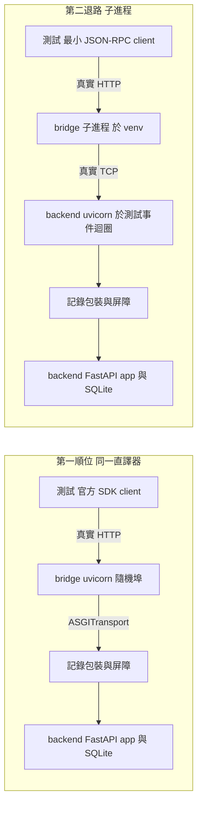

# 可靠性設計 — `U21 mcp-bridge`

> 承接 `../nfr-requirements/reliability-requirements.md` 的 `NFR21.25`–`NFR21.32`，並以設計收斂 nfr-requirements 審查的 `R-02`
> （第二退路下測試不可執行）、`R-08` 第 1、2 點、`R-09` 第 2 點，與 functional-design 審查的 `R-11`、`R-17`、`R-20` 第 1 點。
> 「靜態讀」的定義見 `performance-design.md` 檔頭。

## 〇、不採用的模式

| 模式 | 理由 |
|---|---|
| 重試 | `BR75.1`／D-12：每次工具呼叫恰一次 backend 請求；重試決策交給 agent（`retryable`）。`NFR21.27` |
| 熔斷 | 需要跨請求狀態；bridge 無狀態（`BR71.2`）。backend 不可用時每次呼叫在 ≤ 3 秒（連線拒絕為毫秒級）內以 `backend_unavailable` 結束，已是快速失敗 |
| 排隊 | `NFR21.21`「不排隊」；超額 503（`scalability-design.md` §一） |
| 備份 | 不持久化任何資料（`reliability-requirements.md` 第五節） |

## 一、傳輸失敗的封閉歸類（`NFR21.26`；帶入項 nfr-requirements `R-08` 第 2 點、functional-design `R-20` 第 1 點）

### 1.1 型別（`entities.md` 的增補由 `code-generation` 完成，依 `R-08` 的 Required action）

- `TransportFailure.kind` 為**恰好四值**的封閉枚舉：`refused`、`timeout`、`dns`、`protocol`。nfr-requirements 原文的「至少」改為「恰為」，
  使 `map_outcome` 的窮舉測試有固定母體。
- 執行層結果為封閉聯集 `ExchangeResult = Received(status, body) | TransportFailure(kind) | ResponseTooLarge | InternalFailure`。
  `map_outcome(ExchangeResult) -> ToolOutcome` 是 `BR76.1` 封閉表**唯一**的實作點（純函式，`outcomes.py`，不 import `httpx`）。

### 1.2 歸類函式 `executor.classify_transport_error(exc) -> TransportFailure | None`（只在執行層，唯一 import `httpx` 例外型別之處）

| 例外 | `kind` | 依據 |
|---|---|---|
| `httpx.ConnectError` 且例外鏈（`__cause__`／`__context__`）含 `socket.gaierror` | `dns` | DNS 失敗在 httpx 中同屬 `ConnectError`，只能由例外鏈區分（**未實測**；若鏈中無 `gaierror`，會被歸為 `refused`——兩者映射到相同的錯誤碼與 `retryable`，對外行為不變，只有 `NFR21.26` ② 的 dns 案會紅燈，由 code-generation 實測後擇定判定方式） |
| 其餘 `httpx.ConnectError` | `refused` | |
| `httpx.ConnectTimeout`、`httpx.ReadTimeout`、`httpx.WriteTimeout`、`httpx.PoolTimeout`、`TimeoutError`（`asyncio.timeout`） | `timeout` | |
| `httpx.RemoteProtocolError`、`httpx.ReadError`、`httpx.WriteError` | `protocol` | 連線中途斷開或回應不合 HTTP |
| 其他任何例外（含未列出的 `httpx.HTTPError` 子類） | 回 `None` → 呼叫端產生 `InternalFailure` | `BR76.1` 的「其他」列 |

`map_outcome` 對四個 `kind` 一律回 `backend_unavailable`、`retryable: true`；`InternalFailure`、`ResponseTooLarge` 回 `internal_error`、
`retryable: false`；`Received` 依狀態碼查表。判準：`NFR21.26` 的 ①②③，① 改為「枚舉恰四值且逐值測試」。

## 二、每次呼叫恰一次 backend 請求（`NFR21.27`）

`dispatch.run_tool_call` 在一次工具呼叫中至多呼叫一次 `executor.exchange`；`exchange` 內不迴圈、不重送；httpx client 的
`follow_redirects=False`（`NFR21.13`）。判準三案（503、逾時、中途斷線）各記錄 1 筆。

## 三、請求間隔離與例外（`NFR21.28`、`NFR21.29`）

### 3.1 憑證上下文（`guards.CredentialContext`，不 import `mcp`）

ASGI 中介層：從請求標頭取 `Authorization`、`X-Cloud360-Agent` 的**原始值**放入模組層 `ContextVar`（以 `set()` 取得 reset token），
在 `try/finally` 中呼叫內層，`finally` 一律 `reset()`。`ContextVar` 本身是模組層物件，但**值**只存在於該請求的 context；SDK 在請求內
衍生的 task 於建立時複製 context，故能讀到本請求的值（`BR78.4` 以並發屏障驗證）。

### 3.2 工具處理函式的總攔截（`dispatch.run_tool_call` 與 `app.py` 的轉接）

靜讀 `mcp 1.29.0` 的 `mcp/server/lowlevel/server.py:589-590`：工具函式拋出的任何例外會被 SDK 以 `_make_error_result(str(e))` 轉成工具結果——
**例外文字會原樣回給 agent**，違反 `BR76.1`／`NFR21.8`。故：

- `dispatch.run_tool_call(spec_or_none, arguments, credential, agent_header, exchange) -> ToolOutcome` 位於非 SDK 模組，並在自己的 `finally` 中寫出 `NFR21.34` 的那一行；
  MB-W3 第 2–8 步（第 8 步的 contextvar 重設屬 §3.1 的中介層，除外）全部在其內；它以 `except Exception` 總攔截，一律回 `internal_error`（固定訊息）並在 log 只記例外**型別名**
  （`BR77.2`）。`asyncio.CancelledError` 屬 `BaseException`，不被攔截，照常傳遞。
- `app.py` 的工具函式只做兩件事：呼叫 `run_tool_call`、把 `ToolOutcome` 轉成 `CallToolResult`；它本身不含可能拋例外的邏輯。
- `exchange` 以注入方式傳入 `run_tool_call`，使 `NFR21.29` 的「令 `build_backend_call` 拋 `RuntimeError("SECRET-MARKER")`」可在**主直譯器**
  直接以替身構造（兩條依賴路線相同，§六）。

### 3.3 判準的構造（兩條路線皆可執行）

| 需求 | 單元層（主直譯器，兩條路線相同） | 端到端層 |
|---|---|---|
| `NFR21.28` | 以一個會拋例外的假內層應用包住 `CredentialContext`：第一個請求帶 A 的標頭並使內層拋例外，第二個請求不帶標頭；斷言內層在第二次看到的值為空。突變：拿掉 `finally` 的 `reset` → 紅燈 | 第一順位：原判準（記錄包裝拋例外 → `internal_error`，接著無憑證呼叫 → `unauthenticated`、0 筆）。第二退路：記錄包裝改為中途切斷連線（→ `backend_unavailable`），其餘斷言相同——「含例外」的部分由單元層承擔 |
| `NFR21.29` | `run_tool_call` 注入拋 `RuntimeError("SECRET-MARKER")` 的 `build_backend_call` 替身：結果為 `internal_error`，結果與收集到的 log 皆不含 `SECRET-MARKER`；下一次以正常替身呼叫成功 | 不另設（`NFR21.8` 的逐分支端到端已涵蓋 `internal_error` 分支） |

## 四、backend 不可用與啟動（`NFR21.25`）

- 啟動（`cli.main`）不建立對 backend 的連線：httpx client 為惰性連線；`load_and_validate` 只讀本機三份檔（`BR71.4`）。
- 每次呼叫的失敗只影響該次：`exchange` 回 `TransportFailure`，`run_tool_call` 回 `backend_unavailable`，進程與並行計數照常
  （`ConcurrencyGate` 的 `finally` 釋放名額）。
- backend 恢復後無需重啟：httpx 的連線池在下一次請求時重新建立連線。判準照 `NFR21.25` 原文。

## 五、致命的啟動錯誤：具名入口（`NFR21.6`、`NFR21.35`；帶入項 functional-design `R-12`、`R-17`）

```text
# __main__.py 的全部內容（另有 import 兩行）
raise SystemExit(main(sys.argv[1:]))

def main(argv, *, config_dir=PACKAGE_DIR) -> int:          # cli.py，模組頂層不 import mcp
    args = parse_args(argv)                                 # --host 預設 127.0.0.1、--port 8080、--max-concurrency 16
    configure_logging()                                     # observability.py
    try:
        loaded = load_and_validate(config_dir)              # startup.py：讀 generated_tools.json、agents.json、allowlist.json
    except StartupConfigError as err:
        log_startup_failed(err.subject)                     # 恰一行 ERROR，只含工具名或 agent 名
        return 1
    from .server import serve                               # 驗證通過後才載入含 mcp 的模組
    return serve(loaded, args)                              # 建 client、create_app、uvicorn；記啟動 INFO
```

- **`R-12` 擇 (a)**：啟動載入 `allowlist.json`，`validate_tool_specs(specs, allowlist)` 以它為獨立參考集合（與已核可的 2.5 簽名一致）。
  `NFR21.6` ④ 因此為「`inputSchema` 多一個未在 `allowlist.json` 宣告的屬性」。`allowlist.json` 位於 `backend/mcp_bridge/`，已在映像的
  build context 內，不需改打包。
- **`R-17` 簽名統一**：`create_app(*, backend_client, registry, tool_specs, allowed_hosts, limits=BridgeLimits())`——四個必填加一個帶預設的
  `limits`（本站新增，`scalability-design.md` §一）。統一後的簽名由 `code-generation` 在計畫中呈現並寫進 code-summary。
- `main` 在驗證通過**之後**才 import 含 `mcp` 的 `server`／`app` 模組，使 `NFR21.6` 的四份手改產物測試在**主直譯器**直接呼叫
  `main(argv, config_dir=暫存目錄)` 即可得到回傳值 1——兩條依賴路線相同。函式內 import 是刻意的，理由寫在該行註解。
- 判準：`__main__.py` 除 import 與該行外無其他頂層陳述（AST 檢查：模組 body 恰為 import 節點與一個 `Raise`）。

## 六、測試拓樸：兩條依賴路線都可執行（`NFR21.30`；帶入項 nfr-requirements `R-02`、functional-design `R-11`）

### 6.1 根本作法：把不需要 SDK 的檢查全部移出含 `mcp` 的模組

`R-02` 的核心是「同一個直譯器內不可能同時有 `mcp` 與 backend app」。本設計把 bridge 拆成**只有 `app.py` 與 `server.py` import `mcp`**，
其餘模組（`cli`、`startup`、`observability`、`limits`、`guards`、`dispatch`、`executor` 與五個純函式模組）都不 import `mcp`，
且 `backend/mcp_bridge/__init__.py` **為空**（否則 import 任一子模組都會先執行它）。於是：

| 層 | 涵蓋的需求 | 執行位置 |
|---|---|---|
| 純函式與 PBT | `NFR21.9`（性質六）、`NFR21.10`、`NFR21.26` ①、`NFR21.39`、`NFR21.40` | 主直譯器（兩路線相同） |
| 非 SDK 的執行層單元 | `NFR21.2`、`NFR21.6`、`NFR21.16` ①、`NFR21.21` ④、`NFR21.26` ②、`NFR21.28`／`NFR21.29` 單元層、`NFR21.33`、`NFR21.35`、`guards` 三個中介層（以假內層應用驅動） | 主直譯器（兩路線相同） |
| 端到端（需 SDK 與真實 HTTP） | `NFR21.1`、`NFR21.4`、`NFR21.7`、`NFR21.8`、`NFR21.9` 必測輸入、`NFR21.11`–`NFR21.15`、`NFR21.16` ③、`NFR21.19`–`NFR21.23`、`NFR21.25`、`NFR21.27`、`NFR21.28` 端到端、`NFR21.34`、`NFR21.36` | 依路線而定（§6.2） |
| 產物與 CI 檔案斷言 | `NFR21.5`、`NFR21.17`、`NFR21.24`、`NFR21.31`、`NFR21.32`、`NFR21.16` ②、`NFR21.37`、`NFR21.38`、`NFR21.41` | 主直譯器或 grep（兩路線相同） |

### 6.2 端到端拓樸



文字 fallback：**第一順位**——測試以官方 SDK client 經真實 HTTP 呼叫以 uvicorn 起在 `127.0.0.1` 隨機埠的 bridge；bridge 經
`httpx.ASGITransport` 直達記錄包裝，記錄包裝內含屏障，再進入真實的 FastAPI app 與 SQLite 測試資料庫（即 `BR78.2` 原文）。
**第二退路**——測試以手寫的最小 JSON-RPC client 經真實 HTTP 呼叫跑在獨立 venv 子進程中的 bridge；bridge 經真實 TCP 呼叫在測試自己的
事件迴圈內以 `uvicorn.Server.serve()` 起的 backend，backend 外層同樣是記錄包裝與屏障，再進入同一個 FastAPI app 與 SQLite。

| 元素 | 第一順位 | 第二退路 |
|---|---|---|
| 路線宣告 | `backend/tests/mcp_topology.py` 的常數 `MCP_ROUTE = "same-interpreter"` | 同檔 `MCP_ROUTE = "isolated-venv"`；由 code-generation 依第 1 步的判定設定**一次** |
| 前置條件不成立時 | `import mcp` 失敗 → `AssertionError`（**不是 skip**） | venv 直譯器不存在 → `AssertionError`，訊息指出建立指令 |
| bridge 的建立 | `create_app(...)`，`uvicorn.Server.serve(sockets=[預先綁定的 socket])`（靜讀 `uvicorn/server.py:76-77` 支援 `sockets`）；埠在建立 app 前已知，`allowed_hosts` 據此推導 | 子進程 `<venv>/bin/python -m mcp_bridge --backend-url http://127.0.0.1:<p> --port <q>`，`cwd=backend/`；`<q>` 由測試先綁定再釋放取得，子進程綁定失敗（非零退出）時換埠重試至多 3 次；以輪詢 `/healthz` 判定就緒（上限 10 秒） |
| backend | `ASGITransport(app=記錄包裝(main.app))` | 同一個記錄包裝，以 `uvicorn.Server` 起在 `127.0.0.1` 的預先綁定 socket 上、跑在測試的事件迴圈內；SQLite 為 `StaticPool`＋`check_same_thread=False`（`backend/tests/helpers.py:42-48`），跨執行緒共用同一個記憶體資料庫，與 `ASGITransport` 下的同步端點執行緒池條件相同 |
| 測試 client | 官方 SDK 的 streamable HTTP client（`BR78.1` 原文） | `backend/tests/mcp_wire_client.py`：以 `httpx.AsyncClient` 送 JSON-RPC 的 `initialize`、`tools/list`、`tools/call`，標頭 `Accept: application/json, text/event-stream`；bridge 以 `json_response=True` 回應（`BR71.2`「回應以 JSON 為主」），故只解析 JSON。另加**一案**互通煙霧測試：以 venv 直譯器執行一支腳本，用官方 SDK client 呼叫 `list_tools` 與一次讀取，輸出 JSON 給主測試斷言 |
| 屏障（`NFR21.7`、`NFR21.21`） | 記錄包裝內的 `asyncio.Event`，與測試同一事件迴圈 | 同左——backend 在測試的事件迴圈內，屏障不跨進程 |
| log 收集（`NFR21.8`、`NFR21.34`、`NFR21.36`） | 根 logger 掛收集 handler，使用正式的 `BridgeFormatter`（`observability-design.md` §一） | 讀子進程 stderr；同一個 `BridgeFormatter` 的單行格式，以同一組斷言比對文字 |
| 斷言程式 | 測試本體只依賴一個介面 `McpClientPort`（`list_tools`、`call_tool(name, args, headers)`）與一個 `LogSource`（`lines()`），兩條路線各提供一個實作；**斷言程式碼兩路線共用、只寫一份** | 同左 |

### 6.3 CI 與依賴計數（`NFR21.30`、`NFR21.38`、`NFR21.41` 在第二退路下的改寫）

- **同一個 `backend` job**：第二退路在 `unittest` 步驟之前加一步，於 repo 根目錄建立 `.mcp-venv/`（`python -m venv` 後以其 `pip` 安裝
  `backend/requirements-mcp.txt`）。repo 根目錄不在 backend 映像的 build context 內，`.gitignore:38` 的 `*venv/` 已涵蓋，不入版控、不進映像。
  bridge 的純函式 PBT 與 `gen_mcp_tools.py --check` 仍在主直譯器執行（`NFR21.40`）。
- **skip 禁令擴及全部**（`R-02` 要求）：本單元全部測試檔內 `skipTest`、`skipUnless`、`skipIf`、`SkipTest` 的出現次數為 0（不限以 `mcp`
  為條件）；CI 的 `unittest -v` 輸出中，本單元測試模組的 skipped 計數為 0。前置條件不成立一律以 `AssertionError` 失敗（§6.2）。
- **`NFR21.38` 的計數口徑**：第一順位——`backend/requirements.txt` 新增非註解行恰為 1（`mcp==…`）。第二退路——`backend/requirements.txt`
  的 diff 為空，新檔 `backend/requirements-mcp.txt` 的非註解行恰為 1（`mcp==…`）。依據：`mcp 1.29.0` 的套件中繼資料已宣告依賴
  `httpx`、`uvicorn`、`starlette`、`anyio`（靜讀其 `METADATA` 的 `Requires-Dist`），bridge 直接 import 的第三方套件都由它傳遞帶入；
  若 code-generation 選定的版本不是如此，額外列入的每一行須在 code-summary 對應到 bridge 的一個直接 import。
- **`NFR21.41`（Dockerfile）**：第二退路的 diff 只含 `/opt/mcp-venv` 的建立與 `requirements-mcp.txt` 的安裝；compose `command` 改用
  `/opt/mcp-venv/bin/python`，工作目錄沿用映像的 `WORKDIR /app`（`backend/Dockerfile:14`）。交接 `infrastructure-design`（CONDITIONAL）→
  `code-generation`（ALWAYS）。

## 七、漂移閘門（`NFR21.31`）

`backend` job 在 `dump_openapi.py --check` 之後加 `python scripts/gen_mcp_tools.py --check`。`gen_mcp_tools.py` 只 import
`mcp_bridge.generator`（純函式）——因 `__init__.py` 為空，兩條路線下都能在主直譯器執行。

## 八、部署與優雅關閉（`NFR21.32`；帶入項 nfr-requirements `R-09` 第 2 點）

- compose 形狀照 `NFR21.32` 原文（`restart: unless-stopped`、覆寫 healthcheck 探 `8080/healthz`、記憶體上限、`depends_on: [backend]`
  無 `condition`、`json_file_bounded`、只在 `internal`、無 `ports:`）。記憶體上限的設計輸入見 `scalability-design.md` §六。
- **優雅關閉**：uvicorn 收到 SIGTERM 後停止接受新連線並等待進行中請求完成（`timeout_graceful_shutdown` 預設不限，靜讀
  `uvicorn/config.py:231`）。單次工具呼叫上限 10 秒（`NFR21.1`），compose 預設 `stop_grace_period` 也是 10 秒，兩者貼在同一個邊界上，
  SIGKILL 可能截斷最後一次呼叫。**本站定 `stop_grace_period: 15s`**（10 秒上限＋1 秒判定餘裕＋關閉本身的時間，取整），交接
  `infrastructure-design`（CONDITIONAL；若被 skip 轉 `code-generation`，ALWAYS，判定 skip 者須重新提交使用者）寫入 compose 服務定義。被截斷的情形若仍發生：backend 已收到的請求會照常完成（寫入與清空皆冪等，`X-04`
  `retry_and_idempotency`），agent 端看到的是連線中斷。

## 九、client 中途斷線（`X-04` 的 `consequence_of_the_gap` 在本單元的落點）

`X-04` 明記「連線中斷、逾時、半開連線的行為本契約未定義」。本單元的設計意圖：client 在工具呼叫進行中斷線時，**已送出的 backend
請求不被取消**（它有 10 秒上限，且寫入冪等），並照常產生 `NFR21.34` 的那一行 log（以實際結果為 `outcome`）；只有回應送不回去。
做法：`run_tool_call` 內對 `exchange` 與記 log 的那一段以 `asyncio.shield` 保護。SDK 在 client 斷線時是否取消工具 task **未實測**，
故列為 `OPEN-MB21-16`（`logical-components.md` §七），由 code-generation 以一案驗證：client 送出後立即關閉連線 → 記錄包裝恰 1 筆、
11 秒內出現一行 `outcome=ok` 的 INFO。
