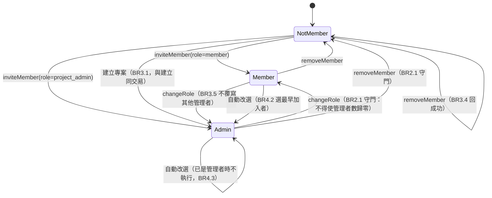
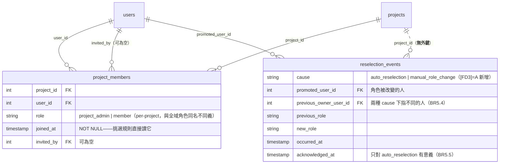

# 功能規格 — `U19 membership-service`

## 〇、本單元是什麼

`service` 單元（L）：交付 **per-project 授權判定的唯一來源**、成員生命週期
（邀請／移出／角色變更）、**自動改選**與其稽核、「專案不得失去最後一位管理者」的
**共同上游守門**，並擴充一處**既有端點**（停用使用者）的回應契約。

消費端：`U20`（同進程）、`U13`（同進程，WebSocket）、`U24`（HTTP）、`U21`（獨立進程）、
以及**既有的 `AdminPage.tsx`**（停用端點的 409）。

本檔是**工作流程與狀態機的單一真實來源**；`entities.md`（資料形狀）與 `rules.md`
（決策邏輯）表達不了有序行為與狀態轉移。§六與§七的兩個檢視是**衍生**的。

### 上游依據（逐一指名，含檔名）

| 上游產出 | 本站用到它的什麼 |
|---|---|
| `contract-summary.md` | 契約 `K-16` 全文：`authorization_model`（唯一入口／兩層串聯／兩層 facade 切分／principal 傳遞／拒絕回報／殘留缺口）、五個 `public_interface` 方法、`last_admin_guard`、`existing_endpoint_extension`、`auditing`、`retry_and_idempotency`；另 `K-15`（本單元寫入的兩張表）、`K-07`（驗證專案存在） |
| `unit-of-work.md` | `:356`–`:366` 的單元定義與驗證方式；`:445`–`:452` 的七項 `U19` 注意事項 |
| `requirements.md` | `FR12.0`–`FR12.6b`（`:279` 起）；其中 `FR12.5`（`:329`）的「唯一**成員**」措辭是 `[FD1]` 的來源之一 |
| `stories.md` | `US12.1`–`US12.6` 共 **20 條 AC**（實算，見 §八） |
| `components.md` | `:533`–`:561` 的 `ProjectMembership` 元件 behaviour 與 responsibilities |
| `unit-of-work-story-map.md` | `:175`–`:180` 的六則故事指派；`:230` 的建議實作順序鏈 |
| `U18` 的 `entities.md`／`rules.md` | 本單元寫入的兩張表的欄位與約束（**唯讀引用，不回改**） |

## 一、三個本站定案

| id | 定案 | 落點規則 |
|---|---|---|
| `[FD1]`=A | 共同守門的不變量是**至少一位管理者**（單一謂詞） | `BR2.1`／`BR2.2` |
| `[FD2]`=A | `removeMember` 對已非成員**回成功**（冪等） | `BR3.4` |
| `[FD3]`=A | 人工角色變更與自動改選**寫同一張表**，以 `cause` 區分 | `BR5.3`–`BR5.5` |

## 二、工作流程（本檔的單一真實來源）

### 2.1 `resolveProjectRole`（per-project 判定的唯一入口）

1. 呼叫端傳入 `principal` 與具名的 `projectId`（`BR1.4`）。
2. 驗證專案存在（經 `K-07`；不存在則 `MembershipNotFound`）。
3. 查 `(projectId, userId)` 的成員列。
4. 有列 → 回該列的 `role`；**無列 → 回 `None`**。
5. 呼叫端收到 `None` **必須當成拒絕**（`BR1.6`）。

**唯讀、冪等，可安全重試。** 這是最熱的路徑：每一次 per-project 授權判定都走它。

### 2.2 `listMembers`

1. 授權：`principal` 須為該專案的成員（`project_admin` 或 `member`）——
   **非成員即拒**（`BR1.6` 的 `None` 路徑 ＋ `BR1.2` 的兩層串聯）。
2. 回該專案全部成員的 `list[MemberView]`。
3. **回傳內容不含 per-project 判定以外的授權結論，也不含全域角色**
   ——前端不得自行推導 per-project 權限（不變量 `I-5`），它只讀本元件給的結論。

**唯讀、冪等。** 這是 `U24` 成員頁的唯一資料來源，也是四條 AC 的觀察面
（`AC12.1.1` 恰有一列、`AC12.2.1` 顯示新角色、`AC12.6.1` 多一列、`AC12.6.2` 少一列）
——`BR3.6` 的「成功是一級行為」之所以可被驗證，就是因為這個方法把清單變成可觀察的。

**`AC12.2.3`（清單上沒有改角色的控件）的伺服器側對應**：本方法**只回傳**成員檢視，
不提供任何變更入口；角色變更的唯一入口是 `changeRole`（§2.5）。畫面側屬 `U24`。

### 2.3 `inviteMember`

1. 授權：`principal` 在該專案須為 `project_admin`（否則 `MembershipForbidden`，`BR1.5`）。
2. **前置檢查**：受邀者須具備對應的全域功能權限；缺少則 `MissingGlobalPermission`（`BR3.2`）。
3. 已是成員則拒絕（`BR3.3`，**非冪等**）。
4. 寫入一列 `ProjectMember`（`role` 取自參數、`joinedAt` 為現在、`invitedBy` 為 `principal`）。
5. 回 `MemberView`。

**步驟 1–4 在單一交易內**（`BR3.2`）：被拒時成員清單不新增任何列（`AC12.5.3`）。
**成功是一級行為**（`BR3.6`）：成功 ⇒ 清單必然多一列。

### 2.4 `removeMember`

1. 授權同上。
2. **守門**：`assertStillHasAdmin(projectId, 移除該成員之後)`（`BR2.1`）；命中則 `LastAdminGuard`。
3. 刪除該列；**查無該列時回成功**（`BR3.4`，`[FD2]`=A）。
4. 回 `None`。

**成功 ⇒ 清單必然少一列，且該成員其後讀取本專案資料被拒**（`BR3.6` ＋ `AC12.6.2`）
——後半句由 2.1 的 `None` 路徑自動成立，不需另寫邏輯。

### 2.5 `changeRole`

1. 授權同上。
2. **守門**：若此變更會使該專案的 `project_admin` 數降為 0（即把最後一位管理者改為
   `member`，含**自我降級**）則 `LastAdminGuard`（`BR2.1` ＋ `AC12.3.1`）。
3. 更新該列的 `role`；**不覆寫其他管理者**（`BR3.5`）。
4. 寫一列 `ReselectionEvent`，`cause = manual_role_change`（`BR5.1`／`BR5.3`），
   `previousOwnerUserId` = **執行變更的 `principal`**（`BR5.4`），`acknowledgedAt` 留空（`BR5.5`）。
5. 回 `MemberView`。

**步驟 3–4 同交易**：角色改了而稽核沒寫，會讓 `AC12.2.2` 的變更紀錄漏一筆而無人察覺。

### 2.6 `assertCanDeactivate`（既有端點呼叫）

1. **唯讀**（`BR2.3`）：找出所有「該使用者是最後一位 `project_admin`」的專案。
2. 集合非空 → `LastAdminGuard(projects=[...])`；空 → 回 `None`（通過）。

呼叫位置：既有停用端點，在 `is_active` 寫入**之前**，與既有兩道保護並列（`BR6.1`／`BR6.3`）。
命中時端點回 **409**，酬載為 `LastAdminGuardReport`，且該 409 必須**顯式**宣告於
route decorator（`BR6.2`）。

### 2.7 自動改選（系統發起，無人按按鈕）

1. **觸發**：停用帳號**成功之後**，且被停用者是某專案的 `owner`，且該專案另有成員（`BR4.4`）。
2. **冪等檢查**：該專案已有其他 `project_admin` → 不執行、不寫事件（`BR4.3`）。
3. 取該專案的成員集合 → 轉為 `list[MemberSnapshot]`。
4. 呼叫**純函式** `selectSuccessor(snapshots)`（`BR4.1`）→ 被選中者。
5. 把被選中者的 `role` 更新為 `project_admin`。
6. 寫一列 `ReselectionEvent`，`cause = auto_reselection`，
   `previousOwnerUserId` = **被停用的 owner**（`BR5.4`），`acknowledgedAt` 留空。
7. 步驟 5–6 同交易。

**注意 1–2 的次序與 2.5 的關係**：守門先判（可能擋下整個停用），改選在停用**成功之後**
才跑。次序反了會對一個其實沒被停用的帳號產生改選事件（`BR4.4`）。

### 2.8 `selectSuccessor`（純函式，PBT 的作用對象）

輸入 `list[MemberSnapshot]`，輸出被選中者。

```
sort key = (joinedAt, userId)   # 決定性；形狀沿用 best_clouds
return min(snapshots, key=lambda s: (s.joinedAt, s.userId))
```

**不讀 DB、不連外、不 raise 領域例外**（`BR4.1`）。
`userId` 進入排序鍵是 `AC12.4.2` 的全部理由：只以 `joinedAt` 排序時，加入時間完全
相同就沒有穩定順序，而那是**靜默的**錯誤。

### 2.9 橫幅的顯示與確認

- **顯示**：查 `cause = 'auto_reselection'` **且** `promotedUserId = 我` **且**
  `acknowledgedAt IS NULL` 的事件（`BR5.5`）。
  **漏掉 `cause` 過濾會讓每次人工角色變更都彈一則橫幅**，而文案是
  「系統自動把管理權交給你」——對人工變更是錯的訊息。
- **確認**：設定該**事件列**的 `acknowledgedAt`（`BR5.6`）。以事件為鍵使同一人
  第二次被改選時仍看得到；狀態在伺服器端故跨裝置一致（`AC12.4.4`）。

## 三、狀態機：成員在一個專案內的生命週期



**文字 fallback**：一位使用者對一個專案有三種狀態——`NotMember`、`Member`、`Admin`。
進入 `Admin` 有三條路徑（邀請時直接給、`changeRole` 升級、自動改選升級）；
進入 `Member` 有兩條（邀請時給、`changeRole` 降級）。
離開成員身分只有 `removeMember` 一條。
`Admin → Member`（降級）與 `Admin → NotMember`（移出）**兩條都經 `BR2.1` 的守門**；
`NotMember → NotMember` 是 `[FD2]`=A 的冪等自環（回成功而非錯誤）。
**沒有從任何狀態到「專案零管理者」的轉移**——那正是 `BR2.1` 要維持的不變量。

## 四、`[FD1]`=A 的一個對齊修正，與它指派回補的地方

`[FD1]`=A 把守門的不變量定為「至少一位**管理者**」。這使**停用路徑的 409 條件比
`FR12.5` 的字面更嚴**：

| 情境 | `FR12.5` 字面（唯一成員） | `[FD1]`=A（最後一位管理者） |
|---|---|---|
| 專案只有 `X` 一人（且是管理者） | 擋下 | 擋下 |
| 專案有 `X`（唯一管理者）與 `Y`（一般成員），停用 `X` | **不擋** | **擋下** |

後者是分歧點：`FR12.5` 的字面不擋，而不擋會留下一個沒有任何管理者的專案。
`[FD1]`=A 選擇擋下。

**因此 `AC12.3.3` 的 Given 措辭與本定案不一致**（它寫「唯一**成員**」）。
依 `project.md`：標出缺口、寫明它讓哪一條 AC 的字面不再成立、指派具體落點與修法，
**不回改已通過審查的上游產出**。

| 缺口 | 不一致處 | 指派落點 | 具體修法 |
|---|---|---|---|
| `AC12.3.3` 的 Given 寫「唯一**成員**」，而 `[FD1]`=A 的 409 條件是「最後一位**管理者**」 | `stories.md:812` | `code-generation`（`ALWAYS`，在游標之後） | 測試依 `[FD1]`=A 的條件撰寫（allow／deny 雙向都要有「兩位成員但只有一位管理者」那一例）；`stories.md` 與 `requirements.md:329` 的措辭回補屬上游修訂，由 `code-generation` 在 summary 揭露 |
| `[FD3]`=A 需要 `reselection_events` 新增 `cause` 欄 | `U18` 的 `entities.md`／`rules.md` 與 `schema_rbac.sql` 的 `J)` 區塊 | `code-generation`（同上） | DDL 加 `cause VARCHAR(32) NOT NULL` ＋ CHECK ＋ COMMENT；觸發 `project.md` 的 blocking 同步（`schema_rbac.sql` ＋ `DEPLOY.md`）。**這是跨單元回補**，本站不改 `U18` 的產出 |

### 4.1 第三處對齊修正：契約 `K-16` 的 `user_router.py` 行號全部過期

`K-16` 的 `preserved_existing_protections` 引用了四個行號，而**四個都不對**。
該契約甚至自帶一段更正史（`line_number_correction_history`：第一次寫
`:651` 與 `:668-671`、「兩者皆錯」，改成 `:645-646` 與 `:667-671`）
——**改過之後仍然是錯的**，因為 `user_router.py` 在那之後又長大了。

| 對象 | `K-16` 寫的 | 本站 `grep -n` 實測 |
|---|---|---|
| 函式 `update_user_active` | （未引用） | `:645` |
| 自我停用守門 | `:645-646` | **`:654`**（條件）／**`:655`**（raise） |
| 最後一位可編輯角色的全域管理員守門 | `:667-671` | **`:676`**（條件）／**`:679`**（訊息） |
| `target_user.is_active = request.is_active` | `:673` | **`:682`** |

**事實全部成立，只有定位錯**（四處都偏約 9 行）。本站在 `BR6.3` 寫入實測行號，
**不回改** `K-16`。這是本 intent 第三次在 `user_router.py` 上踩到同一件事
（`_audit_append` 的 `:213` 實為 `:222`；停用端點的 `:673` 實為 `:682`），
故**引用該檔的行號一律須重驗**，包含從已核可契約複製來的。

`code-generation` 在游標之後——已查 `aidlc-state.md` 的 `Current Stage` 與
`Last Completed Stage`，不是憑 `execution` 欄推定（本 intent 已有三次指派給游標
之前的站而落空的實例）。

## 五、本單元**不**負責的事

| 不負責 | 負責者 |
|---|---|
| 兩張表的 DDL | 契約 `K-15`（`U18`，已交付；`cause` 欄為本站指派的回補） |
| 全域功能權限的判定 | 既有 `require_story_action`（**本元件不得重新實作**，`BR1.2`） |
| 需求欄位的讀寫與其授權映射 | 契約 `K-17`（`U20`；它呼叫本 facade 取 per-project 角色，但**自己負責**把角色映射到欄位操作許可） |
| 成員頁與橫幅的畫面 | `U24`／`U23` |
| 專案與系統的存在性與擁有權 | 契約 `K-07`（`U7`） |

## 六、實體關係圖（**衍生**檢視；`entities.md` 的 yaml 為真實來源）



**文字 fallback**：`public.users` 以兩條路徑指向 `project_members`
（`user_id` 必填、`invited_by` 可為空）；`projects` 一對多指向 `project_members`
（有外鍵，`ON DELETE CASCADE`）。`projects` 與 `reselection_events` 之間是
**虛線**——邏輯上一對多，但**資料庫層沒有外鍵**（`U18` 的 `[ND1]`=A，使稽核在
專案被刪除後獨立存活），故本元件寫入時不得假設有參照完整性保護。
`users` 一對多指向 `reselection_events` 的 `promoted_user_id`（有外鍵，無 `ON DELETE`）。

## 七、規則摘要（**衍生**檢視；`rules.md` 的 yaml 為真實來源）

| 群組 | 條數 | 管什麼 |
|---|---|---|
| `BR1.x` | 6 | 授權模型 |
| `BR2.x` | 3 | 共同上游守門（`[FD1]`=A） |
| `BR3.x` | 6 | 成員生命週期 |
| `BR4.x` | 4 | 自動改選與純函式 |
| `BR5.x` | 6 | 稽核（`[FD3]`=A） |
| `BR6.x` | 4 | 既有端點的契約擴充 |

合計 **29 條**（由 `yaml.safe_load` 解析 `rules.md` 實算）。

## 八、ADR-0006 四面向 ＋ PBT

逐格對照上游 `components.md:863`–`:871` 的同名表。**上游那張表的「適用性」是對整個
修訂（全部新元件）判的，而它為每個面向點名的落點不一定在本單元**，故本節的欄位是
「上游判定」、「上游點名的落點」、「**本單元**的落點」三欄——把三者併成一句
「與上游相同」會在兩個面向上說出不實的話（本站自檢 7 查出，見下方 ⚠）。

| 面向 | 上游判定 | 上游點名的落點 | **本單元**的落點 |
|---|---|---|---|
| **IAM** | **適用**（上游逐字「這是本修訂最重的一面」） | `ADR-012` 的 per-project 判定單一提供者 ＋ 三條路徑的共同上游守門 ——**兩者都在本元件** | **本單元即是它**：`BR1.1`（唯一入口）、`BR1.2`（兩層串聯）、`BR1.5`（拒絕形式）、`BR1.6`（`None` 即拒絕）、`BR2.1`（守門）。**殘留缺口如實記載**：「facade 是唯一入口」**無機械強制**（同 `K-07` 的 `OQ-N2`）；判定結論由伺服器產生、前端不得推導（`I-5`），但**沒有機制擋住前端自己猜** |
| **Encryption** | **適用** | **`McpBridge`（`U21`）一處**——工具 schema 的憑證欄位白名單 | ⚠ **本單元無落點。** 三張表與五個方法都不經憑證／token／金鑰。**這一格與上游判定不同，理由是作用域不同**：上游判的是整個修訂適用，而它唯一點名的落點在 `U21`。本站**不寫「不適用」**——那會讀成「這個面向對本修訂不成立」 |
| **Network exposure** | **適用** | **`McpBridge`（`U21`）一處**——第二個新增進程邊界，不得對外暴露 | ⚠ **本單元有落點，但**不是**上游點名的那一個。** 本單元新增 HTTP 端點供 `U24`（同一 FastAPI process，`embedded`，**不新增監聽埠**），並**擴充一處既有端點的回應契約**；實質約束是 `BR6.1`（三道檢查都在 `:682` 的寫入之前）與 `BR6.3`（既有兩道不得削弱） |
| **Audit logging** | **適用**（上游逐字「兩處」） | ① `FR12.4b` 的自動改選稽核須為 UI 讀得到的持久層 ② `ADR-015` 的清空留 `clearedAt` 與 `updatedBy` | **第 ① 項即本單元**：`BR5.1`（五個事實齊備）、`BR5.2`（不得只用 `logger.info`）、`BR5.3`–`BR5.5`（`[FD3]`=A 的同表、雙語意欄位、`acknowledgedAt` 的範圍）、`BR5.6`（事件為鍵）。第 ② 項屬 `U20`。`OPEN-ND18-3` 由本站**關閉** |

> ⚠ **兩格與上游判定不一致，且差異是作用域而非結論。** `project.md` 記過
> 「與上游相反的判定比沒跑這道檢查更糟——表格的存在本身就是『已檢查過』的訊號」。
> 本站初稿兩格都寫「不適用／適用，**與上游相同**」，自檢 7 逐格比對上游原文後
> 查出 encryption 一格的「不適用」與上游的「適用」直接相反，故改為上述三欄形式。

### PBT 判定：**適用且 blocking**（這是本單元與 `U18`／`U5` 的關鍵差別）

前三個單元的 PBT 判定都是 **N/A（非豁免）**，理由是「本單元是 DDL，沒有任何函式」。
**本單元有函式，而且上游已經點名了哪一個**：`selectSuccessor`
（`unit-of-work.md:448`、`K-16` 的 `select_successor`）。

| 項目 | 內容 |
|---|---|
| 作用對象 | `selectSuccessor(list[MemberSnapshot]) -> MemberSnapshot` |
| 結構前提 | `BR4.1`——不讀 DB、不連外。違反它會讓 PBT **失去作用對象** |
| 真正可失敗的性質 | **排列不變性**：對同一組成員的任意排列，輸出必須相同 |
| 為什麼不是「同一組輸入選出同一人」 | 那是**恆真命題**（純函式當然如此）。可失敗的是「輸入順序改變而輸出跟著改變」——`ORDER BY joined_at` 在時間戳相同時沒有穩定順序，而 `AC12.4.2` 正是它的斷言 |
| 落點 | `code-generation`（本單元），以 `hypothesis` 撰寫；`team.md` 已記載 repo 既有 13 個 `@given` 皆落在純函式模組 |

## 九、殘餘風險

1. **`BR1.1`（facade 是唯一入口）無機械強制。** 任何人直接 `SELECT` `project_members`
   就繞過了全部授權。承接自 `K-07` 的 `OQ-N2`，本站不宣稱已守住。
2. **`BR6.2`（顯式宣告 409）違反後全綠。** spec 照樣通過漂移檢查，前端只是產不出型別。
   這是本單元唯一「違反後沒有任何東西變紅」的規則，故它需要自己的測試。
3. **`AC12.3.3` 的措辭與 `[FD1]`=A 不一致**（§四），已指派回補。
4. **`cause` 欄尚未存在**：`[FD3]`=A 的設計依賴一個 `U18` 還沒建的欄位（§四）。
   在它落地前，`changeRole` 的稽核無處可寫。
5. **本單元的 20 條 AC 中 19 條的 Given 在今天不可構造**：`US12.6`（成功邀請）
   落地前沒有任何東西產生「該專案另有成員」那個人（`[US:review-02 R-01]` 的唯一
   Critical）。`unit-of-work-story-map.md:230` 的建議順序鏈
   （`US12.1` → `US12.6` → `US12.2` → `US12.5` → `US12.3` → `US12.4`）即為此。
6. **`invitedBy` 有寫入端而無讀取端。** 本站的契約端點三問查出的——
   `inviteMember` 寫它，而 `MemberView` 的四個欄位不含它、`AC12.2.2` 的變更紀錄
   只涵蓋**角色**變更。它是本單元唯一的懸空契約端（`OPEN-FD19-6`）。
   **不自行加進 `MemberView`**：那會擴大一個已核可的回傳形狀而沒有 AC 要求它。
7. **`FR12.1` 的建立者自動成為 owner 今天沒有寫入端**（`[V-09]`）：唯一寫
   `projects.owner_user_id` 的是 `hierarchy_migration.py`（一次性遷移）。
   `BR3.1` 要求它與專案建立同交易，而那條建立路徑屬 `U7`／`U23`。
