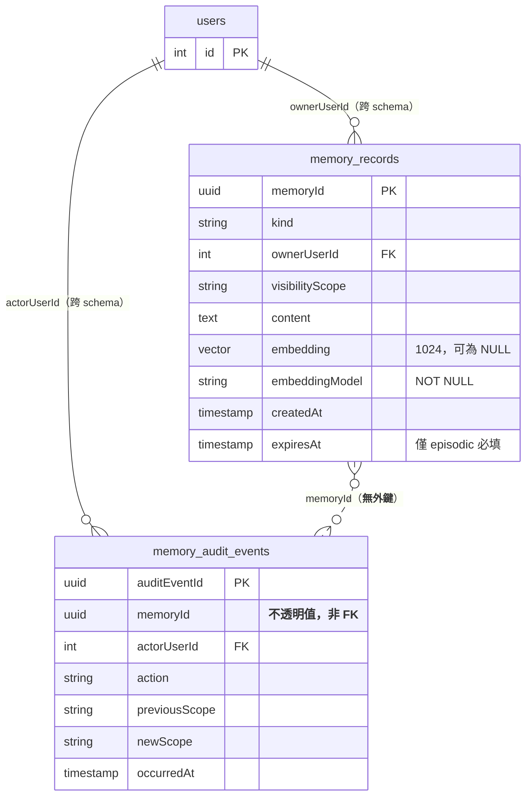

# 功能規格 — `U5 memory-data`

## 〇、本單元是什麼

一個 `spec` 單元：交付**記憶獨立 schema ＋ grant 邊界 ＋ pgvector `vector(1024)`
欄位 ＋ `embeddingModel` 欄位**（`unit-of-work.md:91` 逐字）。

它**沒有應用程式碼、沒有端點、沒有畫面**。消費端是 `U8 memory-service`
（讀寫）與 `U9 memory-purge`（清除）。驗證方式為**真實 PostgreSQL CI job**。

**與 `U7 hierarchy-service` 的關鍵差別**：`U7` 不擁有 DDL（屬已交付的 `U4`），
而**本單元擁有 DDL**。故 `project.md` 的 blocking 同步規則**觸發**，見 §五。

## 〇之二、上游依據（逐一指名，含檔名）

| 上游產出 | 本站用到它的什麼 |
|---|---|
| `contract-summary.md` | 契約 `K-05` 的 `schema_isolation`／`invariants`／`known_gap`（`DG-1`）／`behaviour_semantics`／`verification` 五段；契約 `K-01` 對 `OLLAMA_EMBED_MODEL` 的 validation（1024 維的來源）；契約 `K-08` 的 facade 承擔列層級授權 |
| `requirements.md` | `FR4.4`（grant 邊界）、`FR4.5` ＋ `FR4.5a`（90 天與其承載形式）、`FR4.6`（使用者自行刪除）、`FR4.7`（刪除留稽核）、`FR4.3b`（可見範圍變更留稽核）、`NFR6`（schema 隔離與其驗證）、`OQ-3`（加密手段）、`OQ-12`（可放寬可見範圍的角色） |
| `unit-of-work.md` | `:41`／`:91` 的單元定義與交付物；`:218` 的「獨立 schema 零前例」風險；`:248` 的 Encryption 落點與 `OQ-3` 的風險鏈 |
| `unit-of-work-story-map.md` | `US4.1`／`US4.2`／`US4.3` 對本單元的指派——**三者的使用者可見行為都不在本站**（屬 `U8`），本站只交付其資料層前提，故 `traceability.json` 將三者記為 `N/A` 並指向對應規則 |
| `components.md` | `:465` 的 `MemoryAuditEvent` 列（寫入端為 `MemoryStore`、讀取面為回補項 `N-8`、缺口 `DG-1`）——這是 `DG-1` 的定義處，本站的處置依它而非依印象 |
| `bolt-plan.md` | `:186` 把 `DG-1` 列為 `U5`／`U8` 那個 Bolt 的**進入條件**。這是本站必須解掉它的原因 |

## 一、`DG-1` 的處置（本站的核心決定）

`DG-1` 是契約 `K-05` 的具名缺口，其 `landing` 指名本站，且是
`bolt-plan.md:186` 的 **B1 進入條件**——不解掉它，`U5`／`U8` 那個 Bolt 不能開工。

### 衝突的精確形狀

| 已核可需求 | 逐字要求 |
|---|---|
| `FR4.5` | episodic memory 保存 **90 天**，逾期自動刪除 |
| `FR4.7` | 記憶的**刪除動作本身**應留下稽核紀錄 |

清除一列記憶時，**兩件事同時發生**：

1. 清除動作**產生**一筆新的稽核事件，而它的 `memoryId` 指向剛被刪掉的列；
2. 該記憶**既有**的稽核事件（如 `FR4.3b` 的可見範圍變更）全部指向不存在的列。

設了外鍵就必須在兩個壞結果中選一個，**而兩者都違反已核可需求**：
`CASCADE` 使 `FR4.7` 在 90 天後實質失效（記錄與被記錄者一起消失）；
`RESTRICT` 使 `FR4.5` 無法執行。

### 定案（使用者裁決 `[M1]`=A，2026-10-06）

**稽核表不對記憶表設外鍵；`memoryId` 存為不透明值；稽核獨立於記憶存活。**
落在 `rules.md` 的 `BR2.1`。

**這個決定能成立的前提是 `BR2.2`**：稽核表**不含記憶內容**。
若含內容，「保留稽核」就等於「保留被刪除的使用者資料」——使用者以為刪了，
而它還在稽核表裡，`FR4.5` 形同虛設。契約 `K-05` 的 `key_columns` 本來就沒有
`content`／`embedding` 兩欄，本站確認並寫明這個依存關係。

### 兩項代價，如實記載

| 代價 | 內容 | 登錄 |
|---|---|---|
| 失去參照完整性保護 | 可寫入不存在的 `memoryId` 而資料庫不會擋。緩解是寫入端唯一（`K-08` 的 facade），但那是**應用層**保證而非資料層保證 | `OPEN-M1` |
| 稽核自身無保存期 | `FR4.5` 只約束 episodic memory；**沒有任何已核可需求談稽核事件要留多久**，而本決定讓它無限期累積 | `OPEN-M2` |

## 二、`embeddingModel` 不變量：本單元唯一靜默的失敗模式

契約 `K-05` 的 `invariants` 逐字：

> 每列記憶帶 `embeddingModel`；相似度檢索只比對同一 `embeddingModel` 的列——
> **同維度不等於同向量空間**，不加這道過濾會讓跨模型的檢索回垃圾**且不報錯**

**為什麼它比其他 12 條規則都危險**：兩個不同模型都產生 1024 維向量，所以
型別正確、維度相符、索引可用、查詢成功回傳結果——**只有語意是垃圾**。
沒有例外、沒有錯誤碼、沒有監控訊號。

| 其他規則的違反 | 本條的違反 |
|---|---|
| 寫入被擋、DDL 失敗、CI 紅燈、或留下可見痕跡 | 一切正常，結果無意義 |

**故它的驗證不能靠程式碼審查**（「有沒有寫 `WHERE embedding_model = ?`」）。
需要一個以**兩種** `embeddingModel` 寫入、斷言檢索結果不跨模型的測試，
落點是 `N-2` 的真實 PostgreSQL CI job。

## 三、三個 kind 與保存期的分流

| `kind` | 保存期 | `expiresAt` |
|---|---|---|
| `semantic` | 無 | NULL |
| `procedure` | 無 | NULL |
| `episodic` | **90 天**（`FR4.5` 逐字只約束這一種） | 必填 = `createdAt` ＋ 90 天 |

**為什麼「`episodic` 則 `expiresAt` 必填」要寫成資料層 CHECK 而非靠寫入端自律**：
清除作業是**依 `expiresAt` 選列**的，所以一列 `expiresAt` 為 NULL 的 episodic
記憶**永遠不會被選中**——它會永久留存，而且沒有任何跡象。
漏填的後果不是錯誤，是靜默的永久保留（`rules.md` `BR4.1`）。

反方向同樣有害：把 90 天套到 `semantic`／`procedure` 會刪掉不該刪的長期記憶。

## 四、本單元**不**負責的事（避免下游誤讀）

| 不負責 | 負責者 | 本單元與它的關係 |
|---|---|---|
| 列層級的擁有者與可見範圍授權 | 契約 `K-08` 的 facade（`U8`） | 本單元只提供 **grant 邊界**（資料庫層）。兩者**不可互相替代**：facade 擋應用層呼叫，grant 擋「繞過應用層直連資料庫」（`K-05` 的 `authorization_responsibility` 逐字） |
| 產生 embedding | `U6 embedding-port`（契約 `K-06`） | 本單元只定義欄位與維度 |
| 90 天清除的執行 | `U9 memory-purge` ＋ 交付物 `N-6` | 本單元只定義 `expiresAt` 與稽核事件的形狀（`OPEN-M3`） |
| 放寬可見範圍的角色集合 | `OQ-12`，**本輪未定** | 本單元只定義 `visibilityScope` 欄位 |
| episodic memory 的加密手段 | `OQ-3`，指派 `nfr-design` | **注意該站是 CONDITIONAL 且其條件依賴 `nfr-requirements` 是否執行**，與 `OQ-4`／`OQ-10` 同一條風險鏈（`unit-of-work.md:248` 逐字）。若兩站都 skip，`OQ-3` 會無聲落空——見 `OPEN-M4` |

## 五、`project.md` 的 blocking 同步規則**觸發**

本單元新增一個 schema、兩張表、向量索引與 grant，屬「新增表」與
「索引／約束變更」，故 `project.md ## Mandated` 的 blocking 規則觸發：

- **必做 1** — `schema_rbac.sql`：寫入對應 DDL 與 COMMENT，使用
  `IF NOT EXISTS` 等可重跑安全寫法（與 `BR1.3` 一致），並更新檔頭涵蓋清單。
- **必做 2** — `DEPLOY.md`：更新「這支 SQL 會建立的表／欄位」表，
  補 `psql` 驗證指令，並寫明與啟動補丁的關係。

**兩者皆在 `code-generation` 完成，不在本站**（本站不寫檔案到 repo 根目錄）。
未完成不得標示該 stage 為完成。

**一處需要注意的張力**：`schema_rbac.sql` 目前只在**空 volume** 執行
（該檔第 324 行附近逐字說明），而既有非空 volume 的演進路徑是
`backend/services/hierarchy_migration.py` 那類啟動補丁。本單元的 schema
在既有環境要怎麼建立，**本站不預選手段**——它是部署路徑的問題，
落點 `code-generation` 與 `infrastructure-design`（`OPEN-M5`）。

## 六、實體關係圖（衍生檢視）

**文字 fallback**：`public.users` 以 `ownerUserId` 一對多指向
`memory.memory_records`，以 `actorUserId` 一對多指向
`memory.memory_audit_events`——兩者皆為**跨 schema 參照**，這是選獨立 schema
而非獨立 database 的理由。`memory_records` 與 `memory_audit_events` 之間
以 `memoryId` 關聯，但**刻意沒有外鍵**（虛線），故這是邏輯關係而非資料層保證
（`DG-1` 的處置）。`embedding` 可為 NULL（`fulltext` 模式），
而 `embeddingModel` 在該情況下仍必填。

## 七、規則摘要（衍生檢視）

源頭是 `rules.md`。

| 群組 | 條數 | 管什麼 |
|---|---|---|
| `BR1.x` | 3 | schema 隔離、grant 邊界、可重跑 |
| `BR2.x` | 4 | 稽核軌跡（`DG-1`）、不含內容、動作分類、系統行為者 |
| `BR3.x` | 3 | `embeddingModel` 過濾、1024 維、NULL 的語意 |
| `BR4.x` | 3 | 只有 episodic 受保存期、承載形式、清除留稽核 |

合計 **13 條**（由 `yaml.safe_load` 解析 `rules.md` 的 yaml 區塊實算）。

## 八、ADR-0006 四面向 ＋ PBT 逐項判定

`project.md` 逐字要求「對每一項變更檢查 ADR-0006 的四個面向」，且涉及
IAM／網路暴露／稽核記錄者須明列影響與處置，不得以「已有 ADR-0006」帶過。

| 面向 | 判定 | 本單元的影響與處置 |
|---|---|---|
| **IAM** | **適用** | grant 邊界是本單元的核心交付之一（`BR1.2`）。處置：只開放 `memory` schema 的 USAGE 與兩表 DML，不開放 `public` 寫入；跨 schema 讀 `public.users` 單獨授予最小權限。**關鍵限定**：這是**資料庫層**邊界，列層級授權屬 `K-08` 的 facade，兩者不可互相替代 |
| **Encryption** | **適用，且本輪未定** | episodic memory 是 by-user 的對話歷程，其靜態與傳輸加密為 `OQ-3`（`unit-of-work.md:248` 逐字），指派 `nfr-design`。**本站不預選手段**，但點名它落在本單元的資料範圍內。**風險**：該站 CONDITIONAL 且條件依賴 `nfr-requirements`，兩站皆 skip 時 `OQ-3` 會無聲落空（`OPEN-M4`） |
| **Network exposure** | **不適用** | 本單元零端點、零進程、零監聽埠。它是 schema ＋ grant。對照：本 intent 的新對外網路面只有 `U13` 的 WebSocket（`unit-of-work.md:249` 逐字「唯一」） |
| **Audit logging** | **適用（本單元的另一個核心）** | `memory_audit_events` 整張表。處置：`BR2.1`（獨立存活，`DG-1` 的處置）、`BR2.2`（不含記憶內容——這是 `BR2.1` 的前提）、`BR2.3`（區分使用者刪除與逾期清除）、`BR2.4`（清除的行為者為系統，不得假裝有使用者）、`BR4.3`（清除動作留稽核）。**已知減損**：稽核自身無保存期（`OPEN-M2`）、`memoryId` 無參照完整性（`OPEN-M1`） |

**PBT 判定：N/A（非豁免）。** ADR-0006 的 PBT hard constraint 適用對象為
IaC generator、cost calculator／估價表解析器、agent routing；
`unit-of-work.md` 全檔對 `U5` 無 PBT 指派。本單元是 **DDL 與 grant**，
**沒有任何函式**——沒有可施加 property 的對象。
**失效條件**：若日後本單元納入「算出哪些列逾期」的純函式，PBT 即適用；
但依 `BR4.2`，那段邏輯的落點是 Actions 步驟而非 `backend/`，故不在本單元。

## 九、殘餘風險與已知限制（不美化）

1. **`memoryId` 沒有參照完整性保護**（`BR2.1`／`OPEN-M1`）。`DG-1` 處置的
   直接代價。緩解是應用層的單一寫入端，不是資料層保證。
2. **稽核事件無保存期，會無限期累積**（`OPEN-M2`）。本決定造成的新缺口。
3. **`BR3.1` 的違反是完全靜默的**（§二）。本單元最危險的一條，
   且無法靠程式碼審查守住。
4. **本 repo 對獨立 schema 零前例**，且既有測試走 in-memory SQLite
   （**SQLite 沒有 schema 概念**），故**既有測試基礎設施對本契約沒有任何
   驗證路徑**（契約 K-05 的 `why_not_existing_tests` 逐字）。
   驗證完全依賴 `N-2` 這個尚未建立的真實 PG CI job——**它本身是一個交付物**，
   而不是既有能力（`OPEN-M6`）。
5. **既有非空 volume 的 schema 建立路徑未定**（`OPEN-M5`）。
6. **`OQ-3`（加密手段）與 `OQ-12`（可放寬可見範圍的角色）皆未定**，
   前者有無聲落空的風險（`OPEN-M4`）。
