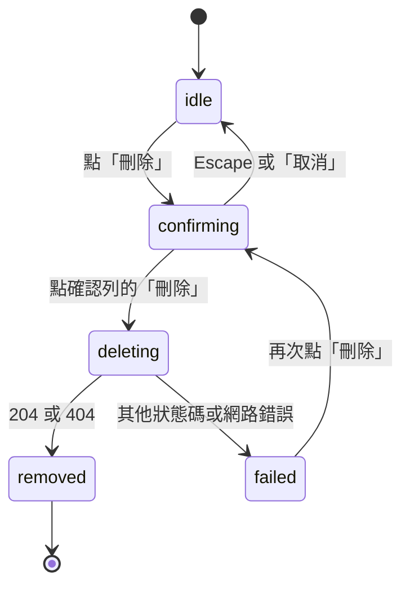
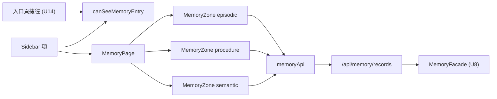

# Functional Spec — `U15 memory-page-ui`

> **本檔是本單元互動流程與狀態機的正本。** 單元類型 `ui`，依 stage 檔：
> UI-only 單元的 `functional-spec.md` **自足**——它直接規定互動流程與畫面／狀態
> 轉移，不依賴實體檔。本單元**不產出 `entities.md`**（記憶的實體由 `U5`／`U8`
> 擁有，見 §七的說明）；`rules.md` 仍產出，理由見該檔 §一。

## 零、上游來源（逐檔）

| 來源 | 本站用它決定什麼 | 實讀確認 |
|---|---|---|
| `inception/units-generation/unit-of-work.md:51`、`:186-192` | 單元身分（`U15`、kind `ui`、M）、擁有與交付、驗證方式、依賴 `U8` | 是 |
| `inception/units-generation/unit-of-work-story-map.md:53,55,120` | 指派 `US4.2`、`US4.4` 兩則 | 是 |
| `inception/user-stories/stories.md` US4 群 | 6 條 AC 的逐字 Given／When／Then | 是 |
| `inception/requirements-analysis/requirements.md:148-170` | `FR4.3a`／`FR4.3b`／`FR4.5`／`FR4.6`／`FR4.7` | 是 |
| `inception/domain-design/components.md:178,345,354` | `MemoryStore` 的責任與 `MemoryRecord` 欄位集合；**本單元無對應的 UI 元件條目**（該檔為後端元件目錄） | 是 |
| `inception/contract-design/contract-summary.md:589-680`（`K-08`）、`:1066-1082`（`K-14`） | 消費契約與本單元對 `U17` 的 test-target 契約 | 是 |
| `ideation/rough-mockups/wireframes.md:281-330`（§9） | 三區 ＋ 逐則刪除 ＋ 說明文字 ＋ 保存期限列 | 是 |
| `inception/refined-mockups/mockups.md` M0／M6／M7 | Sidebar 項、記憶頁定稿、入口頁捷徑 | 是 |
| `inception/refined-mockups/interaction-spec.md:33,480-567` | INV-3、States 表、條目形狀、刪除確認、無障礙、test ids、流程 C | 是 |
| **出貨程式**（`backend/services/memory_*.py`、`frontend/src/**`） | API 的**實際**形狀與既有前端慣例 | 是，逐行引用於 §四 |

## 一、這個單元要做什麼

一個獨立頁面 `/memory`，讓使用者**看見**大腦記住的事並**刪除自己的**那些。
`unit-of-work.md:188` 逐字：「/memory 頁三區檢視與逐則刪除 ＋ Sidebar 項 ＋
入口頁捷徑（兩入口一個顯示條件）」。

本單元承載的 AC（逐條判定，非整則故事）：

| AC | 落在本單元？ | 理由 |
|---|---|---|
| `AC4.2.1` | **是** | 「要求刪除」的操作面在本頁；「不再出現在脈絡組裝中」那一半在 `U8`／`U11` |
| `AC4.2.2` | 否 | 稽核的**寫入**在 `U8` 的 `delete`；**查詢面**是回補項 `N-8`，不在任何已列單元 |
| `AC4.2.3` | 否 | 90 天清除是 `U9 memory-purge`（GitHub Actions workflow） |
| `AC4.4.1` | **是** | 「我**檢視**它的擁有者欄位」——檢視面在本頁 |
| `AC4.4.2` | 否 | 酬載自行指定擁有者會被忽略，純伺服器端行為，e2e 碰不到 |
| `AC4.4.3` | **是** | 「我**檢視**它的可見範圍」——同上 |

## 二、本站五個定案及其後果

| 題 | 定案 | 最要緊的後果 |
|---|---|---|
| `M1` | 情節記憶用「上一頁／下一頁」＋「第 N–M 則」，**不顯示總數** | 偏離已核可線框兩處（無「共 34 則」、不用 `PaginationControl`）；同一原則使三區標題在滿頁時顯示「N+ 則」 |
| `M2` | **三個請求**，每區一個 | 三區各有獨立三態（滿足 States 表）；首次載入 3 次請求 |
| `M3` | 刪除成功後**就地移除**，不重抓 | 與 `deleting` 態的「其餘可用」相容；需在刪空某頁時另算頁次 |
| `M4` | 本單元做 Sidebar 項 ＋ 共用判定；捷徑渲染留 `U14` | INV-3 有承載者，但本單元 e2e 只驗得一半 |
| `M5` | 非擁有者的列照顯示、**不渲染刪除鍵**，並為每則補擁有者與可見範圍欄位 | 線框的「你可以刪掉任何一則」為假，須對齊修正；`AC4.4.1`／`AC4.4.3` 因此才有落點 |

### 二之一、`M1` ＋ `M5` 合起來產生的一條硬約束（本站推導，非上游原文）

`M1`=A 之下「這一頁有幾則」永遠是**未知**的；`M5`=A 之下「這一頁有幾則**我能刪**」
也是未知的。所以**畫面任何位置都不得出現一個宣稱完整的計數**——包含頁首說明。
線框 §9 的說明文字沒有計數，故不受影響；但 `mockups.md` M6 的
`情節記憶 2 則 / 共 34 則` 與三區標題的 `3 則`／`1 則` 都落在這條約束內。

處置：區標題改為 `BR32.4` 的「N 則」／「N+ 則」雙形式，情節記憶區另加
`BR33.2` 的「第 N–M 則」。**沒有任何位置顯示總數。**

## 三、畫面與路由

| 項 | 值 | 來源 |
|---|---|---|
| 路由 | `/memory` | `K-14` `provides.route` |
| 守衛 | `ProtectedRoute`，**不包** `CapabilityRoute` | `BR31.1` |
| 前例區塊 | `frontend/src/App.tsx:40-47`（`/waiting-approval`） | 實讀；**上游 citation 有誤，見 `BR31.1` note** |
| Sidebar 項 | 第二個獨立項，位於「入口」之後 | `mockups.md` M0 |
| 入口頁捷徑 | **本單元不渲染**，只提供共用判定 | `BR31.2`／`[M4]`=A |
| 標題層級 | `h1`「我的記憶」；三區各 `h2`，不跳級 | `interaction-spec.md` Accessibility |
| 區塊語意 | 每區 `role="region"` ＋ `aria-labelledby` 指向其 `h2` | 同上 |
| 條目語意 | 每區內 `list`／`listitem` | 同上 |
| live region | 每頁一個 `<LiveRegion />`（`role="status"` 寫死） | `LiveRegion.tsx` 的契約段 |

### 三之一、對已核可線框的三處對齊修正（依 `refined-mockups:c3` 不回改上游）

| 線框／定稿的逐字內容 | 為什麼不成立 | 本站的處置 |
|---|---|---|
| `mockups.md` M6：`情節記憶 2 則 / 共 34 則` ＋「沿用既有 `PaginationControl`」 | 回應沒有總筆數（§四），而該元件的 props 要求 `total` | `BR33.2`：改「第 N–M 則」＋ 兩鍵；修法列 `OPEN-MP15-2` |
| `wireframes.md` §9／`mockups.md` M6 說明文字：「**你可以刪掉任何一則**」 | 清單含他人設為 `platform` 的列，刪除回 404（§四之三） | `BR35.2`：那些列不渲染刪除鍵；說明文字改為「你可以刪掉**自己的**任何一則；標為『平台可見（他人的記憶）』的列由其擁有者管理」 |
| `interaction-spec.md:509-511` 的條目形狀（只有內容與日期） | `AC4.4.1`／`AC4.4.3` 要求檢視擁有者與可見範圍，三區條目都沒有這兩個欄位 | `BR35.1`：每則增補兩個欄位（**增補**，不改動既有的內容與日期） |

**三處都是對齊修正，不是本站的新定案。** 本站沒有擴大任何已核可的範圍：
頁面仍是「三區檢視 ＋ 逐則刪除 ＋ Sidebar 項」，沒有新增畫面、沒有新增端點。

### 三之二、`procedural` 與 `procedure` 不是同一個字（本站查出，刻意不統一）

| 落點 | 字面 | 性質 |
|---|---|---|
| `interaction-spec.md` Test ids | `memory-zone-procedural` | **已核可**的測試識別字 |
| `memory_types.py:41` 的 `MEMORY_KINDS` | `procedure` | **出貨程式**的封閉集合值 |

兩者不同，而**兩者都不改**：test id 改了會讓已核可的規格與實作不符，
`MEMORY_KINDS` 改了會動到 `U8` 的封閉集合與其 `CHECK` 約束。
處置是在元件內做一次顯式映射（`'procedure' → 'procedural'` 僅用於組 test id），
並在 `frontend-components.md §九` 把這個映射寫成表，使它不是一個藏在字串裡的巧合。

## 四、API 消費點（**已實測存在於磁碟**，非設計推測）

全部掛在 `/api/memory`（`backend/main.py:102` 的
`app.include_router(memory_router, prefix="/api/memory")`）。

| 操作 | 方法與路徑 | 回應 | 本單元是否消費 |
|---|---|---|---|
| 列出 | `GET /api/memory/records?kind=&offset=&limit=` | `200` `List[MemoryView]`、`403` | **是**，每區一次 |
| 刪除 | `DELETE /api/memory/records/{memory_id}` | `204`、`404` | **是** |
| 建立 | `POST /api/memory/records` | `201`、`422`、`503` | 否——本頁不建立記憶（`BR35.3`） |
| 放寬範圍 | `PUT /api/memory/records/{memory_id}/scope` | `200`、`403`、`404`、`422` | 否（`BR35.3`） |
| 稽核查詢 | `GET /api/memory/audit-events` | `200`、`403` | 否——稽核查詢面是回補項 `N-8` |

**與已核可契約的兩處差異**（`U8` 在其 code-generation 記為 `D8-1`／`D8-2`，
本站只是確認並消費實際形狀）：

1. `K-08` 的 OpenAPI 半邊宣告 `DELETE` 有 `403`；**實作沒有**——`[D1]`=A 把
   「非擁有者」收斂進 404（`memory_router.py` 的 `delete_memory` docstring
   逐字「`responses` **刻意不含 403**」）。本站的 `BR34.5` 依**實作**而非契約撰寫。
2. `K-08` 的 OpenAPI 半邊沒有 `POST /records`；**實作有**（`[FD4]`=A 的契約增量）。
   本單元不消費它，故此差異對本單元無影響，僅記載以免下游誤讀。

### 四之一、每頁 20 則的由來（本站取值，不假裝有上游來源）

| 候選 | 問題 |
|---|---|
| 2（線框 M6 畫的筆數） | 那是示意用的畫面行數，不是規格；一頁 2 則會讓 90 天內的記憶需要翻數十頁 |
| 50（`DEFAULT_LIST_PAGE_SIZE`） | 伺服器預設值，不是畫面決定；50 則會把另外兩區推到視窗之外 |
| 200（`MAX_LIST_PAGE_SIZE`） | 等於不分頁，與 `interaction-spec.md:511`「分頁」衝突 |

本站取 **20**。兩個可檢查的理由：① `20 + 1 = 21 ≤ 200`，故 `BR33.1` 的
`limit+1` 探測永遠不會撞到 `clamp_page_size` 的收斂（若取 200，`limit=201`
會被收回 200，探測靜默失效）；② 一頁 20 則在三區並存的版面下，情節記憶區不會
把另外兩區推離首屏。**這是本站的判斷，沒有上游來源**，列為 `OPEN-MP15-3`
交 `nfr-requirements` 覆核。

### 四之二、`MemoryView` 的欄位集合（照既有程式，不擴充）

`backend/services/memory_types.py:143-160` 實讀，8 個欄位：

| 欄位 | 型別 | 本頁怎麼用 |
|---|---|---|
| `memory_id` | `str` | React `key`、test id、`DELETE` 的路徑參數 |
| `kind` | `str`（`semantic`／`procedure`／`episodic`） | 分區（本頁已按 kind 分別請求，故此欄位用於驗證而非分組） |
| `owner_user_id` | `int` | `BR35.1` 的擁有者欄位、`BR35.2` 的 `canDelete` 判定 |
| `visibility_scope` | `str`（`owner`／`platform`） | `BR35.1` 的可見範圍欄位 |
| `content` | `str` | 條目正文；情節記憶的「主題」即取此欄 |
| `embedding_model` | `str` | **本頁不顯示**——它是檢索分群用的內部欄位（`BR3.2` 屬 `U8`） |
| `created_at` | `datetime` | 情節記憶的日期 |
| `expires_at` | `Optional[datetime]` | 情節記憶的保存期限列；`semantic`／`procedure` 為 `None`（`memory_service.py:181-191` 逐字「只有 `episodic` 有保存期上界」） |

**本頁不顯示 `embedding_model`**，而這不是遺漏：它對使用者「這則記得對不對、
要不要刪」沒有任何判斷價值，而顯示它會讓畫面出現一個使用者無法處置的技術欄位。

### 四之三、清單會包含他人的記憶（本站查出的關鍵事實）

`backend/services/memory_service.py:270-283` 的 `_visible_to`：

```
(MemoryRecord.owner_user_id == principal_user_id)
| (MemoryRecord.visibility_scope == VISIBILITY_SCOPE_PLATFORM)
```

過濾是 **OR**。所以 `GET /api/memory/records` 回傳的集合是
「自己的全部」∪「任何人設為 `platform` 的全部」。

**可達性已查證**：`PUT /api/memory/records/{id}/scope` 已上線，
`memory_types.py:100` 的 `SCOPE_WIDENING_ROLES = ("Platform_Admin", "Platform_Owner")`
得把任何一則放寬。放寬後所有已登入使用者的記憶頁都會看到那一則。

這是 `BR35.1`／`BR35.2`／`BR35.3` 與 §三之一第二列的全部理由。

## 五、互動流程（numbered step sequences — 本檔是這些流程的**正本**）

### W1. 開啟記憶頁

1. 使用者從 Sidebar 的「我的記憶」或直接輸入 `/memory` 進入。
2. `ProtectedRoute` 檢查登入；未登入導向登入頁（`BR31.1`）。
3. 三區同時進入 `loading`，live region 播報「正在載入記憶」。
4. 三個請求並行發出（`BR32.2`）：
   - `?kind=semantic&limit=200`
   - `?kind=procedure&limit=200`
   - `?kind=episodic&offset=0&limit=21`
5. 每個請求各自結束各自那一區（`BR32.2`）：
   - 200 且非空 → `default`；區標題依 `BR32.4` 顯示「N 則」或「N+ 則」。
   - 200 且空 → `empty`（`BR32.3` 的 empty 文案）。
   - 失敗 → `error`（**不得**顯示 empty 文案）。
6. 情節記憶區依 `BR33.1` 計算 `hasNext`，渲染前 20 筆，顯示「第 1–N 則」。
7. 三區都結束後，live region 播報「記憶已載入」。

### W2. 檢視一則記憶（`AC4.4.1`／`AC4.4.3` 的操作面）

1. 每一則渲染：正文（情節記憶另帶日期）、擁有者欄位、可見範圍欄位（`BR35.1`）。
2. 擁有者為自己 → 顯示「你」；否則顯示「其他使用者」。數值一律寫入
   `data-owner-user-id`，供 e2e 精確斷言。
3. 可見範圍 `owner` → 「僅你可見」；`platform` → 「平台可見」。
4. 擁有者為自己 → 渲染刪除入口；否則顯示「平台可見（他人的記憶）」標記且
   **不渲染任何刪除入口**（`BR35.2`）。

### W3. 情節記憶翻頁

1. 使用者點「下一頁」（`hasNext` 為 false 時該鍵停用）。
2. **只有情節記憶區**進入 `loading`；另外兩區不動（`BR32.2`）。
3. 請求 `?kind=episodic&offset=<page*20>&limit=21`。
4. 成功 → 更新該區條目、`hasNext`、「第 N–M 則」。
5. 失敗 → 該區進入 `error`，**頁次不前進**（否則重試會跳過一頁）。
6. 「上一頁」同流程，`offset` 遞減；第一頁時該鍵停用。

### W4. 刪除一則記憶（`AC4.2.1` 的操作面；`interaction-spec.md` 流程 C 的細化）

1. 使用者點該則的「刪除」→ 就地確認列展開，焦點移到確認列的「刪除」（`BR34.1`／`BR34.2`）。
2. 按 Escape 或「取消」→ 確認列收起，焦點還給原本的「刪除」入口，**無任何請求發出**。
3. 按確認列的「刪除」→ 該則進入 `deleting`（淡化 ＋ 停用），**該區不進入 `loading`**
   （`BR34.3`）；其餘各則與另外兩區照常可互動。
4. 發出 `DELETE /api/memory/records/{memory_id}`。
5. `204` **或** `404` → 以回傳新陣列的方式移除該則（`BR34.4`／`BR34.5`），
   live region 播報「已刪除：<摘要>」；焦點移到該區標題（原本的焦點目標已不存在）。
6. 該則屬情節記憶且移除後該區渲染筆數為 0 且 `page > 1` → `page -= 1` 並重抓該區
   （`BR34.6`）。若 `page === 1` → 該區進入 `empty`。
7. 其他狀態碼或網路錯誤 → 該則離開 `deleting` 回到可用，就地顯示錯誤訊息並播報
   （`BR34.5`）；**不移除該則**。

### W5. 兩個入口的顯示判定（INV-3）

1. 本單元匯出單一判定（`canSeeMemoryEntry(auth)`，內容為「已登入」）。
2. Sidebar 項呼叫它（本單元實作）。
3. 入口頁捷徑呼叫它（`U14` 實作，本單元只提供判定）。
4. 任何第三個入口若出現，一律呼叫同一個判定，不自行判斷（`BR31.2`）。

## 六、狀態機

### 六之一、每個區（三個實例，各自獨立）

```mermaid
stateDiagram-v2
    [*] --> loading
    loading --> default: 200 且非空
    loading --> empty: 200 且空
    loading --> error: 請求失敗
    error --> loading: 使用者點重試
    default --> empty: 最後一則被刪除且為第一頁
    default --> loading: 情節記憶翻頁
    empty --> loading: 情節記憶退回前一頁
```

**文字 fallback**：每區初始為 `loading`。回應 200 且非空轉 `default`、200 且空轉
`empty`、失敗轉 `error`。`error` 可由使用者點重試回到 `loading`。`default` 在最後
一則被刪除且處於第一頁時轉 `empty`；情節記憶翻頁時由 `default` 回到 `loading`。
`empty` 在情節記憶退回前一頁時回到 `loading`。
（`deleting` 不在此圖——它是**單一條目**的狀態，見六之二。）

### 六之二、單一條目



**文字 fallback**：條目初始 `idle`。點「刪除」轉 `confirming`（就地確認列展開）。
Escape 或「取消」回 `idle`，不發請求。點確認列的「刪除」轉 `deleting`（該則淡化停用）。
`204` 或 `404` 轉 `removed`（該則自畫面移除）。其他失敗轉 `failed`（該則恢復可用並
就地顯示錯誤）；使用者可再次點「刪除」回到 `confirming`。

**`idle` 只對擁有者存在**：非擁有者的列沒有刪除入口（`BR35.2`），故它沒有這個
狀態機——它是一個純顯示的條目。

## 七、衍生檢視

### 七之一、為什麼沒有 ER 圖

stage 檔要求 `functional-spec.md` 攜帶一張由 `entities.md` 導出的 ER 圖。
**本單元沒有 `entities.md`**（`produces_kinds` 的 `entities: [service, spec, library]`
不含 `ui`），而本單元也**不擁有任何實體**——`MemoryRecord` 與 `MemoryAuditEvent`
的擁有者是 `MemoryStore`（`components.md:354-355`）。畫一張它不擁有的實體的 ER 圖
會讓下游以為本單元有資料層職責。

代之以**資料流**圖（本單元真正擁有的那一面）：



**文字 fallback**：Sidebar 項與入口頁捷徑（後者由 `U14` 實作）呼叫同一個
`canSeeMemoryEntry` 判定。Sidebar 項導向 `MemoryPage`，該頁掛三個 `MemoryZone`
（semantic／procedure／episodic），三者皆經 `memoryApi` 呼叫
`/api/memory/records`，再由 `U8` 的 `MemoryFacade` 承擔授權。

### 七之二、規則摘要（derived from `rules.md`）

19 條，分五群：`BR31` 路由與授權責任（3）、`BR32` 三區檢視（4）、
`BR33` 分頁（3）、`BR34` 逐則刪除（6）、`BR35` 擁有者與可見範圍（3）。
逐條摘要見 `rules.md §三`（該檔為正本）。

## 八、開放項與指派

| id | 內容 | 落點 | 執行性 |
|---|---|---|---|
| `OPEN-MP15-1` | INV-3 的第二個呼叫點（入口頁捷徑）在 `U14` 落地前不存在，故本單元的 e2e 只驗得 Sidebar 那一半 | `U14 entry-page-ui` 的 `functional-design` | 該單元尚未施工，在游標之後，指派有效 |
| `OPEN-MP15-2` | `GET /api/memory/records` 不回總筆數，使 `mockups.md` M6 的「共 34 則」與「沿用 `PaginationControl`」兩處不可滿足 | **無自然承接站**——修法在 `U8` 的契約，而 `U8` 已完成且在游標之前（與 `OPEN-MP24-6` 同形）。已於本站向使用者揭露（`M1`），由使用者選擇 A 接受此偏離 | 已揭露並定案，不是懸空項 |
| `OPEN-MP15-3` | 每頁 20 則無上游來源，為本站取值（理由見 §四之一） | `nfr-requirements`（3.2，本單元的下一站，**在游標之後**） | 有效 |
| `OPEN-MP15-4` | `procedural`（test id）與 `procedure`（API 值）不一致，本站以顯式映射處理而非統一任一方 | 記載即處置；若 `U17 a11y-gate` 的掃描需要 test id 清單，以 `frontend-components.md §九` 的映射表為準 | 無待決事項 |
| `OPEN-MP15-5` | `AC4.2.2` 的稽核**查詢面**（回補項 `N-8`）不在任何已列單元，故「管理者查得出誰刪了什麼」在本 intent 無使用者可見面 | **沿用上游既有的 `N-8` 登錄，本站不另開指派**（`stories.md` US4.3 的註已指派並說明） | 不重複指派 |

**本站沒有新增任何 scope 未涵蓋的項目**：五個定案都落在「三區檢視 ＋ 逐則刪除
＋ Sidebar 項 ＋ 入口頁捷徑」之內，§三之一的三處是對齊修正而非範圍擴充。

## 九、自檢報告（七項，逐項）

| 項 | 結果 |
|---|---|
| **1 可達性** | **1 處需要刻意構造**。`BR35.2` 的「非擁有者的列」需要 `Platform_Admin`／`Platform_Owner` 先對某則執行 `PUT .../scope`。**可達已查證**（§四之三），但 Playwright e2e 要構造它需要兩個使用者 ＋ 一個平台角色；若 e2e 層成本過高，驗證落點改為後端 `TestClient`（與 `U24` 的 `I-6` 同形處置）。已寫入 `frontend-components.md §十`。其餘 18 條規則的觸發條件皆為單一使用者可達 |
| **2 契約端點三問** | **逐一跑過，範圍為本 stage 全部產出**。本單元不擁有任何欄位或實體，故三問對象是**本單元宣告的方法與共享判定**：① `canSeeMemoryEntry`——寫（定義）＝本單元、讀（呼叫）＝Sidebar（本單元）＋ 入口頁捷徑（`U14`）、清＝N/A（純函式無狀態）；**第二個讀者在 `U14` 落地前不存在，已記為 `OPEN-MP15-1`，不是懸空契約**。② `canDelete` 判定——寫＝本單元、讀＝每則的刪除入口渲染（本單元）、清＝N/A。③ 三區的 `page`／`hasNext` 狀態——寫＝`W1` 第 6 步與 `W3`、讀＝`BR33.2` 的「第 N–M 則」與兩鍵的停用判定、**清＝`W4` 第 6 步**（`BR34.6`，刪空某頁時重算）。三者皆三問齊備 |
| **3 引用逐字核對** | **逐處開檔驗證，分開驗事實與驗定位**。查出 **1 處上游 citation 錯誤**：`K-14` 與 `mockups.md` M0 的 `App.tsx` 行號（實為 `40-47`，見 `BR31.1` note，成因已查明為「寫下當時即錯一行」＋「`U24` 其後插入 35 行」）。其餘引用（`memory_service.py:72-73`／`:181-191`／`:270-283`、`memory_types.py:41`／`:100`／`:143-160`、`main.py:102`、`Sidebar.tsx:209`、`PaginationControl.tsx:8-11`、`interaction-spec.md:33`／`:502-503`／`:509-511`、`components.md:354-355`、`unit-of-work.md:51`／`:186-192`、`unit-of-work-story-map.md:120`）皆以 `awk NR` 或 `grep -n` 核對行號與內容兩者 |
| **4 檔案集合一致性** | 與同類單元 `U24 member-pages-ui` diff 產出清單：該單元 6 檔（`functional-design-questions.md`、`functional-spec.md`、`rules.md`、`frontend-components.md`、`traceability.json`、`reviews/`）。本單元同為 `ui`，產出同一集合。**無缺項** |
| **5 跨檔傳播** | 按**事實**列舉，非按改過的字串。本輪的事實有 5 個：①「無總筆數」→ `rules.md` `BR33.1`／`BR33.2`、本檔 §二之一／§三之一／§四、`frontend-components.md §五`、`traceability.json` 的 `AC4.2.1` note；②「清單含他人記憶」→ `rules.md` `BR35.1`–`BR35.3`、本檔 §三之一／§四之三／§五 W2、`frontend-components.md §四`；③「`App.tsx` 行號為 40-47」→ `rules.md` `BR31.1` note、本檔 §三；④「每頁 20」→ `rules.md` `BR33.1`／`BR33.3`、本檔 §四之一、`frontend-components.md §五`；⑤「`procedural` vs `procedure`」→ 本檔 §三之二、`frontend-components.md §九`。每個事實以其**多種表達形式**各 grep 一次（如事實①以 `total`、`PaginationControl`、`共 34`、`count()` 四種形式），確認無殘留、無矛盾 |
| **6 可算的數字先算再寫** | 3 個數字，全部由命令算出而非估計：**19** 條規則（`rules.md §三` 表列數實算，並以 3+4+3+6+3 交叉驗）、**6** 條 upstream AC（`stories.md` US4.2 的 3 條 ＋ US4.4 的 3 條，逐條列於 §一）、**3** 條 `OK`／**3** 條非 `OK`（§一的判定表實算）。`App.tsx` 的 `40-47` 以 `awk 'NR>=36 && NR<=48'` 印出行號核對 |
| **7 Hard constraint 逐項對照** | 見九之二（ADR-0006 四面向）與九之三（PBT） |

### 九之一、三個數字各自的取得方式

| 數字 | 取得方式 |
|---|---|
| 19 條規則 | `rules.md §三` 摘要表的資料列數；交叉驗 `BR31` 3 ＋ `BR32` 4 ＋ `BR33` 3 ＋ `BR34` 6 ＋ `BR35` 3 |
| 6 條 upstream AC | `stories.md` 的 US4.2（`AC4.2.1`–`AC4.2.3`）＋ US4.4（`AC4.4.1`–`AC4.4.3`），逐條抄錄於 §一的判定表 |
| 3 `OK` ／ 3 非 `OK` | §一判定表的「落在本單元？」欄位實算 |

### 九之二、ADR-0006 security baseline 四面向（逐項，不留空白）

| 面向 | 適用？ | 本單元的影響與處置 |
|---|---|---|
| **IAM** | **適用** | `/memory` 走 `ProtectedRoute` 不包 `CapabilityRoute`（`BR31.1`），**不新增 story id**——把關的是擁有者欄位而非角色（`K-14` 已核可此判定）。頁內授權**全部**由 `U8` 的 `MemoryFacade` 承擔，前端不自行過濾（`BR31.3`）。`BR35.2` 的 `canDelete` **不是**第二套授權：它是「不渲染一個必然被拒的控件」的 UI 判定，伺服器仍會對同一個請求回 404——**前端放行也不會成功**。這個區別必須寫下來，否則下游會以為把它移除就等於開放刪除他人記憶 |
| **Encryption** | **不適用（本單元無新增落點）** | 本單元零新增持久化、零新增傳輸通道；沿用既有 HTTPS（Cloudflare Tunnel）與既有 `Authorization: Bearer` 標頭形狀。**判定失效條件**：若日後本頁加入任何本機暫存（`localStorage` 快取記憶內容），本列即轉為適用 |
| **Network exposure** | **不適用（本單元無新增落點）** | 零新進程、零新監聽埠、零新環境變數；所有請求走既有 `/api/`，而 `deploy/nginx.conf` 只反向代理 `/api/`（與 `U8` 的 `NFR8.20` 同一事實）。**判定失效條件**：若 INV-3 的第二個入口日後需要跨來源請求，本列轉為適用 |
| **Audit logging** | **適用** | 本頁的唯一寫入操作是刪除，而 `U8` 的 `delete` 會寫一筆稽核事件（`BR34.5` 的 source）。本單元的責任是**不讓刪除以使用者察覺不到的方式發生**——故 `BR34.1` 的確認文案逐字要求說明「此刪除會被記錄」。**殘留缺口（如實記載）**：稽核的**查詢面**在本 intent 無使用者可見面（`OPEN-MP15-5`／回補項 `N-8`），所以「刪除留了稽核」這件事目前只有資料庫證明得了，畫面上無從查證 |

### 九之三、property-based testing hard constraint（ADR-0006）

`project.md ## Testing Posture` 點名的三個 PBT 落點是 IaC generator、
cost calculator、agent routing。**本單元三者皆不涉及**——它是前端頁面，
零純函式計算核心。

但判 N/A 之前先問「它要防的失敗模式在本單元以別的形式存在嗎」：
**存在一處**。`BR33.1` 的 `hasNext = items.length > pageSize` 與 `BR34.6` 的
頁次重算是**可以寫成純函式的計算**，而它們的失敗模式（翻頁重複或漏掉條目、
刪空後卡在空白頁）正是 PBT 擅長的那一類。處置：`frontend-components.md §五`
要求把這兩段抽成不碰 state、不碰 `fetch` 的純函式；**但前端無 unit 測試框架**
（`team.md` 實測：`devDependencies` 只有 `@playwright/test`），故本輪的驗證層
仍是 Playwright e2e。導入前端 unit 測試框架是 `team.md` 的 `D（不採用）`，
不由本單元夾帶。已列入 `frontend-components.md §十`。
