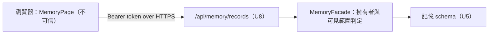

# Security Design — `U15 memory-page-ui`

> 把 `nfr-requirements/security-requirements.md` 的 `NFR4.90`、`NFR7.90`、
> `NFR7.91`、`NFR8.90` 與 `SEC-U15-1`～`SEC-U15-5` 逐條落到設計形狀。
> 本單元**不持有授權判定**；本檔的每一條設計都屬於「不削弱伺服器判定」或
> 「不冒充授權」兩類之一。

## 零、上游來源

| 來源 | 用到什麼 |
|---|---|
| `nfr-requirements/security-requirements.md` | 四條 `NFR*.9x`、五條 `SEC-U15`、§三 STRIDE、§四 ADR-0006、§四之一 交接表 |
| `nfr-requirements/tech-stack-decisions.md` | `TS-U15-3`、`TS-U15-5`、`TS-U15-9` |
| `functional-design/rules.md` | `BR31.3`、`BR34.1`、`BR35.1`～`BR35.3` |
| `inception/contract-design/contract-summary.md` | `K-08`、`K-14` 的授權責任 |

## 一、信任邊界

**文字 fallback**：瀏覽器端的記憶頁是不可信端，只透過既有的 Bearer token 經 HTTPS
呼叫 `U8` 的記憶 API；所有擁有者與可見範圍判定都在 `U8` 的 `MemoryFacade`，
資料在 `U5` 的記憶 schema。本單元的任何程式都在邊界左側。

## 二、逐條設計

| 要求 | 設計 | 驗證落點 |
|---|---|---|
| `NFR4.90` 不寫瀏覽器儲存 | `memoryApi.ts` 只回傳資料；`MemoryZone` 只放進 `useState`。本單元新增檔案**不 import** 任何儲存 API。e2e 前後各讀一次 `localStorage`／`sessionStorage` 的鍵集合並比對無新增鍵 | grep ＋ e2e |
| `NFR7.90` 不跨頁快取 | 不新增 Context、不放模組層變數（`frontend-components.md §二`）；`MemoryPage` 卸載即釋放全部條目。e2e：進 `/memory` → 離開 → 再進，斷言再次發出 3 個 `GET` | e2e |
| `NFR7.91` 確認文案告知稽核 | `DeleteConfirmRow` 的固定文案含「大腦將不再依據它回答，此刪除會被記錄」（`BR34.1`） | e2e 斷言文字 |
| `NFR8.90` 零新環境變數 | 每頁筆數為 `memoryPaging.ts` 常數；URL 經既有 `apiUrl()` | `git diff` 檢查 |
| `SEC-U15-1` 前端不過濾 | `MemoryZone` 渲染回應陣列的**每一列**；`canDelete` 只決定控件，不決定列是否出現 | e2e 以路由攔截餵他人 `platform` 列 |
| `SEC-U15-2` `canDelete` 不是存取控制 | 程式註解在 `canDelete` 定義處明寫「UI 判定，非授權；伺服器以 404 拒絕非擁有者」。後端斷言已存在於 `backend/tests/test_memory_authz.py`（審查查證），code-generation 計畫引用該檔即可，不重寫 | 既有 `TestClient` |
| `SEC-U15-3` 無放寬控件 | 本單元不 import、不呼叫 `PUT .../scope`；畫面無任何 scope 輸入 | grep ＋ e2e |
| `SEC-U15-4` 可見文字不含他人 id | 擁有者欄位的可見文字只有「你」／「其他使用者」；數值只進 `data-owner-user-id` | e2e |
| `SEC-U15-5` console 不含記憶內容 | 失敗路徑只記錄狀態碼與操作名（如 `memory.delete failed: 500`），不帶 `record` 或 `content` | e2e 收集 console 並比對種子內容字串 |

## 三、XSS 與輸出編碼

記憶的 `content` 由使用者與大腦產生，屬不可信文字。設計規定：

- 一律以 React 的文字節點渲染（JSX `{content}`），**不得**使用
  `dangerouslySetInnerHTML`，也不得把 `content` 放進 `href`／`src` 等屬性。
- `aria-label` 的「刪除：<前 30 字>」同樣以字串插值組成，React 會做屬性編碼。
- 驗證：e2e 種一則內容為 `` 的記憶，斷言頁面上
  該字串以文字顯示且 `window.__xss` 未定義。

## 四、跨單元的授權缺口（處置：帶進 code-generation）

nfr-requirements 審查查出、並經使用者裁決併進本單元 code-generation 的後端缺口：

- **現況**：自行註冊的 pending 帳號註冊即取得 token；記憶 API 的端點只依賴
  `get_current_user`，不檢查 `authorization_status`。故 pending 帳號可讀取他人設為
  `platform` 的記憶。
- **設計方向（供 code-generation 計畫採用或修正）**：在記憶 API 的 router 層加一個
  「已核准」dependency，pending／rejected 帳號一律 403；同時補雙向 `TestClient`
  （pending → 403、approved → 2xx），符合 `team.md` 的 A＋B 規則。
- **為什麼不在前端處理**：前端的 `ProtectedRoute` 導頁不是存取控制，任何人可直接呼叫
  API。本單元在前端已無可加的防線。
- **影響範圍**：會改動已完成的 `U8` 程式（`memory_router.py`）。計畫核可時須向使用者
  揭露此跨單元改動。

## 五、ADR-0006 四面向（與上游逐字比對）

| 面向 | nfr-requirements 判定 | 本站判定 | 一致？ | 本站的設計落點 |
|---|---|---|---|---|
| IAM | 適用 | 適用 | 一致 | §二 `SEC-U15-1`～`SEC-U15-3`；§四 後端缺口 |
| Encryption | 不適用（附失效條件） | 不適用（附同一失效條件） | 一致 | §二 `NFR4.90`、`NFR7.90` |
| Network exposure | 不適用 | 不適用 | 一致 | §二 `NFR8.90` |
| Audit logging | 適用 | 適用 | 一致 | §二 `NFR7.91`、`SEC-U15-5` |
