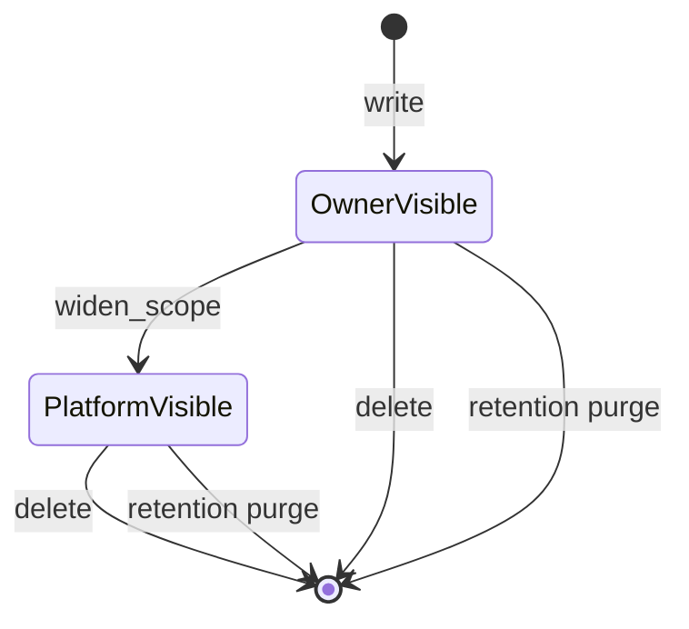
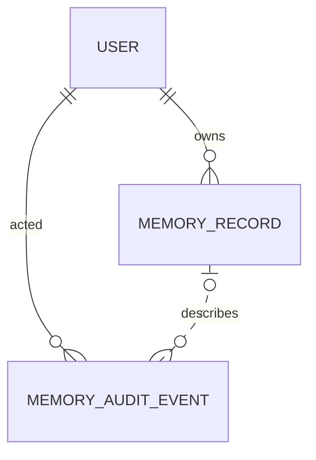

# 行為規格 — `U8 memory-service`

> 本檔是**工作流程與狀態機的真實來源**。`entities.md`（資料形狀）與
> `rules.md`（決策邏輯）都不表達**有序行為**與**狀態轉移**，那是本檔的職責。
> 另含兩份**衍生**檢視（ER 圖與規則摘要），其真實來源分別是前兩份檔。

## 〇、本單元的對外介面（承 `K-08`，含本站新增的一條）

| # | facade 方法 | HTTP | 授權規則 | 稽核 |
|---|---|---|---|---|
| 1 | `MemoryFacade.write` | **`POST /api/memory/records`（本站新增，`[FD4]`=A）** | `BR1.1`／`BR1.2`（擁有者由身分決定） | **無**（`BR7.4`） |
| 2 | `MemoryFacade.search` | — （同進程，`U11` 消費） | `BR2.2` | 無 |
| 3 | — （列出） | `GET /api/memory/records` | `BR2.2` | 無 |
| 4 | `MemoryFacade.delete` | `DELETE /api/memory/records/{memoryId}` | `BR4.1`（**擁有者**） | `deleted_by_user`（`BR4.2`） |
| 5 | `MemoryFacade.widen_scope` | `PUT /api/memory/records/{memoryId}/scope` | `BR5.1`（**角色**） | `scope_changed`（`BR5.3`） |
| 6 | `MemoryFacade.list_audit_events` | `GET /api/memory/audit-events` | `BR6.1`（**角色**） | 無 |

**第 1 列的 HTTP 端點是本站唯一的契約增量**。`K-08` 的 OpenAPI 半邊原本無建立
路徑，而那正是 `OQ-N3` 的機械證據之一。它觸發 OpenAPI drift 閘門
（須重 dump `openapi.json` 並更新前端型別），且依 `team.md` 的 B 規則需
`TestClient` 測試。

### 0.1 單元內的故事順序（取自 `unit-of-work-story-map.md`）

`inception/units-generation/unit-of-work-story-map.md` 把四則故事指派給本單元
（`US4.1`、`US4.2`、`US4.3`、`US4.4`，共 12 條 AC），並給出**單元內的順序**
與其理由（逐字）：

> `US4.1` → `US4.4` → `US4.2` → `US4.3`
> ——「先有寫入與檢索（4.1），才有『我的記憶是我的』的可見範圍（4.4）；
> 刪除（4.2）與稽核查詢（4.3）建立在前兩者的資料之上」

本檔的流程編號**刻意與它一致**，使實作順序不需另行推導：

| 故事順序 | 對應流程 | 對應規則組 |
|---|---|---|
| 1. `US4.1`（寫入與檢索） | §1.1 寫入、§1.2 檢索、§1.3 列出 | `BR1`、`BR3`、`BR7` |
| 2. `US4.4`（可見範圍歸屬） | §1.1 的步 4、7 | `BR2` |
| 3. `US4.2`（刪除） | §1.4 | `BR4` |
| 4. `US4.3`（稽核查詢） | §1.5、§1.6 | `BR5`、`BR6` |

**該檔另記載一項與本站直接相關的事**：`US4.2` 橫跨
`U8`／`U15 memory-page-ui`／`U9 memory-purge` 三個單元，故 `AC4.2.3`
（90 天後不再出現）的清除動作本身不在本單元——本單元只負責讀取端不回傳
已清除的列（`BR3.4`）。

## 一、工作流程（真實來源）

### 1.1 寫入一則記憶

三個入口、**一條寫入路徑**。授權檢查、擁有者賦值與錯誤訊息各只有一份。

| 步 | 動作 | 依據 |
|---|---|---|
| 1 | 取得呼叫者的已驗證身分 | 既有認證層 |
| 2 | 驗證 `kind` 在封閉集合內；不在則拒絕 | `BR7.3`、`EC3` |
| 3 | 驗證 `content` 去除前後空白後非空；否則拒絕 | `EC2` |
| 4 | **忽略**酬載中任何意圖指定擁有者或可見範圍的欄位 | `BR1.2`、`BR2.1` |
| 5 | 向 `U6 embedding-port` 取得查詢向量與其 `embeddingModel` | `BR3.5` |
| 6 | 提供者不可用則拋 `EmbeddingProviderUnavailable` 並**停止**，不降級 | `BR3.5` |
| 7 | 以 `ownerUserId` = 步 1 的身分、`visibilityScope` = `owner` 建立列 | `BR1.1`、`BR2.1` |
| 8 | `kind` 為 `episodic` 時設 `expiresAt` = `createdAt` ＋ 90 天；其餘留空 | `EC1` |
| 9 | **不**產生稽核事件 | `BR7.4` |

**三個入口**（`[FD1]`=B ＋ `[FD4]`=A）：

| 入口 | kind | 觸發 |
|---|---|---|
| `U13 brain-gateway`（同進程） | `episodic` | 每輪對話結束（`BR7.1`） |
| `U12 work-orchestrator`（同進程） | `procedure` | 工作項完成（`BR7.2`） |
| `POST /api/memory/records`（HTTP，`U15`） | 由使用者指定 | 使用者主動（`BR7.3`） |

**步 5–6 在步 7 之前是刻意的**：若先建立列再取向量，提供者不可用時會留下一列
沒有向量且無人知道該不該重試的記憶。先取向量使失敗不留痕跡。

### 1.2 檢索與脈絡組裝

| 步 | 動作 | 依據 |
|---|---|---|
| 1 | 取得呼叫者的已驗證身分 | 既有認證層 |
| 2 | 向 `U6` 取得查詢向量與其 `embeddingModel` M | `BR3.5` |
| 3 | 候選集合 = 呼叫者依可見範圍可讀的列 | `BR2.2` |
| 4 | **再以 `embeddingModel` = M 收斂候選集合** | `BR3.2` |
| 5 | 無向量的列自然落在候選之外，不回報 | `BR3.3` |
| 6 | 依呼叫端指定的 `kinds` 收斂；未指定則三種皆為候選 | `BR3.1` |
| 7 | 以相似度排序並取前 `limit` 筆 | — |

**步 3 必須在步 4 之前**，而兩者**都不能省**。順序本身不影響結果集合
（兩個都是過濾），寫下順序是為了讓「可見範圍過濾是否可能被相似度排序擠掉」
這個問題有明確答案：**不可能**，它是候選集合的構成條件而不是排序權重。

### 1.3 列出（記憶頁的三區）

同 §1.2 但無向量：候選集合僅由 `BR2.2` 決定，依 `kind` 分三區、依
`createdAt` 遞減排序。**不做相似度**，故 `embeddingModel` 不參與過濾——
這是 `BR3.2` 不適用的唯一讀取路徑，寫下來以免被誤套。

### 1.4 刪除

| 步 | 動作 | 依據 |
|---|---|---|
| 1 | 取得呼叫者的已驗證身分 P | 既有認證層 |
| 2 | 取記憶 M；不存在則拋 `MemoryNotFound`（**不產生稽核**） | `BR4.3` |
| 3 | `M.ownerUserId` ≠ P 則拋 `MemoryForbidden(reason="owner")` | `BR4.1` |
| 4 | **在同一個交易邊界內**：寫 `deleted_by_user` 稽核事件 ＋ 刪除 M | `BR4.2` |

**步 4 的交易邊界不可拆**：拆開會產生「記憶沒了但沒稽核」的半套狀態，
直接違反 `FR4.7`，且**事後無法補救**（已經不知道刪了什麼）。
這與 `U9` 的清除路徑是同一條紀律。

### 1.5 放寬可見範圍

| 步 | 動作 | 依據 |
|---|---|---|
| 1 | 取得呼叫者的已驗證身分 P 與其平台角色 | 既有認證層 |
| 2 | P 的角色不是 `Platform_Admin`／`Platform_Owner` → `MemoryForbidden(reason="scope")` | `BR5.1` |
| 3 | 取記憶 M；不存在則 `MemoryNotFound` | — |
| 4 | 驗證目標範圍在封閉集合內 | `BR2.3` |
| 5 | 目標不比現行寬（現行已是 `platform`，或目標為 `owner`）→ 拒絕 | `BR5.2` |
| 6 | **在同一個交易邊界內**：更新範圍 ＋ 寫 `scope_changed` 稽核（帶前後值） | `BR5.3` |

**步 2 在步 3 之前是刻意的**：先查角色再查記憶，使「記憶是否存在」不會
洩漏給無權者——否則 404 與 403 的差異構成一個記憶存在性 oracle。

### 1.6 稽核查詢

| 步 | 動作 | 依據 |
|---|---|---|
| 1 | 取得呼叫者的已驗證身分 P 與其平台角色 | 既有認證層 |
| 2 | P 的角色不是 `Platform_Admin`／`Platform_Owner` → `MemoryForbidden(reason="scope")` | `BR6.1` |
| 3 | 取事件集合；`memoryId` 參數存在時以它收斂 | `BR6.2` |
| 4 | **`memoryId` 指不到記憶的事件仍回傳**，並讓呼叫端可分辨該狀態 | `BR6.3` |

**步 4 是本流程的重點**：過濾掉懸空的事件會讓 `FR4.7` 在 90 天後變成空話——
稽核存在的全部理由就是記憶消失之後還答得出「誰刪的」。

## 二、狀態機（真實來源）

### 2.1 `MemoryRecord` 的生命週期

**文字 fallback**（Mermaid 無法顯示時以此為準）：

一則記憶在寫入後進入 `OwnerVisible`（僅擁有者可見）。
從 `OwnerVisible` 可經放寬進入 `PlatformVisible`（全平台可見）。
兩個狀態都可經**使用者刪除**或**保存期清除**離開生命週期（終止狀態）。
**沒有從 `PlatformVisible` 回到 `OwnerVisible` 的轉移**——收窄不在本輪語意內
（`BR5.2`，缺口見 `FD8-4`）。**沒有軟刪除狀態**：兩條離開路徑都是實際刪除
（`BR3.4`）。

| 轉移 | 觸發 | 授權 | 稽核 |
|---|---|---|---|
| `[*]` → `OwnerVisible` | `write` | 已驗證身分 | **無** |
| `OwnerVisible` → `PlatformVisible` | `widen_scope` | **角色** | `scope_changed` |
| 任一 → `[*]`（使用者） | `delete` | **擁有者** | `deleted_by_user` |
| 任一 → `[*]`（保存期） | `U9` 的清除 | 排程（無人在迴圈內） | `purged_by_retention`（由 `U9` 產生） |

**只有 `episodic` 會走最後一列**：清除依 `expiresAt` 選列，而只有 `episodic`
有該值（`EC1`）。`semantic`／`procedure` 只能由使用者刪除。

### 2.2 `MemoryAuditEvent` 沒有狀態機

它是**append-only 的事實紀錄**：建立後不被更新、不被本單元刪除。
唯一的離開路徑是 `U9` 的 90 天清除（以事件自身的 `occurredAt` 為鍵，
與它所描述記憶的時鐘無關）。寫下來是因為讀者會問「稽核會不會被改」——不會。

## 三、ER 圖（**衍生**檢視，真實來源為 `entities.md`）

**文字 fallback**：

- 一個使用者擁有零到多則記憶（`MemoryRecord.ownerUserId`，必填）。
- 一個使用者是零到多筆稽核事件的行為人（`MemoryAuditEvent.actorUserId`，必填）。
- 一則記憶被零到多筆稽核事件描述，而**該連線以虛線表示**：
  `MemoryAuditEvent.memoryId` 是不透明識別字而**非參照**，故稽核事件可以
  存在而其記憶已不存在（刻意設計，見 `entities.md` 的 `memoryId`）。

## 四、規則摘要（**衍生**檢視，真實來源為 `rules.md`）

| 組 | 條數 | 關注點 |
|---|---|---|
| `BR1` | 2 | 擁有者的寫入端強制 |
| `BR2` | 3 | 可見範圍：預設、讀取過濾、封閉集合 |
| `BR3` | 5 | 檢索：三種皆可取、模型分群、無向量、已刪除、提供者不可用 |
| `BR4` | 3 | 使用者刪除與其稽核 |
| `BR5` | 4 | 放寬可見範圍的授權、方向、稽核 |
| `BR6` | 3 | 稽核查詢的授權與懸空參照 |
| `BR7` | 4 | 三種 kind 各自的寫入端 ＋ 建立不留稽核 |
| **合計** | **22** | |

## 五、本站關閉與新開的項目

### 5.1 關閉

| id | 內容 | 如何關閉 |
|---|---|---|
| **`OQ-N3`**（Critical） | `MemoryFacade.write` 無任何呼叫者，使 `U5`／`U8`／`U9`／`U15` 四個單元惰性 | `[FD1]`=B ＋ `[FD4]`=A 指派三個寫入端（`BR7.1`–`BR7.3`） |
| `AC4.3.3` 的規則缺口 | `K-08` 未定誰可讀稽核事件 | `[FD2]`=A（`BR6.1`） |
| `visibilityScope` 的值集合 | 上游從未列出 | `[FD3]`=A（兩值封閉集合） |
| `contract-summary.md` 的內部矛盾 | `:643` 與 `:1386` 對 `write` 是否留稽核相反 | 由 `action` 的封閉集合裁決（`BR7.4`） |
| `US4.1` 的 Given 不可構造 | `stories.md` 自記、`domain-design` 未解 | 同 `OQ-N3`（三個寫入端落地後可構造） |

### 5.2 新開（逐項附承接）

| id | 內容 | 承接 |
|---|---|---|
| **`FD8-1`** | **兩條新依賴邊 `U12` → `U8` 與 `U13` → `U8` 必須送 `delivery-planning`（2.9，ALWAYS）**——`contract-summary.md:1432` 逐字要求，否則 2.9 排出的 Bolt 序缺這條約束。**這是本站最不可遺漏的一項** | `delivery-planning`（2.9，**ALWAYS**） |
| `FD8-2` | 若日後要讓建立也留稽核，須擴充 `action` 的封閉集合（觸發 `schema_rbac.sql` ＋ `DEPLOY.md` 的 blocking 同步）。**本站不建議**：無任何已核可需求要求它 | 後續 intent |
| `FD8-3` | 三處封閉集合（`visibilityScope`、`previousScope`、`newScope`）在結構層不設防，是本單元的應用層義務 | `code-generation`（3.5，**ALWAYS**）須有對應測試 |
| `FD8-4` | **收窄可見範圍**（`platform` → `owner`）是否允許、由誰允許，上游未定。`FR4.3b` 只說「放寬」 | 後續 intent（本輪不實作，`BR5.2` 明文拒絕） |
| `FD8-5` | **`BR5.1` 沒有任何 AC**：上游要求「僅管理員得放寬」卻無 AC 斷言「非管理員不能放寬」。這是上游的 AC 缺口 | `code-generation`（3.5）須補 allow/deny 雙向測試（`team.md` 的 A 規則） |
| `FD8-6` | 新增的 `POST /api/memory/records` 觸發 OpenAPI drift 閘門，須重 dump `openapi.json` 並更新 `frontend/src/types/api.d.ts` | `code-generation`（3.5） |
| `FD8-7`（承接） | `U15` 的記憶頁三區中，`semantic` 那一區的資料全部來自手動建立——若使用者從未建立，該區空白屬正常而非故障，畫面須能區分 | `U15 memory-page-ui` 的 `functional-design` |
