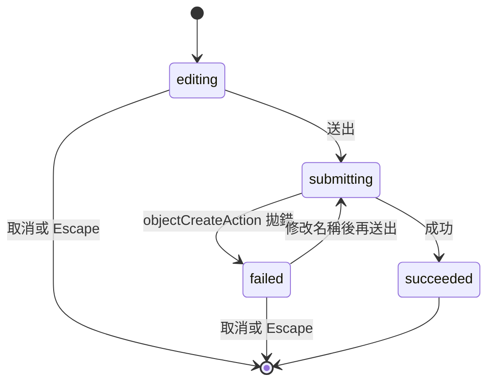
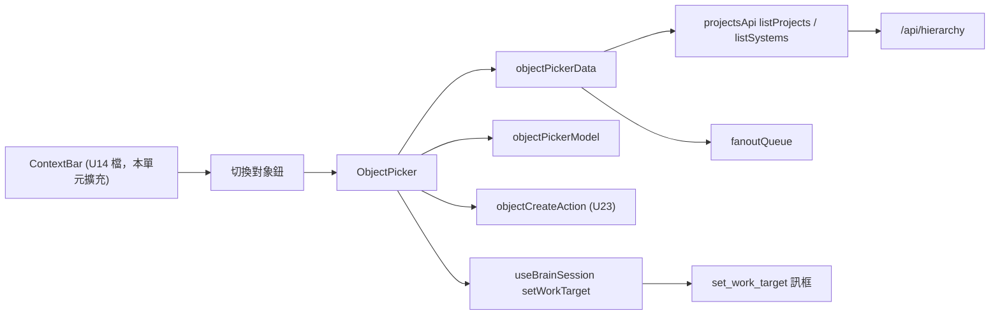

# Functional Spec — `U16 object-picker-ui`

> **本檔是本單元互動流程與狀態機的正本。** 單元類型 `ui`（`unit-of-work.md:52`）；
> 依 stage 檔，UI-only 單元的 `functional-spec.md` **自足**。本單元**不產出
> `entities.md`**（專案與系統的實體由 `U4`／`U7` 擁有）；`rules.md` 仍產出，理由見
> 該檔 §一。

## 零、上游來源（逐檔）

| 來源 | 本站用它決定什麼 | 實讀確認 |
|---|---|---|
| `inception/units-generation/unit-of-work.md:52`、`:194-200`、`:230` | 單元身分（`U16`、`ui`、M）、交付清單、驗證方式、依賴 `U7`／`U14`、`INV-2` 注意事項 | 是 |
| `inception/units-generation/unit-of-work-story-map.md:62`、`:121` | 只承載 `US9.2` | 是 |
| `inception/user-stories/stories.md:459-468` | `AC9.2.1`–`AC9.2.3` 的逐字 Given／When／Then | 是 |
| `inception/requirements-analysis/requirements.md:219-229` | `FR9.5`（建立路徑必須存在、一律經 `require_story_action`） | 是 |
| `inception/domain-design/components.md:238-250` | `ProjectHierarchy` 的「兩個入口、一條寫入路徑」 | 是 |
| `inception/contract-design/contract-summary.md:465-552`（`K-07`）、`:1017-1056`（`K-13`） | 消費的 HTTP 契約與 `ContextBar` 掛載契約 | 是 |
| `inception/refined-mockups/interaction-spec.md:32`、`:256-301`、`:359-379` | `INV-2`、`ObjectPicker` 規格、`ObjectCreateAction` 契約 | 是 |
| `inception/refined-mockups/mockups.md:242-281`（M4）、`:502` | 選單定稿與五態覆蓋 | 是 |
| `inception/refined-mockups/accessibility-checklist.md:14`、`:60`、`:63`、`:78`、`:83`、`:92` | 無障礙要求 | 是 |
| `functional-design-questions.md`（本單元） | `OP1`–`OP4` 的作答（皆為 A）與 §五義務清單 | 是 |
| **出貨程式**（`frontend/src/**`、`backend/services/hierarchy_*.py`、`membership_facade.py`、`ws-contract.json`） | 實際的 API、掛載點與既有元件形狀 | 是，逐行引用於 §四 |

## 一、這個單元要做什麼

`ContextBar` 內的「切換對象」選單：列出可選的專案與系統、選定即把作業對象送到
伺服器；並在選單內就地建立專案與系統。

**本輪交付的範圍比 `unit-of-work.md:196` 少一項**：`CreateConfirmCard`（對話式建立的
確認卡）**不實作**（`[OP1]`=A），理由與後續處置見 §八 `OPEN-OP16-1`。

本單元承載的 AC（逐條判定）：

| AC | 落在本單元？ | 承載方式 |
|---|---|---|
| `AC9.2.1` | **是** | 「+ 新增專案」建立（`BR14.2`）→ 成功即切過去（`BR14.5`）；零系統的專案在清單中**可選**（`BR13.1`） |
| `AC9.2.2` | **是** | 群組旁「+ 新增系統」建立（`BR14.3`）→ 系統歸屬該群組專案、成功即切過去（`BR14.5`）、在清單中可選（`BR13.1`） |
| `AC9.2.3` | **是（畫面面）** | 無權限者不渲染建立入口（`BR14.2`／`BR14.3`）；若仍收到 403，顯示「無權限」文案（`BR14.4`，文案由 `objectCreateAction` 持有）。「拒絕經 `require_story_action`」這一半由 `U7` 的端點與其 `TestClient` 測試承擔（已交付） |

## 二、本站四個定案及其後果

| 題 | 定案 | 最要緊的後果 |
|---|---|---|
| `OP1` | `CreateConfirmCard` 不實作，記為 `OPEN-OP16-1` | 交付清單少一項，**明寫為範圍縮減**；`INV-2` 仍成立（一處實作） |
| `OP2` | 專案與系統都可選 | 偏離 `interaction-spec.md:281`／`:261`（對齊修正）；`AC9.2.1` 才可滿足 |
| `OP3` | 非擁有者的專案照列、停用、附一行說明 | 成員看得到卻選不了；`OPEN-PP23-6` ③ 的落差被看得見地呈現 |
| `OP4` | 「+ 新增系統」在每個群組旁（擁有者且 `K2 edit`）、「+ 新增專案」在底部（`K2 edit`） | 偏離 `mockups.md:260` 與 `interaction-spec.md:284`（對齊修正）；「先選一個專案」的停用狀態不再存在 |

### 二之一、`OP3` ＋ `OP4` 合起來的一條一致性約束（本站推導）

`BR13.2` 的「可選」與 `BR14.3` 的「可在其下建系統」用**同一個欄位、同一方向**
（`owner_user_id === 目前使用者 id`），後者再加 `can('K2','edit')`。所以不存在
「選不了卻能在底下建系統」的組合；反過來「選得了卻不能建系統」是合法的（例如持
`K2 view` 而無 `K2 edit` 的擁有者）。實作上兩者必須呼叫**同一個**擁有者判定函式
（`frontend-components.md §二` 的 `isOwnedByMe`），不得各寫一次比較。

## 三、畫面與掛載

| 項 | 值 | 來源 |
|---|---|---|
| 掛載點 | `ContextBar` 內，作業對象名稱之後 | K-13 `provides_to_U16.mount`；`BR11.1` |
| 出現的頁面 | 入口頁、`/workspace`、`/assessment`（`ContextBar` 的三個掛載處） | `EntryPage.tsx:45`、`WorkspacePage.tsx:930`、`AssessmentPage.tsx:1240` 實讀 |
| 觸發鈕 | 「切換對象」，`brain-context-switch-object`，`aria-haspopup="dialog"` ＋ `aria-expanded` | `entry-page-ui/functional-design/frontend-components.md:143` |
| 覆蓋層 | `role="dialog"` ＋ `aria-modal="true"`，標題「切換作業對象」 | `BR15.1` |
| 新增路由 | **無** | — |

### 三之一、對已核可設計的對齊修正（依 `refined-mockups:c3` 不回改上游）

| 已核可的逐字內容 | 為什麼不成立 | 本站的處置 |
|---|---|---|
| `interaction-spec.md:281`：`onPick` 型別 `(systemId) => void`；`:261`：「依專案分組列出可選**系統**」 | 新建專案沒有系統，只能選系統則 `AC9.2.1` 不可滿足（questions §三 事實 2） | `BR13.1`：專案列也可選；回呼改為以列為單位送出三層 id（`[OP2]`=A） |
| `mockups.md:260`：底部 `[ + 新增專案 ]  [ + 新增系統 ]` 兩鈕並排；`interaction-spec.md:284`：「無選定專案時 `disabled` ＋『先選一個專案』」 | 選單裡「選定專案」無定義；伺服器建立系統還要求請求者是該專案擁有者（questions §三 事實 4） | `BR14.3`：「+ 新增系統」移到每個群組標題旁，父專案即該群組；只在擁有者且 `K2 edit` 時渲染（`[OP4]`=A） |
| `interaction-spec.md:270`：`empty` 態「只顯示『+ 新增專案』＋ 一行說明」 | 無 `K2 edit` 者看到的會是一個送出必然 403 的入口 | `BR14.6`：無 `K2 edit` 時只顯示說明；有 `K2 edit` 時照原文 |
| `interaction-spec.md:300-301`：test id `brain-object-create-system`（單一）；無專案列的 test id | 「+ 新增系統」變為每群組一個；專案列成為可選列 | 改為 `brain-object-create-system-{projectId}`；新增 `brain-object-project-{id}`（`frontend-components.md §九`） |
| `interaction-spec.md:131`：作業對象的寫入端含「`CreateConfirmCard` 建立成功後」 | 本輪不實作該卡（`[OP1]`=A） | 本輪寫入端為大腦、選單選定（`BR11.2`）、選單建立成功（`BR14.5`） |

**以上五處都是對齊修正或作答的直接後果，不是範圍擴充。** 沒有新增端點、沒有新增路由。

### 三之二、`K-13` 掛載點缺口：修改已交付的 `U14` 檔案（如實揭露）

K-13 的 `props_contract` 宣告 `ContextBar` 提供 `onObjectSelected(target)` 與
`currentTarget` 兩個 prop（`contract-summary.md:1028-1030`）。**已交付的 `ContextBar`
沒有這兩個 prop**：它只接受 `sharingToggle`（`ContextBar.tsx:22`），註解寫「切換對象
鈕只在 `U16` 提供選單時渲染，本單元不渲染」（`:20`），作業對象與送出函式改由 context
提供（`brainSession.ts:30-34`、`:57`）。

**本單元的擴充方式**（`BR11.1`）：

1. 在 `ContextBar.tsx` 的作業對象名稱之後、共享徽章之前，加入「切換對象」鈕與一個
   `pickerOpen` 區域 state；鈕只在 `status === 'ready'` 時渲染。
2. `pickerOpen` 為 true 時渲染新元件 `ObjectPicker`（新檔），它自行以
   `useBrainSession()` 取 `target`／`setWorkTarget`／`announce`，以 `useAuth()` 取
   `token`／`user.id`／`can`。
3. **不新增 prop、不修改三個頁面檔**；`sharingToggle` 的語意與「改為獨立對話」控件
   （屬 `U14`）**一行不動**。
4. 把 `ContextBar.tsx:20` 那句「本單元不渲染」的註解改寫為指向本單元的事實陳述
   （否則註解與程式不符）。

**這是重開一個已交付單元的檔案。** 後果與防護：

| 後果 | 防護 |
|---|---|
| `U14` 的 e2e（`entry-page.spec.ts` 等）斷言 `brain-context-bar` 的 `data-state` 與名稱節點；新增的鈕不得改變這些節點 | 鈕放在名稱節點之外；`data-state` 的五態判定不碰；code-generation 須跑全部既有 brain e2e |
| `U14` 的 code-generation 追溯（`entry-page-ui/code-generation/traceability.json:644-648`）寫「`U16` 未提供選單時不渲染」——本單元落地後該敘述不再描述現況 | 依 `refined-mockups:c3` 不回改已核可產出；本檔即為更正的記錄點（`OPEN-OP16-4`） |
| `U14` 的 97.7 號規則逐字「未掛載選單 → 不渲染該鈕」 | 本單元以「ready 才渲染」承接其意圖（不渲染點了沒反應的鈕）；三處永遠掛載，「未掛載」狀態在本單元之後不再存在 |

## 四、API 與既有程式消費點（**已實測存在於磁碟**）

| 操作 | 消費方式 | 回應 | 出處 |
|---|---|---|---|
| 列專案 | `listProjects(token)` → `GET /api/hierarchy/projects` | `200` `ProjectOut[]`（`id`／`name`／`owner_user_id`／`is_default`／`created_at`）、`403`（缺 `K2 view`） | `projectsApi.ts:85-88`；`hierarchy_router.py:151-168` |
| 列系統 | `listSystems(token, projectId)` → `GET /api/hierarchy/projects/{id}/systems` | `200` `SystemOut[]`、`403`、`404`（不存在或不可見，回應相同） | `projectsApi.ts:96-105`；`hierarchy_router.py:213-235` |
| 建立 | `objectCreateAction(token, kind, name, parentProjectId?)` | 成功回 `ProjectOut`／`SystemOut`；失敗拋 `ObjectCreateError`（`empty`／`duplicate`／`forbidden`／`other`） | `objectCreateAction.ts:59-86` |
| 切換作業對象 | `useBrainSession().setWorkTarget({projectId, systemId, diagramId})` → `set_work_target` 訊框（帶本頁讀取段） | 回 `boolean`（未 ready 不送）；成功由伺服器扇出 `work_target` | `brainSession.ts:57`；`useBrainConnection.ts:331-335`；`brain_gateway.py:1540-1562` |
| 播報 | `useBrainSession().announce(text)` | 寫入該頁唯一的大腦 `LiveRegion` | `BrainSession.tsx:19` |
| 扇出佇列 | `fanoutQueue`（`FANOUT_CONCURRENCY = 4`、FIFO、`cancel()`） | — | `fanoutQueue.ts:1-28` |

### 四之一、清單可見範圍與大腦解析範圍不一致（`[OP3]` 的前提）

- 清單：`list_visible_projects` ＝ 成員列 ∪（擁有者且零成員列）（`membership_facade.py:482-498`）。
- 解析：`resolve_work_target` 每層套**擁有者**範圍，非擁有者拋 `HierarchyNotFound`
  （`hierarchy_service.py:73-77`、`:299-309`），閘道回單則 `error`、不扇出
  （`brain_gateway.py:1558-1561`）。

故被邀請的成員看得到、卻不能設為作業對象。`BR13.2` 以停用呈現；根治不在本單元
（`OPEN-OP16-5`）。

### 四之二、角色與兩個權限的實際分佈（`BR14.2`／`BR14.3` 的影響面）

`rbac_seed_data.py:316-337` 實讀：持 `K1 view`（能進入入口頁）的 8 個角色**全部**持
`K2 view`，故凡看得到「切換對象」鈕的人都能列清單；`K2 edit` 只有 `Project_Architect`／
`Project_Editor`／`Project_Admin`／`Platform_Admin` 4 個。其餘持 `K1 view` 的
`Developer`／`FinOps_Analyst`／`Security_Reviewer`／`Platform_Owner` 看得到清單、
看不到任何建立入口。

## 五、互動流程（numbered step sequences — 本檔是這些流程的**正本**）

### W1. 開啟選單

1. 使用者在 `ContextBar` 點「切換對象」（只在連線 `ready` 時存在，`BR11.1`）。
2. 選單以 dialog 開啟，焦點移到搜尋框（`BR15.1`），清單進入 `loading`。
3. 若 `user.id` 尚未取得 → 保持 `loading`，待其成為數字再繼續（`BR12.3`）。
4. 發 `listProjects`；成功後對每個專案經 `fanoutQueue` 發 `listSystems`（`BR12.1`）。
5. 全部成功：
   - 專案數 0 → `empty`（有 `K2 edit` 顯示「+ 新增專案」＋ 說明；否則只顯示說明，`BR14.6`）。
   - 專案數 ≥ 1 → `default`：依 id 遞增渲染群組；每群組為「專案列 ＋ 系統列」，
     非擁有者群組停用並附說明（`BR13.2`），目前對象標「目前」（`BR13.3`）。
6. 任一失敗 → `error`（`BR12.2`）：專案清單 403 顯示「你沒有檢視專案的權限」，其餘
   「無法載入清單」＋ 重試。`loading`／`error` 期間「+ 新增專案」仍可用（若有 `K2 edit`）。
7. 播報「已載入 N 個專案」（N 由實際群組數算出，`BR15.4`）。

### W2. 選定作業對象（`AC9.2.1`／`AC9.2.2` 的「可被選為作業對象」）

1. 使用者點選或以方向鍵移到某列並按 Enter／Space（`BR15.3`）。
2. 該列 `aria-disabled` → 無動作（說明已由 `aria-describedby` 讀出）。
3. 可選 → 組出三層 id（專案列 `{p, null, null}`；系統列 `{p, s, null}`）並呼叫
   `setWorkTarget`（`BR11.2`）。
4. 回傳 `true` → 關閉選單、焦點回「切換對象」鈕（`BR11.3`）；脈絡列等伺服器回推
   `work_target` 才更新（不本地改）。
5. 回傳 `false` → 選單不關，就地顯示「目前無法切換：與大腦的連線中斷」並播報。
6. 在 `/workspace`／`/assessment`：回推由 `U14` 同步掛點處理，顯示「作業對象已改為 X」，
   畫布不自動換圖（`BR11.4`）。

### W3. 搜尋

1. 使用者在搜尋框輸入；每次輸入以 `BR13.4` 過濾已載入的群組，不發請求。
2. 有命中 → 只顯示命中的群組與系統。
3. 無命中 → `no-match`：「沒有符合的對象」，建立入口保留，播報「沒有符合的對象」。
4. 清空搜尋 → 回到完整清單。

### W4. 就地建立專案（`AC9.2.1`）

1. 有 `K2 edit` 的使用者點底部「+ 新增專案」（`BR14.2`）→ `creating`：名稱欄就地展開、焦點進名稱欄。
2. 送出 → 進行中旗標設 true、送出鈕停用（`BR14.4`）→ `objectCreateAction(token, 'project', name)`（`BR14.1`）。
3. 失敗 → 就地顯示錯誤文案（名稱重複／無權限／其他；空名稱不發請求），名稱保留、表單不收。
4. 成功 → `setWorkTarget({新專案, null, null})`、關閉選單、播報「已建立並切換到 <名稱>」（`BR14.5`）。
5. 下次開啟選單時，新專案出現在清單中且**可選**（`BR12.1`、`BR13.1`）——即使它尚無系統。

### W5. 就地建立系統（`AC9.2.2`）

1. 在**自己擁有**的專案群組旁點「+ 新增系統」（只在擁有者且 `K2 edit` 時存在，`BR14.3`）。
2. 表單就地展開於該群組下，父專案固定為該群組（無「所屬專案」欄位）。
3. 送出／失敗同 W4 第 2–3 步，呼叫 `objectCreateAction(token, 'system', name, projectId)`。
4. 成功 → `setWorkTarget({該專案, 新系統, null})`、關閉選單、播報（`BR14.5`）。

### W6. 關閉選單

1. Escape：若在 `creating` → 收起表單、焦點回開啟它的入口；否則關閉選單（`BR15.2`）。
2. 點選單外、選定成功、建立成功 → 關閉。
3. 任何關閉都取消扇出並丟棄在途結果（`BR12.4`），焦點回「切換對象」鈕。

## 六、狀態機

### 六之一、選單（清單面）

```mermaid
stateDiagram-v2
    [*] --> loading
    loading --> default: 全部成功且專案數至少一
    loading --> empty: 全部成功且專案數為零
    loading --> error: 任一請求失敗
    error --> loading: 使用者點重試
    default --> noMatch: 搜尋無命中
    noMatch --> default: 修改或清空搜尋而有命中
    default --> creating: 點任一建立入口
    noMatch --> creating: 點任一建立入口
    empty --> creating: 點新增專案（須有 K2 edit）
    error --> creating: 點新增專案（須有 K2 edit）
    loading --> creating: 點新增專案（須有 K2 edit）
    creating --> default: 取消或 Escape
    creating --> closed: 建立成功
    default --> closed: 選定成功送出、Escape、點選單外
    closed --> [*]
```

**文字 fallback**：選單初始 `loading`。全部請求成功且至少一個專案轉 `default`、零個轉
`empty`、任一失敗轉 `error`（可重試回 `loading`）。`default` 在搜尋無命中時轉
`noMatch`（即規格的 `no-match`），修改搜尋而有命中再回 `default`。`default`、
`noMatch` 點任一建立入口轉 `creating`；`empty`、`error`、`loading` 只能經「+ 新增專案」
轉 `creating`，且須有 `K2 edit`（「+ 新增系統」依附於已載入的群組）。`creating` 取消或
Escape 回 `default`（從其他狀態進入者回到原狀態，圖中以 `default` 代表），建立成功轉
`closed`。`default` 在選定送出成功、Escape、點選單外時轉 `closed`。

### 六之二、建立表單



**文字 fallback**：表單初始 `editing`。送出轉 `submitting`（送出鈕停用、進行中旗標擋
重複觸發）。`objectCreateAction` 拋錯轉 `failed`（就地顯示文案、名稱保留），可修改後
再送出回 `submitting`。成功轉 `succeeded`（觸發 `BR14.5` 後選單關閉）。`editing` 或
`failed` 時取消或 Escape 即結束表單。

## 七、衍生檢視

### 七之一、為什麼沒有 ER 圖

本單元沒有 `entities.md`（`produces_kinds` 的 `entities` 不含 `ui`），也不擁有任何實體——
`Project`／`System` 的擁有者是 `ProjectHierarchy`（`components.md:238`）。代之以本單元
真正擁有的**資料流**：



**文字 fallback**：`ContextBar`（`U14` 的檔，本單元擴充）渲染「切換對象」鈕，開啟
`ObjectPicker`。選單經 `objectPickerData` 以 `projectsApi` 的兩個列舉函式與 `fanoutQueue`
取清單，以純函式模組 `objectPickerModel` 算可選性、目前標示與搜尋結果，建立一律經
`U23` 的 `objectCreateAction`，切換經 `useBrainSession().setWorkTarget` 送出
`set_work_target` 訊框；HTTP 走 `/api/hierarchy`。

### 七之二、規則摘要（derived from `rules.md`）

22 條，分五群：`BR11` 掛載與送出（4）、`BR12` 清單取得（4）、`BR13` 可選性與呈現（4）、
`BR14` 就地建立（6）、`BR15` 無障礙與焦點（4）。逐條見 `rules.md §三`（正本）。

## 八、開放項、範圍縮減與不承接的指派

### 八之一、開放項

| id | 內容 | 落點 | 執行性 |
|---|---|---|---|
| `OPEN-OP16-1` | **範圍縮減：`CreateConfirmCard`（對話式建立）不實作。** 現有管線沒有任何觸發端——伺服器→客戶端訊息型別為封閉九值（`ws-contract.json:759-772`）、意圖路由能力為封閉三值（`intent_routing_types.py:50-54`），兩者都沒有「建立」。`unit-of-work.md:196` 與 `bolt-plan.md:354` 的交付清單因此少一項，`[DM:D2]`=D 的對話那一半不落地。`INV-2` 仍成立（`objectCreateAction` 唯一實作） | **本 intent 內無自然承接站**（`U2`／`U11`／`U12`／`U13` 皆已交付）。由 conductor 在本單元核可關卡**重新提交使用者**，決定是否另開 intent | 已揭露（`[OP1]`=A 選項本文），待使用者在關卡確認 |
| `OPEN-OP16-4` | **重開已交付的 `U14` 檔案**：本單元修改 `ContextBar.tsx`（§三之二）；`U14` code-generation 追溯中「`U16` 未提供選單時不渲染」的敘述在本單元之後不再描述現況 | 本檔即記錄點；本單元 code-generation 須跑全部既有 brain e2e 確認 `U14` 的斷言不受影響 | 有效（code-generation 在游標之後，`ALWAYS`） |
| `OPEN-OP16-5` | `[OP3]`=A 只呈現、不根治 `OPEN-PP23-6` ③：被邀請的成員選不了自己看得到的專案 | 沿用 `U23` 的既有登錄（「本 intent 內無自然承接站」），本站不另開重複指派 | 不重複指派 |
| `OPEN-OP16-6` | 子頁面上自己的選取也會收到「作業對象已改為 X」提示，且畫布不自動換圖（`BR11.4`） | 關卡揭露；若使用者要求消除，須擴充 `U14` 的同步掛點（另一次重開） | 已揭露 |
| `OPEN-OP16-7` | `NFR11`：本單元**會**減少頁面切換——「換作業對象」與「建立專案／系統」兩件事在入口頁與兩個子頁面內即可完成，不必切到 `/projects` | `build-and-test`（3.6，`ALWAYS`；`requirements.md:577-578` 逐字的量測落點）計數時納入這兩個情境 | 有效 |

### 八之二、其他單元指派給本單元、本站**不承接**的義務

| # | 義務與來源 | 不承接的理由 | 處置 |
|---|---|---|---|
| `D-4`（`OPEN-OP16-2`） | 刪除被拒（專案仍有系統、系統仍有圖）的錯誤訊息「畫面面」——`hierarchy-data/functional-design/rules.md:222-223`、`hierarchy-data/code-generation/traceability.json:40` | 本單元交付（`unit-of-work.md:196`）**不含任何刪除控件**，選單無刪除入口；做它就要在選單裡新增刪除，屬範圍擴充 | **本 intent 內無自然承接站**（刪除入口若存在應在專案頁，`U23` 已交付）；conductor 於關卡重新提交使用者 |
| `D-5`（`OPEN-OP16-3`） | 新建架構圖時的系統歸屬選擇（`OQ-H2`／`OPEN-H11`／`OPEN-EP14-17`），連帶 `S-7`——`hierarchy-data/functional-design/functional-spec.md:284`、`hierarchy-data/code-generation/traceability.json:65`、`entry-page-ui/functional-design/functional-spec.md:339` | 建圖路徑在既有 `collab_router`／A1（`hierarchy-service/functional-design/functional-spec.md:203-207`），且**沒有任何**「指派圖到系統」的寫入端點；本單元做它就要新增後端端點，超出 `kind: ui`。`S-7` 只在 `OQ-H2` 收成 NOT NULL 時成立，本單元不收，故不觸發 | **本 intent 內無自然承接站**（`U7` 已交付）；conductor 於關卡重新提交使用者 |

### 八之三、指派落點有誤的三項（指出正確落點，不承接）

| # | 指派與來源 | 為什麼落點有誤 | 正確落點 |
|---|---|---|---|
| `D-6` | `U12` 行動者解析失敗（`S-11`）的「訊息呈現」——`hierarchy-data/nfr-design/security-design.md:146`、`:158` | 該失敗發生在大腦改圖的回合內，經閘道 `error` 訊框送到**對話流**；本單元的選單不收任何大腦回合訊息 | `U14` 的對話流錯誤呈現（已交付） |
| `D-9` | `NFR11` 在 `U23`／`U16` 量測——`hierarchy-service/nfr-requirements/traceability.json:142` | `requirements.md:577-578` 逐字把量測機制落點定在 `build-and-test`，不是任何單元 | `build-and-test`（本單元提供情境，見 `OPEN-OP16-7`） |
| `D-10` | `US2.x`／`US3.1`／`US9.1` 等多條 AC「承載在 U13／U14／U16 的使用者可見層」——`session-store/code-generation/traceability.json:141-256` | story map 把那些故事指給 `U14`；`U16` 只承載 `US9.2`（`unit-of-work-story-map.md:121`）。該處的 `U16` 是泛稱消費端 | `U14`（已交付） |

### 八之四、附帶承接（非本單元 AC）

`D-7`：`AC9.1.3`（遷移不改變既有頁面行為）的 e2e 斷言被指給「`U16` 或既有 Playwright
層」（`hierarchy-data/nfr-requirements/traceability.json:183`）。本單元本來就要改
`/workspace` 上的 `ContextBar`，順帶加一案「無系統歸屬的既有圖在 `/workspace` 照常開啟、
脈絡列只顯示圖名」（`frontend-components.md §十之一`）。`AC9.1.3` 不在本單元的
`upstream_ids` 內（story map 未指派 `US9.1` 給 `U16`），於 `traceability.json` 不列。

`D-8`：選單不特別把預設專案排前，照伺服器 id 遞增（`BR12.1`）。

## 九、自檢報告（七項，逐項）

| 項 | 結果 |
|---|---|
| **1 可達性** | 逐條規則的觸發狀態皆可達，**3 處需要刻意構造**：① `BR13.2` 的「非擁有者專案」需要一位擁有者邀請第二位使用者為成員（`U19`／`U24` 已交付的邀請路徑），e2e 以 `page.route` 回應一個 `owner_user_id` 不等於目前使用者的 `ProjectOut` 即可構造，不需真實邀請；② `BR11.2` 的 `setWorkTarget` 回 `false` 需要「鈕已渲染（ready）後、送出前連線中斷」——以既有假伺服器在開啟選單後關閉 WebSocket 可構造；③ `BR12.3` 的 `user.id` 未決視窗需延遲 `/api/auth/me` 回應，以 `page.route` 延遲可構造。`BR14.6` 需無 `K2 edit` 的角色（如 `Developer`，`rbac_seed_data.py:328`）且清單為空——可構造 |
| **2 契約端點三問** | 範圍為本 stage 全部產出（`functional-spec.md`／`rules.md`／`frontend-components.md`／`traceability.json`）。本單元不擁有實體；三問對象為本單元宣告的**方法與 state**：① `isOwnedByMe(project, userId)`——寫（定義）＝`objectPickerModel`、讀＝`BR13.2` 的可選判定 ＋ `BR14.3` 的建立入口判定（兩處，§二之一）、清＝N/A（純函式）。② `pickerOpen`（`ContextBar` state）——寫＝切換鈕點擊、讀＝是否渲染 `ObjectPicker`、清＝W6 的全部關閉路徑。③ `groups`／`status`（`ObjectPicker` state）——寫＝W1 第 4–6 步、讀＝清單渲染與搜尋、清＝卸載（每次開啟重抓，`BR12.1`）。④ `createForm`（哪一張表單開著、名稱、進行中旗標、錯誤）——寫＝建立入口點擊與輸入、讀＝表單渲染與送出、清＝取消／Escape／成功（`BR14.4`／`BR14.5`）、**另一張表單開啟時亦清**（`BR14.4` 首句）。⑤ `setWorkTarget`——擁有＝`U14`、呼叫＝`BR11.2` 與 `BR14.5` 兩處。⑥ `objectCreateAction`——擁有＝`U23`、呼叫＝`BR14.1`。**出現在少於兩處者**：`announce` 只在 `BR15.4` 定義、由 W1／W2／W3／W4 四處呼叫，非孤兒。無懸空契約 |
| **3 引用逐字核對** | 逐處開檔以行號印出核對，**分開驗事實與驗定位**。questions 檔第一版有 **5 處行號誤差**（`interaction-spec.md:290-296`→`293-296`、`contract-summary.md:1051-1055`→`1051-1054`、`interaction-spec.md:375-376`→`376`、`hierarchy_router.py:155`→`156`、`requirements.md:574-578`→`577-578`），已於 Phase 1 更正。本輪產出初稿另查出 **2 處**定位錯誤並已更正：`contract-summary.md:532`→`:534`（K-07 的「`create_*` 寫入並留稽核」）、`entry-page-ui/code-generation/traceability.json:645-648`→`644-648`（`BR97.7` 那一筆的 `id` 在 `:644`）——事實都對，只有行號錯，正是只驗內容的核對會放過的那一類。本輪新增引用（`ContextBar.tsx:20`／`:22`、`brainSession.ts:30-34`／`:57`、`useBrainConnection.ts:331-335`、`BrainSession.tsx:19`、`projectsApi.ts:85-105`、`fanoutQueue.ts:1-28`、`objectCreateAction.ts:59-86`、`hierarchy_service.py:73-77`／`:299-309`、`membership_facade.py:482-498`、`brain_gateway.py:1540-1562`、`rbac_seed_data.py:316-337`、`mockups.md:260`、`interaction-spec.md:270`／`:281`／`:284`、`EntryPage.tsx:45`、`WorkspacePage.tsx:930`、`AssessmentPage.tsx:1240`）皆以 `sed -n` 印出確認，結果見 §九之一 |
| **4 檔案集合一致性** | 與同類 `ui` 單元 `U15`／`U24` diff：兩者皆為 `functional-design-questions.md`、`functional-spec.md`、`rules.md`、`frontend-components.md`、`traceability.json`（另有審查產生的 `reviews/`）。本單元產出同一五檔，**無缺項** |
| **5 跨檔傳播** | 按**事實**列舉：①「`CreateConfirmCard` 不實作」→ 本檔 §一／§二／§三之一／§八 `OPEN-OP16-1`、`frontend-components.md §十之二`、questions §八之一，以 `CreateConfirmCard`、`OPEN-OP16-1`、`對話式建立` 三種形式 grep；②「專案可選」→ `BR13.1`、本檔 §三之一第 1 列／W2／W4 第 5 步、`frontend-components.md §九`（`brain-object-project-{id}`），以 `專案列`、`brain-object-project`、`OP2` grep；③「建立系統在群組旁」→ `BR14.3`、本檔 §三之一第 2 列／W5、`frontend-components.md §二／§九`，以 `新增系統`、`create-system`、`OP4` grep；④「擁有者判定同一函式」→ `BR13.2`、`BR14.3`、本檔 §二之一、`frontend-components.md §四之一`，以 `isOwnedByMe`、`owner_user_id` grep；⑤「修改 `ContextBar.tsx`」→ `BR11.1` note、本檔 §三之二／`OPEN-OP16-4`、`frontend-components.md §一／§二`，以 `ContextBar.tsx`、`重開` grep。結果見 §九之一 |
| **6 可算的數字先算再寫** | 數字：**22** 條規則、**3** 條 upstream AC、**3** `OK`、規則群組分佈 4/4/4/6/4、`K2 edit` 角色 **4** 個、持 `K1 view` 角色 **8** 個——全部由 §九之一的命令算出 |
| **7 Hard constraint 逐項對照** | 見九之二（ADR-0006 四面向）與九之三（PBT） |

### 九之一、數字與核對的取得方式

| 數字／核對 | 取得方式 |
|---|---|
| 22 條規則、分佈 4/4/4/6/4 | 對 `rules.md` 執行 `grep -oE 'id: BR1[1-5]\.[0-9]+'` 計數並按群組分組 |
| 3 條 upstream AC | `stories.md:466-468` 三列；`unit-of-work-story-map.md:121` 只指派 `US9.2` |
| `K2 edit` 4 個、`K1 view` 8 個 | `rbac_seed_data.py:316-337` 逐列讀第 3、4 欄 |
| 引用定位 | 每個 `<file>:<n>` 以 `sed -n '<n>p'` 印出內容逐一比對（腳本輸出，非記憶） |
| 跨檔傳播 | 每個事實的每種表達形式對四份產出各 `grep -c` 一次 |

### 九之二、ADR-0006 security baseline 四面向（逐項，不留空白）

| 面向 | 適用？ | 本單元的影響與處置 |
|---|---|---|
| **IAM** | **適用（呈現層）** | 本單元不新增 story id、不改權限矩陣。建立入口依 `K2 edit`（`BR14.2`）與擁有者欄位（`BR14.3`）、可選性依擁有者欄位（`BR13.2`）。**三者都不是授權**：伺服器仍以 `require_story_action`（`K2`）＋ 擁有者檢查判定建立（`hierarchy_router.py:237-272`），以擁有者範圍解析作業對象（`hierarchy_service.py:299-309`）。移除前端判定只會讓畫面出現必然被拒的控件，不會擴大任何人的權限——此區別寫在 `BR13.2` note，以免下游誤以為移除它就等於開放。`[OP3]`=D（擴大解析範圍）**未被選**，故本單元不改變任何可存取資源的集合 |
| **Encryption** | **不適用（本單元無新增落點）** | 零新增持久化、零新增傳輸通道；HTTP 沿用既有 `Authorization: Bearer`，WebSocket 沿用既有握手。**判定失效條件**：若日後選單快取清單於本機儲存，本列轉為適用 |
| **Network exposure** | **不適用（本單元無新增落點）** | 零新端點、零新進程、零新環境變數；消費的四支 `/api/hierarchy` 端點與 `set_work_target` 訊框皆已存在。`[OP1]`=B、`[OP2]`=D 會新增端點或訊息型別，**皆未被選** |
| **Audit logging** | **不適用（本單元無新增落點）** | 建立的稽核由 `U7` 的 `create_*` 承擔（K-07 `observable_side_effects`，`contract-summary.md:534`）；本單元經 `objectCreateAction` 呼叫同一端點，不另寫、不繞過。`set_work_target` 不寫稽核屬既有設計（`U10`）。**殘留**：建立的稽核在本 intent 無使用者可見的查詢面——與 `U15` 的 `OPEN-MP15-5` 同型，屬既有缺口，本站不另開 |

### 九之三、property-based testing hard constraint（ADR-0006）

`project.md ## Testing Posture` 點名的 PBT 落點是 IaC generator、cost calculator、agent
routing；本單元三者皆不涉及（`[OP1]`=B 會動到 agent routing，**未被選**）。判 N/A 之前
先問它要防的失敗模式是否以別的形式存在：**存在兩處**可寫成純函式的計算——`BR13.2`／
`BR14.3` 的擁有者判定與 `BR13.4` 的搜尋過濾（漏列或多列的失敗正是 PBT 擅長的那一類）。
處置：`frontend-components.md §五之二` 要求兩者抽成不碰 state、不碰 `fetch` 的純函式；
但前端無 unit 測試框架（`team.md ## Testing Posture`），本輪驗證層仍為 Playwright e2e，
導入前端 unit 框架是 `team.md` 的「D（不採用）」，不由本單元夾帶。
