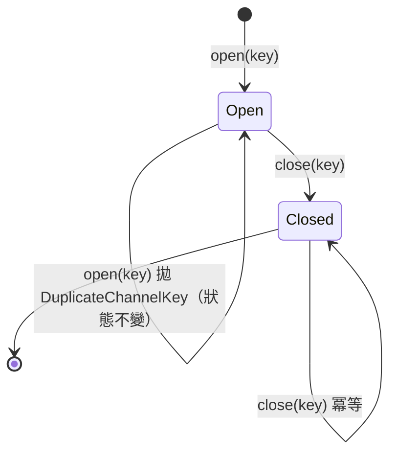
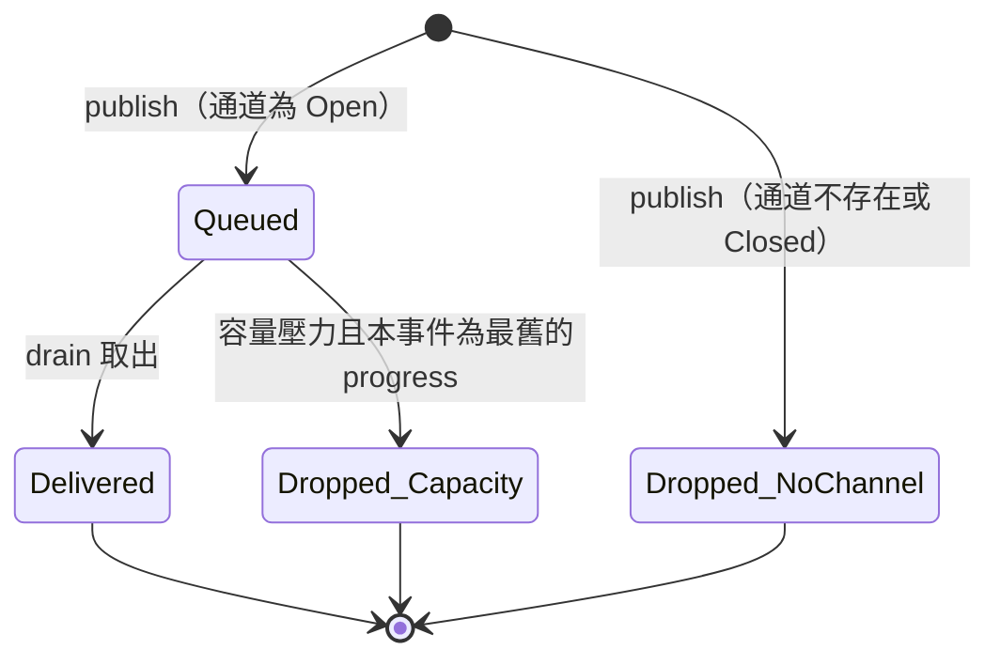
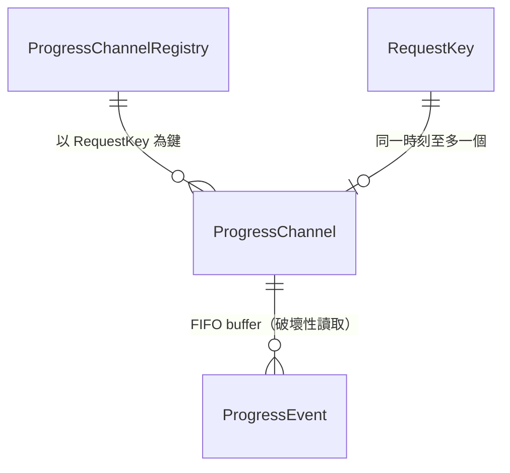

# 行為規格 — `U22` `progress-channel`

> 單元：`U22` `progress-channel`（`library`，M，**本輪新增的唯一可平行根**）
> Stage：`functional-design`（3.1）　Depth：`Minimal`
> 本檔是**工作流程與狀態機的真實來源**；`entities.md`（資料形狀）與 `rules.md`
> （決策邏輯）不捕捉有序行為與狀態轉移。檔內的 ER 圖與規則摘要是**衍生視圖**，
> 其真實來源分別是那兩份檔的 fenced yaml 區塊。

---

## §〇 先看這一句：本單元交出去的是什麼

**它不新增任何使用者可見的功能。** 它把一個**共用的格子**換成**一組各自獨立的格子**，
使兩件已經在發生的壞事停止：一位使用者收到另一位使用者的架構圖，以及一個請求結束
時把另一個還在跑的請求弄崩。

本單元是 `library`（`unit-of-work.md:310` 逐字「行程內狀態容器，無獨立執行期」），
**無 HTTP、無 UI、無持久化、無受保護操作**。它的依賴邊是空的（葉中之葉：既無出邊，
`depends_on: []`），入邊有兩條——`U13 brain-gateway`（讀）與 `U12 work-orchestrator`
（建立與關閉）。

**它是本輪新增七個單元裡唯一的可平行根**，理由寫在 `unit-of-work.md:404`：它修的是
既有程式，不需要任何新東西先落地。

---

## §一 工作流程

### `WF-1` 正常的一次產圖請求

| 步 | 誰 | 做什麼 | 規則 |
|---|---|---|---|
| 1 | `U13`／`U12`（入口端） | 鑄造一個不透明且不可猜的 `request_key` | `BR1.1` |
| 2 | `U12` | `ProgressChannel.open(request_key)`；該鍵已存在即拋 `DuplicateChannelKey` | `BR1.2` |
| 3 | `U12` | 把 `request_key` 以顯式參數傳入 `run_design_agent(...)`，與 `thread_id` **並存** | `BR1.1` |
| 4 | agent 的工具 | 每次有進度即 `ProgressChannel.publish(request_key, event)` | `BR4.1` |
| 5 | `U13` | 在串流迴圈內反覆 `ProgressChannel.drain(request_key)`，把取到的事件送往 SSE | `BR1.3`、`BR3.1` |
| 6 | `U13` | 迴圈結束後**再 drain 一次**，收尾 | `BR1.3` |
| 7 | `U12` | 於 `finally` 呼叫 `ProgressChannel.close(request_key)` | `BR2.1`、`BR2.2` |

**步 7 必須在 `finally`，不是在步 6 之後的正常路徑上**——這是 `[Q2]`=A 的全部內容。
步 1–3 的順序不可調換（鍵要先存在才能開、要先開才能傳下去）；步 4 與步 5 **刻意並行**，
那正是要被隔離的那個併發。

### `WF-2` 兩個重疊請求（`AC13.1.1` 的可測形式）

| 步 | 做什麼 | 現狀的結果 | 修後的結果 |
|---|---|---|---|
| 1 | A 以鍵 `kA` open 並開始產圖 | 全域被指派為 A 的 queue | registry 有 `kA` |
| 2 | B 以鍵 `kB` open 並開始產圖 | **全域被覆寫為 B 的 queue** | registry 有 `kA`、`kB` 兩個 |
| 3 | A 的工具 publish 一則 `xml` | 寫進 **B 的** queue | 寫進 `kA` |
| 4 | A 的讀取端 drain | 取到 **B 的**事件 | 只取到 `kA` 的 |
| 5 | 斷言兩集合互斥**且各自非空** | **紅**（A 為空、B 收到 A 的產出，互斥真空成立——只斷言互斥會通過） | 綠 |

交錯順序以 `asyncio.Event` barrier 釘住，**不得以 `sleep` 製造**（`BR5.2`）。

### `WF-3` 先結束的請求不得弄壞另一個（`AC13.1.2`）

| 步 | 做什麼 | 現狀 | 修後 |
|---|---|---|---|
| 1 | A、B 重疊，B 先結束並 close | `design_agent.py:218` 把全域設為 `None` | 只移除 `kB` |
| 2 | A 的工具其後 publish | 寫入 `None` → 寫入端的 `if _progress_queue is not None` 把它**靜默跳過** | 寫進 `kA` |
| 3 | A 的讀取端 drain | `_drain_progress(None)` 在 `:163` 對 `None` 呼叫 `get_nowait()` **拋 `AttributeError`** | 取到 `kA` 的事件 |
| 4 | 該例外如何到使用者手上 | **原文被送進 SSE** | 不發生 |

> **`FR13.3` 的原始描述是錯的，而 `AC13.1.2` 已更正它。** `FR13.3` 寫「事件被**靜默
> 丟棄**」，實測是另一個請求**崩潰**（`[Q-08]`／`[V-02]` 的共同發現）。一條斷言
> 「沒有事件被靜默丟棄」的 AC 會在**修前與修後都通過**；改為斷言「**仍收到**自己的
> 事件」，那是可失敗的。本站沿用 `AC13.1.2` 的措辭，不回改已核可的 `requirements.md`。

### `WF-4` 容量壓力下的丟棄（`BR4.1`／`BR4.2`）

| 情境 | 處置 |
|---|---|
| buffer 滿，新事件是 `progress` | 自最舊端找第一則 `progress` 丟棄，寫入新的；記 WARN log |
| buffer 滿且**已無 `progress` 可丟**，新事件是 `progress` | 拒絕寫入新的 `progress`；記 WARN log |
| buffer 滿，新事件是 `xml` 或 `error` | **一律寫入**，必要時 buffer 暫時超過上界 |

**不阻塞生產者。** 生產者是 agent 的執行路徑；阻塞它等於讓一個慢的或已斷線的消費者
拖住產圖，把記憶體問題換成可用性問題（`[Q4]` 選項 C 被否決的理由）。

---

## §二 狀態機

### `SM-1` 單一通道的生命週期

**文字 fallback**：通道有兩個狀態。`open(key)` 由不存在進入 **Open**；在 Open 內
`publish` 與 `drain` 不改變狀態；`close(key)` 進入 **Closed**；對 Closed 再 `close`
視為成功且狀態不變（`BR2.2` 冪等）；對已是 Open 的鍵再 `open` 拋
`DuplicateChannelKey` 且**狀態不變**（`BR1.2`——重點是它不轉為一個新的空通道，
因為那會讓前一個請求已寫入的事件憑空消失）。

**Closed 與「從未存在」在對外行為上刻意不可區分**（`BR2.4`）：兩者的 `drain` 都回
空迭代器、`publish` 都是記 log 並丟棄。可區分的話，呼叫端就能探知某個鍵曾經存在，
而鍵的不可猜性是本單元唯一的可見性機制。

### `SM-2` 單一事件在 buffer 內的歷程

**文字 fallback**：一則事件 `publish` 後若通道為 Open 即進入 **Queued**；若通道不存在
或已關閉則直接進入 **Dropped_NoChannel**（記 log，不崩潰、不靜默成功——`BR3.2`）。
Queued 的事件被 `drain` 取出後進入 **Delivered** 並自 buffer 移除（破壞性讀取，
`[Q3]`=A，不保證重放）；或在容量壓力下、且它是最舊的 `progress` 類時進入
**Dropped_Capacity**（記 WARN log，`BR4.2`）。**`xml` 與 `error` 永遠不會進入
Dropped_Capacity**（`BR4.1`）。

三個終態都是最終態，沒有任何一條邊回到 Queued——**沒有重播路徑**，這是 `[Q3]`=A
的狀態機形式。

---

## §三 衍生視圖：ER 圖

> 真實來源為 `entities.md` 的 fenced yaml。本圖為可讀性而存在，兩者若有出入
> 以該 yaml 為準。

**文字 fallback**：`ProgressChannelRegistry` 持有 0 到多個 `ProgressChannel`，以
`RequestKey` 為鍵；每個 `ProgressChannel` 持有 0 到多個 `ProgressEvent`，順序為 FIFO
且讀取為破壞性；一個 `RequestKey` 在同一時刻至多對應一個存活的 `ProgressChannel`
（由 `BR1.2` 保證）。全部為行程內狀態，**無資料表**。

**實體數 4**（`RequestKey`、`ProgressEvent` 為 value object；`ProgressChannel`、
`ProgressChannelRegistry` 為 entity）——由腳本解析 `entities.md` yaml 的 `kind:` 欄
算出（`{'value_object': 2, 'entity': 2}`）。

---

## §四 衍生視圖：規則摘要

> 真實來源為 `rules.md` 的 fenced yaml。**13 條規則**，類別分佈
> `constraint` **10**、`validation` **1**、`policy` **2**，`authorization` 與
> `calculation` 皆 **0**——由腳本解析該 yaml 的 `- id:` 與 `category:` 兩欄算出。

| 群 | 規則 | 一句話 |
|---|---|---|
| BR1 | `BR1.1` | 鍵必須 per-request，由入口端鑄造並顯式傳遞 |
| | `BR1.2` | `open` 對已存在的鍵拋 `DuplicateChannelKey`，不靜默覆寫 |
| | `BR1.3` | 一則事件只能被寫入它的那個鍵的 `drain` 取得 |
| BR2 | `BR2.1` | 請求結束必須 `close`，由呼叫端 `try/finally` 擁有 |
| | `BR2.2` | `close` 冪等 |
| | `BR2.3` | 被中途放棄的請求結束後鍵不得殘留（**須有測試，不得只以推論成立**） |
| | `BR2.4` | `drain` 不存在的鍵回空迭代器，不拋 |
| BR3 | `BR3.1` | 對外錯誤為固定訊息，不含例外原文 |
| | `BR3.2` | `publish` 到不存在的通道：記 log 並丟棄，不崩潰、不靜默成功 |
| BR4 | `BR4.1` | buffer 有上界；滿載丟最舊的 `progress`，`xml`／`error` 永不丟棄 |
| | `BR4.2` | 任何因容量丟棄的事件必須留下可觀察痕跡 |
| BR5 | `BR5.1` | 被取代的五個既有符號不得以舊形式存在（**可 grep**） |
| | `BR5.2` | 併發測試以 `asyncio.Event` barrier 釘住交錯，不得用 `sleep` |

---

## §五 ADR-0006 安全基線四面向逐項判定

`project.md` 的 hard constraint：涉及 IAM／權限矩陣／網路暴露／稽核記錄的變更，
須在該 stage 產出中明列 security 影響與處置，**不得僅以「已有 ADR-0006」帶過**。
四格皆有判定與理由，無空白。

| 面向 | 判定 | 落點與處置 |
|---|---|---|
| **IAM** | **適用**——而且這是本單元存在的理由 | 本單元**不新增任何受保護操作**，也不做授權判定（`contract-summary.md` K-18 `authorization_responsibility` 逐字「無受保護操作」）。但它修的缺陷**本身就是 IAM 面**：`requirements.md:808` 的 IAM 列第 ④ 項逐字「`_progress_queue` 使 A 取得 B 產生的架構圖內容，這是**跨使用者資料暴露而非單純競態**」。**處置是隔離（`BR1.3`）而非加授權**——加授權擋不住它，因為兩位使用者各自都有產圖的權限；壞的是事件去錯了地方。可見性由 `RequestKey` 的不可猜性承擔，`BR2.4` 的「Closed 與從未存在不可區分」是這個機制的連帶要求。 |
| **Encryption** | **不適用** | 本單元無持久化（`observable_side_effects` 逐字「行程內狀態的建立與移除；無持久化、無跨行程可見性」）、無跨進程傳輸、無新欄位。事件內容（含 `xml`）只存在於單一行程的記憶體中，其後的傳輸由 `U13` 的 SSE 通道承擔，加密判定屬該單元。**本面向在本單元沒有標的，不是被豁免。** |
| **Network exposure** | **不適用** | 本單元為 `library`，`unit-of-work.md:310` 逐字「行程內狀態容器，**無獨立執行期**」——無 socket、無 port、無 HTTP、不新增任何進程邊界。對照：本 intent 確實有兩個新增進程邊界（Redis 與 `U21` 的 MCP server，`requirements.md:810` 的 Network exposure 列逐字「MCP server 是本 intent 的**第二個**新增進程邊界（第一個是 Redis）」），**本單元不是其中之一**。 |
| **Audit logging** | **適用（兩處，且兩處都是本站新增）** | ① `BR3.2`：`publish` 到不存在的通道須**記 log**（含鍵與事件類別，**不含** `content`——`xml` 可能是使用者的架構圖內容）。這是 `BR2.1` 違反後最可能的症狀，必須留得下痕跡才查得到。② `BR4.2`：任何因容量被丟棄的事件須記 WARN log（含鍵、類別、累計丟棄數，同樣不含 `content`）。**兩者都不是既有稽核表的擴充**——本單元不寫任何表，它寫的是應用程式 log。`requirements.md:808` 的 audit logging 列記載「使用者域沒有可讀的稽核表」是已知缺口（`[Q-11]`），本單元不改變那個事實。 |

### PBT hard constraint 的判定

**不適用，理由與上游一致。** `requirements.md:630` 逐字：「`FR13.2` 併發事件互斥 —
**不適用 PBT**：它需要併發編排而非輸入空間探索。以兩個重疊請求的明確案例驗證即足」。

本站補一句上游沒寫的：本單元**沒有純計算函式**。`publish`／`drain`／`open`／`close`
四個操作全部是對共享可變狀態的操作，其正確性由交錯順序決定而非由輸入值域決定
——property-based testing 探索的是後者。ADR-0006 點名的三個 PBT 落點
（IaC generator、cost calculator、agent routing）都不在本單元。

---

## §六 Assumptions & Open Questions

| id | 項目 | 落點 | 風險 |
|---|---|---|---|
| `OQ-P1` | **buffer 上界的數值**。本站只定性質（有上界、丟棄有優先序、丟棄留痕），不定數字——它取決於單一 `run_design_agent` 呼叫能產生多少則 `progress`，而那由 agent 的步數決定，本站既沒量過也沒有依據可算。依 `delivery-planning:dp-L1`，寧可記為具名開放項也不寫一個看起來合理的數字。 | `code-generation`（3.5） | **低**。`code-generation` 為 `ALWAYS`（已查 `.claude/tools/data/stage-graph.json`），不會被 skip，故無需轉移目標。定值時的依據建議：實測一次典型產圖的 `progress` 則數再乘一個倍數，並把該數字的來源寫進程式註解。 |
| `OQ-P2` | **`FR13.4` 的 `thread_id` 缺陷與本單元的關係**。`wa_collab_orchestrator.py:79` 不傳 `thread_id`，使所有 A4 共編使用者共用 `"default-thread"`——那是**對話記憶**的共用，與進度事件錯送**是兩回事**（US13 DoD 逐字列為「US13 的第二個修復對象」）。本單元的 `BR5.1` 只要求該行**補傳 per-request 的鍵**；要不要同時補傳 `thread_id`、以及補傳什麼值，本站不定案——那牽涉 `design_agent.py:169` 的 `MemorySaver()` 模組層單例與對話記憶的分區語意。 | `code-generation`（3.5） | **中**。兩個缺陷在同一行程式上，改一個時很容易順手改另一個而沒想清楚語意。`BR5.1` 刻意只鎖進度通道那一半，以免本單元夾帶一個它沒有依據的記憶分區決定。 |
| `A-P1` | **假設**：Starlette 在客戶端斷線時會關閉回應 generator，使 `finally` 執行。 | 本站以 `BR2.3` 要求一條測試承載它 | **已降級為可驗證項**。`[Q2]`=A 的全部理由就是這一句：「因此會跑」是推論不是證據，所以把它變成測試而不是假設。 |
| `A-P2` | **假設**：本單元在單執行緒的 asyncio 事件迴圈上執行，故不需要鎖。 | 由 `BR1.2`／`BR4.1` 的實作承擔 | **低，但不是零**。依據是 `contract-summary.md` K-18 `shape_precedent.do_not_follow` 的逐字判定。若未來有任何路徑把 `publish` 丟到 `run_in_executor` 或另一條 thread 上，這個假設即失效，而失效是安靜的。建議 `code-generation` 在模組 docstring 寫明此前提。 |

### 本階段新增、已核可 scope 尚未涵蓋

**無。** 本單元的四項決定（`[Q1]`–`[Q4]`）全部落在既有契約 `K-18` 與 US13 DoD 的
範圍內，三項是把已鎖的性質具體化（`[Q1]` 對應 `key_contract.passing`、`[Q3]` 對應
`retry_and_idempotency` 第 3 項、`[Q2]` 對應 `ProgressChannel.close` 的「必須呼叫」），
只有 `[Q4]`（buffer 上界）是上游完全沒談的——而它不是新能力，是把
`asyncio.Queue()` 的無上界現狀補上一個界。`scope` 仍為 12 項能力，`FR13` 依
`requirements.md:524` 逐字「它不增加能力總數」、`:379` 逐字「scope 仍為 12 項」。

### 送審前自檢的逐項報告

`project.md` 要求六項自檢加第七項（hard constraint 逐項對照），且**必須逐項報告結果**：

| # | 自檢 | 結果 |
|---|---|---|
| 1 | **可達性**——每條「偵測 X 狀態」的規則先驗 X 可達 | **通過**。七條規則在現狀上為紅（`BR1.2`／`BR1.3`／`BR2.4`／`BR3.1`／`BR4.1`／`BR4.2`／`BR5.1`），兩條在現狀上無對應物但各有可失敗的驗證方式（`BR2.2` 以重複 close 驗、`BR5.2` 以「把 barrier 換成 sleep 後仍綠」這個已實測的突變驗），逐條列於 `rules.md` 的「哪幾條是現狀會讓它紅燈的」表。無恆真規則。 |
| 2 | **契約端點三問**（每個欄位誰寫／誰讀／誰清；每個方法誰擁有／誰呼叫） | **通過**。四個方法：`open` 由 `U12` 呼叫、`publish` 由 agent 的工具呼叫、`drain` 由 `U13` 呼叫、`close` 由 `U12` 呼叫（`contract-summary.md` K-18 的 `consumed_by` 逐欄指名）。三個狀態欄位的清除端全部具名：`buffer` 由 `drain`（破壞性）與 `BR4.1`（容量）清、`channels` 由 `close`（`BR2.1`）清、`is_open` 由 `close` 翻轉。**「誰清」這一問在本單元是主題而非附帶**——ADR-014 的全部內容就是它。 |
| 3 | **引用逐字核對（事實與定位分開驗）** | **通過，但查出自己兩處定位錯並已更正**：原寫 `requirements.md:805`（實為空行，正確位置 `:619`）與 `:379-380`（`:380` 為空行，正確為 `:378`＋`:379`）。另 13 處程式引用逐行印出比對全部正確（`design_agent.py:31`／`:32`／`:163`／`:169`／`:183`／`:198`／`:218`、`wa_collab_orchestrator.py:79`、`agent_router.py:125`、`advice_orchestrator.py:21`／`:23`／`:24`、`playwright.config.ts:17`）。`requirements.md:808`（IAM 列含 ④ `_progress_queue`）與 `:630`（FR13.2 不適用 PBT）逐字正確。附帶：核對 `agent_router.py:125` 時我的 `cut -c1-80` 把 `thread_id=f"user-{id}-design"` 截掉，一度以為引用錯了——**是我的驗證工具誤導我，不是引用錯**。 |
| 4 | **檔案集合一致性** | **通過**。`produces` 四項全部存在（`entities.md`／`rules.md`／`functional-spec.md`／`traceability.json`）。`frontend-components.md` 為 CONDITIONAL 且 `produces_kinds` 限 `[ui]`，本單元為 `library`，**不適用**。 |
| 5 | **跨檔傳播** | **通過**。13 條 `BR` 在 `rules.md` 定義、`traceability.json` 引用，兩集合由腳本比對**完全相等**（`引用了但未定義: 無`／`定義了但 coverage∪reverse 未解析: 無`）。四項決定（`[Q1]`–`[Q4]`）各自在 `entities.md` 的 constraints、`rules.md` 的對應 BR、`functional-spec.md` 的 WF／SM 三處表達，逐一確認一致。 |
| 6 | **可算的數字先算再寫** | **查出並更正一處**。`rules.md` 初稿寫「11 條、`constraint` 9」——實算為 **13 條**、`constraint` **10**／`validation` **1**／`policy` **2**（腳本解析 fenced yaml 的 `- id:` 與 `category:` 兩欄）。初稿的兩個數字加起來還是 12，連內部一致都不成立。實體數 4 亦由 `kind:` 欄實算。 |
| 7 | **ADR-0006 四面向 ＋ PBT hard constraint** | **通過**，逐格見 `§五`。IAM 適用（**且是本單元存在的理由**）、Encryption 不適用（無持久化、無跨進程傳輸，附理由）、Network exposure 不適用（`library`，無獨立執行期，附理由）、Audit logging 適用兩處（`BR3.2`／`BR4.2`，**皆為本站新增**）。PBT 不適用，理由與 `requirements.md:630` 逐字一致，本站另補「本單元沒有純計算函式」這一層。 |

---

## §七 `project.md` blocking 規則的逐項對照

| 觸發條件 | 命中？ | 理由 |
|---|---|---|
| 新增／刪除／更名表 | **否** | 本單元無任何表 |
| 新增／刪除／更名／改型欄位 | **否** | 同上 |
| 索引／唯一約束／外鍵變更 | **否** | 同上 |
| seed／預設資料語意變更 | **否** | 不碰 `role_permissions`，無新 story id（本單元無受保護操作） |
| ORM／啟動補丁引入新 DDL | **否** | 不碰 `models.py`／`database.py` 的 `_ensure_*` 家族 |

**五項皆未命中，故 `schema_rbac.sql` 與 `DEPLOY.md` 的 blocking 同步不適用於本單元。**

其他已查證的對照：

- **`team.md` 規則 B（新增或修改 HTTP 端點需 `TestClient` 測試）**：不適用——本單元
  無 HTTP 端點。`U13` 之後若開出串流端點，該義務屬 `U13`。
- **`team.md` 規則 A（`role_permissions` 變更需 allow/deny 雙向測試）**：不適用
  ——本單元不改權限矩陣。
- **`team.md` 規則 C（前端資料形狀變更需 e2e 斷言）**：不適用——本單元不碰前端。
- **backend 測試落點**：`backend/tests/test_*.py`，框架為 Python 內建 `unittest`
  （**不是 pytest**），前例為 `backend/tests/test_langgraph_migration.py`
  （`IsolatedAsyncioTestCase` ＋ patch `ChatAnthropic`／`build_graph`／
  `build_system_prompt`／`format_user_prompt`）——US13 DoD 逐字「**不需新 seam**，
  兩位 agent 各自獨立建出可跑的測試」。
