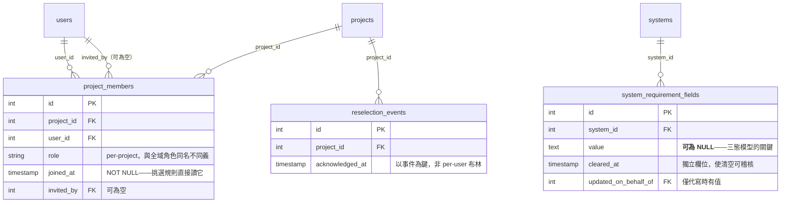

# 功能規格 — `U18 project-meta-data`

## 〇、本單元是什麼

`spec` 單元：交付**三張新表的 DDL** ＋ `schema_rbac.sql` 與 `DEPLOY.md` 的
**blocking 同步**。零應用程式碼、零端點、零畫面。

消費端為 `U19 membership-service`（成員）與 `U20 requirement-field-service`
（需求欄位）。驗證方式為**真實 PostgreSQL CI job ＋ 兩份部署資產的同步檢查**。

### 上游依據（逐一指名，含檔名）

| 上游產出 | 本站用到它的什麼 |
|---|---|
| `contract-summary.md` | 契約 `K-15` 全文：`tables`／`foreign_keys`／`columns_that_carry_semantics`（五個欄位各自的理由）／`ddl_comment_requirement`／`blocking_sync`／`behaviour_semantics`／`known_constraint_inherited_from_K04` |
| `unit-of-work.md` | `:306`／`:343` 的單元定義與交付清單；`:443` 的 `[UG:G9]`=A COMMENT 義務；`:444` 的既有環境建立路徑風險 |
| `requirements.md` | `FR12.4`（自動改選挑最早加入者）、`FR12.4c`（第二次被改選仍須看到橫幅）、`FR12.3` |
| `components.md` | `ProjectMembership`／`RequirementRegistry` 兩個元件及其對 `ProjectHierarchy` 的 `sync` 入邊（`:559-561`／`:618-620`）——本單元交付它們的資料層 |
| `scope-document.md` | 能力 12（成員管理）與其第 (4) 項「自動改選」的定義 |
| `rough-mockups.md` | `M12`（需求欄位畫面）要求區分「從未填過」與「清空」——這是 `BR1.3` 的來源 |
| `unit-of-work-story-map.md` | `US12.x` 與 `US11.2` 對本單元的指派——**全部七則的使用者可見行為都不在本站**（屬 `U19`／`U20`／`U23`），本單元只交付其資料層，故 `traceability.json` 將它們一律記為 `N/A` 並指向對應規則 |
| `backend/database.py` | **本站實讀**：`_ensure_*` 補丁的錯誤處理形狀（見 §三） |

## 一、三張表與其語意承載欄位

契約 `K-15` 的 `columns_that_carry_semantics` 列出**五個**欄位，每一個都附了
「為什麼它必須長這樣」。本單元把那五個理由逐條落為 `BR1.1`–`BR1.5`：

| 欄位 | 約束 | 違反的後果 |
|---|---|---|
| `project_members.joined_at` | **NOT NULL** | 自動改選在空值上**無序**——每次選出不同人，而這是靜默的 |
| `reselection_events.acknowledged_at` | 以**事件**為鍵 | per-user 布林值會讓同一人**第二次**被改選時看不到橫幅（`FR12.4c` 要防的正是它） |
| `system_requirement_fields.value` | **可為 NULL** | 「從未填過」與「清空」在資料層不可區分，而 `M12` 要求區分 |
| `system_requirement_fields.cleared_at` | 獨立欄位 | 清空動作不可稽核 |
| `system_requirement_fields.updated_on_behalf_of` | 僅代寫時有值 | 使用者無法分辨哪些值是自己填的——而這是該欄存在的唯一理由 |

## 二、`system_requirement_fields` 的三態模型（本單元最易實作錯的地方）

| 狀態 | 列 | `value` | `cleared_at` |
|---|---|---|---|
| 從未填過 | **無** | — | — |
| 已填 | 有 | 有值 | NULL |
| 曾填後清空 | **有** | **NULL** | **有值** |

**「從未填過」與「清空」在畫面上看起來一樣，在資料層必須不一樣。**
前者無列、後者有列且有清空時間戳。`ADR-015` 定下這個語意，`M12` 依賴它。

### `[UG:G9]`=A 的 COMMENT 義務不是文件義務

契約 `K-15` 的 `ddl_comment_requirement` 要求 COMMENT 寫明三件事
（欄位定義被移除後值列**保留**、畫面不渲染該組、未填計數只算當前已宣告的欄位），
而它給的理由逐字是：

> 不寫下來的話，「資料庫裡有、畫面上看不到」的列會被下一個人**當成髒資料清掉**。

**被清掉的是使用者曾經填過的值。** 故這是寫給未來維護者的防呆。

## 三、既有環境的建立路徑：本站實讀了既有形狀，而它會靜默失敗

`unit-of-work.md:444` 警告既有的 `_ensure_*` 補丁「**全部吞掉失敗**」。
本站**實地查證**（`backend/database.py`）：

| 位置 | 形狀 |
|---|---|
| `:257`（A4 補丁） | `except Exception` → `logger.warning("A4 schema 補丁略過/失敗: ...")` → **繼續** |
| `:304`（J5 補丁） | 同形 |
| `:228`（vector 擴充） | `logger.warning` → 繼續（但該處**刻意如此**，阻斷由 `create_all()` 承擔，且有測試守著順序） |
| `:192`（`init_db()` 自身） | `except Exception` → `logger.error` → `db.rollback()` → **不 re-raise** |

**所以照抄既有形狀的後果是具體的**：三張表沒建起來而**服務照常啟動**，
之後 `U19`／`U20` 的每一次查詢都失敗，而**根因在啟動時只留了一行 warning**。

故 `BR3.1` 要求：若經該路徑建立，**失敗必須大聲失敗**（re-raise）。
這不是「記得寫對」，而是**必須刻意偏離既有形狀**。

**三張表走哪一條路徑，本站不預選**——`schema_rbac.sql` 只在空 volume 執行
（`BR3.2`），而 `192.168.10.10` 是既有環境。落點 `code-generation`／部署決策
（`OPEN-P1`）。**與 `U5` 的 `OPEN-M5` 是同一個問題的第二次出現**，
而它在本 intent 已經是第三張、第四張、第五張新表——這個缺口不會自己消失。

## 四、本單元**不**負責的事

| 不負責 | 負責者 |
|---|---|
| 成員的邀請／移出／角色變更／自動改選 | 契約 `K-16`（`U19`） |
| 需求欄位的讀寫與清空動作 | 契約 `K-17`（`U20`） |
| per-project 授權判定 | 契約 `K-16` 的 facade |
| 橫幅的呈現 | `U23`／畫面層 |

契約 `K-15` 的 `authorization_responsibility` 逐字：「**無**——DDL 在部署／啟動
路徑執行，不經使用者授權。資料的存取授權由 `K-16`／`K-17` 的 facade 承擔」。

## 五、兩次 blocking 同步，不可互相替代

契約 `K-15` 的 `blocking_sync.note` 逐字：本單元的三張表觸發一次，
`K-03` 的 `role_permissions` seed 語意變更（`U3`）另觸發一次，
**兩者不可互相替代**。

以「`U3` 已經同步過了」為由跳過本單元的同步，會讓三張表不出現在 `DEPLOY.md`
的表清單裡——而那份清單是部署時的檢查依據。

兩項必做（在 `code-generation`）：`schema_rbac.sql` 寫入可重跑 DDL ＋ COMMENT；
`DEPLOY.md` 更新表清單 ＋ `psql` 驗證指令。

## 六、實體關係圖（衍生檢視）

**文字 fallback**：`public.users` 以兩條路徑指向 `project_members`
（`user_id` 必填、`invited_by` 可為空）；`projects`（`K-04` 的表）一對多指向
`project_members` 與 `reselection_events`；`systems`（`K-04` 的表）一對多指向
`system_requirement_fields`。四條外鍵即契約 `K-15` 的 `foreign_keys` 清單。
三張表皆為全新，**沒有既有資料要搬**（與 `U4` 的關鍵差別）。

## 七、規則摘要（衍生檢視）

| 群組 | 條數 | 管什麼 |
|---|---|---|
| `BR1.x` | 5 | 五個承載語意的欄位 |
| `BR2.x` | 3 | DDL 可重跑、COMMENT 義務、四條外鍵 |
| `BR3.x` | 3 | 既有環境須大聲失敗、空 volume 限制、兩次 blocking 同步 |

合計 **11 條**（由 parser 解析 `rules.md` 實算）。

## 八、ADR-0006 四面向 ＋ PBT

| 面向 | 判定 | 處置 |
|---|---|---|
| **IAM** | **不適用於本單元** | 契約 `K-15` 逐字「無——DDL 不經使用者授權」。**但本單元交付的是 per-project 授權的資料基礎**（`project_members`），故 `BR1.1`（`joined_at` 非空）間接影響授權正確性：改選選錯人等於把專案管理權給錯人。這一點寫明以免被讀成「與授權無關」 |
| **Encryption** | **不適用** | 三張表無機敏欄位（無憑證、無 token、無金鑰）。`value` 是架構假設（SLA／TPS／預算），非個人機敏資料 |
| **Network exposure** | **不適用** | 零端點、零進程、零監聽埠 |
| **Audit logging** | **適用** | `cleared_at`（清空可稽核）、`updated_on_behalf_of`（代寫溯源）、`reselection_events`（改選事件本身即稽核）。**已知缺口**：`BR7.x` 類的「拒絕事件要不要留稽核」在 `U19` 的 `H-8` 仍未決，不屬本單元 |

**PBT 判定：N/A（非豁免）**——本單元是 DDL，沒有任何函式。
**失效條件**：`U19` 的自動改選挑選函式**應為不讀 DB 的純函式**
（`unit-of-work.md:448` 逐字），PBT 在**那裡**適用，且真正可失敗的性質是
**排列不變性**（`ORDER BY joined_at` 在時間戳相同時沒有穩定順序）
——而本單元的 `BR1.1` 正是讓那個性質可被驗證的資料層前提。

## 九、殘餘風險

1. **`BR3.1` 的違反是靜默的**（§三）：表沒建起來而服務照常啟動。
2. **既有環境的建立路徑未定**（`OPEN-P1`）。**這是本 intent 第二次出現同一個缺口**
   （`U5` 的 `OPEN-M5`），且新表數已累積到五張。
3. **`project_members.role` 與全域角色同名不同義**（`OPEN-P2`）：
   `project.md` 已記過 `project_admin` vs `Project_Admin` 的教訓，
   而本單元只能在 COMMENT 中標明，無法在資料層強制區分。
