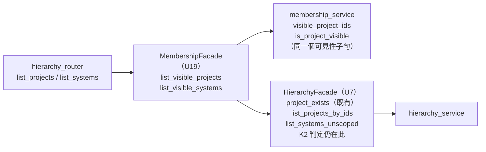
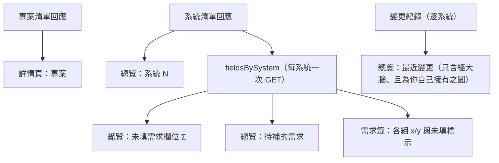

# Functional Spec — `U23 project-pages-ui`

> 建檔時間 2026-10-15T14:57:34Z（以 `date -u` 取值）。單元類型 `ui`，L。
> **修訂 1**（2026-10-15T22:33:15Z）：依第一輪審查 R-01–R-11 與 `[PP3]`=A 修訂，逐項落點見 §十一。
> 本檔是本單元**互動流程與狀態轉移的正本**；規則正本在 `rules.md`（`BR81`–`BR88`，
> 共 39 條），元件層級在 `frontend-components.md`，追溯在 `traceability.json`。

## 零、上游來源（逐檔）

| 檔案 | 取用內容 |
|---|---|
| `inception/units-generation/unit-of-work.md` | `U23` 定義（`:407-417`）、`U23`／`U24` 共同前端約束（`:460`）、`[US:D-15]` 的清空控件判定（`:540-542`） |
| `inception/units-generation/unit-of-work-story-map.md` | `U23` 承載 `US11.1`／`US11.2`／`US11.3`（`:171-173`、`:219`） |
| `inception/user-stories/stories.md` | `US11.1`–`US11.3` 的 9 條 AC；`AC12.1.3`／`AC12.6.3`；共同 DoD |
| `inception/requirements-analysis/requirements.md` | `FR11.1`–`FR11.3`（經 stories 承接） |
| `ideation/rough-mockups/wireframes.md` §14–§18 | 版面、無障礙註記、§18 的「本站不主張」 |
| `inception/refined-mockups/` | `mockups.md` M10–M12、`interaction-spec.md` 的 `ProjectList`／`SystemCreateAction`／`ObjectCreateAction`／`I-4` |
| `inception/contract-design/contract-summary.md` | `K-19`（本單元是 `U17` 的掃描標的）、`K-16`、`K-17` |
| `inception/domain-design/components.md` | `ProjectHierarchy`、`ProjectMembership`、`RequirementRegistry` 的擁有權與 `sync` 入邊 |
| `inception/delivery-planning/bolt-plan.md:494` | 交錯順序（本單元 B13 早於 `U16` 的 B7） |
| 已交付的依賴單元 | `hierarchy-service`、`membership-service`、`requirement-field-service`、`member-pages-ui` 的 code-summary 與實際程式 |
| `construction/deferred-ac-rulings.md` | 三項改寫皆屬 `U12`／`U13`，**與本單元的 AC 無交集** |
| 本站問題檔 | `[PP1]`=A、`[PP2]`=A（2026-10-15T14:56:29Z 作答）；`[PP3]`=A（2026-10-15T22:28:55Z 作答，第二輪） |

## 一、這個單元要做什麼

1. 專案清單頁（含 Sidebar 入口）與建立頁。
2. 專案詳情頁三籤：總覽（計數、最近變更、待補的需求）、需求（按 agent 分組的固定欄位）、
   記憶摘要（本輪為說明佔位）。
3. 建立專案／系統的共用寫入路徑 `objectCreateAction`（`U16` 之後沿用）。
4. **後端**：`U7` 的兩支列舉端點的可見範圍由「擁有者」放寬為「成員列 ∪（擁有者 且 該專案零成員列）」
   （`[PP1]`=A、`[PP3]`=A）。

承載 11 條 AC：`US11.1`–`US11.3` 的 9 條，以及依 `U24` 的 `OPEN-MP24-5` 承接的
`AC12.1.3`、`AC12.6.3`。

## 二、本站的三個定案及其後果

| 定案 | 內容 | 後果 |
|---|---|---|
| `[PP1]`=A | 本單元 code-generation 把專案清單與系統清單改為成員可見，router 委派 `U19` | 本單元**不是純前端**；新增 7 條伺服器端規則（`BR87`）、雙向 `TestClient` 與 ast 靜態測試義務；`AC12.1.3`／`AC12.6.3` 由本單元承接並可滿足 |
| `[PP2]`=A | 已核可版面保留，無來源的三處顯示「尚無法取得」，`[設定]` 不渲染 | 三籤結構與 `K-19` 字面不變；四處各記一個開放項（`OPEN-PP23-1`–`4`）；零後端變更於這四處 |
| `[PP3]`=A | 擁有者那一半只在該專案**尚無任何成員列**時生效；有成員列就一律以成員列為準 | 被移出的建立者看不到專案、系統清單 404，`AC12.6.2` 的伺服器側讀取拒絕在本單元的兩支端點上成立；`BR87.5` 由三種身分擴為五種；零 schema 變更 |

### 二之一、`openapi.json` **會**漂移（只在說明文字）——對派工訊息與 `[PP1]` 選項文字的更正

**須在核可關卡摘要明列**（審查 R-04）：`[PP1]` 選項 A 的原文寫「路徑與回應形狀不變，
`openapi.json` 不漂移」，使用者是在這句話之下作答的；實際上 `openapi.json` 的 **description
文字會漂移**（路徑、回應模型、狀態碼仍不變）。此更正不改變 `[PP1]` 的決定本身，但使用者
作答時看到的代價描述少了一項必做步驟（重 dump `openapi.json` 與重產型別檔）。

派工訊息亦寫「網址與回應形狀不變、`openapi.json` 不漂移」。前半成立，後半**不成立**：
FastAPI 以 handler 的 docstring 作為 operation 的 `description`，而實測 `openapi.json` 中
`GET /api/hierarchy/projects` 的 description 逐字含「**被分享或以成員身分取得的存取在本輪
看不到任何東西**」——放寬之後這句話為假，必須改寫，`openapi.json` 的 description 因此變動。
處置寫進 `BR87.4`：路徑、`response_model`、狀態碼與 404 宣告不變；改寫 docstring 後重新
dump `openapi.json` 並重產 `api.d.ts`。CI 的漂移閘門會擋下「改了 docstring 沒重 dump」，
所以這不是靜默風險，而是一個必做步驟。

## 三、畫面與路由

| 畫面 | 路由 | 進入點 | 把關 |
|---|---|---|---|
| 專案清單 | `/projects` | Sidebar 第一層「專案」 | `K2 view`（`BR81.1`） |
| 建立專案 | `/projects/new` | 清單頁 `[+ 建立專案]`／空狀態 `[+ 建立第一個專案]` | `K2 edit` |
| 專案詳情 | `/projects/:projectId?tab=overview\|requirements\|memory` | 清單列 `[>]`；建立成功後導向 | `K2 view`；需求籤另需 `K4 view`（`BR83.2`），編輯與 `[儲存]` 另需 `K4 edit`（`BR84.7`） |
| 成員頁（既有，`U24`） | `/projects/:projectId/members` | 詳情頁頁首 `[成員]` | `K3 view`（既有） |

Sidebar：第一層新增「專案」，位置依線框 §14 在「入口」之後、「我的記憶」之前（`U14` 的
「入口」尚未落地，落地前「專案」為第一個獨立項）。實測 `Sidebar.tsx` 現有 `<NavLink` 7 處。

## 四、API 消費點與後端變更

### 四之一、前端消費的 7 個端點（實測存在於 `openapi.json`）

見 `frontend-components.md` §六。其中端點 1、2 的伺服器行為由本單元修改（四之二），
其餘五個照既有契約消費。

### 四之二、`[PP1]`=A ＋ `[PP3]`=A 的後端變更（`BR87`）

**現況（實測）**：`hierarchy_facade.py:275-280` 的 `list_projects` 只回 `owner_user_id`
等於請求者的列；`:282-288` 的 `list_systems` 先 `assert_project_owned_by`。`U7` 的規則 6.2
把這宣告為刻意收窄，最終模型屬 `K-16`。`U19` 沒有任何列出可見專案的方法。

**變更後的呼叫方向**（`BR87.3`）：

<!-- Text fallback: 兩支列舉 handler 委派給 U19 的 MembershipFacade 新增的
list_visible_projects 與 list_visible_systems；後者以 membership_service 新增的
visible_project_ids／is_project_visible（共用同一個可見性子句）判定，並呼叫 U7 的
HierarchyFacade 既有的 project_exists 與新增的 list_projects_by_ids／list_systems_unscoped
取資料，K2 全域判定仍只在 HierarchyFacade 內。U7 不呼叫 U19，不形成循環。 -->

| 層 | 新增 | 職責 | 不得做 |
|---|---|---|---|
| `hierarchy_router` | 兩個 handler 改為委派 | 取身分 → 呼叫 `MembershipFacade` → 轉譯例外（`HierarchyForbidden` → 403；`MembershipNotFound`／`HierarchyNotFound` → 404，皆沿用既有 `_translate`，`hierarchy_router.py:129-136`） | 自行判定成員資格 |
| `MembershipFacade` | `list_visible_projects(self, principal: Principal) -> List[Project]`；`list_visible_systems(self, principal: Principal, *, project_id: int) -> List[System]` | 前者：`visible_project_ids` → `list_projects_by_ids`。後者：`project_exists`（K2 先行，`HierarchyForbidden` 原樣上拋）→ 不存在則 `MembershipNotFound` → `is_project_visible` 為假則 `MembershipNotFound` → `list_systems_unscoped` | 直接讀 `projects`／`systems` 表（須經 `HierarchyFacade`）；改走 `_assert_project_exists`（會把 403 變 404，`BR87.2`） |
| `HierarchyFacade` | `list_projects_by_ids(self, principal: Principal, *, project_ids: Sequence[int]) -> List[Project]`；`list_systems_unscoped(self, principal: Principal, *, project_id: int) -> List[System]` | 第一行執行 `K2 view` 判定（集合為空也先判定），再取資料；兩者都**不做擁有者檢查** | import 任何 membership 符號；被 `MembershipFacade` 以外的應用程式碼呼叫（`BR87.7` 以 ast 靜態測試鎖住） |
| `membership_service` | `visible_project_ids(db: Session, *, user_id: int) -> List[int]`；`is_project_visible(db: Session, *, project_id: int, user_id: int) -> bool` | 兩者共用**同一個私有可見性子句**：「有 (專案, 使用者) 成員列」或「`owner_user_id` = 使用者 且 該專案零成員列」。形狀沿用 `project_ids_where_admin`（`membership_service.py:299`）與 `project_ids_owned_by`（`:678-685`，本模組已有讀 `projects` 表的先例）；「零成員列」的 `NOT EXISTS` 形狀沿用 `backfill_project_members.py:150-154` | 各自寫一份謂詞 |

**為什麼擁有者那一半要限在「零成員列」**（`[PP3]`=A，審查 R-01）：第一輪取了不設限的
「擁有者 ∪ 成員」，理由是回填未跑的環境裡擁有者不應失去自己的專案（`NFR12.25`、
`DEPLOY.md:855`）。那個理由仍成立，但聯集同時讓**被共同管理者移出的建立者**經擁有者那一半
繼續看得到專案——`remove_member` 只擋最後一位管理者（`membership_facade.py:296-305`），
移除後 `owner_user_id` 不變，而**沒有任何程式路徑會改寫 `owner_user_id`**（只在建立時寫入，
`hierarchy_service.py:132`、`hierarchy_migration.py:411`）。這違反 `AC12.6.2`（`stories.md:903`
「他再次嘗試讀取本專案資料時被拒絕」），也與 `U20` 的需求欄位讀取不一致（只認 per-project
判定，`requirement_field_facade.py:257-264`）。

限在零成員列**不會把擁有者鎖在門外**：新專案必有建立者的成員列（`membership_facade.py:455-460`）；
零成員列的專案無人能邀請（邀請者須是該專案的 `project_admin`，`:244-246`）；最後一位管理者
不可被移除（`:296`）。故「有成員列而擁有者不在其中」只能由擁有者被移出產生——回填腳本也把它
寫成「人為決定的結果」（`backfill_project_members.py:135-137`、`DEPLOY.md:894`）。回填完成後，
擁有者那一半只在「回填後又重跑 `run_hierarchy_migration.py`」這種手動步驟出錯時發揮作用。

**R-03 的處置——不再是無機械強制的殘留**：兩個不做擁有者檢查的 `HierarchyFacade` 方法
（`list_projects_by_ids` 也算：給任意 id 集合就回那些專案）由 `BR87.7` 的 ast 靜態測試鎖住，
只允許 `MembershipFacade` 呼叫。`brain_gateway.py` 持有 hierarchy facade 工廠
（`:1230-1239`），正是這個鎖要防的同類呼叫端。

**範圍界線**（`BR87.6`）：只放寬這兩支。建立系統、刪除、作業對象解析、變更紀錄查詢維持
擁有者範圍；`HierarchyFacade` 既有的 `list_projects`／`list_systems` 也不變（呼叫端含大腦的
對象目錄，見 `OPEN-PP23-6` 第 ③ 項）。被移出的建立者在 API 層仍可建立系統、刪除空專案
（`OPEN-PP23-10`）。

**測試義務**（`BR87.5`、`BR87.7`）：兩支端點各五種身分（擁有者且有成員列／成員／非成員／
**被移出的擁有者**／零成員列專案的擁有者）＋ 缺 `K2` 一案（非 canonical role，兩支皆 **403**；
系統清單對存在與不存在的 id 皆 403），皆以 `TestClient` 斷言狀態碼與回應內容；突變四道
（M1–M4，見 `BR87.5`）；另加一支 ast 靜態測試與其突變。既有的
`tests/test_hierarchy_service.py:130-141`（T2b）必須維持綠燈——它斷言非 canonical role 的
系統清單為 403，是 R-04 的既有回歸鎖。

## 五、互動流程（numbered step sequences — 正本）

### W1. 開啟專案清單

1. 使用者點 Sidebar「專案」（`can('K2','view')` 時才渲染）→ `/projects`。
2. 頁面渲染 loading 骨架；`LiveRegion` 以初始文字「正在載入專案」。
3. 取專案清單（端點 1）。失敗 → error 態（`BR81.3`），播報一次，結束。
4. 成功且為空 → empty 態（說明 ＋ `[+ 建立第一個專案]`），結束。
5. 成功且非空 → 對每個專案取系統清單（端點 2），以並行上限 4 的佇列依專案 id 遞增發出
   （`BR88.3`），各列獨立：排隊中顯示載入子狀態，成功顯示「N 個系統」與系統名，
   0 個顯示「尚無系統」，失敗顯示「系統清單讀取失敗」（`BR81.4`）。
6. 每列 `[>]` 導向 `/projects/<id>?tab=overview`。

### W2. 建立專案

1. 清單頁 `[+ 建立專案]` → `/projects/new`。
2. 輸入名稱；空白則送出前擋下並顯示「請輸入名稱」。
3. 送出 → `objectCreateAction('project', name)` 發 `POST`（端點 3），按鈕進入 pending、
   重複觸發不發第二次（`BR82.3`）。
4. 201 → 導向 `/projects/<新 id>?tab=overview`（`BR82.5`）。伺服器在同一交易寫入建立者的
   `project_admin` 成員列（`U19` 既有行為）。
5. 409／403／其他 → 三類文案之一，名稱保留，表單留在原頁（`BR82.2`）。

### W3. 開啟專案詳情

1. 取專案清單（端點 1），以 `projectId` 挑出該專案。不在其中 → not-found 態（`BR83.4`），結束。
2. 取該專案的系統清單（端點 2）。404 → 同一個 not-found 態。
3. 若 `can('K4','view')`：對每個系統取一次欄位（端點 5），存入 `fieldsBySystem`（`BR85.1`）；
   單一系統失敗記為 `'failed'`，不中止其他系統。本步與第 5 步的變更紀錄共用一個並行上限 4
   的佇列（`BR88.3`）。
4. 依網址 `tab` 渲染籤；非法值或無 `K4` 時的 `requirements` 視為 `overview`。
5. 總覽：系統 N（清單長度）、架構圖「尚無法取得」（`BR86.1`）、未填需求欄位 Σ（`BR85.2`，
   無 `K4` 時整區不渲染）、最近變更（逐系統取端點 7，`BR86.2`）、待補的需求（由
   `fieldsBySystem` 推導：每個系統列出其 `filled_state` 為未填的欄位標籤，依組分行）。
6. 頁首只渲染 `[成員]`（`can('K3','view')` 時）。

### W4. 建立系統

1. 擁有者且 `can('K2','edit')` 時，總覽「系統 N」旁與需求籤空狀態渲染 `[+ 建立系統]`（`BR82.4`）。
2. 點擊 → 就地展開名稱輸入；送出 → `objectCreateAction('system', name, projectId)` 發 `POST`（端點 4）。
3. 201 → 重讀系統清單；「系統 N」由長度得出（0 → 1，`AC11.1.3`）；若具 `K4`，對新系統取一次欄位。
4. 失敗 → 同 W2 第 5 步。

### W5. 切換籤

1. 方向鍵或點擊切籤 → 更新網址 `tab`（不新增瀏覽歷史項）→ 只切換顯示，**不發請求**（`BR85.1`）。

### W6. 填寫並儲存需求欄位

1. 需求籤：選作業對象（系統）；無系統時為空狀態（`BR84.1`）。
2. 每組為 `fieldset`，`legend` 與 `x/y` 取自回應；未填欄位旁有文字「未填」（`BR84.2`）。
   更新者標示的 agent 標題以 `updated_on_behalf_of` 對回應 `groups[].group_key` 比對取得
   （`BR84.4`）。
3. 不具 `can('K4','edit')` → 欄位為唯讀、不渲染 `[儲存]`、顯示「你可以檢視需求欄位，但沒有
   編輯權限」，流程到此為止（`BR84.7`）。以下步驟僅適用於具 `K4 edit` 者。
4. 使用者修改若干欄位 → 寫入 `drafts`。
5. 按 `[儲存]` → 對每個已改動欄位發一次 `PUT`（端點 6），彼此獨立。
6. 全部回應到齊後重讀該系統（端點 5）。
7. **重讀成功**：以新物件取代 `fieldsBySystem` 中那一筆（`BR85.3`）；成功欄位清除草稿、呈現
   重讀值；失敗欄位保留草稿、標「未儲存」並顯示 `detail`（`BR84.5`）。
8. **重讀失敗**（審查 R-08）：成功欄位**不清除**草稿、標「已儲存、重新整理失敗」；失敗欄位同
   第 7 步；`fieldsBySystem` 該筆改為 `'failed'`，總覽顯示「無法取得」；需求籤出現
   `[重新整理]`，只重發該系統的 `GET`，成功後回到第 7 步（`BR85.6`）。
9. `LiveRegion` 播報「已儲存」「有 K 個欄位未儲存」或「已儲存，但重新整理失敗」之一。
10. 切到總覽：未填計數已反映重讀結果（`AC11.3.2`）。

### W7. 清空一個欄位

1. 把某個有值的欄位改成空白 → 依 W6 儲存（空值 `PUT`、不帶 `on_behalf_of`）。
2. 伺服器將其視為使用者清空；重讀後該欄 `filled_state` 為未填、更新者為「由你」（`BR84.6`）。

### W8. 被邀請的成員看到專案（`AC12.6.3`）

1. 專案管理者在成員頁邀請使用者 X（`U24` 既有流程）。
2. X 登入並開啟 `/projects` → 端點 1 的可見集合含該專案（`BR87.1`）→ 清單出現該專案。
3. X 點入 → 端點 2 對成員回 200（`BR87.2`）→ 看得到系統；具 `K4` 時看得到需求籤
   （`U20` 本就按 per-project 角色判定）。
4. X 不是擁有者 → `[+ 建立系統]` 不渲染（`BR82.4`、`BR87.6`）。
5. 未被邀請的使用者 Y 開啟 `/projects` → 不出現該專案；以網址直接進入 → not-found（`AC12.1.3`）。
6. 另一位專案管理者把**建立者 Z** 移出專案（`U24` 既有流程，另有管理者時允許）→ Z 下次開啟
   `/projects` 不出現該專案；以網址直接進入 → not-found（系統清單 404）。與需求籤對 Z 的
   拒絕方向一致（`BR87.1`、`[PP3]`=A）。

### W9. 伺服器端列舉請求（`BR87`）

1. handler 取已驗證使用者 → 呼叫 `MembershipFacade.list_visible_projects` 或
   `list_visible_systems`。
2. **`K2 view` 先行**：專案清單由 `list_projects_by_ids` 的第一行判定（可見集合為空也判定）；
   系統清單由 `project_exists` 的第一行判定，`HierarchyForbidden` 原樣上拋。不通過 → **403**
   （既有行為，`BR87.2`）。
3. 專案清單：可見 id 集合 = 成員列 ∪（擁有者 且 該專案零成員列）→ 以 id 集合取專案、依 id 遞增回傳。
4. 系統清單：專案不存在 → 404；`is_project_visible` 為假 → 404；否則回該專案的系統。

## 六、狀態機

### 六之一、專案清單頁

| 狀態 | 進入條件 | 離開 |
|---|---|---|
| `loading` | 進頁 | 端點 1 回應 |
| `error` | 端點 1 失敗 | `[重試]` → `loading` |
| `empty` | 端點 1 成功且為空 | 建立成功後離開本頁 |
| `ready` | 端點 1 成功且非空 | — |

`ready` 內每列另有子狀態 `systems-loading`／`systems-ok`／`systems-failed`（`BR81.4`）。

### 六之二、需求欄位（單一欄位）

| 狀態 | 進入 | 離開 |
|---|---|---|
| `clean` | 重讀後無草稿 | 使用者修改 → `dirty` |
| `dirty` | 使用者修改 | 按儲存 → `saving` |
| `saving` | 已送出 `PUT` | 成功且重讀成功 → `clean`；成功但重讀失敗 → `saved-stale`；失敗 → `failed` |
| `failed` | `PUT` 失敗 | 使用者再修改 → `dirty`；再按儲存 → `saving` |
| `saved-stale` | `PUT` 成功但重讀失敗（`BR85.6`） | `[重新整理]` 成功 → `clean`；使用者再修改 → `dirty` |
| `readonly` | 不具 `K4 edit`（`BR84.7`） | 無（不接受輸入、不建立草稿） |

`failed` 與 `saved-stale` 的草稿都不被清除——這是 `AC11.2.3` 的全部內容在兩條失敗路徑上的
落地。

### 六之三、詳情頁

`loading` → `not-found`（不在可見清單或系統清單 404）｜`error`（網路失敗）｜`ready`。

## 七、衍生檢視

**本單元不產出 `entities.md`（第二輪重新判定，仍不需要）**：`produces_kinds` 的 `entities`
只列 `[service, spec, library]`，`ui` 不在其中；`[PP1]`／`[PP3]` 使本單元多了後端變更，但
**沒有新增任何實體、值物件或資料表**——六個新增方法只回傳既有的 `Project`／`System` ORM 物件
與 `int` 集合，可見性是一個查詢謂詞而非新實體，回應模型仍是既有的 `ProjectOut`／`SystemOut`
（`BR87.4`）。`mcp-bridge` 有 `entities.md` 是因為它是 `service` 單元且宣告了自己的工具與
值物件；本單元沒有可寫進去的東西，硬產一份會是空殼。

**資料依賴圖**（此圖取代 ER 圖，說明三籤讀哪份資料）：

<!-- Text fallback: 專案清單回應提供詳情頁的專案資料；系統清單回應提供總覽的系統數，並決定
要對哪些系統各取一次需求欄位；這份 fieldsBySystem 同時是總覽未填總數、待補的需求與需求籤
各組 x/y 的唯一來源；變更紀錄逐系統查詢後提供最近變更，只含經大腦、且為請求者自己擁有之圖的變更。 -->

**規則摘要**：見 `rules.md` §三（8 組、39 條）。

## 八、開放項與指派

| # | 項目 | 性質 | 落點 |
|---|---|---|---|
| `OPEN-PP23-1` | **總覽「架構圖」計數無資料來源**：架構圖清單不帶階層歸屬（`collab_router.py` 對 `system_id`／`project` 命中 0），任何端點都回答不了「此專案有幾張圖」。本輪渲染「尚無法取得」（`BR86.1`） | `[PP2]`=A 的已知缺口 | **本 intent 內無自然承接站**（需新的查詢能力）。本單元 code-generation 的核可關卡由 conductor 重新提交使用者，決定是否另開 intent |
| `OPEN-PP23-2` | **「最近變更」只有部分來源**：變更紀錄只含經大腦的變更、只含請求者自己擁有的圖（見 `OPEN-PP23-6` ①）、查不到無系統歸屬的圖、保存 90 天，且須逐系統查詢。本輪照實呈現並標示（`BR86.2`） | `[PP2]`=A 的已知限制 | 同上 |
| `OPEN-PP23-3` | **記憶摘要籤無資料來源**：記憶可見範圍只有 `owner`／`platform`（`memory_types.py:48-53`），無專案範圍與來源 agent；彙整管道四個問題（誰觸發、頻率、誰摘要、可見範圍）在線框 §18 明寫未假設。本輪渲染說明（`BR86.3`） | `[PP2]`=A 的已知缺口 | 同上 |
| `OPEN-PP23-4` | **頁首 `[設定]` 無目的地**：線框 §16–§18 畫了它，任何上游文件都沒有定義。本輪不渲染（`BR83.3`） | `[PP2]`=A 的已知缺口 | 同上 |
| `OPEN-PP23-5` | **前端扇出的請求數上界**：清單頁 1＋P、詳情頁 2＋2S（＋儲存時 k＋1）。本站不預選**上界**數字。**未定案前的預設**（審查 R-11，`BR88.3`）：每頁一個**並行上限 4** 的佇列、完成一個補一個、依 id 遞增**逐批**發出；排隊中的項目顯示既有的載入子狀態（清單列 `systems-loading`；總覽的未填與待補區在全部完成前顯示載入中）；**不截斷總數**（截斷會使 `BR85.2` 的和變成部分和）。`nfr-requirements` 若被精簡執行而未定出數字，code-generation 直接採用此預設，不自行發明 | 未定參數（已有預設） | 本單元的 `nfr-requirements`（下一站）；未定時以 `BR88.3` 為準 |
| `OPEN-PP23-6` | **成員在專案頁的三個已知限制**：①「最近變更」只含**他自己擁有的圖**（變更紀錄以圖的擁有者判定，`hierarchy_facade.py:345-357`），區塊標示已改為「只含經大腦、且為你自己擁有之圖的變更」（`BR86.2`，審查 R-10）；② 非擁有者的專案管理者不能建立系統（`U7` 的規則 6.5）；③ **大腦的專案目錄仍為擁有者範圍**：`HierarchyFacade.list_projects`／`list_systems` 不變，而 `brain_gateway.py:1230-1239` 的對象目錄呼叫的正是這兩個方法，故被邀請的成員在專案頁看得到的專案，大腦的對象解析與脈絡列看不到（審查 R-05）。三者都在 `[PP1]`=A 的範圍之外（`BR87.6`） | 已知限制 | 記載於本單元；**本 intent 內無自然承接站**（`U13 brain-gateway` 已交付）。第 ③ 項由本單元 code-generation 的核可關卡由 conductor 重新提交使用者，決定是否另開 intent |
| `OPEN-PP23-7` | **`data-testid` 前綴與 `K-19` 字面不一致**：`K-19` 寫「沿用 `U14` 的 `brain-*`」，而 `U14` 未落地、`U24` 實際落地為無前綴形式。本單元以已交付程式為準，用 `project-` 等前綴 | 契約字面落差 | 下一輪契約追認（與 `U20` 的 `OPEN-RF20-5` 同批）；依 `refined-mockups:c3` 不回改 `contract-summary.md` |
| `OPEN-PP23-8` | **`objectCreateAction` 由本單元建、`U16` 沿用**：`U16` 的 code-generation 必須呼叫它，不得自建建立路徑（`BR82.1`） | 跨單元交接 | `U16 object-picker-ui` 的 code-generation（ALWAYS，在游標之後） |
| `OPEN-PP23-9` | **已核可文件與本單元落地後的實作有四處落差**：① `U7` 的規則 6.2 的收窄宣告過時；② `K-16` 的消費端多了 `hierarchy_router`，`MembershipFacade` 多兩個方法、`HierarchyFacade` 多兩個方法、`membership_service` 多兩個函式；③ **依賴邊**（審查 R-09）：本單元新增 **`U23` → `U19 membership-service`** 一條邊（router 委派與 `MembershipFacade` 新方法由本單元撰寫），而 `unit-of-work.md:415-416` 的 `U23` 依賴清單只有 `U20`／`U7`／`U8`／`U3`；同時 **`U23` → `U8 memory-service` 已不再被使用**（記憶摘要籤改為純說明，`BR86.3`）；④ `backend/scripts/backfill_project_members.py:18-21` 與 `DEPLOY.md:867` 寫「`list_projects` 目前是 owner-scoped、既有列表路徑不經本單元」，本單元落地後為假（改寫列入 §八之一） | 已核可文件與實作的落差 | ①②③ 不回改 `U7` 的 `rules.md`、`contract-summary.md` 與 `unit-of-work.md`，**指派下一輪契約追認同批處理**（與 `OPEN-PP23-7` 同批）；④ 由本單元 code-generation 處理（非已核可 AIDLC 產出，是程式與部署文件） |
| `OPEN-PP23-10` | **被移出的建立者在 API 層仍保有擁有者寫入權**：`U7` 的建立系統、刪除專案、刪除系統只認 `owner_user_id`（`hierarchy_facade.py:213-240`），而沒有任何程式路徑改寫 `owner_user_id`。被另一位管理者移出的建立者因此仍能經 API 在該專案下建立系統、刪除**空**專案與系統。畫面上不可達（`[PP3]`=A 後他已看不到該專案）；`AC12.6.2` 的字面只管讀取，不涵蓋這三支寫入 | 已知缺口（`[PP3]` 題幹第 7 點） | **本 intent 內無自然承接站**：`U7` 已交付，剩餘單元沒有一個擁有 `U7` 的寫入授權；`[PP3]` 選項 C（移除時改寫擁有者）可一併解掉，但它需擴大 scope 與改 schema，使用者未選。由本單元 code-generation 的核可關卡由 conductor 重新提交使用者，決定是否另開 intent |

### 八之一、交給本單元 code-generation 的清單（非 AIDLC 產出的同步義務）

| # | 項目 | 依據 |
|---|---|---|
| 1 | 改寫兩支 handler 的 docstring，重新 dump `openapi.json` 並重產 `src/types/api.d.ts` | `BR87.4` |
| 2 | 新增六個方法（簽章見 `BR87.3`）；兩個 `HierarchyFacade` 新方法的 docstring 寫明唯一合法呼叫端 | `BR87.3`、`BR87.7` |
| 3 | 新增 `backend/tests/test_project_visibility_static.py`（ast 靜態鎖）與其突變紀錄 | `BR87.7` |
| 4 | 新增兩支端點的 `TestClient` 測試（五身分 ＋ 缺 `K2`）與 M1–M4 突變紀錄；既有 T2b 維持綠燈 | `BR87.5` |
| 5 | **更新 `backend/scripts/backfill_project_members.py` 檔頭第 18–21 行那一句**（「`hierarchy_facade.list_projects` 目前是 owner-scoped……既有的專案列表路徑不經本單元」）與 **`DEPLOY.md:867` 對應敘述**：改寫為「`U23` 落地後專案清單改讀成員列；擁有者只在零成員列時可見，故回填未跑時擁有者仍看得到自己的專案，但需求籤與成員頁會拒絕他」。不改腳本行為 | `OPEN-PP23-9` 第 ④ 項、審查 R-09 |
| 6 | e2e：`K4 edit` 的 allow／deny 兩案（`BR84.7`）、重讀失敗（`BR85.6`）、被移出建立者的清單（W8 第 6 步）、AC11.3.x 以單一系統專案構造 | `traceability.json` |

## 九、ADR-0006 security baseline 與 PBT

### 九之一、四面向（逐格對照上游）

上游對照：`unit-of-work.md` 修訂 4 的四面向表為本 intent 新單元列出落點時，**`U23` 沒有任何
一格**——當時本單元是純前端。`[PP1]`=A 之後本單元多了一個 IAM 落點，判定與上游不同的理由
是**範圍變了**，不是重判。

| 面向 | 判定 | 本單元的落點 |
|---|---|---|
| **IAM** | **適用（本單元新增的落點；修訂 1 擴充）** | 兩支列舉端點的可見範圍放寬屬授權變更：① 全域 `K2 view` 判定照舊先行、只有一份（在 `HierarchyFacade`），缺 `K2` 一律 **403**、不因改走 `U19` 而變成 404（`BR87.2`，審查 R-04）；② 可見性謂詞只寫一份（`membership_service` 的私有子句），擁有者那一半限在零成員列，**被移出的建立者被拒**（`BR87.1`、`[PP3]`=A，審查 R-01）；③ 非成員的系統清單回 404，與「專案不存在」同一結果，不洩漏存在性；④ 雙向 `TestClient` 五身分 ＋ 缺 `K2`，突變 M1–M4 須紅（`BR87.5`）；⑤ **兩個不做擁有者檢查的 facade 方法以 ast 靜態測試鎖住唯一呼叫端**（`BR87.7`，審查 R-03——第一輪記為「無機械強制」的殘留已消除）；⑥ 前端的 `K2`／`K4 view`／**`K4 edit`** 可見性只是呈現，伺服器照樣判定；無 `K4 edit` 者不再看到必然被拒的 `[儲存]`（`BR84.7`，審查 R-02）；`[+ 建立系統]` 的條件與伺服器規則逐字相同。**殘留（如實記載）**：被移出的建立者在 API 層仍保有 `U7` 的三支擁有者寫入（`OPEN-PP23-10`）；大腦的對象目錄仍為擁有者範圍（`OPEN-PP23-6` 第 ③ 項）——兩者都是「看得到的比該看的少／做得到的比該做的多」，後者是授權面的真缺口，已記為開放項並交 conductor 重新提交 |
| **Encryption** | **適用，但不在本單元**（與上游一致：唯一落點是 `U21`） | 零新傳輸、零新儲存；需求欄位的草稿只在記憶體 state，不寫瀏覽器儲存 |
| **Network exposure** | **適用，但不在本單元**（上游落點是 `U21`） | 零新端點、零新進程、零新埠；兩支端點仍在 `/api/` 下且需驗證身分 |
| **Audit logging** | **適用（沿用既有）** | 本單元不新增寫入路徑：建立專案／系統走既有端點，需求欄位寫入由 `U20` 記 `updated_by`／`cleared_at`。列舉讀取不記稽核，與放寬前相同；本站不新增讀取稽核，這是刻意的範圍決定 |

### 九之二、PBT hard constraint

**不適用**。`ADR-0006` 點名的三個落點（IaC generator、cost calculator、agent routing）皆非本單元；
可見集合是一個有兩個分支的謂詞（成員列；擁有者且零成員列），以五種身分的 example-based
雙向測試（`BR87.5`）即可涵蓋其全部分支與兩個分支的交界（被移出的擁有者、零成員列的擁有者）。

## 十、七項自檢

> 下表是**第一輪**（送審前）的紀錄，原文保留；其中的「35 條」「三種身分」「無機械強制」等
> 已被修訂 1 取代，現行結果見 §十之二，現行數字見 §十之一。

| # | 自檢 | 結果 |
|---|---|---|
| 1 | **可達性** | 逐一推導本檔每個「偵測 X 狀態」的觸發路徑：清單 empty（有 `K2` 而無專案的新使用者）、error 與「系統清單讀取失敗」與儲存部分失敗（e2e 以路由攔截構造）、「尚無系統」與需求籤空狀態（剛建立的專案）、未填（新系統的欄位全未填）、「由大腦」（`U20` 的代寫路徑已交付，可經 HTTP 帶 `on_behalf_of` 構造）、清空後未填（本單元 W7 即可構造；`unit-of-work.md` 自檢 1 當時判它「在 `U20` 清空端點落地前不可達」，`U20` 已交付，現為可達）、not-found（非成員）、無 `K4` 的總覽（`U3` 的規則 6.3 記載三個維運角色有 `K2` 無 `K4`）。**一處依賴本單元自身變更才可達**：`AC12.6.3` 的「成員看得到專案」在 `BR87` 落地前不可達——這正是 `[PP1]`=A 的目的，已寫入 `BR87.1` |
| 2 | **契約端點三問**（範圍：本站四份產出） | 狀態欄位：`fieldsBySystem`（寫＝詳情頁進頁與 `onSaved`；讀＝總覽、需求籤；清＝詳情頁卸載）；`drafts`（寫＝輸入；讀＝儲存；清＝該欄儲存成功）；`systemsByProject`（寫＝清單頁；讀＝清單列；清＝卸載）。方法：`objectCreateAction`（擁有＝本單元；呼叫＝`ProjectCreatePage`、`SystemCreateAction` 兩處渲染、之後 `U16`）；`MembershipFacade` 兩個新方法（擁有＝`U19` 的模組、由本單元 code-generation 撰寫；呼叫＝`hierarchy_router` 兩支 handler）；`HierarchyFacade` 兩個新方法（呼叫＝僅 `MembershipFacade`）；`membership_service` 的成員 id 查詢（呼叫＝`MembershipFacade`）。**查出並已處置一處**：初稿只寫「`HierarchyFacade` 取資料」而沒有指名它的方法與唯一呼叫端，等於有讀者無提供者；已在 §四之二 補表並記為殘留缺口。出現在少於兩個單元的方法逐一判定：`objectCreateAction` 為跨單元契約（`OPEN-PP23-8`），其餘為本單元內部方法 |
| 3 | **引用逐字核對（分開驗事實與定位）** | 開檔核對：`hierarchy_facade.py:275-280`（擁有者範圍）、`:282-288`（`assert_project_owned_by`）、`:216`（建立系統的擁有者檢查）、`hierarchy_router.py:173-198`（建立專案委派 `U19` 的先例）、`membership_facade.py:174`（`resolve_project_role`）、`:426`（`create_project_with_owner`）、`membership_service.py:299`（`project_ids_where_admin`）、`backend/scripts/backfill_project_members.py` 檔頭（owner-scoped 與 `NFR12.25`）、`DEPLOY.md:855`（回填步驟）、`requirement_field_facade.py:258`、`memory_types.py:48-53`、`Sidebar.tsx:8`／`:19-21`、`unit-of-work.md:407-417`／`:460`／`:540-542`、`bolt-plan.md:494`、`member-pages-ui/functional-design/functional-spec.md:83`、`openapi.json` 的兩支 description（以 `jq` 取出）。**問題檔出題時有兩處行號錯，已於提問前更正**（`:541-542` → `:540-542`、`:410` → `:408`） |
| 4 | **檔案集合一致性** | 本站產出 `functional-design-questions.md`、`functional-spec.md`、`frontend-components.md`、`rules.md`、`traceability.json` 五份；與同類 `ui` 單元 `member-pages-ui/functional-design/` 的檔案集合（不計 `reviews/`）逐一比對**相同**。`entities.md` 不產出（`produces_kinds` 不含 `ui`），`rules.md` 產出的理由同 `OPEN-MP24-4` |
| 5 | **跨檔傳播（按事實）** | 列出的事實與其表達形式各 grep 一次：①「規則 35 條／8 組」（`rules.md` 摘要表、本檔 §〇與 §七）；②「11 條 AC」（本檔 §一、`traceability.json` 的 `upstream_ids`）；③「`openapi.json` 的 description 會變、須重 dump」（本檔 §二之一、`BR87.4`、`frontend-components.md` §六）；④「可見集合＝擁有者 ∪ 成員」（`BR87.1`、§四之二、W8／W9）；⑤「`[設定]` 不渲染」（`BR83.3`、`OPEN-PP23-4`、`frontend-components.md` §九）；⑥「testid 用 `project-` 前綴」（`frontend-components.md` §八、`OPEN-PP23-7`）。無互相矛盾的殘留 |
| 6 | **可算的數字先算再寫** | 全部以 `grep`／`jq` 實算（見十之一），寫入後重跑一次確認未變 |
| 7 | **ADR-0006 四面向 ＋ PBT** | 見 §九。與上游逐格比對：Encryption、Network exposure 與上游一致（落點在 `U21`）；IAM 與 Audit 為本單元新增或沿用的落點，差異理由是 `[PP1]`=A 擴大了本單元的範圍，已在 §九之一 寫明。PBT 不適用，與上游一致 |

### 十之一、數字的取得方式

| 數字 | 值 | 指令 |
|---|---|---|
修訂 1 之後重算（2026-10-15T22:33:15Z 之後、全部編輯完成後執行）：

| 數字 | 值 | 指令 |
|---|---|---|
| 規則總數 | 39 | `grep -c "^  - id: BR8" rules.md` |
| 各組條數 | 4／5／4／7／6／3／7／3 | 對 `BR81`–`BR88` 各跑 `grep -c "^  - id: BR8<n>\."` |
| `policy` 類規則 | 4 | `grep -c "category: policy" rules.md` |
| 四份產出引用到但未定義的本單元規則 | 0 | 各檔 `grep -oE "\bBR[0-9]+\.[0-9]+\b" \| sort -u` 對 `- id:` 集合做 `comm -23`，四份皆空 |
| 他單元規則識別字字面 | 0 | `grep -oE "\bBR[0-9]+\.[0-9]+\b"` 中不以 `BR8[1-8].` 開頭者 |
| AC 數 | 11 | `jq '.upstream_ids \| length' traceability.json` |
| `OK` 列 | 11 | `jq '[.coverage[] \| select(.status=="OK")] \| length'` |
| `coverage` 指名的規則（去重） | 13 | `jq -r '.coverage[].target'` 依逗號拆開後 `sort -u` |
| `reverse` 列 | 26（無重複） | `jq '.reverse \| length'`；`sort -u` 後仍為 26 |
| 規則覆蓋 | 39／39（13 ＋ 26，兩集合交集為空，聯集與 `rules.md` 的 id 集合 `comm -3` 輸出為空） | 同上 |
| 開放項 | 10 | `grep -o "OPEN-PP23-[0-9][0-9]*" functional-spec.md \| sort -u \| wc -l` |
| `BR87.5` 的身分數 | 5（＋缺 `K2` 一案） | `rules.md` `BR87.5` 的 ①–⑤ |
| `BR87.5` 的突變數 | 4（M1–M4） | 同上 |
| 新增方法 | 6（`MembershipFacade` 2、`HierarchyFacade` 2、`membership_service` 2） | `BR87.3` |
| `Sidebar.tsx` 的 `<NavLink` | 7 | `grep -c "<NavLink" frontend/src/components/Sidebar.tsx` |
| 前端消費端點 | 7 | `frontend-components.md` §六的表列 |

### 十之二、修訂 1 的七項自檢（現行）

| # | 自檢 | 結果 |
|---|---|---|
| 1 | **可達性**（本輪新增的每個「偵測 X 狀態」） | ① **被移出的擁有者**：另有管理者時經 `U24` 的移出流程可達（`remove_member` 只擋最後一位管理者，`membership_facade.py:296-305`）；`TestClient` 直接構造。② **零成員列專案的擁有者**：以 ORM 建立專案而不寫成員列構造（模擬回填前／回填後重跑遷移）；正式環境可達性見 `BR87.1`。③ **缺 `K2`**：只能以非 canonical role 構造（11 個 canonical role 的 `K2 view` 皆 True），既有 T2b 即此形狀。④ **唯讀需求籤**：`Developer` 等四個角色（`rbac_seed_data.py:349-359`）。⑤ **`saved-stale`**：e2e 以路由攔截「`PUT` 之後的那一次 `GET`」構造。⑥ **更新者降級「由大腦」**：正式環境只在組定義自程式移除而舊列保留時出現（`schema_rbac.sql:785`）；e2e 以攔截 `GET` 回應、把 `updated_on_behalf_of` 改成不存在的 key 構造。⑦ **ast 靜態鎖的紅燈**：突變「在 `hierarchy_router` 直呼」可構造。**無不可達的規則** |
| 2 | **契約端點三問**（範圍：本站全部產出，含本輪新定名的六個方法與四條新規則） | **方法**（擁有／呼叫）：`list_visible_projects`（`U19` 模組、由本單元寫／`hierarchy_router` 專案清單 handler）；`list_visible_systems`（同／系統清單 handler）；`list_projects_by_ids`（`U7` 模組、由本單元寫／**僅** `list_visible_projects`）；`list_systems_unscoped`（同／**僅** `list_visible_systems`）；`visible_project_ids`（`U19` 的 service／**僅** `list_visible_projects`）；`is_project_visible`（同／**僅** `list_visible_systems`）；私有可見性子句（寫一份／被前兩者讀）。六個方法**每個都有呼叫端**，無孤兒。**狀態欄位**（寫／讀／清）：`savedStale`（`onSaved` 回 `'reload-failed'`／`RequirementField` 的 `stale`／`[重新整理]` 成功、使用者再修改、卸載）；`drafts` 的清除端修訂為「該欄儲存成功**且重讀成功**」或 `[重新整理]` 成功；`canEdit`（`can('K4','edit')`／`RequirementsTab`／不需清）；`requesterTitle`（由回應推導，不持久）。**behaviour 對 dependents 的矛盾檢查**：`BR87.7` 禁止 `MembershipFacade` 以外呼叫兩個 `HierarchyFacade` 新方法，而它們的入邊只有 `MembershipFacade`——不矛盾；`BR87.2` 禁止走 `_assert_project_exists`，`list_visible_systems` 的呼叫序列用 `project_exists`——不矛盾 |
| 3 | **引用逐字核對（分開驗事實與定位）** | 本輪新引用全部開檔核對內容與行號：`membership_facade.py:131-132`／`:244-246`／`:296`／`:296-305`／`:455-460`；`membership_service.py:299`／`:678-685`；`hierarchy_service.py:132`；`hierarchy_migration.py:411`；`hierarchy_router.py:129-136`／`:131-132`；`hierarchy_facade.py:213-240`／`:345-357`；`brain_gateway.py:1230-1239`（`:1230` 呼叫 `list_projects`、`:1239` 呼叫 `list_systems`）；`requirement_field_facade.py:257-264`／`:352-356`；`rbac_seed_data.py:349-359`／`:350`；`schema_rbac.sql:785`；`tests/test_hierarchy_service.py:130-141`；`stories.md:903`；`unit-of-work.md:415-416`；`backfill_project_members.py:18-21`／`:135-137`／`:150-154`；`DEPLOY.md:855`／`:867`／`:894`；`openapi.json` 的 `DiagramChangeOut.created_at`（`anyOf` 含 `null`）、`FieldGroupView` 有 `group_key`、`FieldView` 有 `updated_on_behalf_of`（以 `jq` 取出）。**本站內部位移**：四份產出彼此以 § 與規則 ID 互引，不以行號互引，故本輪插入不造成內部引用位移（以 `grep -n "functional-spec.md:\|rules.md:\|frontend-components.md:"` 確認四份產出內無本站檔案的行號引用） |
| 4 | **檔案集合一致性** | 對照 `mcp-bridge/functional-design/`（`entities.md`、`functional-design-questions.md`、`functional-spec.md`、`rules.md`、`traceability.json`）與 `member-pages-ui/functional-design/`（後四者 ＋ `frontend-components.md`）。本單元與 `member-pages-ui` 相同；與 `mcp-bridge` 差 `entities.md`（它是 `service`）與 `frontend-components.md`（本單元是 `ui`）。**`entities.md` 判定為不需要**，理由寫在 §七：`produces_kinds` 不含 `ui`，且本輪後端變更沒有新增任何實體、值物件或資料表 |
| 5 | **跨檔傳播（按事實）** | 逐一事實與其各種表達形式 grep 四份產出：①「可見集合」——「擁有者 ∪ 成員」在現行內容殘留 2 處，皆為描述舊版或突變（§四之二「第一輪取了不設限的…」、`BR87.5` 的 M2），屬刻意；另 1 處在 §十 第一輪紀錄（已標示），以及本列自述；「擁有者 ＋ 成員」0 處；②「規則總數」——「35」只殘留於 §十 第一輪紀錄（已標示），現行處 39（標頭、§七、`rules.md` 摘要表與修訂註記、§十之一）；③「各組條數」——現行 4／5／4／7／6／3／7／3；④「`BR87.5` 的身分數」——「三種身分」僅於 `[PP3]` 列敘述「由三種擴為五種」，「三案」0 處；⑤「最近變更的標示」——「只含經大腦的變更」只剩 `OPEN-PP23-2` 描述來源性質的一句（已補「只含請求者自己擁有的圖」），「尚無經大腦的變更」0 處；⑥「無機械強制」——只剩「不再是無機械強制的殘留」與 IAM 列的「已消除」；⑦「開放項數」——現行 10；⑧「`[PP1]` 選項稱 `openapi.json` 不漂移」——§二之一 已明列 |
| 6 | **可算的數字先算再寫** | §十之一 全部數字在全部編輯完成後以指令實算，指令與值並列 |
| 7 | **ADR-0006 四面向 ＋ PBT** | **IAM 需要更新且已更新**：R-01（被移出建立者被拒）、R-02（`K4 edit` 呈現）、R-03（ast 靜態鎖取代「無機械強制」）、R-04（缺 `K2` 維持 403）四項都是授權面，已併入 §九之一 IAM 列並如實列出兩項殘留（`OPEN-PP23-10`、`OPEN-PP23-6` ③）。Encryption、Network exposure：本輪無新傳輸、新儲存、新端點或新進程，維持原判定。Audit logging：本輪無新寫入路徑，維持原判定。PBT：仍不適用，理由更新為「兩分支謂詞以五身分 example-based 涵蓋」 |

## 十一、第一輪審查的逐項處置（修訂 1）

| 發現 | 處置 | 落點 |
|---|---|---|
| R-01 | 依 `[PP3]`=A 把擁有者那一半限在零成員列；`BR87.5` 新增「被移出的擁有者」（清單不含、系統清單 404）與「零成員列擁有者」兩案，突變 M2／M3；被移出建立者的 API 寫入權記為新開放項 | `BR87.1`、`BR87.5`、§四之二、W8 第 6 步、W9、`OPEN-PP23-10` |
| R-02 | 新增 `K4 edit` 把關：唯讀呈現、不渲染 `[儲存]`，「未填」與更新者照常顯示；e2e allow／deny | `BR84.7`、W6 第 3 步、六之二 `readonly`、`frontend-components.md` §二／§三／§七／§八、`traceability.json` 的 `BR84.7` |
| R-03 | 六個新增方法定名與簽章；新增 ast 靜態測試規則與突變（`hierarchy_router` 直呼 → 紅） | `BR87.3`、`BR87.7`、§四之二 表、§八之一 第 2–3 項 |
| R-04 | 缺 `K2 view` 兩支端點皆 403；系統清單改用 `project_exists` 而非 `_assert_project_exists`；以非 canonical role 測、存在與不存在的 id 皆 403；既有 T2b 為回歸鎖。`[PP1]` 選項曾稱 `openapi.json` 不漂移、實為 description 漂移，已明列供關卡摘要 | `BR87.2`、`BR87.5`、W9、§二之一 |
| R-05 | `OPEN-PP23-6` 增列第 ③ 項「大腦的專案目錄仍為擁有者範圍」，寫明本 intent 內無自然承接站；`BR87.6` 補 facade 既有方法不變與 `brain_gateway` 呼叫端 | `OPEN-PP23-6`、`BR87.6` |
| R-06 | 標題以 `updated_on_behalf_of` 對回應 `groups[].group_key` 比對取得；比對不到降級為「由大腦」 | `BR84.4`、W6 第 2 步、`frontend-components.md` §三 |
| R-07 | 三條 AC 的 e2e 預言機寫明（單一系統專案；或全部系統皆已填）；`BR85.2` 說明多系統時兩處數字的關係 | `BR85.2`、`traceability.json` 的 `AC11.3.1`–`AC11.3.3` |
| R-08 | 重讀失敗：成功欄位保留送出值並標「已儲存、重新整理失敗」，該系統標 `'failed'`、總覽「無法取得」、提供 `[重新整理]` | `BR85.6`、W6 第 8 步、六之二 `saved-stale`、`traceability.json` 的 `AC11.2.3` |
| R-09 | `OPEN-PP23-9` 補列 `U23`→`U19` 新邊與 `U23`→`U8` 已不使用，指派下一輪契約追認；code-generation 清單含「更新 backfill 腳本檔頭該句與 `DEPLOY.md` 對應敘述」 | `OPEN-PP23-9`、§八之一 第 5 項 |
| R-10 | 標示改為「只含經大腦、且為你自己擁有之圖的變更」；空態改寫；`created_at` 為 null 排在最後、同值依 id 由大到小 | `BR86.2`、`OPEN-PP23-6` ①、`OPEN-PP23-2`、§七 資料依賴圖 |
| R-11 | 未定案前的預設：每頁並行上限 4、依 id 遞增逐批、排隊中顯示載入子狀態、不截斷 | `BR88.3`、`OPEN-PP23-5`、W1 第 5 步、W3 第 3 步、`frontend-components.md` §六 |

**偏離審查建議之處**：
1. **R-02 多了一行唯讀說明文字**（「你可以檢視需求欄位，但沒有編輯權限」）。審查只要求唯讀與不渲染
   `[儲存]`；不加說明時，僅有檢視權者面對一組無法輸入的框而不知原因。這是新增的畫面文字，
   不在已核可線框 §17 內，故在此揭露。
2. **R-03 的靜態鎖涵蓋兩個方法而非一個**：審查只點名「列出某專案的系統（不做擁有者檢查）」，
   但 `list_projects_by_ids` 同樣不做擁有者檢查（給任意 id 就回那些專案），故一併鎖住。
3. **R-11 選擇「不截斷」**：審查舉例「超過上限時的呈現」，本站解讀為「超過**並行**上限時排隊」，
   而非「超過**總數**上限時截斷」——後者會讓 `BR85.2` 的總和變成部分和。
4. **R-01 的被移出建立者寫入權**未在本單元修，記為 `OPEN-PP23-10`：它是 `U7` 的寫入授權，
   `AC12.6.2` 只管讀取，且能一併解掉它的 `[PP3]` 選項 C 使用者未選。
