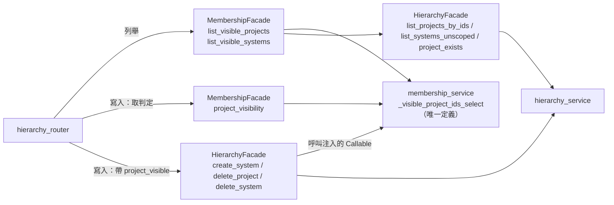

# Logical Components — `U23 project-pages-ui`

> 撰寫時間 2026-10-15T23:26:04Z（`date -u` 取值）。
>
> 把 `performance-design.md` 與 `security-design.md` 的設計落到**元件層級**：每一個新增或修改的方法的簽章、呼叫方向、
> 失敗域，以及索引與遷移的逐檔落點（帶入項 nfr-requirements `R-02` 的主體）。code-generation 以本檔 §一 為改動清單。
> 本站未執行任何程式；行號皆於撰寫當下實讀。

## 零、上游來源

| 來源 | 用到什麼 |
|---|---|
| `../functional-design/functional-spec.md` §四之二、§八之一 | 六個新方法的原始簽章（`BR87.3`）、交給 code-generation 的同步義務清單 |
| `../nfr-requirements/tech-stack-decisions.md` | `PPN-21`–`PPN-25`、`NFR8.100` |
| `../carried-review-items.md` | nfr-requirements `R-02`（使用者裁決：索引沿用 `U18` 的遷移路徑、不動啟動路徑）；functional-design `R-02` |
| repo 實測 | `schema_rbac.sql:567`（`J)` 區塊起點）、`:594-606`（`project_members` DDL）、`:608-615`（「刻意不建」註解）；`backend/models.py:546`（`class ProjectMember`）、`:582`（「`user_id` 側刻意不建」註解）、`:584`（`__table_args__`）；`backend/scripts/run_meta_schema_migration.py:95`（`BLOCKS_TO_RUN = ("X", "I", "J")`）、`:104-117`（`BLOCK_SENTINELS`）、`:155-171`（`EXPECTED_INDEXES`，8 筆）、`:584`（成功輸出的索引數）；`backend/tests/test_membership_data.py:74-80`（`ddl_indexes` 的正規式）、`:139`（`test_M3`）；`DEPLOY.md:660`（2.2.9 的執行步驟）、`:674`（「7 個索引」）、`:867`；`backend/scripts/backfill_project_members.py:18-21` |

## 一、元件與改動清單

### 一之一、後端

| 元件 | 改動 | 簽章（新增或變更） | 呼叫者 | 設計依據 |
|---|---|---|---|---|
| `services/hierarchy_facade.py` | 新增兩個訊息常數 | `PROJECT_NOT_FOUND_DETAIL`、`SYSTEM_NOT_FOUND_DETAIL`（`:78` 之後） | `hierarchy_service`、`membership_facade` | security §一之一 |
| 〃 | **變更**三個寫入方法簽章，加守門 | `create_system(principal, *, project_id, name, project_visible: Callable[[int], bool])`；`delete_project(principal, *, project_id, project_visible)`；`delete_system(principal, *, system_id, project_visible)`——`project_visible` 必填、無預設 | `hierarchy_router` 三處；既有測試 15 處 | security §二之一、§二之二 |
| 〃 | 新增兩個不做擁有者檢查的方法 | `list_projects_by_ids(principal, *, project_ids: Sequence[int]) -> List[Project]`；`list_systems_unscoped(principal, *, project_id: int) -> List[System]`——第一行 `K2 view`；空集合不發 `IN` | 只有 `MembershipFacade`（ast 鎖，`BR87.7`） | `BR87.3`；performance §二之二 |
| 〃 | `[PPD1]`=A：成功刪除後記 actor | `delete_project`／`delete_system` 尾端各一行 `logger.info`（`:47` 的既有 logger） | — | security §五之三 |
| `services/hierarchy_service.py` | 六處 f-string 改用常數 | `:70`、`:77`、`:180`、`:199`、`:381`、`:388`；`:89` 不改 | — | security §一之一 |
| `services/membership_service.py` | 新增私有可見性定義與兩個函式 | `_visible_project_ids_select(user_id)`（私有，回傳 `UNION` 選取式）；`visible_project_ids(db, *, user_id) -> List[int]`；`is_project_visible(db, *, project_id, user_id) -> bool` | `MembershipFacade` | `BR87.3`；performance §二之一 |
| `services/membership_facade.py` | 新增三個方法 | `list_visible_projects(principal) -> List[Project]`；`list_visible_systems(principal, *, project_id) -> List[System]`（不存在與不可見皆 `MembershipNotFound(PROJECT_NOT_FOUND_DETAIL)`，`K2` 的 `HierarchyForbidden` 原樣上拋）；`project_visibility(principal) -> Callable[[int], bool]` | `hierarchy_router` | `BR87.3`；security §一之二、§二之一 |
| `services/hierarchy_router.py` | 兩支列舉 handler 改委派；三支寫入 handler 傳入判定 | 列舉：`membership_facade.MembershipFacade(db).list_visible_*(…)`；寫入：`project_visible=membership_facade.MembershipFacade(db).project_visibility(principal)`；兩支列舉 handler 的 docstring 改寫（`BR87.4`） | — | security §二之四 第 2 條 |
| `models.py` | `ProjectMember.__table_args__` 加 `Index("ix_project_members_user_id", "user_id")`；改寫 `:582` 的「刻意不建」註解 | — | — | §三 |
| `schema_rbac.sql`、`run_meta_schema_migration.py`、`DEPLOY.md` | 索引與部署同步（blocking） | — | — | §三 |
| `scripts/backfill_project_members.py`、`DEPLOY.md:867` | 改寫「`list_projects` 目前是 owner-scoped」一句（不改腳本行為） | — | — | `functional-spec.md` §八之一 第 5 項 |
| `openapi.json`、`frontend/src/types/api.d.ts` | 重 dump／重產（只有 description 漂移） | — | — | `PPN-24` |

**新增測試檔**（全在 `backend/tests/`，由既有 `unittest discover` 撿到，`PPN-23`）：`test_project_visibility_endpoints.py`
（security §三）、`test_project_write_guard.py`（security §二之三）、`test_project_visibility_static.py`（`BR87.7` ＋ security
§二之四）、`test_project_visibility_queries.py`（performance §二之二）。**修改的既有測試**：`test_membership_data.py`（`test_M3`
docstring 與新增斷言，§三）、`tests/helpers.py`（`ALWAYS_VISIBLE`）、四支既有測試檔的 15 處呼叫（逐檔數字見 `security-design.md` §二之一；跨單元面見本檔 §四）。

### 一之二、前端

| 元件 | 改動 | 設計依據 |
|---|---|---|
| `src/projects/fanoutQueue.ts`（新） | `FANOUT_CONCURRENCY = 4`、`createFanoutQueue`、`FanoutCancelled`；無 React 依賴、無 `console.` | performance §一之一 |
| `ProjectsListPage` | effect 內建一個佇列，P 個端點 2 依專案 id 遞增入列；cleanup `cancel()` | performance §一 |
| `ProjectDetailPage` | effect 內建一個佇列，先 S 個端點 5、後 S 個端點 7，各依系統 id 遞增；重讀與 `[重新整理]` 不經佇列 | performance §一之一 |
| `RecentChanges`（帶入項 functional-design `R-02`） | 標示文字逐字為「**只含經大腦、已歸屬系統、且為你自己擁有之圖的變更**」；空態逐字為「**沒有符合條件的變更紀錄**」（不宣稱絕對無）。e2e 斷言兩句皆出現；`traceability` 與 code-summary 註明「未歸屬系統的圖（`OPEN-H11`）查不到」 | `BR86.2` 的修正（設計檔不回改，以本檔為準） |

## 二、呼叫方向

<!-- Text fallback: hierarchy_router 的兩支列舉 handler 呼叫 MembershipFacade 的 list_visible_projects／list_visible_systems；
三支寫入 handler 先向 MembershipFacade.project_visibility 取得一個 Callable，再把它以 project_visible 關鍵字傳給
HierarchyFacade 的 create_system／delete_project／delete_system。MembershipFacade 經 membership_service 的唯一可見性定義
_visible_project_ids_select 判定，並呼叫 HierarchyFacade 的 list_projects_by_ids／list_systems_unscoped／project_exists 取資料。
HierarchyFacade 執行時呼叫的是被注入的 Callable（執行期指向 membership_service），但原始碼不 import 任何 membership 符號。
U7 的 HierarchyFacade 在靜態依賴上不指向 U19，沒有循環。 -->

**靜態依賴與執行期呼叫的區別**：圖中 `HierarchyFacade --> membership_service` 那條邊只存在於**執行期**（經注入的閉包），
`hierarchy_facade.py` 的原始碼不 import membership（security §四 的 grep 為 0）。這是 `BR87.3`「`U7` 不呼叫 `U19`」在
寫入路徑上仍成立的方式。

## 三、索引與遷移的落點（帶入項 nfr-requirements `R-02`，使用者裁決）

裁決的路徑是「沿用 `U18` 建成員表的路徑、不動啟動路徑」。`project_members` 的 DDL 在 `schema_rbac.sql` 的 `J)` 區塊
（`:567` 起），而 `run_meta_schema_migration.py` **直接解析並執行** `X`／`I`／`J` 三區塊的同一份文字（`:95`），故把
`CREATE INDEX` 寫進 `J)` 區塊，既有環境重跑該腳本即建出索引——**DDL 只有一份**，不需複製到其他檔。

| # | 檔案 | 改動 | 為什麼必要（不做的後果） |
|---|---|---|---|
| 1 | `schema_rbac.sql` `J)` 區塊，緊接 `project_members` 的 `CREATE TABLE`（`:594-606`）之後 | `CREATE INDEX IF NOT EXISTS ix_project_members_user_id ON project_members (user_id);`——**必須寫成單行或「名稱後換行再接 `ON project_members`」**，且不加 schema 前綴 | `test_membership_data.py:74-80` 的 `ddl_indexes` 以 `CREATE INDEX IF NOT EXISTS\s+(\w+)\s*\n?\s*ON\s+project_members\b` 擷取；寫成 `ON public.project_members` 會使 `test_M3` 認不出這個索引而紅 |
| 2 | 同上 `:608-615` 的註解 | 改寫為「`user_id` 側由 `U23` 建立：條件 ① 已成立（專案清單改讀成員列，`[PP1]`=A）；條件 ② 仍未決，與本索引無關」 | 不改則註解宣稱「本輪都不成立」為假 |
| 3 | `models.py:584` `__table_args__` | 加 `Index("ix_project_members_user_id", "user_id")`；`:582` 註解同步 | `test_M3` 要求 ORM 與 DDL 的索引名稱集合相等；新環境的 `create_all` 也靠它 |
| 4 | `test_membership_data.py:139` `test_M3` | 改寫 docstring 中「`project_members.user_id` 被補上 `index=True`（刻意不建）」一句；新增 `assertIn("ix_project_members_user_id", …)` 對 ORM 與 DDL 各一次 | 只靠集合相等時，兩邊**同時漏掉**仍綠；點名斷言擋住這一種 |
| 5 | `run_meta_schema_migration.py:155-171` `EXPECTED_INDEXES` | 加 `("public", "project_members", "ix_project_members_user_id")` | 只加 SQL 不加這一列：索引被建立但不被驗證，「結束碼 0」的語意悄悄變窄（該檔 `:161-165` 的既有註解逐字警告這一點） |
| 6 | 同檔 `:104-117` `BLOCK_SENTINELS["J"]` | 加 `"ix_project_members_user_id"`（比照同組已有的 `"ix_reselection_events_unack"`） | 使「有人把 `CREATE INDEX` 從 `J)` 區塊移走」在解析階段就失敗，而不是等後條件 |
| 7 | `DEPLOY.md:674` | 「7 個索引」改為「**9** 個索引」，並加一句說明：**改前的 7 已與腳本不符**（`EXPECTED_INDEXES` 實為 8 筆，`U8` 的 HNSW 索引加入時未同步），本次一併更正 | 這行是「結束碼 0 代表什麼」的人讀版本；它與腳本不符時，讀者會以為少驗了一個 |
| 8 | `DEPLOY.md` 2.2.9（`:660` 的執行步驟附近） | 新增一段：「**`U23` 起，既有環境需再跑一次本腳本**以建立 `ix_project_members_user_id`（`IF NOT EXISTS`，可重跑安全；已跑過的環境只會多建這一個索引）」與驗證指令 `psql "$DATABASE_URL" -c "SELECT indexname FROM pg_indexes WHERE tablename='project_members' AND indexname='ix_project_members_user_id';"`（應回 1 列） | `deploy.yml` 不呼叫任何遷移腳本（`DEPLOY.md:691-692`），不寫明就沒人會跑；**缺索引時功能照常、只是慢**，是無聲的失敗模式 |
| 9 | `DEPLOY.md` 2.2.9 的「這支 SQL 會建立的表／欄位」表（`:591` 的 `project_members` 列） | 該列補「索引：`uq_project_members_project_user`、`ix_project_members_user_id`」 | `project.md ## Mandated` 必做 2 |

**不做**：`backend/database.py` 不加 `_ensure_*` 補丁（使用者裁決；`DEPLOY.md` 的 `NFR8.4`「不動啟動路徑」），故
`LOCAL-DEV.md` 的同步義務**不觸發**；`schema.sql` 不含 `project_members`（`grep` 實查 0 命中），不需改。

**可判定的完成條件**（code-generation 的 code-summary 逐項報告）：`grep -c "ix_project_members_user_id"` 對
`schema_rbac.sql`、`backend/models.py`、`backend/scripts/run_meta_schema_migration.py`、`DEPLOY.md` 各 ≥ 1；`test_M3` 綠；
staging 部署後執行 #8 的驗證指令回 1 列（這一項只能人工，記入 tcms-test-cases 的手動桶候選）。

## 四、失敗域與爆炸半徑

| 改動 | 若做錯，壞的是什麼 | 誰會發現 |
|---|---|---|
| 三個寫入方法的簽章 | 漏傳 → `TypeError` → 500（fail-closed，不會靜默放行） | 既有 15 處測試呼叫與三個 router 端點的 `TestClient` 測試 |
| 守門順序 | 403 變 404（`PPN-14a`）或 409 洩漏（`R-04`） | security §二之三 (e)(f) |
| 訊息常數 | 某路徑仍帶 id → 存在性預言機 | security §一之三 |
| 可見性定義 | 漏寫關聯 → 任何成員可見所有專案 | security §三 的 ③ 與 `M6` |
| 索引 | 缺索引 → 功能正常、專案清單變慢（無聲） | `test_M3`（DDL／ORM）；既有環境只能靠 §三 #8 的人工驗證 |
| 前端佇列 | 退化為全發 → 突發請求；截斷 → 部分和 | performance §一之四 |

**跨單元面**：本單元改到四個已交付單元的測試檔（`U7` 的 `test_hierarchy_service.py`、`U20` 的 `test_requirement_field_facade.py`、
`U21` 的 `test_mcp_bridge_e2e.py`、`test_work_orchestrator_store.py`），改動只限補一個關鍵字參數，不改任何斷言；
code-summary 須逐檔列出並註明「斷言未動」。`U16 object-picker-ui` 沿用 `objectCreateAction`（`OPEN-PP23-8`），它不直接呼叫
facade，不受簽章變更影響。
