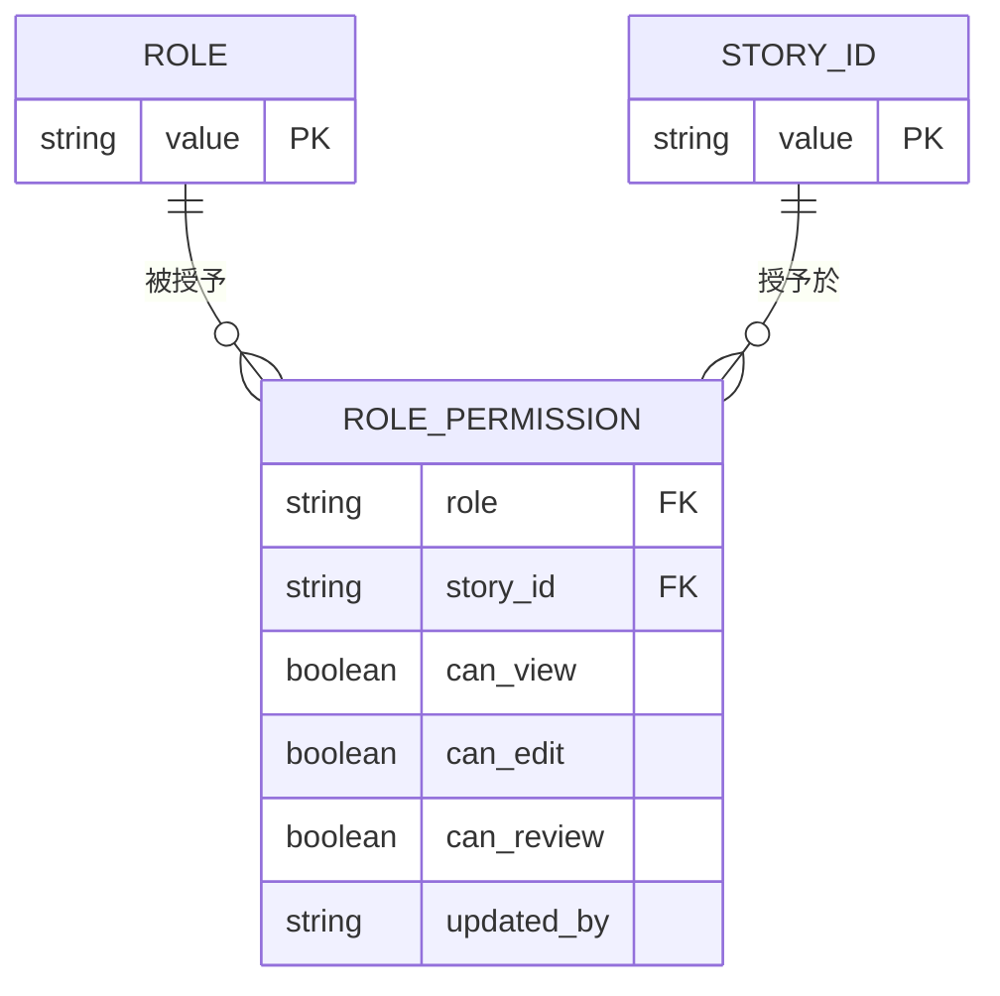

# Functional Spec — `U3 rbac-story-ids`（`spec`）

<!-- Stage: functional-design（Construction 3.1）· Unit: rbac-story-ids · kind: spec -->

> **⚠ 本檔有修訂 1（2026-10-04）**：`K3`／`K4` 兩個 story id、矩陣 **352** 列、兩條新工作流程。
> 下方 §一 的標題寫「22 列（完整列舉）」，那是**修訂前**的完整列舉；
> 修訂 1 後的完整列舉是 **§一′ 的 44 列**，§六 的 ADR-0006 判定亦由 §六′ 取代。
> **讀本檔請一併讀文末的「修訂 1」段。**

本檔是**工作流程與狀態轉移的 source of truth**；實體模型的正本在 `entities.md`、
規則的正本在 `rules.md`，本檔的 ER 圖與規則摘要為衍生視圖。

---

## 一、本單元的 22 列（完整列舉）

這張表是本單元的全部交付內容。`v`／`e`／`r` 分別為 `can_view`／`can_edit`／
`can_review`，`-` 表示 `false`。

| 角色 | `K1` 統一入口頁 | `K2` 專案／系統階層 |
|---|---|---|
| `Project_Architect` | `v--` | `ve-` |
| `Developer` | `v--` | `v--` |
| `Project_Editor` | `v--` | `ve-` |
| `Project_Admin` | `v--` | `ve-` |
| `FinOps_Analyst` | `v--` | `v--` |
| `SRE` | `---` | `v--` |
| `Ops_Lead` | `---` | `v--` |
| `Platform_Engineer` | `---` | `v--` |
| `Security_Reviewer` | `v--` | `v--` |
| `Platform_Admin` | `v--` | `ve-` |
| `Platform_Owner` | `v--` | `v--` |

**實算複驗**：`K1` 欄有 8 個 `v`、3 個 `---`；`K2` 欄有 11 個 `v`、其中 4 個帶 `e`；
`r` 欄在兩個 story id 上皆為 0。合計 22 列，矩陣由 308 增為 **330**。

**兩個可達性保證各自成立**：

- `BR1.3`：`SRE`／`Ops_Lead`／`Platform_Engineer` 三者皆持有 `A1` view
  （本站實讀 `DEFAULT_ROLE_PERMISSIONS` 複驗），故 `AC1.4.2` 的 Given 可構造。
- `BR2.2`：七個角色不具 `K2.edit`，故 `AC9.2.3` 的 Given 可構造。

---

## 二、工作流程

### W-1：應用程式啟動時的 seed 寫入

本單元**不新增這條流程**，它已存在（`database.py:158–175`）。本單元改變的是
它所迭代的資料。逐步如下：

1. 啟動路徑呼叫 `ensure_role_permissions_seeded(db, force=False)`。
2. 該函式檢查 `role_permissions` 列數。
   - **空表**（全新環境）→ 寫入全部 330 列，結束。
   - **非空**（既有環境）→ **整段 no-op 並回 0**（`rbac.py:63–65`）。
     這一步對本單元的 22 列**完全無效**，`BR3.2` 即為此而立。
3. 啟動路徑接著呼叫 `ensure_missing_role_permissions(db)`。
4. 該函式逐列走訪 `DEFAULT_ROLE_PERMISSIONS`（現為 330 列）：
   - `(role, story_id)` 已存在 → 略過，**不覆寫**（`BR3.3`）。
   - 不存在 → `INSERT`，`updated_by = "system_seed"`。
5. 既有環境在此步補進 22 列；全新環境在此步插入 0 列（第 2 步已寫完）。
   兩條路徑殊途同歸，這是本流程冪等的來源。

**失敗行為**：第 3 步若不存在或未被呼叫，既有環境永遠拿不到 `K1`／`K2`，
而**應用程式不會報錯**——`user_can` 對缺列回 `false`（`rbac.py:150–151`），
現象是「所有人都沒有入口頁權限」，不是一個可辨識的錯誤。
本站已查證該函式存在於 `rbac.py:84–111` 且已被 `database.py:171–175` 呼叫，
故這一條是**既有保障，不是本單元要新建的機制**。

### W-2：空 volume 建庫

`schema_rbac.sql` 只在空 volume 執行，內含裸的 `DELETE FROM role_permissions;`
後重寫 seed。本單元必須把 22 列加進該檔的 seed 區塊（`BR4.1`），否則
「從 SQL 建的新環境」與「程式內的預設值」不一致——而 `W-1` 第 2 步會因為表非空
而 no-op，第 4 步才補上差額。**兩邊不一致時系統仍能運作**，只是新環境的
初始狀態與預期不同，這是它難以被發現的原因。

`rbac_seed_data.py` 檔頭逐字：「由 `schema_rbac.sql` 產生的預設 `role_permissions`
列（勿手改；改 SQL 後重跑產生腳本）」。**正確順序是先改 SQL、再重新產生 Python**。

### W-3：管理者於權限頁調整（既有流程，本單元的影響）

`K1`／`K2` 加入後，權限頁會多出兩列可調整的能力。三件事要注意：

1. 調整後該列的 `updated_by` 由 `"system_seed"` 變為操作者，
   `W-1` 第 4 步此後永遠不會再動它（`BR3.3`）。
2. 若管理者把 `K1` 給滿全部 11 個角色，`BR1.3` 被破壞、`AC1.4.2` 變成死碼——
   **但這是執行期的資料狀態，不是 seed 缺陷**。本單元保證的是**預設值**成立，
   不保證管理者不會把它改壞。`BR1.3` 的可執行檢查落在 seed 的測試上。
3. `user_router.py:885` 存在一個以 `force=True` 呼叫
   `ensure_role_permissions_seeded` 的端點，它會 `DELETE` 全表再重寫。
   `K1`／`K2` 進入 `DEFAULT_ROLE_PERMISSIONS` 後，該端點的重置目標一併包含
   新兩欄——**這是正確行為**，記此以免下游誤讀為本單元引入的缺陷。

---

## 三、狀態機：單一 `(role, story_id)` 列的生命週期

```
        [不存在]
            |
            | W-1 第 2 步（空表全寫）或第 4 步（補缺失列）
            v
      [預設值 · updated_by = system_seed]
            |
            | 管理者於權限頁調整（W-3）
            v
      [已調整 · updated_by = <操作者>]
            |
            | user_router.py:885 的 force=True 重置端點
            v
      [預設值 · updated_by = system_seed]   ← 回到上一狀態
```

<!-- Text fallback：一列有兩個狀態。從「不存在」經 seed 進入「預設值」；
管理者在權限頁調整後進入「已調整」；唯一能從「已調整」回到「預設值」的路徑是
force=True 的重置端點，它會清空全表重寫。ensure_missing_role_permissions
只做「不存在 → 預設值」這一個轉移，永遠不做另外兩個。 -->

**轉移的完整性**：`ensure_missing_role_permissions` 只實作第一個轉移。
它不會把「已調整」改回「預設值」，也不會刪除任何列——這正是它能在每次啟動
安全執行的原因（`BR3.3`）。

---

## 四、ER 圖（衍生自 `entities.md`，該檔的 YAML 為正本）



<!-- Text fallback：三個實體。ROLE（11 個正式角色，value 為主鍵）與
STORY_ID（30 個能力識別字，value 為主鍵）各自一對多連到 ROLE_PERMISSION。
ROLE_PERMISSION 以 (role, story_id) 為複合唯一鍵，帶三個布林旗標
can_view／can_edit／can_review 與一個 updated_by 字串。
本單元不新增實體，只新增 ROLE_PERMISSION 的 22 個實例與 STORY_ID 的 2 個值。 -->

---

## 五、規則摘要（衍生自 `rules.md`，該檔的 YAML 為正本）

16 條規則分四群：`BR1`（`K1` 語意與預設值，4 條）、`BR2`（`K2`，4 條）、
`BR3`（寫入端與冪等，4 條）、`BR4`（同步義務，4 條）。
類別實算：constraint 10、policy 5、validation 1、authorization 0、calculation 0。
完整對照表見 `rules.md` 的摘要段。

**審查後補入的第 16 條**：`BR4.4` 要求同一個 PR 新增測試鎖住 `schema_rbac.sql`
與 `rbac_seed_data.py` 兩份 seed 副本逐列等值。它不是審查提出的，是本站自查——
`team.md ## Code Style` 的「單一真實來源」逐字要求跨語言邊界的副本必須附一致性
測試，而本站查證 `backend/tests/` **目前沒有任何測試做這件事**，且本單元正是在
往兩份副本各加 22 列。

---

## 六、ADR-0006 security baseline 的四個面向（hard constraint，逐項判定）

| 面向 | 適用 | 本單元的處置 |
|---|---|---|
| **IAM** | **適用（核心）** | 本單元**就是** IAM 變更：新增兩個 story id、22 列 seed。處置為 `BR1.1`–`BR2.4` 的明文預設值，加上兩條可達性保證（`BR1.3`、`BR2.2`）確保「不具權限」的情形可被測試構造。交付條件含 allow/deny 雙向 TestClient（`team.md` A 規則）。**最小權限**的具體落點：`K1` 不給三個純唯讀維運角色、`K2.edit` 只給四個角色而非全部。 |
| **Encryption** | **不適用** | 本單元不新增任何欄位、不儲存任何機密值。`role_permissions` 的內容是布林旗標與角色名，無敏感資料。理由與 `U4` 的加密判定同源（同一個 PostgreSQL、同一個磁碟邊界）。 |
| **Network exposure** | **不適用** | 本單元交付零端點、零畫面、零對外介面。新增的暴露面在 `U7`（HTTP 端點）與 `U14`（頁面），各自於其 stage 判定。 |
| **Audit logging** | **適用（部分）** | seed 寫入的可稽核性由 `updated_by` 欄位承載：預設列為 `"system_seed"`，人工調整後為操作者（`entities.md` 的 `updated_by` 約束）。**已知缺口**：`ensure_missing_role_permissions` 只在插入非零列時記一行 `logger.info`（`rbac.py:109–110`），**不記錄是哪些列**。既有環境補進 22 列時，日誌只會有一個數字。此缺口不在本單元修（改動既有函式的日誌行為超出 seed 範圍），記為交接事項 `H-3`。 |

---

## 七、交接事項

| ID | 事項 | 承接站 | 性質 |
|---|---|---|---|
| `H-1` | **`K1` 的唯讀／編輯雙態**。Figma `首頁`（`53:2`）副標逐字「目前處於唯讀分享模式…請求編輯權限解鎖完整 AI 互動能力」＋「進入編輯模式」按鈕。本站經人工裁決**不採納為需求**（`K1` 做成 view-only，`BR1.2`）。若 `U14` 決定要雙態，`K1` 的 seed 要再改一次並再觸發一次 `BR4.1`／`BR4.2` 的 blocking 同步。記為 `OQ-K1`。 | `U14 entry-page-ui` | 開放決策 |
| `H-2` | **刪除專案／系統時既有資料的處置**。本站 Q4 未採「非空不可刪」的結構前提，故該行為未定。`K-04` 的 `DG-2` 已在追蹤同一件事（cascade 未定會讓 `system_id` 懸空，使 `U4` 的不變量在遷移**之後**被打破）。記為 `OQ-K2`。 | `U7 hierarchy-service` | 開放決策 |
| `H-3` | **seed 寫入的稽核粒度**。`ensure_missing_role_permissions` 只記插入列數、不記哪些列（見第六節）。 | **無自然承接站**（見下方註） | 已知缺口 |
| `H-4` | **入口頁沒有脈絡列**。Figma `首頁` 無「目前作業對象」列，專案／子系統選擇器只在編輯模式的畫布頁 header。已核可的 `AC2.1.1` 要求「在入口頁看到三元組 → 切到 `/workspace` 逐欄相同」，其**起點在該設計上不存在**。 | `U14 entry-page-ui` | 設計落差（人工裁決本站不處理） |
| `H-5` | **沒有「進行中的工作」常駐區**。`mockups.md` M1 的 `[DM:D4]`=C 釘死 `INV-1`（一份狀態、兩個視圖）；Figma 首頁與三欄圖的 AI 面板皆無常駐區，`FR1.2` 的五狀態集合在畫面上沒有對象。 | `U14 entry-page-ui` | 設計落差（同上） |
| `H-6` | **八張能力卡 ≠ M2 的反問候選**。Figma `首頁` 的 A–H 八張卡與 `user_router.py:60` 的 `STORY_FEATURE_LABELS` 字首組 **1:1 對應**（A 架構、B 跨雲選型、C 成本、D IaC、E 維運、F 多雲維運、G 安全、H MCP/Skill；J 為 Sidebar 的「系統管理」群組）。那是**產品功能目錄**；M2 的候選是**針對使用者該句話的歧義澄清**（Figma `選擇功能` `54:191` 才是後者，其候選逐字標為「A1. 自然語言轉架構與草圖產出」「A2. 自動化 Well-Architected 評核與模擬」）。兩者在 Figma 裡同時存在，已核可文件只有後者。 | `U14 entry-page-ui` | 設計落差（同上） |
| `H-7` | **記憶沒有入口**。`mockups.md` M0／M6／M7 要求 Sidebar 有「我的記憶」為第二個獨立項；Figma 左欄是「新對話 ＋ 對話歷史（今天／過去 7 天／過去 30 天）＋ 系統管理」，無記憶項，而「對話歷史」是已核可設計裡沒有的。 | `U15 memory-page-ui`、`U14` | 設計落差（同上） |

**`H-3` 為何寫「無自然承接站」**（審查 R-02 要求給確定落點，本站的回應）：
缺口在 `ensure_missing_role_permissions` 的日誌行為，而那是 `rbac.py` 的共用函式，
**本 intent 沒有任何單元的責任範圍涵蓋它**——`U3` 的 `§八` 明文不改它的行為，
`U7` 交付的是 `projects`／`systems` 的 HTTP 端點、不碰 seed 路徑。
依 `project.md` 的既有教訓（找不到誠實的轉移目標時寫「無自然承接站」並重新提交
使用者，不得填一個看起來合理的站），本站不指派假目標。**處置**：第六節的
ADR-0006 表已標示 audit logging 面為「適用（部分）」，本註把它講明——
**該面向在本 intent 內只被部分履行，`H-3` 未結案**。任何日後引用本單元作為
「已處理 ADR-0006 稽核面」的說法都須一併讀這一段。

**`H-4`–`H-7` 的來源**：Figma 檔 `ecYwIVWjHESXzaQRyLphix` 的四個框架於本站
進行中由使用者提供並**實讀畫面**（非讀圖層名推斷）。經人工裁決「只先解第 4 項
（＝`H-1`），其餘記成交接」，故本站**不回改任何已核可的上游產出**。

---

## 八、本單元明確不做的事

- 任何 HTTP 端點、任何 service 層函式、任何前端檔案（`BR1.4`）。
- 任何授權判定邏輯——判定由既有 `require_story_action` 承擔。
- 新增或修改既有 308 列中的任何一列。
- 修改 `ensure_missing_role_permissions` 或 `ensure_role_permissions_seeded`
  的行為（兩者皆已存在且已被呼叫，本單元只改變其迭代的資料）。
- `STORY_FEATURE_LABELS` 以外的 `user_router.py` 變更。

---

# 修訂 1（2026-10-04）— `K3`／`K4` 兩個新 story id

<!-- 本段為 append。上方原文**不回改**。第一節的表格、第二節的不變量檢查與
     本段所有數字皆由 scratchpad 的 k_matrix.py 從
     backend/services/rbac_seed_data.py 實際解析後輸出，非手寫。 -->

## 一′、本單元的 44 列（完整列舉，修訂 1 後）

`v`／`e`／`r` 分別為 `can_view`／`can_edit`／`can_review`，`-` 表示 `false`。

| 角色 | `K1` 統一入口頁 | `K2` 專案／系統階層 | `K3` 專案成員管理 | `K4` 需求欄位 |
|---|---|---|---|---|
| `Project_Architect` | `v--` | `ve-` | `ve-` | `ve-` |
| `Developer` | `v--` | `v--` | `v--` | `v--` |
| `Project_Editor` | `v--` | `ve-` | `ve-` | `ve-` |
| `Project_Admin` | `v--` | `ve-` | `ve-` | `ve-` |
| `FinOps_Analyst` | `v--` | `v--` | `v--` | `v--` |
| `SRE` | `---` | `v--` | `---` | `---` |
| `Ops_Lead` | `---` | `v--` | `---` | `---` |
| `Platform_Engineer` | `---` | `v--` | `---` | `---` |
| `Security_Reviewer` | `v--` | `v--` | `v--` | `v--` |
| `Platform_Admin` | `v--` | `ve-` | `ve-` | `ve-` |
| `Platform_Owner` | `v--` | `v--` | `v--` | `v--` |

**各欄實算**（腳本輸出）：

```
K1: view=8 edit=0 全 false=3
K2: view=11 edit=4 全 false=0
K3: view=8 edit=4 全 false=3
K4: view=8 edit=4 全 false=3
```

**總數實算**：既有 **308** 列 ＝ 11 角色 × 28 story id（組合完整、無缺漏）；
308 ＋ 11 × 4 ＝ **352** 列。`units-generation` 逐字要求「施工時須以
`rbac_seed_data.py` 的實際角色數複算，不得照抄」——已照做，算式成立。

## 二′、11 項不變量檢查（腳本輸出，0 項失敗）

```
PASS - 既有矩陣完整（11 × 28） （len=308 roles=11 sids=28）
PASS - 新增列數 = 11 × 4 （44）
PASS - 總列數 = 308 + 44 （352）
PASS - 四個建立者角色皆持有 K3.edit （Project_Architect,Project_Editor,Project_Admin,Platform_Admin）
PASS - 至少一個角色完全不持有 K3 （3 個：['SRE', 'Ops_Lead', 'Platform_Engineer']）
PASS - 不持有 K3 者皆持有 A1 view（Given 可構造） （['Ops_Lead', 'Platform_Engineer', 'SRE']）
PASS - 至少一個角色完全不持有 K4 （3 個：['SRE', 'Ops_Lead', 'Platform_Engineer']）
PASS - BR1.3 仍成立（有 A1 view 但無 K1 者存在） （['SRE', 'Ops_Lead', 'Platform_Engineer']）
PASS - 七個角色不具 K2.edit（AC9.2.3 可構造） （7 個）
PASS - 四個新 id 的 can_review 全為 false 
PASS - 新 id 與既有 28 個無重複 

ALL PASS: True
```

這些不是裝飾性的斷言。其中四項各自對應一條會靜默失效的已核可驗收標準：

| 檢查 | 它保護的 AC | 違反時的現象 |
|---|---|---|
| 四個建立者角色皆持有 `K3.edit` | `AC12.1.2`（建立者邀請成員「不需任何額外授權步驟」） | 「我建的專案，我管不動」，而權限頁看不出是哪一層擋的 |
| 至少一個角色完全不持有 `K3` | `AC12.5.1`／`AC12.5.3`（邀請缺權限者被拒、拒絕不留半套狀態） | 兩條 AC 的 Given 不可構造，測試綠燈但測不到東西 |
| 至少一個角色完全不持有 `K4` | `BR6.4`（無 `K4` 者隱藏未填計數） | 本修訂新增的規則成為不可觸發的死碼 |
| `BR1.3` 仍成立 | `AC1.4.2`（不持有入口頁權限但持有架構圖權限） | 原文已記載的同一個陷阱，本修訂不得把它弄壞 |

## 三′、兩條新工作流程

### W-4：邀請一位使用者加入專案時的全域層檢查

落點為 `U19` 的 `MembershipFacade`（`K-16`），本單元只定義檢查什麼。
本流程的來源是 `requirements.md` 的 **FR12.6a**（加入時的前置條件）疊加在同檔
**FR12.6**（執行期的兩層串聯）之上——`[RA-2]`=C 的作答註解逐字說明它「是在其上
**疊加**限制而非與它矛盾」，而 **FR12.6b** 明文記載其後果（入職順序被強制為
「先全域權限、後專案成員」）。

1. 邀請者送出邀請，附被邀請者身分與要指定的 per-project 角色。
2. **全域層檢查（本單元的規則）**：
   - 目標角色為一般成員 → `user_can(invitee, 'K3', 'view')`（`BR7.1`）
   - 目標角色為專案管理者 → `user_can(invitee, 'K3', 'edit')`（`BR7.2`）
3. 不通過 → 拒絕，**不寫入任何列**（`AC12.5.3`），並回 `BR7.5` 的兩種
   `reason` 之一，讓畫面說得出「他缺少什麼」（`AC12.5.1`）。
4. 通過 → 再走 `K-16` 的 per-project 判定（邀請者自己必須是該專案的
   `project_admin`），然後寫入成員列。

**順序不可對調**：`BR7.1`／`BR7.2` 檢查的是**被邀請者**的全域權限，
`K-16` 檢查的是**邀請者**的 per-project 角色。兩者的主體不同，
把它們讀成同一道檢查會讓其中一邊消失。

### W-5：`project_admin` 被停用時的自動改選

本流程的來源是 `requirements.md` 的 **FR12.4**（自動改選）與 **FR12.5a**
（停用前置檢查）。

1. 既有停用端點收到停用請求（`user_router.py` 的停用路徑）。
2. 前置檢查（與 `[M3]`=A 的「唯一成員」檢查**同一個閘門**，不是第四道）：
   對該使用者擔任 `project_admin` 的每一個專案，算出候選集合
   `{m ∈ members | m ≠ 被停用者 AND user_can(m, 'K3', 'edit')}`（`BR7.3`）。
3. 任一專案的候選集合為空 → **擋下停用**，回 409 並列出那些專案
   （沿用 `[M3]`=A 已核可的「要求先指定接手人」形狀）。
4. 全部專案都有候選 → 對每個專案呼叫挑選純函式。該函式**不讀 DB**，
   候選者的 `K3.edit` 旗標由步驟 2 查好後傳入（`BR7.4`）。
5. 寫入新的 `project_admin`、記 `ReselectionEvent`、觸發交棒橫幅。

**失敗行為**：若步驟 2 不過濾候選集合，被選中者可能只有 `K3.view`——
他會收到橫幅「系統自動把管理權交給你」然後每個動作都 403，
而這條路徑**沒有任何人按下按鈕**可以被告知失敗。這是 `BR7.3` 存在的全部理由。

## 四′、既有三條工作流程的影響（W-1／W-2／W-3）

**三條流程的形狀全部不變**，只有它們迭代的資料量變了：

| 流程 | 原文 | 修訂 1 後 |
|---|---|---|
| `W-1` 第 2 步（空表全寫） | 330 列 | **352** 列 |
| `W-1` 第 4–5 步（既有環境補缺失列） | 補 22 列 | 補 **44** 列 |
| `W-2` 空 volume 建庫 | seed 區塊加 22 列 | 加 **44** 列，**且該檔兩處數字要改**（`BR4.1`′） |
| `W-3` 權限頁調整 | 多出兩列可調整的能力 | 多出**四列** |

`W-3` 的第 3 點（`force=True` 重置端點會一併包含新欄）原樣適用於四個 id。

## 五′、ER 圖與規則摘要的衍生視圖更新

上方第四節的 ER 圖**結構不變**（三個實體、兩條一對多關係），只有基數變了：
`STORY_ID` 由 30 個值變為 **32** 個，`ROLE_PERMISSION` 的實例由 330 變為
**352**。不重畫圖——重畫一張結構相同的圖只會製造兩份要同步的副本。

規則摘要見 `rules.md` 的兩張摘要表與其「實算結果」段：合併後 **32** 條規則，
`authorization` 類別由 0 變為 **3**（該段的每個數字皆由腳本從 `rules.md` 的兩個
YAML 區塊解析後輸出；本行的兩個數字同樣取自該腳本的輸出，非手寫）。

## 六′、ADR-0006 security baseline 的四個面向（修訂 1 重新逐項判定）

| 面向 | 適用 | 修訂 1 的處置 |
|---|---|---|
| **IAM** | **適用（核心，比原文更重）** | 本修訂把本單元從「只定義授權資料」擴為「同時定義一條加入時的前置授權規則」（`BR7` 群，`authorization` 類別由 0 變為 3）。最小權限的落點：`K3`／`K4` 皆不給三個純唯讀維運角色、`edit` 只給四個建立者角色而非全部。新增兩條可達性保證（`BR5.3`、`BR6.5`）與一條蘊含約束（`BR5.4`），三者皆已由腳本實測成立。 |
| **Encryption** | **不適用** | 理由與原文相同：不新增欄位、不儲存機密值，新增的 44 列仍是布林旗標與角色名。 |
| **Network exposure** | **適用（一處）——原文判「不適用」，本修訂的自檢 2 推翻它** | 本單元仍交付零端點零畫面，但它**改變了一個既有公開端點的回應內容**：`user_router.py:310` 的 `/roles/catalog` docstring 逐字「**公開**：註冊頁角色功能目錄」、**無任何 `Depends(get_current_user)`**，而 `_build_role_catalog`（`:249`）逐角色列出其持有能力的中文標籤。補上 `K1`–`K4` 的 `STORY_FEATURE_LABELS`（`BR4.3`′）之後，四個功能名即對**未驗證身分的訪客**可讀。**處置見 `BR4.5`：照既有先例發布、不加入 `CATALOG_EXCLUDED_STORIES`**——該集合目前只含 `J1`（登入能力），而 `J3a`「使用者設定」／`J3b`「細項設定」這兩個管理類標籤已經是公開的，故不引入新的揭露類別；揭露內容是四個中文功能名。**精確說法（審查 `R-04` 更正）**：該端點本就逐角色列出其持有能力的中文標籤，即**確實**揭露「哪個角色能做什麼」的對應——那是它的既有設計目的；它不揭露的是「**誰**是什麼角色」（使用者與角色的對應）。`K1`–`K4` 不改變揭露的類別。其餘新增暴露面在 `U19`（`K-16` 的 HTTP 面）、`U20`（`K-17`）、`U23`／`U24`（畫面），各自於其 stage 判定。 |
| **Audit logging** | **適用（部分，缺口擴大）** | 原文的 `H-3` 缺口（`ensure_missing_role_permissions` 只記插入列數、不記哪些列）**在本修訂變大**：既有環境補進的列由 22 變為 44，而日誌仍只會有一個數字。**另一面是新增的**：`BR7.1`–`BR7.3` 的**拒絕**事件是否要留稽核紀錄，本單元未定——`AC12.2.2` 只要求角色變更有可見紀錄，拒絕不在其中。記為新交接事項 `H-8`。 |

## 六′-b、自檢 2（契約端點三問）查出的兩項，與一處行號更正

跑完整個 stage 產出的三問（不只本輪動過的部分）後，有兩項需要記下來：

| # | 發現 | 處置 |
|---|---|---|
| 1 | **`ensure_role_permissions_seeded` 有第三個呼叫點，上游與原文皆未記載**：`user_router.py:313`，在**公開**端點 `/roles/catalog` 內。它在表非空時是 no-op，故對資料無影響；但它使矩陣成為**未驗證身分即可讀**的資料來源之一。 | 新增 `BR4.5`；`§六′` 的 network exposure 列由「不適用」改為「適用（一處）」。 |
| 2 | **行號更正（事實對、定位錯）**：原文的 `BR3.1` note 與 `W-1` 第 3 步寫 `ensure_missing_role_permissions`「已被 `database.py:171–175` 在啟動時呼叫」。實測 `database.py:171` 是**另一個函式** `ensure_role_permissions_seeded(db, force=False)`；`ensure_missing_role_permissions(db)` 在 **`database.py:184`**。 | **事實成立、不改決定**：它確實在啟動時被呼叫，就在 seed 之後。依 `functional-design:c22` 只修定位，原文不回改，在此記明。這正是本 record 已記過 26 個相異行號、77 處引用失效的同一個形狀。 |

三問的其餘項目逐一有兩端（寫入端／讀取端／清除端，或擁有者／呼叫者）：

| 契約端點 | 誰寫 | 誰讀 | 誰清 |
|---|---|---|---|
| `StoryId` 的 `K1`–`K4` | `DEFAULT_ROLE_PERMISSIONS` ＋ `schema_rbac.sql` seed（兩份副本，`BR4.4`′ 鎖住一致） | `user_can`／`require_story_action`（`U7`／`U14`／`U19`／`U20`／`U23`／`U24`） | 無（story id 不刪除） |
| `RolePermission` 的 44 列 | `ensure_missing_role_permissions`（`rbac.py:84`，只 INSERT）＋ 空表路徑 `ensure_role_permissions_seeded`（`rbac.py:58`） | 同上 | `user_router.py:885` 的 `force=True` 重置端點（DELETE 全表後重寫） |
| `updated_by` | seed 寫 `"system_seed"`；權限頁寫操作者 | 「這列還是不是預設值」的唯一判斷依據 | `force=True` 重置端點會還原為 `"system_seed"` |
| `STORY_FEATURE_LABELS` 的四個新鍵（`BR4.3`′） | 本單元的 PR（`user_router.py:60`） | `_feature_label`（`:242`）→ 權限頁、`_build_role_catalog`（`:249`）→ **公開**的 `/roles/catalog` | 無 |
| `BR7.5` 的 `reason` 代碼 | `U19` 的拒絕回應（`K-16`） | `U24` 的邀請對話框文案 | 無（單次回應欄位，不持久化） |
| `BR7.3` 的候選集合 ＋ `BR7.4` 的 `K3.edit` 旗標 | `W-5` 第 2 步（`U19`，查全域矩陣） | `AC12.4.2` 的挑選純函式（不讀 DB） | 無 |
| `BR6.4` 的 `unfilled_count` 隱藏 | `U20` 的 `read_fields` 回應（`K-17`） | `U23` 的總覽籤 | 無 |

| 方法 | 誰擁有 | 誰呼叫 |
|---|---|---|
| `ensure_missing_role_permissions` | 既有，`rbac.py:84` | `database.py:184`（啟動路徑，**本修訂更正的行號**） |
| `ensure_role_permissions_seeded` | 既有，`rbac.py:58` | `database.py:171`（啟動）、`user_router.py:313`（**公開** `/roles/catalog`，本修訂查出）、`user_router.py:885`（`force=True` 重置） |
| `AC12.4.2` 的挑選純函式 | `U19`（本單元只定義其輸入約束，`BR7.4`） | `U19` 的停用路徑（`W-5` 第 4 步） |

## 七′、修訂 1 新增的四項交接事項（`H-11` 為審查 `R-01` 後補入）

| ID | 事項 | 承接站 | 性質 |
|---|---|---|---|
| `H-8` | **邀請被拒事件的稽核**。`BR7.1`–`BR7.3` 會拒絕邀請與擋下停用，而 `AC12.2.2` 只要求**角色變更**有使用者可見的紀錄。被拒事件是否留紀錄（以及留在哪裡——`ReselectionEvent` 是改選事件，不是拒絕事件）本單元未定。影響：一位管理者反覆嘗試邀請同一個缺權限的人，系統不留任何痕跡。 | `U19 membership-service`（`functional-design`，`CONDITIONAL` → `code-generation`，**ALWAYS**） | 開放決策 |
| `H-9` | **三個維運角色的 `K2.view` 在預設值下是否成為死資料**。`BR2.1` 給全部 11 個角色 `K2.view`，理由逐字是「不給 view 的角色看不到自己的架構圖歸屬於哪個專案／系統」；但 `BR5.1`＋`BR7.1` 使 `SRE`／`Ops_Lead`／`Platform_Engineer` 在預設值下**永遠無法成為任何專案的成員**，而 `AC12.1.3` 要求非成員看不到該專案。問題：他們**自己擁有**的架構圖（`user_diagrams.user_id`）在遷移後會有 `system_id`，他們能不能在不是專案成員的情況下看到那個三元組？若不能，`K2.view` 對這三個角色是死資料。**本單元不自行定案**——這是 `U7` 的讀取路徑是否檢查成員資格的問題，而那不在本單元的範圍（`BR1.4`／`BR5.5`）。 | `U7 hierarchy-service`（`functional-design`，`CONDITIONAL` → `code-generation`，**ALWAYS**） | 跨單元查證 |
| `H-10` | **`unit-of-work-story-map.md` 未把 `US11`／`US12` 的任何一則指給 `U3`**。本站實測：修訂 4 新增的 11 列中，`U3 rbac-story-ids` 零命中；`U3` 的指派仍是 `US1.4`、`US9.2` 兩則。後果是 `traceability.json` 的 `upstream_ids` 只能列那兩群的 7 條 AC，而本修訂的 `BR5`–`BR7` 共 15 條規則**實際支撐**的是 `AC12.1.2`／`AC12.5.1`／`AC12.5.3`／`AC12.2.1`／`AC12.4.x`／`AC11.2.1`／`AC11.3.x`——它們全部掛在別的單元。**具體修法**：story map 的修訂 5 應把 `US12.5`（邀請被拒）與 `US11.2`／`US11.3`（需求欄位可見性）的 `U3` 列補上，或明文記載「`U3` 只提供資料面前提，不承載這些 AC」。**本站不自行改已核可的 story map**（`units-generation:260822-ug-L2` 的形狀）。 | `units-generation`（**ALWAYS**，但位於游標**之前**——故真正的承接站是 `code-generation`，**ALWAYS**，位於游標之後） | 上游缺口 |

| `H-11` | **`BR7.3` 窄化了已核可的 `AC12.4.1`**。該 AC 逐字「被選中者為該專案**最早加入**的成員」，無任何資格限定；`BR7.3` 窄化為「最早加入**且持有全域 `K3.edit`**」。**4** 個角色（`Developer`／`FinOps_Analyst`／`Security_Reviewer`／`Platform_Owner`）持有 `K3.view` 而無 `K3.edit`（本站以腳本重算，非憑印象；另 3 個角色連 `K3.view` 都沒有，不在此列），故可合法成為一般成員卻不會被選中——若其中之一是最早加入者，AC 的字面與 `BR7.3` 給出不同結果，且 `BR7.3` 還有第三種結果（無人符合時擋下停用）是該 AC 從未涵蓋的。**窄化本身不改**（不窄化會讓被選中者成為管理者後每個動作 403，而 `AC12.4.3` 的文案對他為假），要收斂的是 AC 原文。依 `refined-mockups:c3` 本站不回改 `stories.md`，已在 `rules.md` 的 `BR7.3.alignment_correction` 就地記明。**來源：審查 `R-01`（Major）。** | `user-stories`（**ALWAYS**，但位於游標**之前**——故真正的承接站是 `code-generation`，**ALWAYS**，位於游標之後） | 對齊修正待收斂 |

**`H-10` 的承接站為什麼寫兩層**：`project.md` 已有兩次指派落空的實例（目標站是
`ALWAYS` 但已完成且在游標之前）。本站已核對 `aidlc-state.md`：
`Last Completed Stage` 為 `delivery-planning`、`Current Stage` 為 `functional-design`，
故 `units-generation` 在游標**之前**，指它會落空。`code-generation` 是本 intent
的 Construction 鏈上唯一 `ALWAYS` 且在游標之後的站。

## 八′、本修訂明確不做的事（延續原文第八節）

- 不新增任何 HTTP 端點、service 層函式或前端檔案——`BR7` 群是**本單元定義、
  `U19` 執行**的規則（`BR5.5`）。
- 不修改既有 308 列中的任何一列。
- 不回改 `contract-summary.md` 的 `K-19`（`BR6.3` 是就地記明的對齊修正）。
- 不回改 `unit-of-work-story-map.md`（`H-10` 是標出缺口並指派，不是自行修補）。
- 不改寫上方原文的 `BR2.2` note 與 Q3 作答（`Platform_Owner` 的事實更正記在
  `entities.md` 的修訂 1 段，**決定不改、只修理由**）。
