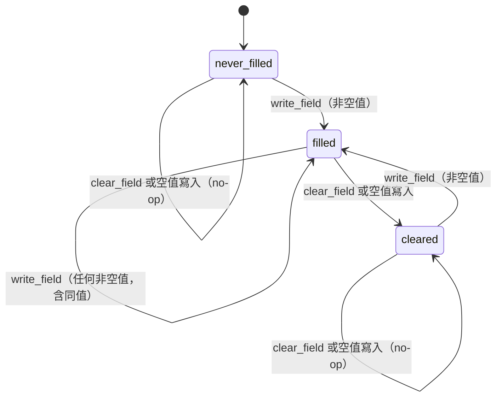
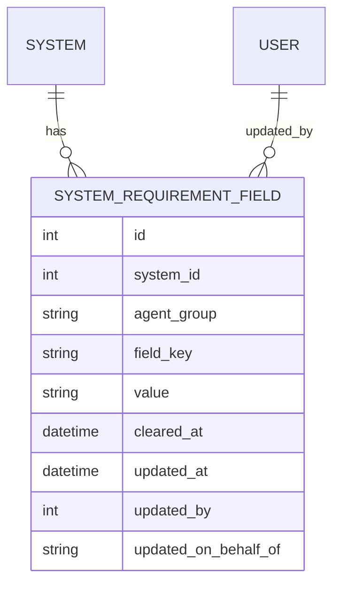

# Functional Spec — `U20 requirement-field-service`

> 本檔是工作流程與狀態轉移的**正式來源**。實體的資料形狀以 `entities.md` 的 YAML
> 為準、決策邏輯以 `rules.md` 的 YAML 為準；下方的 ER 圖與規則摘要是由它們**衍生**
> 的閱讀用視圖。
>
> 本站的四題定案：`[FD1]`=A（代寫者欄改記 agent 組識別字）、`[FD2]`=A（第一版兩組
> 七欄）、`[FD3]`=A（空值儲存視為清空）、`[FD4]`=A（專案成員即可讀寫，寫入另需
> 全域 `K4.edit`）。
>
> **Revision 1（審查 `review-01` 之後）**：審查回 NOT-READY（Major 2、Minor 6）。
> FD1 的代價在選項中揭露不足，已向使用者更正並重新取得裁決（問題檔 `FD1-R`=A）；
> 使用者裁決八項全部修進設計（`FD5`=A）。本站以「重跑本站」解鎖產出後修正，
> 審查額度已用完，修正後**未再送審**。逐項處置見第十一節。

## 一、單元邊界

| 項目 | 內容 |
|---|---|
| 擁有 | `RequirementFieldFacade`（唯一授權入口）、欄位定義常數、`system_requirement_fields` 的讀寫、一個新的 HTTP router |
| 不擁有 | 系統與專案的存在（`U7` 的 `HierarchyFacade`）、per-project 角色（`U19` 的 `MembershipFacade`）、權限矩陣（`U3`）、表的建立（`U18`，本單元只改一欄） |
| 消費者 | `U23 project-pages-ui`（HTTP）、`U13 brain-gateway`（同進程）、`U21 mcp-bridge`（獨立進程，經 HTTP） |
| 部署 | embedded：同一 FastAPI process 的新 router，prefix `/api/requirements` |

## 二、對外介面

### 2.1 Facade（同進程，契約 `K-17`）

| 方法 | 參數 | 回傳 | 例外 |
|---|---|---|---|
| `read_fields` | `principal, system_id` | `FieldSetView` | `RequirementFieldForbidden`、`RequirementFieldNotFound` |
| `write_field` | `principal, system_id: int, agent_group, field_key, value, on_behalf_of=None` | `FieldView` | 上列 ＋ `UnknownFieldKey`、`RequirementFieldValidationError` |
| `clear_field` | `principal, system_id: int, agent_group, field_key` | `FieldView` | `RequirementFieldForbidden`、`RequirementFieldNotFound`、`UnknownFieldKey` |

`system_id` 為整數，與 `HierarchyFacade.get_project_of_system(system_id: int)` 及
`systems.id SERIAL` 一致；`K-17` 字面寫 `str`，列入追認（`OPEN-RF20-5`）。

`principal` 一律由呼叫端傳入（`K-17` `identity_passing`）；facade 不自行從 request 取身分。

### 2.2 HTTP（`U23` 與 `U21` 的入口）

| 方法與路徑 | 對應 | 本體 | 成功 | 錯誤（皆顯式宣告於 `responses`，`BR46.1`） |
|---|---|---|---|---|
| `GET /api/requirements/systems/{system_id}/fields` | `read_fields` | — | 200 `FieldSetView` | 403、404 |
| `PUT /api/requirements/systems/{system_id}/fields/{agent_group}/{field_key}` | `write_field` | `{ value: string, on_behalf_of?: string \| null }` | 200 `FieldView` | 403、404、422 |
| `DELETE /api/requirements/systems/{system_id}/fields/{agent_group}/{field_key}` | `clear_field` | — | 200 `FieldView` | 403、404、422 |

- **沒有「只回計數」的端點**（`BR44.4`）。總覽籤與需求籤讀同一個 `GET` 的同一個回應。
- `DELETE` 回 200 與清空後的 `FieldView`，不回 204：清空不刪列（`ADR-015`），且呼叫端
  需要知道結果是 `cleared` 還是 no-op 後的 `never_filled`（`BR43.3`）。
- router 掛 `get_current_user` 取身分、以 `mint_principal` 鑄造 principal；**不掛**
  `require_story_action`（`BR41.2` 的理由）。

### 2.3 回應形狀（`FieldSetView`）

```
{
  systemId,
  unfilledCount,                      // BR44.2
  groups: [                            // BR44.6：依 displayOrder
    { groupKey, title, filledCount, totalCount,
      fields: [                        // BR44.5：恆等於宣告集合
        { groupKey, fieldKey, label, value|null, filledState, clearedAt|null,
          updatedAt|null, updatedBy|null, updatedOnBehalfOf|null } ] } ]
}
```

相對於 `K-17` 的 `returns` 字面，本站**加了** `title`、`label`、`filledCount`、
`totalCount` 四個欄位（純增量）。理由：組標題與欄位標籤是程式內定義的一部分，若只回
`fieldKey`，`U23` 就得在前端另抄一份標籤——那是 `team.md` 的「單一真實來源」規則禁止
的第二份物化。四欄須在下一輪契約修訂追認（`OPEN-RF20-5`）。

## 三、工作流程（正式來源）

### 3.1 共同前段：授權（`BR41.1`–`BR41.5`）

1. 若 `principal.is_approved` 為 false → `RequirementFieldForbidden(reason=pending)`，結束。
2. 全域層：讀需 `K4.view`、寫與清空需 `K4.edit`（`user_can`）；不過 → 拒絕並寫拒絕 log（`BR41.6`），結束。
3. `HierarchyFacade.get_project_of_system(principal, system_id)` 取得 `project_id`；
   查不到或 `HierarchyForbidden` → `RequirementFieldNotFound`，結束。
4. `MembershipFacade.resolve_project_role(principal, project_id)`；回 `None` → 拒絕並寫 log，結束。
5. 通過。之後才做任何驗證或資料存取。

### 3.2 讀取（`read_fields`）

1. 共同前段（action = view）。
2. **單一查詢**取該系統的全部 `system_requirement_fields` 列（`BR44.4`）。
3. 以定義為主迴圈：每個已宣告的 `(groupKey, fieldKey)` 在列中查表；無列 → `never_filled`，
   有列 → 依 `BR44.1` 推導 `filledState`（`BR44.5`）。定義外的列忽略（`BR44.3`）。
4. 由第 3 步的同一份明細計算每組 `filledCount`／`totalCount` 與全體 `unfilledCount`（`BR44.2`）。
5. 依 `displayOrder` 與宣告順序排序後回傳（`BR44.6`）。

### 3.3 寫入（`write_field`）

1. 共同前段（action = edit）。
2. 驗證 `agent_group` 已宣告（`BR42.1`）、`field_key` 在該組內已宣告（`BR42.2`）、
   `on_behalf_of` 為 null 或已宣告的組（`BR42.3`）。
3. `value` 去除首尾空白（`BR43.1`）。本體的型別錯誤同樣以領域例外的 422 回應、不回顯輸入（`BR46.4`）。
4. 若結果為空字串：
   - `on_behalf_of` 非 null（代寫路徑）→ `RequirementFieldValidationError`，該欄不變，結束（`BR42.5`）；
   - `on_behalf_of` 為 null（使用者經畫面）→ 轉入 3.4 的清空流程第 2 步起（`BR43.2`），結束。
5. 若長度 > 2000 → `RequirementFieldValidationError`，結束（`BR42.4`）。
6. 單一交易內以三欄唯一鍵 upsert：`value`、`clearedAt = null`、`updatedAt = now`、
   `updatedBy = principal.user_id`、`updatedOnBehalfOf = on_behalf_of`（`BR43.5`、`BR45.1`、`BR45.2`）。
7. 失敗即回滾，該欄維持原狀（`BR46.2`）；成功回 `FieldView`。

### 3.4 清空（`clear_field`，以及 3.3 第 4 步轉入者）

1. 共同前段（action = edit）；驗證組與 key（`BR42.1`、`BR42.2`）。
2. 讀該列：
   - 無列，或有列而 `value` 與 `clearedAt` 皆為 null（第四種列）→ no-op，回 `never_filled`（`BR43.3`、`BR44.1`）。
   - `value` 為 null 且 `clearedAt` 非 null → no-op，回現況（`BR43.4`）。
   - `value` 非 null → 單一 UPDATE：`value = null`、`clearedAt = now`、`updatedAt = now`、
     `updatedBy = principal.user_id`、`updatedOnBehalfOf = null`（`BR43.7`、`BR45.3`）。
3. 失敗即回滾（`BR46.2`）；成功回 `FieldView`（`cleared`）。

> 第 2 步「先讀再改」在兩個併發清空時兩者都會讀到 `filled`、都執行 UPDATE——結果仍是
> `cleared`，差別只在 `clearedAt` 是哪一個的時間。這是可接受的：兩者都是合法的清空者，
> 且資料不會進入非法狀態（`U18` 的 CHECK 約束擋得住「有值又已清空」）。

## 四、狀態機（每個 `(system, agentGroup, fieldKey)`）



文字 fallback：每個欄位初始為「從未填過」（無列）。寫入非空值進入「已填」；對「已填」
清空（或寫入空值）進入「已清空」；對「已清空」寫入非空值回到「已填」。對「從未填過」
與「已清空」清空都是 no-op。**沒有任何轉移回到「從未填過」**——列一旦建立就不刪
（`ADR-015`），這是「三態可區分」的代價，也是它的保證。圖中的「空值寫入」只指
使用者的寫入；代寫路徑的空值寫入被拒（`BR42.5`），不造成任何轉移。資料層另可能
出現「有列而值與清空時間皆為空」的第四種列（非本 facade 所能產生），一律視為
「從未填過」（`BR44.1`）。

## 五、ER 圖（由 `entities.md` 衍生）



文字 fallback：一個系統有零到多列需求欄位值；每列記錄最後寫入或清空它的使用者。
`updated_on_behalf_of` 是 agent 組識別字，**不連到任何表**（`[FD1]`=A）。欄位定義
（組與欄位）是程式內常數，不在圖上。

## 六、規則摘要（由 `rules.md` 衍生）

| 群 | 規則數 | 重點 |
|---|---|---|
| `BR41` 授權 | 6 | 待核准先拒 → 全域 `K4` → 系統存在 → 專案成員；先判定後存取 |
| `BR42` 驗證 | 5 | 組與 key 已宣告、錯綁別組即拒；代寫標示受限；長度上限；代寫路徑不得以空值清空 |
| `BR43` 值語意 | 7 | 去空白；使用者的空值即清空；兩種 no-op；單一 upsert |
| `BR44` 讀取與計數 | 6 | 三態推導對任何列有定義；同一次查詢推導明細與計數 |
| `BR45` 溯源 | 5 | 寫入者恆為本人；代寫標示只是標示 |
| `BR46` 錯誤 | 4 | 403／404／422 顯式宣告；不留半套；不洩原文（含框架的 422） |
| `BR47` 資料表 | 4 | 代寫欄改型、去外鍵；本機與 staging 可重跑收斂；欄位級斷言；ORM 模型與一致性測試 |
| **合計** | **37** | |

## 七、ADR-0006 四面向逐項判定

承 `unit-of-work.md` 修訂 4 的判定表（`U20` 列）與 `contract-summary.md` 的同名表，本表
**不重判適用性**，只寫本單元的落點；逐格比對上游判定欄，無一格相反。

| 面向 | 判定 | 本單元的落點 |
|---|---|---|
| **IAM** | 適用 | 兩層串聯（`BR41.2`＋`BR41.4`），per-project 判定委由 `U19` 唯一來源；待核准帳號先拒（`BR41.1`）；代寫標示不授予權限（`BR45.4`） |
| **Encryption** | 適用（不在本單元） | 上游的 encryption 落點是 `U21` 的工具 schema 白名單；本單元不經手 token，無新落點 |
| **Network exposure** | 適用（不在本單元） | 本單元是既有 FastAPI process 的新 router，**不新增進程邊界或對外埠**；上游的落點是 `U21` |
| **Audit logging** | 適用 | 清空留 `clearedAt`＋`updatedBy`（`BR43.7`）；寫入者恆為本人（`BR45.1`）；代寫溯源（`BR45.2`）；拒絕 log 不含值（`BR41.6`） |

**PBT hard constraint**：**不適用**——與上游一致（`unit-of-work.md` 修訂 4 與
`contract-summary.md:2147` 皆判「對欄位集合的直接計算，值域不廣到需要生成器」）。
本單元也不屬 `project.md` 點名的三個核心模組（IaC generator、cost calculator、agent routing）。

## 八、開放項與交接

| # | 事項 | 承接 |
|---|---|---|
| `OPEN-RF20-1` | **代寫標示可被自填**（`BR45.4`）：有寫入權的使用者能把自己的寫入標成「由大腦（某 agent）請求」。不影響授權，但標示本身無法證明真的是大腦發起 | `U21` 的 agent 身分機制（`OQ-15`）；`U13` 的同進程路徑 |
| `OPEN-RF20-2` | **同一欄位兩人同時編輯時，後存者靜默覆蓋前者**（`BR43.5`）。本輪不做樂觀並行控制 | 已知限制；`U23` 可在儲存成功後重讀以顯示最新值 |
| `OPEN-RF20-3` | **前端那一半的 `I-4`**：`U23` 的總覽籤與需求籤必須讀**同一次** `GET` 的結果，不得各發一次；**每次儲存或清空成功後，以重讀 `GET` 的結果同時更新兩籤，不得在前端以本地加減推算計數**（寫入回應只帶單一 `FieldView`、不帶 `unfilledCount`，本地推算會讓 `I-4` 在前端那一半悄悄失效） | `U23` 的 code-generation |
| `OPEN-RF20-4` | **組標題與欄位標籤以回應為準**：`U23` 不得在前端另寫一份標籤 | `U23` |
| `OPEN-RF20-5` | **契約追認**，與 `K-17` 字面的全部差異：① 回應形狀的四欄增量（`title`／`label`／`filledCount`／`totalCount`，2.3）；② `system_id` 為 `int`（`K-17` 寫 `str`）；③ `write_field` 多拋 `RequirementFieldValidationError`；④ `on_behalf_of` 由任意字串收窄為已宣告的 groupKey（`[FD1]`=A）；⑤ 全域層落在 facade（`BR41.2`）；⑥ 使用者的空值寫入即清空、代寫路徑的空值寫入被拒（`BR43.2`、`BR42.5`）。另 **`K-16` 的 `two_facade_layers.anti_double_check` 逐字寫「`U20` 不得重複呼叫 require_story_action（它的 router 已經做了）」，與 `BR41.2` 直接矛盾**，須一併改掉，否則 `U13`／`U21` 的實作者會依字面假設 router 已檢查 | 下一輪契約修訂，與 `U15` 的 `K-08` 追認同批 |
| `OPEN-RF20-6` | **`U18` 的 `OPEN-CG18-6` 由本站結案**（`[FD1]`=A，`FD1-R` 以完整代價重新確認），落地在本單元 code-generation（`BR47.1`–`BR47.4`），觸發 `schema_rbac.sql` ＋ `DEPLOY.md` 的 blocking 同步 | 本單元 code-generation |
| `OPEN-RF20-7` | **`U18` 的 `OPEN-CG18-7`（第四種列）由本站結案**：判定為「從未填過」，不新增 facade 守門（`BR44.1` 的 note） | 已結案 |
| `OPEN-RF20-8` | **`BR47.2` 的收斂敘述讓 `run_meta_schema_migration.py` 不再是純 DDL**：`K-15` 的 `observable_side_effects` 逐字「不含任何資料寫入」，型別轉換會重寫該欄（在無值的前提下不改變資料內容） | 本單元 code-generation 須在腳本輸出與 `DEPLOY.md` 2.2.9 如實描述 |

**`J-20`（清空沒有使用者入口）的狀態改變**：`[FD3]`=A 讓「刪光再儲存」等於清空，故
「已清空」態在使用者路徑上變得可達。`J-20` 要的「清空**控件**」仍不存在，本站不新增。

## 九、七項送審前自檢

| 自檢 | 結果 |
|---|---|
| **1 可達性** | ① `cleared` 態：經 `BR43.2` 在使用者路徑可達（原本只有 `U13`／`U21`）。② `BR41.1` 的待核准拒絕：待核准帳號能登入並取得 token（`user_router.py:422` 的登入回應帶 `authorization_status`，前端據以導向 `/waiting-approval`，`App.tsx:25`），故持 token 直打 API 可達。③ `BR44.3` 的「定義外的列」：第一版定義不會移除，故今天只能以測試直接插列構造——可達但需刻意構造，落點為 `TestClient` |
| **2 契約端點三問** | `SystemRequirementField`：寫＝`write_field`（`U23`／`U13`／`U21`）；讀＝`read_fields`（同三者）；清＝`clear_field`（`U13`／`U21` 經 `DELETE`）＋`BR43.2`（`U23` 經空值寫入）。**三問齊備**。欄位定義常數：寫＝程式碼；讀＝`read_fields` 與 `BR42` 驗證；清＝移除定義（`BR44.3` 規定其後果）。三個 facade 方法皆有具名消費端；`clear_field` 的消費端由兩個增為三個 |
| **3 引用逐字核對** | 已開檔核對：`schema_rbac.sql` 的 `system_requirement_fields` DDL 與六段 COMMENT（`updated_on_behalf_of INTEGER REFERENCES users (id)`、三欄唯一鍵、`ck_..._cleared_has_null_value`）；`membership_facade.py:93-111`（`_authorize_global` 以 `user_can` 評估、不走 dependency）；`hierarchy_facade.py:374`（`get_project_of_system`）；`rbac_seed_data.py:349-358`（`K4` 十一角色列）；`unit-of-work.md:308`、`:372-380`；`unit-of-work-story-map.md:216`；`contract-summary.md` 的 `K-17` 與 `:2147`；`U18` 的 `code-summary.md:116`（`OPEN-CG18-6` 指派本單元） |
| **4 檔案集合一致性** | `service` 單元應產出四份（`entities`／`rules`／`functional-spec`／`traceability`），與同為 `service` 的 `U19` 相同；`frontend-components` 只對 `ui` 適用，不產出 |
| **5 跨檔傳播** | 本輪的事實：四題答案、規則識別字區段 `BR41`–`BR47`、規則數 33、欄位定義兩組七欄。`entities.md` 原寫的五處規則編號已改為新區段並 grep 確認無舊編號殘留 |
| **6 可算的數字先算再寫** | 規則數由腳本自 `rules.md` 的 YAML 解析核對（Revision 1 後為 37：6＋5＋7＋6＋5＋4＋4）；欄位數 7、組數 2 自 `entities.md` 解析核對 |
| **7 ADR-0006 ＋ PBT** | 見第七節；逐格比對上游判定欄，無相反 |

## 十、Assumptions

- 值的長度上限 2000 字是本站依「人填的短文字」所定，上游無數字 [assumption]
- 欄位的 `fieldKey`（如 `peak_tps`）由本站命名，上游只有中文標籤 [assumption]
- 欄位值一律為自由文字，不依欄位做型別驗證（例如 TPS 不檢查是否為數字）：`K-17` 的
  `value: str` 與上游皆無型別要求，加型別驗證會讓定義多一層要維護的語意 [assumption]

## 十一、`review-01` 逐項處置（Revision 1）

| 發現 | 處置 | 落點 |
|---|---|---|
| `R-01` Major：`BR47` 影響面誤識、與 FD1 選項文字不一致 | 向使用者更正 FD1 的完整代價並重新取得裁決（`FD1-R`=A）；`BR47.1` 改列真正的部署資產並刪除「外鍵數 8→7」；`BR47.2` 收斂範圍擴到 staging、明定既有值轉 null；新增 `BR47.3`（欄位級斷言，並指出 `FORBIDDEN_FKS` 無法表達）與 `BR47.4`（ORM 模型、一致性測試、依方言的 upsert）；`OPEN-RF20-8` 記下與 `K-15`「不含資料寫入」的張力 | `rules.md`、本檔第八節、問題檔第五節 |
| `R-02` Major：`OPEN-CG18-7` 第四種列零提及 | `BR44.1` 改為對任何列皆有定義（第四種列視為從未填過）；`BR43.3` 涵蓋它；3.4 步驟 2 與狀態機文字同步；`OPEN-RF20-7` 結案 | `rules.md`、`entities.md`、本檔 3.4／第四節 |
| `R-03` Minor：追認清單不完整、`K-16` 字面矛盾 | `OPEN-RF20-5` 補齊六項差異與 `K-16` 的矛盾；`FieldView` 補回 `clearedAt`（與 `K-17` 字面一致，少一項偏離） | 本檔 2.1／2.3／第八節、`entities.md` |
| `R-04` Minor：「不洩漏存在性」理由不成立 | `BR41.3` 改寫為實際行為並明列 `K2.view` 為隱含前置；維持 `K-17` 的 Forbidden | `rules.md` |
| `R-05` Minor：框架 422 回顯輸入 | 新增 `BR46.4`；3.3 步驟 3 同步 | `rules.md`、本檔 3.3 |
| `R-06` Minor：agent 空值寫入靜默清空 | 新增 `BR42.5`（代寫路徑空值寫入被拒）；`BR43.2` 收窄為使用者寫入；3.3 步驟 4 分兩支 | `rules.md`、本檔 3.3 |
| `R-07` Minor：儲存後的計數更新 | `OPEN-RF20-3` 補「儲存後重讀、不得本地推算」 | 本檔第八節 |
| `R-08` Minor：兩條 AC 只覆蓋資料層 | `traceability.json` 的兩條 note 首句明寫部分覆蓋與畫面層的承接者 | `traceability.json` |

**未再送審**：本站審查額度（advisory，1 次）已用完。上表修正未經獨立複驗，閘門上
應視為「作者自述已修」。
