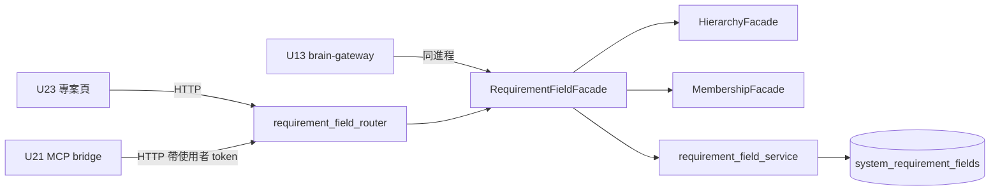

# 邏輯元件 — `U20 requirement-field-service`

## 一、元件清單

| 元件 | 職責 | 失效範圍 |
|---|---|---|
| `requirement_field_definitions`（程式內常數） | 兩組七欄的定義與顯示文字；組、key、代寫組的白名單來源 | 改動即改變白名單與計數，屬程式碼變更 |
| `RequirementFieldFacade` | 唯一授權入口（`BR41`）、驗證（`BR42`）、值語意（`BR43`）、讀取合成（`BR44`） | 單一請求 |
| `requirement_field_service`（資料存取） | 一次讀取、upsert、條件式清空；依方言產生敘述 | 單一請求 |
| `requirement_field_router` | 三個 HTTP 路由、本體模型（`extra="forbid"`）、本 router 範圍的錯誤形狀處置 | 單一請求 |
| `SystemRequirementField` ORM 模型 | 對應 `U18` 的表；與 DDL 的一致性由測試鎖住（`BR47.4`） | — |
| `J)` 區塊收斂敘述 | `updated_on_behalf_of` 的型別收斂（條件式、可重跑） | 部署期一次；失敗即大聲失敗 |

## 二、依賴與邊界

文字 fallback：專案頁與 MCP bridge 經 HTTP 進入 router，大腦閘道同進程直接呼叫 facade；
facade 經 `HierarchyFacade` 取得系統所屬專案、經 `MembershipFacade` 取得 per-project 角色，
再經資料存取層讀寫 `system_requirement_fields`。

- **同進程入口不經 router**：故全域 `K4` 檢查必須在 facade（`BR41.2`），router 不掛
  `require_story_action`。
- **不得繞過 facade**：`U13`／`U21` 不得直接使用資料存取層或直讀表——與 `U7`／`U19` 的同一
  殘留缺口一樣，此約束無機械強制（`J-19`），靠 code review。

## 三、共享資源與爆炸半徑

| 共享資源 | 本單元的使用 | 爆炸半徑 |
|---|---|---|
| PostgreSQL 主 schema | 一張表的讀寫；部署期一次型別收斂 | 收斂敘述取 `ACCESS EXCLUSIVE` 鎖只發生在欄位仍為舊型別時，表內實際無代寫值，時間可忽略 |
| `role_permissions` | 唯讀（`user_can`） | 無 |
| 既有 FastAPI 進程 | 新 router | 本 router 的例外只影響自身請求；錯誤形狀處置只掛在本 router，不改全域 handler |

## 四、開放項（本站新增）

| # | 事項 | 承接 |
|---|---|---|
| `OPEN-RF20-9` | 欄位填寫提示「請勿填入密碼、金鑰或個人資料」需由 `U23` 顯示 | `U23` |
| `OPEN-RF20-10` | 新 parent id `NFR20` 不在 inception 的 `requirements.md`（承 `nfr-requirements` 審查 `review-01` R-05）；`performance-requirements.md` 檔頭寫的命名理由「比照 `U19` 以單元號命名」不精確——`U19` 用的是下一個空的整數。需在下一輪需求修訂回補 `NFR20` 的定義 | 下一輪 `requirements-analysis` 修訂（與 `U19` 的同類回補同批） |
