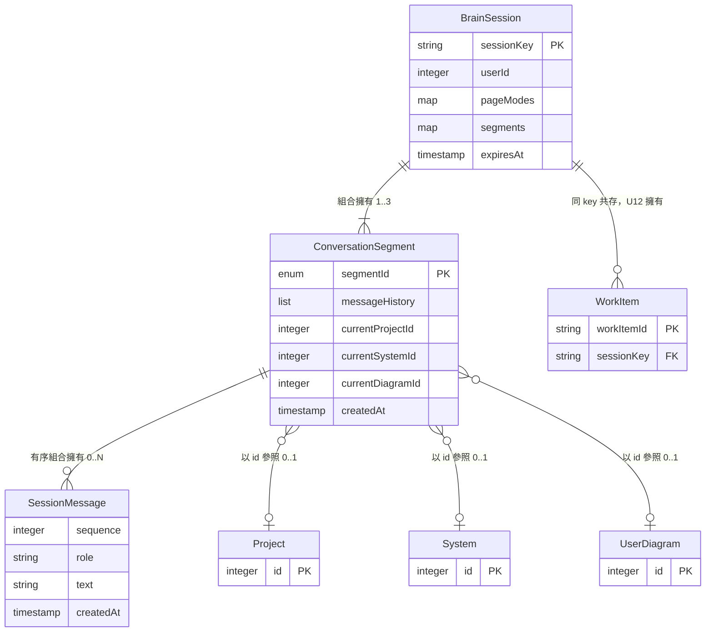

# Functional Specification — `U10 session-store`

> **本檔是工作流程與狀態轉換的唯一真實來源。** `entities.md` 管資料形狀、
> `rules.md` 管決策邏輯——兩者都表達不了「順序」與「轉換」，那是本檔的職責。
> 本檔另帶兩個**衍生**視圖（實體關係圖、規則摘要），它們的真實來源在那兩份檔。
> 技術無關：不含程式、SQL 或框架名稱。

## 零、本站的三項定案（下游一切敘述的前提）

| 題 | 定案 | 一句話後果 |
|---|---|---|
| `[S1]` | **A — 獨立對話為「逐頁」** | `sharingMode` 由 session 層的單一欄位改為 `pageModes`（`/workspace`、`/assessment` 各一），入口頁恆讀共享段 |
| `[S2]`（`OQ-1`） | **A — 保留且可重入** | 切回共享不刪獨立段；再次切到獨立回到**同一段** |
| `[S3]` | **A — 作業對象也分段** | 三層作業對象由 session 層下沉到段層，每段各一組 |

三者合起來給出一個簡單的形狀：**一個 session、至多三段、每段自帶歷程與作業對象、
每頁指向自己要讀的那一段。**

**本檔服務的五則故事**（`unit-of-work-story-map.md:115` 逐字
`| U10 session-store | US2.1、US2.2、US3.1、US6.1、US9.1 | 5 |`）與它們的需求來源
（`requirements.md:125` 的 `FR2.1`、`:133-137` 的 `FR3.1`–`FR3.3`、`:182` 的 `FR6.1`、
`:500-504` 的 `NFR4`）。`components.md:95-129` 的 `SessionContext` 宣告是元件層的前身，
`contract-summary.md:684-742` 的 `K-09` 是對外契約。**本檔的工作流程逐步對應這五則故事，
沒有任何一條流程服務於它們之外的需求**——這是範圍自檢，不是裝飾。

---

## 一、工作流程

每一步都標出它受哪一條 `BRx.y` 約束。`U13`／`U11`／`U12` 的步驟只為了讓順序完整，
**它們不是本單元的交付物**。

### W1 — 連線建立與初始狀態推送

| # | 執行者 | 動作 | 規則 |
|---|---|---|---|
| 1 | `U13` | 握手成功，以已驗證使用者 id 推導 session key | `BR1.1` |
| 2 | `U13` | 呼叫 `load(session_key)` | — |
| 3 | **本單元** | key 不存在 → 回「無」；存在 → 回整個 `BrainSession`（全部段、全部頁面模式） | `BR1.6`、`BR7.1` |
| 4 | **本單元** | 無論哪一種結果都續期 TTL | `BR1.3` |
| 5 | `U13` | 回「無」時建立新 session：只含 `shared` 段，`pageModes` 兩鍵皆 `shared`，作業對象三層皆未選定 | `EC1`、`EC2`、`BR7.2` |
| 6 | `U13` | 推送 `pageModes` 的**每一鍵**與**每一個存在段**的作業對象，各帶識別 | `BR7.3` |
| 7 | 客戶端 | 取屬於自己那一頁的那一則，其餘忽略 | `BR2.7` |

**第 6 步是本站把上游擴寬的地方**：`x-concurrent-connections.on_connect` 原文是推送
「當前 `work_target` 與 `sharing_mode`」（**各一個**）。逐頁模式之下「當前」這個詞
不再唯一，故改為逐鍵／逐段推送。這不改變扇出的對象（仍是該 key 的全部存活連線），
只改變訊息的數量與其識別欄位。

### W2 — 在共享段送出一則訊息

| # | 執行者 | 動作 | 規則 |
|---|---|---|---|
| 1 | 客戶端 | 自入口頁、`/workspace` 或 `/assessment` 送出使用者訊息 | — |
| 2 | `U13` | 解析該頁當前讀哪一段：入口頁恆為 `shared`；其餘頁查 `pageModes[P]` | `BR2.2` |
| 3 | `U13` | 以**該段識別**呼叫 `append_message` | `BR3.1` |
| 4 | **本單元** | 追加到該段尾端，`sequence` 遞增 | `BR3.3` |
| 5 | **本單元** | 若該段筆數超過上限，自該段最舊端丟棄到等於上限 | `BR3.4` |
| 6 | **本單元** | 續期 TTL | `BR1.3` |
| 7 | `U11` | 讀**該段**歷程與**該段**作業對象以解析指涉詞 | `BR3.2`、`BR4.1` |

### W3 — 首次切到獨立對話

| # | 執行者 | 動作 | 規則 |
|---|---|---|---|
| 1 | 客戶端 | 在 `/workspace` 或 `/assessment` 按下「改為獨立對話」 | — |
| 2 | `U13` | 以**頁面識別**呼叫 `set_sharing_mode(P, isolated)` | `BR2.3` |
| 3 | **本單元** | 範圍若為入口頁 → 拒絕 | `BR2.2` |
| 4 | **本單元** | `segments[P]` 不存在 → 建立，並**逐欄複製**共享段當下的三個作業對象值（含 `null`） | `BR2.4`、`BR4.2` |
| 5 | **本單元** | 不重跑 `K-07` 驗證——複製來源是已驗證過的共享段值 | `BR4.7` 的逐字例外 |
| 6 | **本單元** | 寫 `pageModes[P] = isolated`；**其餘頁面不動** | `BR2.3` |
| 7 | `U13` | 送出帶範圍 `P` 的模式狀態訊息給該 key 的**全部**存活連線 | `BR2.7` |
| 8 | 入口頁客戶端 | 範圍不是自己 → 忽略，畫面不變 | **`AC3.1.1` 在此滿足** |

### W4 — 重入既有的獨立段（`[S2]`=A 的核心）

| # | 執行者 | 動作 | 規則 |
|---|---|---|---|
| 1 | 客戶端 | 在同一頁再次按下「改為獨立對話」 | — |
| 2 | **本單元** | `segments[P]` 已存在 → **原樣重入**：不清空歷程、不重設作業對象、不新建第二段 | `BR2.4`、`EC4` |
| 3 | **本單元** | 寫 `pageModes[P] = isolated` | `BR2.3` |
| 4 | `U13` | 推送該段的歷程指標與作業對象，帶段識別 | `BR7.3` |

**為什麼不需要「找回上一段」的查找邏輯**：段識別就是頁面名（`EC4`），故「要回去的
那一段」由構造唯一決定。

### W5 — 切回共享對話

| # | 執行者 | 動作 | 規則 |
|---|---|---|---|
| 1 | 客戶端 | 按下「切回共享對話」 | — |
| 2 | `U13` | 呼叫 `set_sharing_mode(P, shared)` | `BR2.3` |
| 3 | **本單元** | 只改 `pageModes[P] = shared`；`segments[P]` **原樣保留** | `BR2.5` |
| 4 | **本單元** | **不**把獨立段的訊息併入共享段——沒有這條路徑 | `BR2.6` |
| 5 | 客戶端 | 該頁改讀共享段：歷程與作業對象**都**回到離開時的值 | `BR4.4`，**`AC3.1.4` 的兩個子句在此滿足** |

**第 5 步是 `[S3]`=A 的全部理由**。若作業對象仍是 session 層的單一組，使用者在獨立段
改過它之後，第 5 步只能還原歷程那一半，`AC3.1.4` 的 Then 就有一半不成立。

### W6 — 設定作業對象

| # | 執行者 | 動作 | 規則 |
|---|---|---|---|
| 1 | 客戶端 | 在脈絡元件選定專案／系統／架構圖 | — |
| 2 | `U13` | 以該連線的 principal ＋ **段識別**呼叫 `set_work_target` | `BR4.3`、`BR5.2` |
| 3 | **本單元** | 呼叫 `K-07` 的 `HierarchyFacade.resolve_work_target` 解析三層 | `BR4.6` |
| 4 | `K-07` | 目標不屬請求者 → 回「查不到」；無權限 → `HierarchyForbidden` | `BR4.6` |
| 5 | **本單元** | 例外**原樣向上傳遞**，不轉譯、不吞掉 | `BR4.6`、`BR5.1` |
| 6 | **本單元** | 解析成功 → 把結果**原樣**寫進該段的三個欄位，含 `null` 的那幾層 | `BR4.5`、`EC7`、`EC8` |
| 7 | **本單元** | 續期 TTL | `BR1.3` |
| 8 | `U13` | 送出帶段識別的作業對象狀態訊息給該 key 的全部存活連線 | `BR2.7` |

**第 6 步的「含 `null`」是刻意的**，不是容錯：見 `EC7` 引述的
`hierarchy_service.py:261-273` 實測行為與 `OPEN-H11`。

### W7 — TTL 到期後再次進入

| # | 執行者 | 動作 | 規則 |
|---|---|---|---|
| 1 | — | 24 小時無任何互動，key 到期 | `BR1.3` |
| 2 | — | 全部段、全部歷程、全部作業對象、頁面模式與同 key 的工作項集合**一起**消失 | `BR1.4` |
| 3 | 使用者 | 再次進入 → `load` 回「無」 | `BR1.6` |
| 4 | `U13` | 建立全新 session：作業對象回到未選定、兩頁模式皆 `shared` | `BR7.2` |

**這條流程是「尚未選定」這個狀態的可達性證明**（`AC2.2.3`）：若沒有 `BR1.4`，
該狀態就只在每個使用者的第一次使用時可達一次。

### W8 — Redis 不可用

| # | 執行者 | 動作 | 規則 |
|---|---|---|---|
| 1 | 任一呼叫方 | 呼叫 `K-09` 的任一方法 | — |
| 2 | **本單元** | Redis 連線或指令失敗 | — |
| 3 | **本單元** | `raise SessionBackendUnavailable` 向上傳遞 | `BR6.1` |
| 4 | **本單元** | **不**回傳空的 `BrainSession`、**不**退回行程記憶體、**不**以未選定狀態繼續 | `BR6.1`、`BR1.2` |

**第 4 步要防的是本單元最危險的無聲失敗**：回一個空 session 會讓畫面看起來「只是
脈絡被清掉了」，而那與 `W7` 的 TTL 到期**在使用者眼中完全相同**——一個是正常行為、
一個是基礎設施故障，兩者不可區分即等於故障不可偵測。

---

## 二、狀態機

### 2.1 每頁的共享模式（`/workspace` 與 `/assessment` 各一份）

```
          set_sharing_mode(P, isolated)
   ┌────────┐ ─────────────────────────▶ ┌──────────┐
   │ shared │                            │ isolated │
   └────────┘ ◀───────────────────────── └──────────┘
          set_sharing_mode(P, shared)
```

- **初始狀態**：`shared`（`W1` 第 5 步）。
- **入口頁沒有這張狀態機**——它恆為 `shared`，而「恆為」不是狀態機的一個狀態，
  是沒有狀態（`BR2.2`）。
- **兩次轉換的不對稱處**：`shared → isolated` 可能**建立**一個段（首次，`W3`）
  或**不建立**（重入，`W4`）；`isolated → shared` **永遠**不刪段（`BR2.5`）。
- **TTL 到期不是這張狀態機的轉換**——它把整個 session 連同狀態機一起移除（`BR1.4`）。

### 2.2 Session 的生命週期

```
  （不存在）──load 回「無」＋首次寫入──▶（存活）──TTL 到期──▶（不存在）
                                          │  ▲
                                          └──┘
                                     任一方法呼叫：續期
```

- **只有兩個狀態**，而「不存在」與「已到期」是**同一個**狀態——這是 `ADR-005`
  選擇單一 key ＋ TTL 的直接後果，也是它拒絕「分成兩個 key」的理由（會出現
  「常駐區空了但脈絡列還在」的第三個中間態）。
- **沒有「顯式清除」這條轉換**（`BR1.5`）。

### 2.3 段的生命週期

```
  （不存在）──該頁首次切到 isolated──▶（存在）──TTL 到期──▶（不存在）
                                        │  ▲
                                        └──┘
                               切回 shared／再切到 isolated：狀態不變
```

- `shared` 段是例外：它在 session 建立時就存在，從不「不存在」（`EC1`）。
- **沒有「被刪除」這條轉換**，也**沒有「被併入共享段」**這條（`BR2.5`、`BR2.6`）。

---

## 三、衍生視圖：實體關係圖

> **衍生自 `entities.md`，該檔的 YAML 是真實來源。** 本圖若與它不一致，以它為準。
> 語法已以 Mermaid 實際算繪驗證通過（非目視檢查）。



**文字 fallback**（`team.md` 要求 Mermaid 一律附）：

- `BrainSession`（主鍵 `sessionKey`）**組合擁有** 1 至 3 個 `ConversationSegment`。
  組合的意思是段不能脫離 session 存在，且 TTL 到期時一起消失。
- 每個 `ConversationSegment`（主鍵 `segmentId`，值域 `shared`／`workspace`／
  `assessment`）**有序組合擁有** 0 至 N 則 `SessionMessage`。
- 每個 `ConversationSegment` 各自**以識別碼參照** 0 或 1 個 `Project`、
  0 或 1 個 `System`、0 或 1 個 `UserDiagram`——三者皆由 `U7 hierarchy-service`
  擁有，本單元只存 id 不存物件。三個參照**彼此獨立**，允許部分為空（`EC7`）。
- `BrainSession` 與 0 至 N 個 `WorkItem` **共用同一個 Redis key**，但 `WorkItem`
  的形狀與狀態機由 `U12 work-orchestrator` 擁有；本單元只保證同生共死。

**圖上刻意沒有的兩條邊**：`ConversationSegment` 之間**沒有**任何關係
（`BR2.6`：兩段永不合併），`SessionMessage` 與 `UserDiagram` 之間**沒有**關係
（訊息不持有產出物的參照——這正是 `OPEN-S10-1` 的缺口所在，見 §五）。

---

## 四、衍生視圖：規則摘要

> **衍生自 `rules.md`，該檔的 YAML 是真實來源。** 條數與分佈表由腳本自該檔實算，
> 本節只做導讀，不重述數字。

| 群組 | 它回答的問題 | 下游最常踩到的那一條 |
|---|---|---|
| `BR1.x` session 身分與存活期 | 誰產生 key、狀態放哪、什麼時候消失 | `BR1.6`——載入不存在的 key 回「無」而**不是**錯誤 |
| `BR2.x` 段與共享模式 | 誰能切、切了之後誰受影響、段何時建立 | `BR2.7`——扇出對象**不變**，變的是 payload 多一個識別欄位 |
| `BR3.x` 對話歷程 | 訊息寫到哪一段、讀得到哪些、上限怎麼算 | `BR3.5`——上限參數缺值時**不得**以「無上限」啟動 |
| `BR4.x` 作業對象 | 掛在哪一層、誰驗證、缺層怎麼辦 | `BR4.7`——每段各自驗證，`[S3]`=A 自己製造出來的 IAM 面 |
| `BR5.x` 授權委派與暴露面 | 本單元判不判權、取不取身分、對不對外 | `BR5.1`——本單元**不自行判權**，一條都不加 |
| `BR6.x` 失效行為與冪等 | 壞掉時怎麼辦、哪些能重試 | `BR6.1`——Redis 不可用時**不得**回空 session |
| `BR7.x` 重啟還原與可達狀態 | 重啟後還在不在、「未選定」是不是死碼 | `BR7.3`——連線建立時推送**每一段／每一頁**，不是各推一個 |

---

## 五、具名缺口（本站查出、本站不自行關閉）

### `OPEN-S10-1`（**會讓一條 Must 的 AC 目前不可滿足**）

**缺口**：`AC6.1.1` 逐字「**Given** 第一輪已產出一張架構圖，**When** 我第二輪說
『把那張圖的資料庫換成 Aurora』，**Then** 系統作用在**該張**圖上，**不需我重新指定**」。
要滿足它，`U11` 必須能從某處讀到「第一輪產出的那張圖是哪一張」。本單元提供兩個
可能的落點，而**兩個目前都沒有寫入端**：

| 落點 | 現況 | 為何不成立 |
|---|---|---|
| 該段的作業對象 | 只有 `U13` 在收到客戶端的 `set_work_target` 訊息時寫（`contract-summary.md:307`／`:311` 是唯一的寫入敘述） | 第一輪**產出**那張圖，使用者不可能事先選它 |
| 該段的歷程 | `SessionMessage` 只有 `role`／`text`（`K-09.append_message` 逐字 `role: str, text: str`） | 沒有任何欄位承載產出物的識別碼 |

**具體修法與落點**：由**產生該架構圖的單元**在產出成功後，以該段識別呼叫
`set_work_target` 把新圖設為該段的作業對象。該單元是 `U12 work-orchestrator`
（它擁有「呼叫既有 A1／A3／C1 能力並轉譯其回應與狀態事件」，`components.md:151`——該行是 `WorkOrchestrator.responsibilities` 的第四項；同檔 `:153-155` 另宣告 `depends_on: SessionContext`，`interaction` 逐字「工作項集合隨 session 存放；**讀作業對象決定交辦目標**」，`style: sync`），
且 **`unit-of-work-dependency.md` 已有 `work-orchestrator.depends_on: [session-store, …]`
這條邊——不需要新增 DAG 邊**，故不觸發 `contract-summary.md:1432` 對 `OQ-N3` 設下的
「新邊須送 `delivery-planning`」那條要求。

**承接站**：`U12 work-orchestrator` 的 `functional-design`（3.1，CONDITIONAL、per-unit）。
**已查證它在游標之後**：`construction/` 目錄下尚無 `work-orchestrator/`，該單元一站未跑。
CONDITIONAL 的轉移目標為 `U12` 的 `code-generation`（3.5，**ALWAYS**）。

**為什麼不在本站直接關掉**：寫入端在 `U12`，而本站若逕自替 `U12` 決定「產圖後就改
作業對象」的副作用（使用者的脈絡列會自己動），那是 `U12` 的行為設計，不是本單元的。
本站能做、也已經做的是**讓這個缺口是可關的**：`BR4.3` 讓 `set_work_target` 帶段識別，
`BR6.2` 保證它冪等，所以 `U12` 重試也安全。

**被否決的替代修法**：在 `SessionMessage` 上加一個產出物參照欄位。否決理由是
它會讓本單元開始解讀訊息的語意（哪一則訊息「產出了」東西），而 `EC10` 與
`BR3.3` 把本單元對歷程的責任嚴格限制在「保存與排序」。

### `OPEN-S10-2`（**本站推翻了一句已核可的契約敘述**）

`x-session-key-derivation.why_one_key.therefore` 逐字「同一個 key、**同一組**
`currentProjectId`／`currentSystemId`／`currentDiagramId`」，而 `[S3]`=A 把它們
下沉到段層。`OQ-N4` 逐字授權的是 `U10` 的 `data_shape`，**形式上涵蓋**這個改動；
但 `OQ-N4` 的敘述只點名 `messageHistory`，**沒有點名作業對象**——所以這一半是本站
自行查出並定案的，不是上游交代的。如實記為推翻而非沿用，**不回改上游檔案**
（`refined-mockups:c3` 的形狀）。

### `OPEN-S10-3`（**超出授權、須另立 ADR**，即 `D-S10-1`）

`[S1]`=A 與 `[S3]`=A 要求 `K-02` 的四個 payload 各加一個識別欄位。`K-02` 由
`U2 brain-ws-contract` 擁有且**已施工完成**，`OQ-N4` 的授權只涵蓋 `U10`。
詳見 §六。

---

## 六、`D-S10-1`：`K-02` 的最小改動集與 `ADR-0020`

**改動集（逐欄，刻意求最小）**：

| payload | 方向 | 新增欄位 | 值域 |
|---|---|---|---|
| `SharingModePayload` | 伺服器→客戶端 | `scope` | `workspace`｜`assessment` |
| `SetSharingModePayload` | 客戶端→伺服器 | `scope` | `workspace`｜`assessment` |
| `WorkTargetPayload` | 伺服器→客戶端 | `segment` | `shared`｜`workspace`｜`assessment` |
| `SetWorkTargetPayload` | 客戶端→伺服器 | `segment` | `shared`｜`workspace`｜`assessment` |

**三件刻意不動的事，以及為什麼**：

1. **不動握手（`hello`）**。另一個設計是讓連線在握手時宣告自己屬於哪一頁，伺服器
   據此只把訊息送給同頁的連線。那會**改動扇出規則本身**
   （`x-concurrent-connections.state_change_fanout` 逐字「推送給該 key 的**全部存活
   連線**」），並讓伺服器開始以連線為狀態單位——而同一條逐字接著說「伺服器不以連線
   為狀態單位」。改 payload 讓客戶端自行過濾，兩條逐字都不動。
2. **不動扇出規則**。同上。`BR2.7` 把這一點寫成規則而非留給實作。
3. **`scope` 不含入口頁**。入口頁恆為 `shared`（`BR2.2`），它的模式是常數，
   常數不需要狀態訊息。

**為什麼這需要 ADR 而不是逕自改**：`project.md` 禁止下游逕自修改已核可上游產出；
而 `U2` 不只是已核可，是**已施工**（`backend/services/brain_ws_contract.py` 已存在，
且 `NFR5` 要求的前後端契約閘門會對它的改動發出 CI 訊號）。

**先例**：`brain_ws_contract.py:94-95` 逐字記載
「`select_clarify_candidate` 為 `functional-design` 審查 R-02 新增（`AC1.2.2`／
`AC1.2.3` 在原契約下傳輸面不可構造——五個既有 type 沒有一個能承載候選的 id）。
**此擴充超出 `K-02` 的條款，由 `ADR-0019` 作為上游追認的載體。**」
本次是**同型**的事：已核可 AC 在原契約下不可構造，故擴充契約並以 ADR 追認。

**編號**：下一個可用號為 **`ADR-0020`**（全樹已占用至 `0019`，且 `0019` 已被兩個
intent 各用一次——`260920-orchestration-brain` 與 `261001-a2-langgraph`。本站**不**
沿用 `0019`）。

**ADR 的撰寫落點**：`inception/decisions/`（`project.md ## Mandated` 逐字
「架構級決策開 ADR 於 `<record>/inception/decisions/NNNN-*.md`」）。**本站不寫它**
——本站是 construction 的 per-unit 站，而 ADR 屬 inception 層的產物；本站的責任是
**指名它必須存在、說清楚它要追認什麼、並確認承接站有效**。

**承接站**：`U13 brain-gateway` 與 `U2 brain-ws-contract` 的 `code-generation`
（3.5，**ALWAYS**）。`U13` 尚未施工（`construction/` 下無 `brain-gateway/`），
故它是**游標之後的有效站**；`U2` 已完成，其改動須以新的一輪 `code-generation`
或由 `U13` 的那一輪一併承載——**這個選擇本站不代決**，列為下游的第一個決定。

---

## 七、ADR-0006 Security Baseline 四面向（第七項自檢）

`project.md` 逐字要求「對每一項變更檢查 ADR-0006 security baseline 的四個面向」，
且「涉及 IAM／權限矩陣／網路暴露／稽核記錄的變更，須在該 stage 產出中明列 security
影響與處置，不得僅以『已有 ADR-0006』帶過」。**逐格填，不留空白。**

| 面向 | 判定 | 本單元的落點與處置 |
|---|---|---|
| **IAM** | **適用（本單元最重的一面）** | ① 本單元**不自行判權**（`BR5.1`），作業對象的授權一律委派 `K-07`（`BR4.6`）——`hierarchy_facade.py:277-281` 逐字「這是**同進程**路徑，**沒有任何 router 層會替它補上範圍檢查**」，故這條委派是唯一的防線。② **`[S3]`=A 製造了一個新的 IAM 面**：作業對象由一組變成每段一組，若驗證仍只跑一次就會有 N−1 組未驗的值——`BR4.7` 關閉它，並把唯一的例外（`BR4.2` 的初始化路徑，來源是已驗證的共享段值）逐字寫出，不留給實作推測。③ 本單元不讀 `role_permissions`、不呼叫 `require_story_action`、不新增任何 story id。 |
| **Encryption** | **適用（有增量）** | 本單元是 Redis 這個**新儲存體**的唯一使用者，而它持有的是**個人對話內容**。憑證以 ACL 使用者承載（`deploy/render-env.sh:121-123` 的 `REDIS_URL`／`REDIS_USER`／`REDIS_PASSWORD`），`K-01` 逐字要求 `REDIS_PASSWORD` **不得含 `$`**（compose 會對 `--env-file` 的值內插並無聲截斷）且須以 `openssl rand -hex 32` 產生。傳輸落在 compose 內部網路。**不寫「不適用」。** |
| **Network exposure** | **適用（零增量）** | 本單元是 `in-process` 契約，`BR5.3` 禁止它暴露任何 HTTP 或 WebSocket 端點；對外一律經 `U13` 的既有端點。Redis 服務由 `U1` 建立且 `K-01` 逐字 `exposure: compose 內部網路only；不得 publish port`——本單元**不新增**任何暴露面，但它是第一個真正使用那個服務的單元，故該約束自本單元起才有實際後果。 |
| **Audit logging** | **適用** | ① **本單元刻意不寫任何稽核列**，這是宣告而非遺漏：session 狀態 24 小時即消失（`BR1.4`），它與記憶層的稽核是兩件事（`ADR-016` 逐字 session 層 vs 內容層）。② 帳號活動稽核（`users.last_activity_at`）由 `U13` 的握手以 `record=True` 承擔（`K-12` 的 `activity_record` 逐字），**本單元不重複**。③ **反向的稽核義務是禁令**：`BR3.6` 與 `EC6` 禁止對話內容進入任何 log——本 repo 為 public 且 Actions log 公開可讀。 |

**四面向皆適用，無不適用項。**

### Property-based testing hard constraint 的逐項判定

`ADR-0006` 逐字點名三個落點：IaC generator、cost calculator、agent routing。
**本單元不是其中任何一個**，故該 hard constraint 對本單元為 **N/A（非豁免、非違反）**。

**但本單元有一個自然的 PBT 標的，列為自發實踐的候選**（`team.md` 記載 repo 既有
13 個 `@given` 皆落在純函式模組，屬自發良好實踐）：`BR3.4` 的**上限修剪**是一個純
函式（輸入：訊息序列 ＋ 上限；輸出：修剪後序列），其性質可機械表述——
① 輸出長度永不超過上限；② 輸出是輸入的**後綴**（丟的一定是最舊的）；
③ 輸入長度已 ≤ 上限時輸出與輸入相同。**本站只指出它適合，數值與是否採用由
`nfr-requirements`（下一站）與 `code-generation` 決定。**

---

## 八、送審前自檢（六項＋第七項）逐項報告

`project.md` 逐字要求「在派 reviewer 之前跑完六項送審前自檢，並在 stage summary
**逐項報告結果**（blocking，未報告不得派工）」，另加本 intent 自己加的第七項。

| # | 自檢項 | 結果 |
|---|---|---|
| 1 | **可達性**——每條「偵測 X 狀態」的規則先驗 X 可達 | **通過，且查出一項**。`BR7.2`（「尚未選定」可達）的可達路徑逐步驗過：`W7` 第 4 步。反向也驗了：若沒有 `BR1.4` 的整體到期，該狀態只在首次使用可達一次——`ADR-005` 的 Consequences 已逐字記載這一點。另驗 `EC3`（`isolated` ⇒ 段存在）：`W3` 第 4 步先建段再改模式，順序保證它恆成立。 |
| 2 | **契約端點三問**（每個欄位誰寫／誰讀／誰清；每個方法誰擁有／誰呼叫），**範圍是整個 stage 的全部產出** | **未全部通過——查出 `OPEN-S10-1`**。逐欄跑的結果見下表。 |
| 3 | **引用逐字核對**——每個來源標籤開檔驗證 | **通過，含定位驗證**。見下方「引用核對明細」。 |
| 4 | **檔案集合一致性**——同類單元之間 diff 產出檔清單 | **通過**。與 `memory-service`／`hierarchy-service` 兩個 `service` kind 單元逐一比對：四個 produces 齊備（`entities.md`／`rules.md`／`functional-spec.md`／`traceability.json`），無 `frontend-components.md`（本單元零前端面，`produces_kinds` 給 `frontend-components` 的 kind 是 `ui`，本單元 kind 為 `service`）。 |
| 5 | **跨檔傳播**——列出改動的**事實**，每個事實用它的幾種表達形式各 grep 一次 | **通過**。見下方「跨檔傳播明細」。 |
| 6 | **可算的數字先算再寫** | **通過**。`rules.md` 的條數、群組分佈與類別分佈**全部由腳本自該檔的 YAML 解析產生**並直接寫入該檔，本檔與 `traceability.json` 的計數同樣由腳本輸出（見摘要）。本檔**不手寫任何條數**。 |
| 7 | **逐項對照 hard constraint**（ADR-0006 四面向 ＋ PBT） | **通過**。見 §七，四格逐格填、無空白、無「不適用」；PBT 判 N/A 並附理由與自發候選。 |

### 自檢 2 的逐欄結果（契約端點三問）

| 欄位／方法 | 誰寫 | 誰讀 | 誰清 | 判定 |
|---|---|---|---|---|
| `sessionKey` | `U13`（握手後推導，`BR1.1`） | 本單元全部方法、`U11`／`U12` | TTL（`BR1.4`） | ✅ 三端齊備 |
| `userId` | 本單元於建立時自 principal 取 | `U11`／`U12`／`U13` | TTL | ✅ |
| `pageModes[P]` | 本單元於 `set_sharing_mode`（`BR2.3`） | `U13`（決定該頁讀哪段，`W2` 第 2 步） | TTL | ✅ |
| `segments[P]` | 本單元於 `BR2.4` 建立 | `U11`（歷程與作業對象）、`U13` | TTL；**刻意無個別刪除端**（`BR2.5`） | ✅ 「無個別刪除端」是定案而非缺口 |
| `messageHistory` | 本單元於 `append_message`（`BR3.1`） | `U11`（`BR3.2`） | 上限修剪（`BR3.4`）＋ TTL | ✅ |
| `currentProjectId`／`SystemId`／`DiagramId` | 本單元於 `set_work_target`（`BR4.3`）；呼叫者**只有** `U13`（`contract-summary.md:307`／`:311`） | `U11`（解析指涉詞）、`U13`（推送脈絡列） | TTL；單層清除以 `null` 寫入表達 | ⚠️ **寫入端不足**——見 `OPEN-S10-1`：`AC6.1.1` 需要「產出物自動成為作業對象」，而現有唯一寫入端是使用者的手動選取 |
| `expiresAt` | 本單元於每次互動（`BR1.3`） | `U13`（可選） | 隨 key 消失 | ✅ 派生欄位，`EC5` 禁止外部寫 |
| `sequence` | 本單元於追加時遞增 | `U11` | 隨段消失 | ✅ |
| `SessionStore.load`／`touch`／`append_message`／`set_sharing_mode`／`set_work_target` | 本單元擁有 | 呼叫者皆為 `U13`（`K-09.consumers` 另列 `U11`／`U12` 為讀取端） | — | ✅ 五個方法皆有**具名**呼叫者 |

### 自檢 3 的引用核對明細（**事實與定位分開驗**）

`project.md` 逐字：「核對引用時要分開驗**事實**與驗**定位**——內容對而行號錯的引用
會通過任何只檢查內容的核對」。本輪每一條都開檔讀該行，不憑印象：

| 引用 | 事實 | 定位 |
|---|---|---|
| `hierarchy_service.py:261-273` | ✅ `if diagram_id is not None:` 起，`:269` 逐字 `if diagram.system_id is not None:`，`:266-268` 的註解逐字含「`OPEN-H11`：新建的圖從未被指派系統」 | ✅ 開檔逐行核對 |
| `hierarchy_facade.py:277-281` | ✅ 逐字「`BR6.1`：解析的目標若不屬請求者，回「查不到」。少了這一步，`SessionContext` 可以把任何人的識別碼解析成合法的作業對象——而這是**同進程**路徑，**沒有任何 router 層會替它補上範圍檢查**」 | ✅ |
| `brain_ws_contract.py:94-95` | ✅ 逐字含「此擴充超出 `K-02` 的條款，由 `ADR-0019` 作為上游追認的載體」 | ✅ |
| `deploy/render-env.sh:121-123` | ✅ 三行依序為 `REDIS_URL=redis://redis:6379/0`、`REDIS_USER=cloud360`、`REDIS_PASSWORD=${REDIS_PASSWORD}` | ✅ |
| `unit-of-work.md:133` | ✅ 逐字「**擁有與交付**：SessionContext：作業對象三層、共享↔獨立、對話歷程、單一 Redis key ＋ TTL 24h 續期；獨立那段保留但不併入共享流」 | ✅ |
| `unit-of-work.md:479` | ✅ 逐字「`OQ-1`／`OQ-2`／`OQ-9`／`OQ-11`／`OQ-12`／`OQ-14` 的轉移條件是「`domain-design` 被 skip」，而它**實際已執行並完成**，故六項不轉進本站」 | ✅ |
| `contract-summary.md:1423`／`:1433` | ✅ 兩列分別為 `OQ-1` 與 `OQ-N4`，內容如 §零與問題檔所引 | ✅ |
| `contract-summary.md:307`／`:311` | ✅ `:307` 逐字「`U13` 收訊息、再呼叫 `K-09.set_work_target` 正是上游已宣告的形狀」；`:311` 逐字「`U13` 收到後以該連線的 principal 呼叫 `K-09.set_work_target`」 | ✅ |
| `components.md:151`／`:153-155` | ✅ `:151` 逐字「- 呼叫既有 A1／A3／C1 能力並轉譯其回應與狀態事件」；`:153-155` 逐字 `- component: SessionContext` ＋ `interaction: 工作項集合隨 session 存放；讀作業對象決定交辦目標` ＋ `style: sync` | ✅ **本輪自己改對了一次**：草稿原引 `:152` 並自稱「行號為區塊起點的近似、`depends_on` 自 `:154` 起」——**兩個數字都錯**（`:152` 是 `depends_on:` 這一行本身，不是責任敘述；`depends_on` 起於 `:152` 而非 `:154`）。開檔逐行印出後改為 `:151`（責任）與 `:153-155`（依賴）。這正是 `project.md` 記載的「事實對、定位錯」形狀，差別只在這次是在**送審前**抓到 |
| `ADR-005`／`ADR-016` | ✅ 逐字引文見問題檔與本檔 §二、§七 | ✅ `decisions.md:197`／`:664` |

### 自檢 5 的跨檔傳播明細（按**事實**列舉，不按改過的字串）

| 事實 | 它在本站產出的幾種表達形式 | 核對 |
|---|---|---|
| 作業對象下沉到段層（`[S3]`=A） | ① `entities.md` 的 `ConversationSegment` 屬性；② `entities.md` 的推翻對照表第 2 列；③ `rules.md` 的 `BR4.1`；④ 本檔 `W5` 第 5 步與 `W6` 第 6 步；⑤ 本檔 §三的 ER 圖與文字 fallback；⑥ `OPEN-S10-2` | 六處逐一開檔確認一致 |
| 段識別是封閉三值 | ① `EC4`；② `BR2.1`；③ ER 圖的 `enum segmentId`；④ `W4` 第 2 步的「由構造唯一決定」 | 四處一致 |
| 扇出規則**不變**、只加識別欄位 | ① `BR2.7`；② 本檔 `W1` 第 6 步、`W3` 第 7 步、`W6` 第 8 步；③ §六的「三件刻意不動的事」第 2 點 | 三處一致；**特別核對沒有任何一處寫成「只送給同頁連線」** |
| 上限每段獨立計算 | ① `BR3.4`；② `EC9`；③ `entities.md` 摘要的「段的數量有上界 3，總量仍然有界」；④ 本檔 §四的導讀 | 四處一致 |
| 本單元不自行判權 | ① `BR5.1`／`BR5.2`；② `W6` 第 5 步；③ §七的 IAM 格 | 三處一致 |
| `shared` 段恆存在 | ① `EC1`；② `W1` 第 5 步；③ §2.3 的「`shared` 段是例外」 | 三處一致 |
