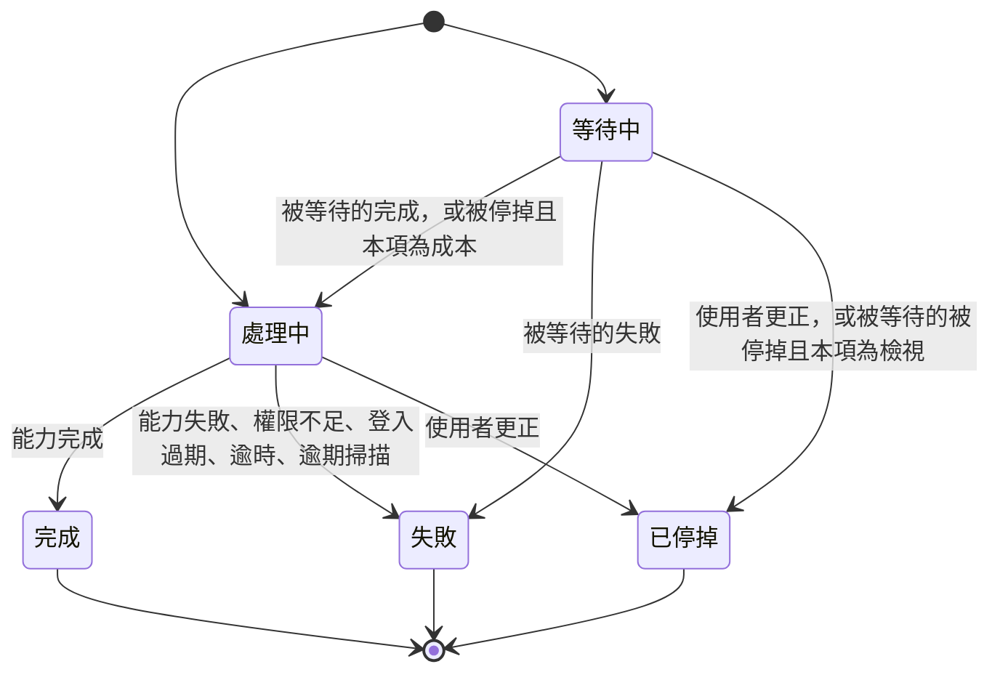
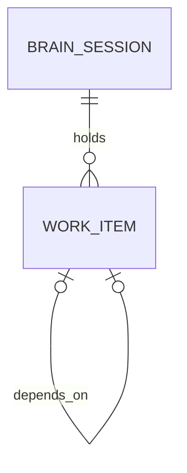

# Functional Spec — `U12 work-orchestrator`

> 工作流程與狀態機的正式來源。資料形狀以 `entities.md` 為準、決策邏輯以 `rules.md` 為準。
> 本站六題定案：`[WO1]`=A（模板訊息＋功能文字照轉，不呼叫 LLM）、`[WO2]`=A（成本或檢視排在
> 架構設計後就等待）、`[WO3]`=A（擴充 `U10` 的工作階段儲存）、`[WO4]`=A（停掉後請使用者再說一次）、
> `[WO5]`=A（最新一份估價表）、`[WO6]`=A（經既有存檔端點存回目標圖）。
>
> **修訂 1（2026-10-12）**：依 `reviews/review-01.md` 的 R-01～R-13 修正，逐項對應見第十一節。
>
> **修訂 2（2026-10-12）**：依 `reviews/review-02.md` 的 R-03、R-08、R-10、R-14～R-19 修正，逐項對應見第十二節。

## 一、單元邊界

| 項目 | 內容 |
|---|---|
| 擁有 | `WorkOrchestrator`（交辦、更正、列出）、工作項狀態機、對 A1／A3／C1 的呼叫與結果判定、編排層的固定句型訊息、逾期掃描 |
| 不擁有 | 意圖判讀（`U11`）、工作階段本身（`U10`；本單元只在其上新增工作項方法）、WebSocket 連線、扇出與 turnId 的產生（`U13`）、權限判定（既有端點自己的 dependency） |
| 消費者 | `U13 brain-gateway`（同進程） |
| 新依賴 | `U8 MemoryFacade.write`（`U8` 的 `[FD4]`=B 已定）；`U7 HierarchyFacade`（變更紀錄、**新增** `list_diagrams_of_system`） |
| 部署 | embedded，同一 FastAPI 進程 |

## 二、介面

### 2.1 Facade（契約 `K-11`，含本站的增量）

| 方法 | 參數 | 回傳 | 說明 |
|---|---|---|---|
| 建構子 | `app, session_store, *, clock` | — | `app` 為 FastAPI app 參考，由 `U13` 取自 `websocket.app` 傳入（不 import `main`，避免循環匯入） |
| `dispatch` | `principal, session, decision, *, utterance, segment_id, turn_id, bearer_token, sink` | `list[WorkItem]` | 建立工作項、以本輪 `turn_id` 送建立訊息、在背景執行；回傳建立當下的集合 |
| `correct` | `principal, session_key, work_item_id, *, bearer_token, sink` | `WorkItem` | 逐項停掉（`BR55`） |
| `list_items` | `principal, session_key, *, bearer_token, sink` | `list[WorkItem]` | 讀取並先做復原掃描（逾期與孤兒等待，`BR56.7`）；掃描可能讓等待項開始執行，故需要 token 與 sink |

**`sink` 的形狀**（由 `U13` 實作）：

| 方法 | 用途 | turnId |
|---|---|---|
| `emit_session(msg)` | 非輪次訊息（`work_items`） | null |
| `emit_in_turn(turn_id, msgs)` | 使用者本輪內的訊息（建立與等待的 `token`；`BR58.2`） | 本輪 |
| `emit_turn(msgs)` | 伺服器發起的新輪次：`U13` 產生新 turnId，依序送出 `msgs`（`token`／`cost_card`）後送 `done`（`BR58.5`） | 新產生 |

**對 `K-11` 的增量**（列入契約追認，第八節 `OPEN-WO12-1`）：`dispatch` 增加 `utterance`、`segment_id`、
`turn_id`、`bearer_token`、`sink`；`correct` 增加 `bearer_token`、`sink`；`list_items` 增加 `principal`、
`bearer_token`、`sink`；`K-11` 的 `raises` 中 `CapabilityCallFailed` **不再拋出**——能力呼叫失敗一律落成
工作項的失敗狀態（`BR56.4`）。

### 2.2 呼叫既有能力的傳輸方式

以 `httpx.AsyncClient` 搭配 `ASGITransport(app=<U13 傳入的 app>)` 呼叫同一個 FastAPI app：請求完整走過
既有端點的 FastAPI dependency（含 `require_story_action`／`require_arch_action`），授權照常執行，且
**不需要新的環境變數**（不必設定回呼自己的網址）。

**ASGI 傳輸一律緩衝（不是某些版本）**：已安裝的 `httpx` 0.28.1 的 `ASGITransport.handle_async_request`
把 `http.response.body` 累積進 `body_parts`，等 app 整個結束才回傳。本設計據此：

| 能力 | 後果 | 處置 |
|---|---|---|
| A1 產圖（SSE） | 說明文字在產圖結束時一次到 | `BR58.3` 改為收齊後一次轉送；`BR56.5` 在回應結束後判定 |
| A3 檢視（SSE） | 同上 | `BR56.5` 在回應結束後判定 |
| C1 建議串流（SSE） | 串流在 completed／failed／逾時時結束，但中途的 progress／heartbeat 收不到，等同一次慢的快照讀取 | **不使用**；改輪詢 `GET /sets/{set_id}/advice` 快照（`BR57.1`）。注意快照端點不回收過期的 `generating` 列（只有串流端點呼叫 `reclaim_stale_generating`），故 `BR57.4` 以 `started_at` 自行判定逾時 |

所有呼叫皆以 `asyncio.wait_for` 包在 `BR56.6` 的牆鐘上限內，緩衝的時間因此有上界。

### 2.3 對 `U10` 的擴充（`[WO3]`=A）

在 `SessionStore` 新增三個方法，皆沿用同一個 Redis key 的現有到期時間（不重設、不另設）。兩個寫入方法
都是 Lua 腳本，放在 `backend/services/session_scripts/`（與既有的 `append_message.lua`、
`switch_to_isolated.lua` 同處），經 `RedisGateway.eval_script` 執行：

| 方法 | 腳本 | 行為 |
|---|---|---|
| `load_work_items(session_key)` | — | 讀出所有 `wi:*` 欄位 |
| `put_work_item(session_key, item) -> bool` | `put_work_item.lua` | key 不存在 → 拒絕（不得重建一個沒有到期時間、沒有 `meta` 的 key）；欄位已存在 → 拒絕；否則寫入（`BR52.4`） |
| `update_work_item(session_key, work_item_id, expected_statuses, expected_dispatch_stage, item) -> bool` | `update_work_item.lua` | 原子地讀欄位、比對 `status` 在預期集合內**且** `dispatchStage` 等於預期值，皆符合才寫入（`BR52.7`） |

逐項欄位＋比對後寫入，使同一工作階段的 N 個背景 task 與 `correct` 不會互相覆蓋，多個 worker 間也成立
（`review-01` R-10）。這是跨單元修改 `U10` 已交付的程式，比照 `U15` 修改 `U8` 的先例，在 code-generation 揭露。

### 2.4 對 `U7` 的擴充

在 `HierarchyFacade` 新增唯讀方法 `list_diagrams_of_system(principal, *, system_id) -> list[(diagram_id, title)]`：
先以既有授權（`_authorize(view)`）與 `assert_system_owned_by` 確認系統屬於呼叫者，再列出該系統下
`user_diagrams.system_id = system_id` 的圖。`system_id` 為空的圖不屬於任何系統。

**誠實記載**：`UserDiagram.system_id` 為 nullable，三條建圖路徑都不傳它，`OPEN-H11` 記載新建的圖常未掛系統。
因此「只指定系統」這條路徑在現況下**多半回零張**，`BR56.1`／`BR56.3` 以「這個系統下沒有掛上的架構圖，
請在脈絡列選定圖」失敗——失敗文字指出真正原因（找不到掛在此系統的圖），不說成「沒有估價表」。
`AC1.1.4`、`AC10.1.1` 的覆蓋以「作業對象為圖」或「系統下恰有一張圖」為前提成立，見 `traceability.json` 的 note。

## 三、工作流程（正式來源）

### 3.1 交辦（`dispatch`）

1. 先做復原掃描（`BR56.7`）。
2. `decision.below_threshold` 為真 → 回空集合，結束（反問由 `U11`／`U13` 處理；`BR52.1`）。
3. 取 `segment_id` 那一段的作業對象（`BR52.6`）；依 `decision.intents` 的順序逐一建立工作項：label（`BR52.2`）、
   初始狀態（`BR52.3`／`BR53.1`）、`requestText`=`utterance` 前 2000 字。
4. 逐項 `put_work_item`（`BR52.4`；被拒 → 工作階段已到期，拋 `ValueError`），推送 `work_items`（`BR52.5`）。
5. **立即**以本輪 `turn_id` 送建立或等待訊息（`BR58.1`／`BR58.2`）。
6. 對每個處理中的工作項寫入 `deadlineAt` 並啟動背景執行（3.3）；等待中的不啟動。
7. 回傳步驟 3 建立的集合。之後由 `U13` 送本輪的 `done`。

### 3.2 更正（`correct`）

1. 在該工作階段找工作項；找不到 → `WorkItemNotFound`（`BR55.6`）。
2. 已是終態 → 回現況（`BR55.2`）。
3. 依讀到的 `dispatchStage` 算 `sideEffect`（`BR55.1`），以比對後寫入（預期 status ∈ {處理中, 等待中}、
   預期 `dispatchStage`=讀到的值）轉為已停掉；比對失敗即重讀重算，若已是終態則同步驟 2。取消本行程內
   該項的背景 task（若存在）；已送出的請求無法取消，由 `sideEffect` 揭露。
4. 等它的工作項依 `BR53.4`：成本項開始執行，檢視項轉為已停掉並送說明。
5. 推送 `work_items`；以 `emit_turn` 送停掉訊息（`BR55.5`）。

### 3.3 背景執行（每個工作項一條）

每一步副作用都以比對後寫入推進（預期狀態=處理中、預期 `dispatchStage`=上一步寫入的值），比對失敗即中止（`BR55.3`）。
每一次 `U7`／`U8` 的 facade 呼叫都重新自 DB 取使用者並鑄造 `Principal`（`BR51.7`）。整條以 `BR56.6` 的上限包住。

| 能力 | 步驟 |
|---|---|
| `architecture-design` | 決定目標圖（`BR56.1`）→ GET 圖 → POST A1（`request_sent`）→ 收齊判定（`BR56.5`）→ 轉送說明文字（`BR58.3`）→ 再 GET 比對 `updated_at` → `persisting` → PUT（帶回原 title）→ `result_persisted` → 寫變更紀錄（`BR51.4`）→ 完成 |
| `well-architected-review` | 決定目標圖 → POST A3（`diagram_id`；`request_sent`）→ 收齊判定 → `result_persisted` → 完成並送摘要 |
| `cost-finops` | 取目標圖集合 → 分頁找最新估價表（`BR56.3`）→ 寫 `estimateSetId` → 每 2 秒輪詢快照；`generating` 且 `started_at` 已逾 5 分鐘即判逾時（`BR57`） |

完成時：寫 procedure 記憶（`BR51.5`，`to_thread`）→ 以 `emit_turn` 送完成訊息（成本項附卡片）→ 等它的工作項依 `BR53.2` 開始。
失敗時：以 `emit_turn` 送失敗訊息 → 等它的工作項依 `BR53.3` 失敗。401 → `BR51.6`；403 → `BR51.3`。
任何 `sink` 例外 → `BR56.8`。

### 3.4 復原掃描（`BR56.7`）

在 `dispatch`、`correct` 之前與 `list_items`（`U13` 在連線與重連時呼叫）執行，依序兩步：

1. **逾期**：處理中且 `deadlineAt` 已過者轉為失敗「服務重新啟動或逾時，這一項沒有完成」。
2. **孤兒等待**：等待中且 `dependsOn` 指向的工作項已是終態者（含第 1 步剛轉失敗的），依被等待者的終態
   套用 `BR53.2`／`BR53.3`／`BR53.4`。這補上「被等待者的終態已寫入、推進等待者之前行程重啟或 Redis
   暫時不可用」的缺口——兩次寫入不在同一個原子操作內。

不需要知道哪個行程在跑它——重啟後所有 task 都不存在，Redis 的儲存值是唯一跨行程可靠的判據。

## 四、狀態機

文字 fallback：新工作項為處理中或等待中。等待中在被等待者完成時轉處理中；被等待者被停掉時，成本項轉處理中、
檢視項轉已停掉；被等待者失敗時轉失敗；被使用者更正時轉已停掉。處理中轉完成、失敗或已停掉。完成、失敗、已停掉三者為終態。

**PBT 的事件詞彙**（`transition(status, event)` 的取樣空間；`review-01` R-13）：

| 事件 | 合法的來源狀態 → 目的 |
|---|---|
| `dependency_completed` | 等待中 → 處理中 |
| `dependency_stopped_proceed`（被等待者停掉、本項為成本） | 等待中 → 處理中 |
| `dependency_stopped_skip`（被等待者停掉、本項為檢視） | 等待中 → 已停掉 |
| `dependency_failed` | 等待中 → 失敗 |
| `capability_completed` | 處理中 → 完成 |
| `capability_failed`（含 403、401、逾時、逾期掃描） | 處理中 → 失敗 |
| `user_corrected` | 等待中／處理中 → 已停掉 |

不在表內的（狀態, 事件）組合一律拒絕（`BR54.1`）。被等待者停掉時用哪一個事件由純函式
`on_dependency_stopped(capability)` 決定（`BR53.4`）。

## 五、ER 與規則摘要（衍生）

文字 fallback：一個大腦工作階段持有零到多個工作項；工作項可依賴同一次交辦內的另一個工作項。

| 群 | 規則數 |
|---|---|
| `BR51` 授權與呼叫 | 8 |
| `BR52` 建立與存放 | 7 |
| `BR53` 等待中 | 4 |
| `BR54` 狀態機 | 1 |
| `BR55` 逐項更正 | 7 |
| `BR56` 能力執行 | 8 |
| `BR57` 成本轉譯 | 5 |
| `BR58` 回覆 | 5 |
| **合計** | **45** |

## 六、與已交付程式的介面事實（逐一開檔核對）

| 事實 | 出處 |
|---|---|
| 可路由能力為 `architecture-design`／`well-architected-review`／`cost-finops` | `backend/services/intent_routing_types.py:52` |
| `IntentDecision` 帶 `intents`、`confidence`、`below_threshold`、`candidates`，不含使用者原句 | `intent_routing_types.py:198` |
| WebSocket 的 `WorkItem`／`WorkItemsPayload`／`CostCardPayload`／`TokenPayload` 形狀；turnId 由伺服器產生 | `backend/services/brain_ws_contract.py:132`、`:190`、`:229`、`:239`、`:34` |
| A1 產圖：`POST /api/architecture/generate`（`messages`、`current_xml`），SSE 事件 `message`／`progress`／`xml`／`error`；`thread_id=f"user-{id}-design"` | `backend/services/agent_router.py:102`、`:6`、`:153` |
| 讀圖 `GET /api/collab/diagrams/{id}` 回 `title`、`xml_data`、`updated_at`；存圖 `PUT` 一律 `diagram.title = request.title` 並設 `last_opened_diagram_id` | `collab_router.py:487`、`:543`、`:544` |
| A3 建立檢視：`POST /api/architecture/reviews`（`StartReviewBody` 含 `diagram_id`；`require_story_action("A3","edit")`），SSE；完成事件 `complete` 帶 `overall_score`、`findings`，失敗事件 `error` | `review_router.py:104`；`review_orchestrator.py:365`、`:160` |
| C1 列估價表：`GET /api/cost/v1/sets`，分頁、依 `created_at` 新到舊，每列有 `diagram_id`、`advice_status` | `cost/estimate_intake_router.py:170`；`cost/estimate_intake_service.py:501`、`:235` |
| C1 建議快照：`GET /api/cost/v1/sets/{set_id}/advice`，無建議列回 404；`status` ∈ generating／completed／failed，逾時以 `unavailable_reasons.timed_out` 標示 | `cost/estimate_intake_router.py:229`；`cost/estimate_intake_service.py:650`；`cost/advice_orchestrator.py:96` |
| C1 自己的建議逾時為 5 分鐘 | `cost/advice_orchestrator.py:19` |
| 變更紀錄：`HierarchyFacade.record_diagram_change(…, actor_user_id=…)`，非冪等 | `hierarchy_facade.py:242` |
| 系統擁有者檢查：`assert_system_owned_by`；圖擁有者檢查：`assert_diagram_owned_by` | `hierarchy_service.py:74`、`:83` |
| 記憶寫入：`MemoryFacade.write(principal, kind, content)`，同步 | `memory_facade.py:246` |
| Redis 封裝支援 Lua：`RedisGateway.eval_script` | `redis_gateway.py:460` |
| C1 快照回傳 `started_at`，且**不**呼叫 `reclaim_stale_generating`；只有串流端點每圈呼叫它 | `cost/estimate_intake_service.py:650`、`:680`；`cost/advice_stream_router.py:97` |
| A3 在開始時即建立檢視紀錄（`created_by=user.id`） | `review_orchestrator.py:142`、`:172` |
| `Principal` 唯一的鑄造入口 `mint_principal(user)`，自 `User` 取 `role` 與核准狀態 | `hierarchy_facade.py:145` |

**一處與契約不一致、由已交付程式裁決**：`K-18` 把 `U12` 列為進度通道 `open`／`close` 的消費端。
但已交付的 A1 端點**自己**在每個請求開關通道（`agent_router.py` 的 `event_generator`，`U22` 交付），
而本單元依 `X-02` 經 HTTP 呼叫 A1——通道的生命週期在 A1 那一側就完整了。本單元**不使用**
`ProgressChannel`；`K-18` 的 `U12` 消費端與 `unit-of-work.md` 修訂 4 補的 `U12 → U22` 邊應於契約
修訂時移除（第八節）。

**三處交互，如實揭露（`review-01` R-12）**：

1. **`configure_provider_env()` 耦合**（`X-02` 的 `coupling_warning`）：呼叫 A1／A3 會間接觸發
   `configure_provider_env()`，改寫整個行程的環境變數。背景 A1 與 `U11` 的 LLM 路徑會併發執行；
   本單元不修這個耦合（屬既有能力），code-generation 須以測試確認兩者併發時 `U11` 讀到的供應商設定不被改錯。
2. **A1 對話記憶共用**：A1 以 `thread_id=f"user-{id}-design"` 使用 `MemorySaver`，大腦發起的產圖請求
   與使用者在 A1 頁的對話共用同一個 thread——使用者回到 A1 頁時會看到大腦送出的需求與模型回覆。
   這是接受的行為（同一個人、同一件事），不另開 thread（另開等於關掉對話記憶，`design_agent.py:229`）。
3. **被分享者改他人的圖**：A1 與 PUT 對被分享者可成功，但 `record_diagram_change` 只允許擁有者，
   會拋 `HierarchyNotFound`——此時圖已改、變更紀錄缺一列，`sideEffect` 註明「變更紀錄未寫入」（`BR51.8`）。

## 七、ADR-0006 四面向與 PBT

| 面向 | 判定 | 本單元的落點 |
|---|---|---|
| **IAM** | 適用 | 呼叫既有能力一律帶使用者 token、走完整的 HTTP dependency（`BR51.1`）；403 與 401 即失敗不繞道（`BR51.3`／`BR51.6`）；`U7`／`U8` 經各自的 facade 並保留其授權（`BR51.8`）；**`Principal` 不沿用握手當下的角色快照**：每次 facade 呼叫重新自 DB 取使用者並鑄造（`BR51.7`），使背景執行期間被降權或停用的使用者在 facade 路徑與 HTTP 路徑得到相同結果；新增的 `list_diagrams_of_system` 限擁有者範圍 |
| **Encryption** | 適用（新增兩處使用者內容落地） | token 只在記憶體內傳遞（`BR51.2`）；不新增傳輸路徑（ASGI 傳輸不出行程）。**新增落地**：`requestText`（使用者原句，至多 2000 字）存進 Redis 24 小時（`[WO3]`=A）；變更紀錄的需求摘要（前 200 字）存進 DB（`BR51.4`）。兩者的靜態加密要求與上游 `OQ-3`（指派 `nfr-design`）同一類，併入該項處理，不在本站另定 |
| **Network exposure** | 適用，本單元無新增暴露面 | 零新埠、零新服務、零新環境變數；呼叫皆在行程內（與 `unit-of-work.md`「四面向皆適用」一致） |
| **Audit logging** | 適用 | 變更紀錄的 actor 為使用者本人（`BR51.4`），在途存檔成功時照寫（`BR55.7`）；log 不含 token 與需求全文（`BR58.4`）。**本單元對 C1 只讀取，C1 的讀取端點不寫 `estimate_audit_events`**——經大腦問成本不會在成本稽核表留下事件（見 `AC10.2.4` 的處置） |

**PBT（hard constraint）**：**適用**。`unit-of-work.md` 為本單元指定「純函式 PBT（狀態轉換）」，且
本單元屬 `project.md` 點名的 agent routing 範圍（編排是路由結果的落地）。受測對象是三個不讀 IO 的純函式：
狀態轉換 `transition(status, event) -> status | 拒絕`（事件詞彙見第四節；性質：任何事件序列都不會離開終態、
不會產生五值以外的狀態）、等待推導 `plan_waits(intents) -> 每項的 dependsOn`（性質：只有成本或檢視會等待、
等待對象一定是同一次交辦中排在它前面的架構設計、不會形成循環）、停掉說明 `side_effect_on_stop(capability,
dispatch_stage)`（性質：cost-finops 恆為 none、not_dispatched 恆為 none、其餘不為 none）、被等待者停掉時的處置
`on_dependency_stopped(capability)`（性質：cost-finops 恆為 proceed、well-architected-review 恆為 skip）。
另以模型式 PBT 驗比對後寫入的交錯：在記憶體替身上隨機交錯「背景推進 `dispatchStage`」與「`correct`」兩串操作，
性質為**請求已送出（`dispatchStage` ≠ not_dispatched）時，停掉後的 `sideEffect` 不得為 none**（cost-finops 除外）
（`review-02` R-10）。

## 八、開放項與交接

| # | 事項 | 承接 |
|---|---|---|
| `OPEN-WO12-1` | **契約追認**：`K-11` 的三個方法增加 2.1 所列參數、`CapabilityCallFailed` 不再拋出；`K-12`（WebSocket 契約）追認伺服器發起輪次（`emit_turn`）的語意；`K-07` 增加 `list_diagrams_of_system`；`K-18` 移除 `U12` 消費端；`OQ-N1` 以 `[WO1]`=A 結案 | 下一輪契約修訂 |
| `OPEN-WO12-2` | **delivery-planning 的邊**：新增 `U12 → U8`（procedure 記憶）；`U12 → U22` 不需要；`U12 → U7` 增一個方法 | 回報 delivery-planning |
| `OPEN-WO12-3` | **`U13` 的責任**：握手時保留 token；傳入 `app`、`utterance`、`segment_id`、`turn_id`；實作 `sink` 的三個方法（含為 `emit_turn` 產生 turnId 並以 `done` 終止）；連線與重連時呼叫 `list_items`；收到「不是這個」時呼叫 `correct`；**呼叫 `dispatch` 之前，依 `IntentDecision.intents` 各項的 `referent`（句中指名的系統或圖）更新該段的作業對象**——本單元只讀作業對象，不解析 `referent`。`U13` 沒有更新時，句中指名的對象不會被用上，`BR56.1`／`BR56.3` 依作業對象為空或只有專案的句型失敗（`AC1.1.5`、`AC10.1.1` 後半依賴此項） | `U13` |
| `OPEN-WO12-4` | **作業對象只指定系統時多半回零張圖**（2.4，`OPEN-H11`），架構設計與檢視會請使用者選圖；畫面引導屬 `U14` | `U14` |
| `OPEN-WO12-5` | **WorkItem 沒有進度文字欄位**：成本生成中只能以處理中標示呈現（`BR57.1`）；若要顯示「已等待 N 秒」等進度，須在 WebSocket 契約的 `WorkItem` 增欄 | 下一輪契約修訂（非本單元必要） |
| `OPEN-WO12-6` | **`AC10.2.4` 的可觀察結果不存在**：C1 的讀取端點不寫稽核事件，經大腦問成本不會留下 AC 要查看的事件。須上游改寫 AC 的 Then（例如改為「授權主體為使用者本人」），或決定由大腦另寫來源為大腦的稽核紀錄。查證結果（`review-02` R-09）：`ALLOWED_EVENT_TYPES` 只是 `cost/estimate_audit.py` 的 `frozenset`，`estimate_audit_events.event_type` 無 CHECK，新增事件型別不需 DDL；但寫入須同進程呼叫 C1 service（違反 `X-01`「不得同進程直呼」）或新增 C1 端點，兩者都不在本單元範圍 | 回報上游（user-stories 已核可，由使用者裁決） |
| `OPEN-WO12-7` | **`AC1.3.2`／`AC5.1.3` 在「停掉前提項」時無法字面成立**：不等它的工作項完全不受影響；但等它的工作項必須有去處（永遠等待會卡到 24 小時）。`BR53.4` 的處置：成本項（唯讀）照常開始；檢視項不執行、轉已停掉（A3 一開始就建立檢視紀錄，在使用者否定的判讀上、對未修改的舊圖建立紀錄與 `BR55.5` 的前提矛盾）。兩者都改變了後項狀態，traceability 標 `Deferred`。須使用者裁決：接受此處置並改寫 AC 的 Then（例如「未依賴被更正項的工作項不受影響」），或指定其他處置 | **使用者裁決**（user-stories 已核可） |

## 九、送審前自檢

| 自檢 | 結果 |
|---|---|
| 1 可達性 | 等待中：`AC5.1.1` 的例句即可達。`persisting` 下停掉：PUT 在途時更正即可達（測試以延遲替身構造）。逾期掃描：把 `deadlineAt` 設在過去即可達。孤兒等待：直接寫入「被等待者完成、等待者仍等待中」的兩個欄位即可達。`correct` 與背景推進的交錯：替身在 `correct` 讀完之後、寫入之前推進 `dispatchStage` 即可達。快照 `generating` 且 `started_at` 已逾 5 分鐘：測試資料直接構造即可達。`list_diagrams_of_system` 恰一張：測試資料把一張圖掛到系統即可達；現況真實資料多半零張（2.4 已揭露） |
| 2 契約端點三問 | `WorkItem`：寫＝`dispatch`／`correct`／背景執行／逾期掃描（皆經 `update_work_item`）；讀＝`list_items`、`work_items` 推送；清＝隨工作階段到期（`BR52.4`）。`deadlineAt`：寫＝進入處理中；讀＝逾期掃描；清＝離開處理中時設 null。`segmentId`：寫＝`dispatch`；讀＝作業對象解析；清＝隨工作項。`list_diagrams_of_system`：擁有者＝`U7`，呼叫者＝`BR56.1`／`BR56.3` |
| 3 引用逐字核對 | 第六節十七項皆開檔核對（含行號；修訂 2 新增三項） |
| 4 檔案集合 | `service` 單元四份產出 |
| 5 跨檔傳播 | 修訂 1 改動的事實：儲存形狀、`dispatchStage` 值集、`dispatch` 參數、C1 讀取方式、停掉前提項的後果、401／403、規則數。修訂 2 改動的事實：比對條件（status＋dispatchStage）、`put_work_item` 改 Lua、停掉前提項依能力分流、復原掃描含孤兒等待、目標圖失敗句型、Principal 重鑄、快照逾時判定、Encryption／IAM 判定。逐一 grep 四份產出確認一致 |
| 6 可算的數字 | 規則 45（8＋7＋4＋1＋7＋8＋5＋5）由腳本自 `rules.md` 解析 |
| 7 ADR-0006＋PBT | 見第七節 |

## 十、Assumptions

- procedure 記憶的內容為「能力名稱＋label」，不含需求全文 [assumption]
- 變更紀錄的需求摘要取需求文字前 200 字 [assumption]
- 牆鐘上限 300／300／360 秒足以涵蓋 A1、A3 的正常執行時間；code-generation 以實測記錄 [assumption]
- 輪詢間隔 2 秒對 C1 的 DB 負擔可接受（每個成本工作項最多 180 次讀取） [assumption]

## 十一、修訂 1 對照（`review-01`）

| 發現 | 處置 |
|---|---|
| R-01 系統→圖對應不存在 | `U7` 新增 `list_diagrams_of_system`（2.4）；`BR56.1`／`BR56.3` 改寫；成本以 `diagram_id` 比對、分頁到找到為止、空 `diagram_id` 不採用；`OPEN-H11` 的後果誠實記載；traceability 三條 AC 改為帶前提 |
| R-02 ASGI 傳輸一律緩衝 | 2.2 改寫；C1 改輪詢快照（`BR57.1`）；A1 文字收齊後轉送（`BR58.3`）；`app` 由 `U13` 傳入；`AC10.1.2` 以「處理中標示就地維持、不新增訊息」判定，進度文字列 `OPEN-WO12-5` |
| R-03 生命週期缺口 | `BR56.6` 牆鐘上限、`BR56.7` 逾期掃描、`BR56.8` sink 失敗 |
| R-04 turn 歸屬 | `sink` 三方法（2.1）；`BR58.2`、`BR58.5`；列 `K-12` 追認 |
| R-05 SSE 帶內結果 | `BR56.5` 判定表；A3 改帶 `diagram_id` |
| R-06 PUT 重設圖名與覆寫 | `BR56.1`：PUT 帶回 GET 的 title；存回前再 GET 比對 `updated_at` |
| R-07 requestText 來源 | `BR52.6`；`dispatch` 增 `utterance`、`segment_id` |
| R-08 停掉前提項與 AC 衝突 | `BR53.4`（停掉 → 後項照常開始）；`BR55.4` 改寫；解讀列 `OPEN-WO12-7` 回報上游 |
| R-09 AC10.2.4 不可觀察 | traceability 改 `Deferred`；第七節 Audit 寫明；`OPEN-WO12-6` |
| R-10 讀改寫原子性 | 逐項欄位＋Lua 比對後寫入（`BR52.4`／`BR52.7`）；`persisting` 與 `BR55.7` |
| R-11 401 與 403 | `BR51.3` 限 403；`BR51.6` 401 |
| R-12 上游義務收尾 | 第六節三處交互；`BR51.7`（DB session、`to_thread`）、`BR51.8`（`U7` 授權語意）；`CapabilityCallFailed` 列入 `OPEN-WO12-1` |
| R-13 等待只是排序、事件詞彙、措辭 | `BR57.5`；第四節事件詞彙表；第七節 Network exposure 改措辭 |

## 十二、修訂 2 對照（`review-02`）

| 發現 | 處置 |
|---|---|
| R-03 等待中項目無復原路徑 | `BR56.7` 增第二步「孤兒等待」：等待中而被等待者已是終態者補做推進；3.4 改寫為兩步 |
| R-08 停掉前提項自動啟動 A3 | 採 required action (a)：`BR53.4` 依能力分流——成本照常開始、檢視轉已停掉並說明；`BR55.4`、第四節狀態圖與事件詞彙同步；traceability `AC1.3.2`／`AC5.1.3` 改 `Deferred`；`OPEN-WO12-7` 改為交使用者裁決 |
| R-10 比對條件只有 status | `BR52.7` 改為比對 status＋`dispatchStage`，`new_item` 須由剛讀到的值推導；`BR55.1`、`BR55.3`、`BR55.7`、2.3、3.2、3.3 同步；第七節增模型式 PBT 性質 |
| R-14 輪詢理由與快照不回收過期列 | `BR57.1` 理由改寫；`BR57.4` 增「`generating` 且 `started_at` 已逾 5 分鐘即判逾時」；2.2 表格改寫 |
| R-15 目標圖失敗句型與空作業對象 | `BR56.1`／`BR56.3` 的失敗句型分為：作業對象為空或只有專案、系統下零張、系統下多張、圖無估價表；2.4 改寫；traceability note 同步 |
| R-16 `put_work_item` 可能重建無 TTL 的 key | `BR52.4`：兩個寫入方法皆為 Lua，key 不存在即拒絕；2.3 點名腳本檔 `put_work_item.lua`、`update_work_item.lua` |
| R-17 Encryption／IAM 低報 | 第七節兩列改寫；`BR51.7` 每次 facade 呼叫重鑄 `Principal` |
| R-18 AC10.1.3 的「取代」 | traceability 加 note：卡片以新輪次送達，「取代」由 `U14` 以處理中標示轉完成＋卡片出現呈現 |
| R-19 `referent` 零引用 | `OPEN-WO12-3` 增 `U13` 依 `referent` 更新作業對象的義務與未更新時的行為 |

