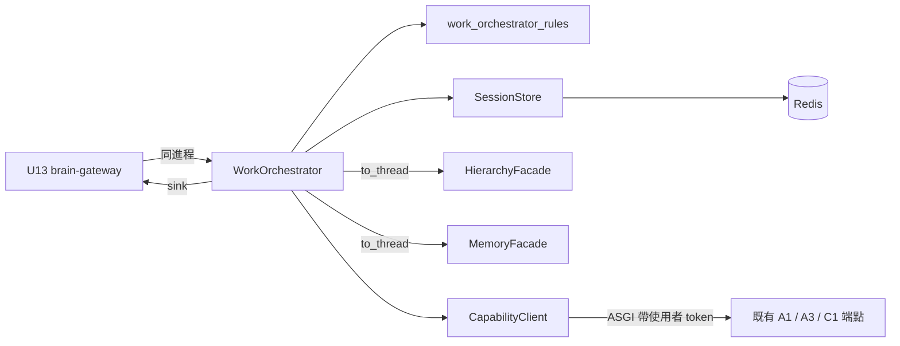

# 邏輯元件 — `U12 work-orchestrator`

## 一、元件清單

| 元件 | 職責 | 失效範圍 |
|---|---|---|
| `WorkOrchestrator`（`backend/services/work_orchestrator.py`） | `dispatch`／`correct`／`list_items`；背景 `_run`、`_finish_persist`、`_recover`、`_advance`、`_emit` | 單一工作階段 |
| 純函式（`backend/services/work_orchestrator_rules.py`） | `transition`、`plan_waits`、`side_effect_on_stop`、`on_dependency_stopped`、目標圖解析的判定、`_PHRASES` | 無 IO；PBT 落點 |
| `SessionStore` 擴充（`U10`） | `load_work_items`、`put_work_item`、`update_work_item` | 單一工作階段 key |
| Lua 腳本 | `session_scripts/put_work_item.lua`、`session_scripts/update_work_item.lua` | 單一 key 的原子操作 |
| `HierarchyFacade.list_diagrams_of_system`（`U7` 擴充） | 系統下使用者擁有的圖 | 單一呼叫 |
| `CapabilityClient`（模組內私有） | 以 ASGITransport 帶使用者 token 呼叫 A1／A3／C1、收齊 SSE 並解析事件 | 單一請求 |

## 二、依賴與邊界

文字 fallback：`U13` 同進程呼叫 `WorkOrchestrator`；它以純函式決定狀態與句型、經 `SessionStore` 讀寫 Redis 的工作項、以
`to_thread` 呼叫 `HierarchyFacade` 與 `MemoryFacade`、經 `CapabilityClient` 以 ASGI 傳輸帶使用者 token 呼叫既有 A1／A3／C1
端點，並經 `U13` 提供的 sink 送出訊息。

## 三、共享資源與爆炸半徑

| 共享資源 | 本單元的使用 | 爆炸半徑 |
|---|---|---|
| Redis 工作階段 key | 每項一個欄位 | 單一工作階段；Lua 腳本不建 key、不改 TTL |
| 既有 FastAPI app | 同進程呼叫既有端點 | 與使用者自己在頁面上呼叫相同；`configure_provider_env()` 的行程級耦合已揭露（functional-spec 第六節） |
| A1 的 `MemorySaver` thread | 與使用者在 A1 頁共用 | 已揭露並接受（functional-spec 第六節） |
| PostgreSQL | 經 facade 寫變更紀錄與 procedure 記憶 | 單一列 |

## 四、開放項（本站新增）

| # | 事項 | 承接 |
|---|---|---|
| `OPEN-WO12-8` | 新 parent id `NFR12` 不在 inception 的 `requirements.md`；與 `U19`／`U20` 的同類回補同批 | 下一輪 `requirements-analysis` 修訂 |
| `OPEN-WO12-9` | functional-design 待回補的文字：`BR56.7` 的 sideEffect 改引 `side_effect_on_stop`；第七節「三個純函式」應為四個；`BR58.1` 增檢視被跳過的句型 | functional-design 下一次修訂（本站設計已以本檔為準） |
