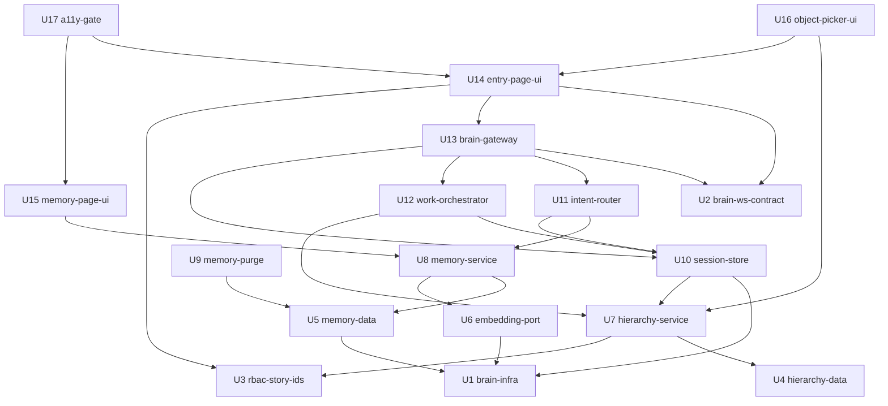
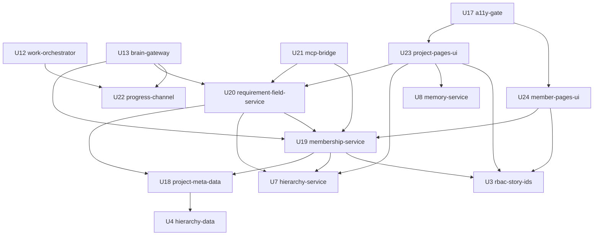

# Unit of Work Dependency — 統一入口大腦

<!-- Stage: units-generation（Inception 2.7）· Record: 260920-orchestration-brain -->

## 這份檔只描述拓樸

stage 檔明文：**本檔不挑「建議施工順序」、不指認關鍵路徑**——那是 2.9 Delivery
Planning 以本檔為輸入所做的經濟決策。下方的「層」是拓樸分層，**不是** Bolt 順序；
同一層的單元之間沒有依賴，故**可以**平行，但 2.9 未必選擇平行做。

依 `project.md` 的 `units-generation:c23`，本節就地註明：**以下任何排序或編號都
不構成 Bolt 順序的建議。**

## 機讀邊塊（下游 fan-out 由此計算，非由散文）

```yaml
units:
  - name: brain-infra
    kind: packaging
    depends_on: []
  - name: brain-ws-contract
    kind: spec
    depends_on: []
  - name: rbac-story-ids
    kind: spec
    depends_on: []
  - name: hierarchy-data
    kind: spec
    depends_on: []
  - name: memory-data
    kind: spec
    depends_on: [brain-infra]
  - name: embedding-port
    kind: library
    depends_on: [brain-infra]
  - name: hierarchy-service
    kind: service
    depends_on: [hierarchy-data, rbac-story-ids]
  - name: memory-service
    kind: service
    depends_on: [memory-data, embedding-port]
  - name: memory-purge
    kind: packaging
    depends_on: [memory-data]
  - name: session-store
    kind: service
    depends_on: [brain-infra, hierarchy-service]
  - name: intent-router
    kind: service
    depends_on: [memory-service, session-store]
  - name: work-orchestrator
    kind: service
    depends_on: [session-store, hierarchy-service, progress-channel]
  - name: brain-gateway
    kind: service
    depends_on: [brain-ws-contract, intent-router, work-orchestrator, session-store, membership-service, requirement-field-service, progress-channel]
  - name: entry-page-ui
    kind: ui
    depends_on: [brain-ws-contract, brain-gateway, rbac-story-ids]
  - name: memory-page-ui
    kind: ui
    depends_on: [memory-service]
  - name: object-picker-ui
    kind: ui
    depends_on: [hierarchy-service, entry-page-ui]
  - name: a11y-gate
    kind: packaging
    depends_on: [entry-page-ui, memory-page-ui, project-pages-ui, member-pages-ui]
  - name: project-meta-data
    kind: spec
    depends_on: [hierarchy-data]
  - name: membership-service
    kind: service
    depends_on: [project-meta-data, hierarchy-service, rbac-story-ids]
  - name: requirement-field-service
    kind: service
    depends_on: [project-meta-data, hierarchy-service, membership-service]
  - name: mcp-bridge
    kind: service
    depends_on: [requirement-field-service, membership-service]
  - name: progress-channel
    kind: library
    depends_on: []
  - name: project-pages-ui
    kind: ui
    depends_on: [requirement-field-service, hierarchy-service, memory-service, rbac-story-ids]
  - name: member-pages-ui
    kind: ui
    depends_on: [membership-service, rbac-story-ids]
```

**well-formedness（修訂 4 重驗，本站以腳本解析上方邊塊，非目測）**：**24** 個名稱唯一；
每個 `depends_on` 成員皆為已宣告單元；無單元依賴自己；**無環**（DFS 三色法，`cycle = []`）；
每個 `kind` 皆為 `service｜spec｜ui｜packaging｜library` 五者之一。
邊數 **46**（既有 25 ＋ 修訂 4 新增 21，其中 17 條由新單元發出、4 條由既有單元補出）。
kind 分佈：`spec` 5、`service` 9、`ui` 5、`packaging` 3、`library` 2。
可平行根 **5**（`brain-infra`、`brain-ws-contract`、`hierarchy-data`、`rbac-story-ids`、
**`progress-channel`**）；層數 **7**；完全互相獨立的單元對 **146**。
以上每個數字皆由同一支腳本從本邊塊的資料結構輸出，**不是手寫後再核對**。

> **修訂 4 改動了這個邊塊本身，而非另開第二個 yaml 區塊。** 理由是機械的：stage 檔
> 指定「下游的 batch fan-out 由這個 fenced `yaml` block 計算」，而 `required-sections`
> sensor 也只檢查一個。兩個 yaml 區塊會讓「哪一個是權威」無法由語法判定——
> `domain-design` 用 `Part A''` 補充區塊是因為那裡的消費者會讀聯集，這裡的消費者只讀
> 一個。修訂 1–3 的 17 單元版本保留於下方的歷史區塊（刻意**不是** `yaml` 圍欄，
> 以免被解析成第二個權威來源）。

<details>
<summary>修訂 1–3 的 17 單元邊塊（歷史紀錄，<strong>非權威</strong>）</summary>

```text
units:
  - name: brain-infra          | packaging | depends_on: []
  - name: brain-ws-contract    | spec      | depends_on: []
  - name: rbac-story-ids       | spec      | depends_on: []
  - name: hierarchy-data       | spec      | depends_on: []
  - name: memory-data          | spec      | depends_on: [brain-infra]
  - name: embedding-port       | library   | depends_on: [brain-infra]
  - name: hierarchy-service    | service   | depends_on: [hierarchy-data, rbac-story-ids]
  - name: memory-service       | service   | depends_on: [memory-data, embedding-port]
  - name: memory-purge         | packaging | depends_on: [memory-data]
  - name: session-store        | service   | depends_on: [brain-infra, hierarchy-service]
  - name: intent-router        | service   | depends_on: [memory-service, session-store]
  - name: work-orchestrator    | service   | depends_on: [session-store, hierarchy-service]
  - name: brain-gateway        | service   | depends_on: [brain-ws-contract, intent-router, work-orchestrator, session-store]
  - name: entry-page-ui        | ui        | depends_on: [brain-ws-contract, brain-gateway, rbac-story-ids]
  - name: memory-page-ui       | ui        | depends_on: [memory-service]
  - name: object-picker-ui     | ui        | depends_on: [hierarchy-service, entry-page-ui]
  - name: a11y-gate            | packaging | depends_on: [entry-page-ui, memory-page-ui]
```

當時的實算為 17 個單元、25 條邊、4 個可平行根、7 層、完全獨立對 56。

</details>

## 修訂 4 的新增邊（21 條，逐條說明）

| 邊（A 依賴 B） | 性質 | 理由 |
|---|---|---|
| `project-meta-data` → `hierarchy-data` | **技術依賴** | 三張新表的 FK 指向 `projects`／`systems`，兩表須先存在 |
| `membership-service` → `project-meta-data` | **技術依賴** | 讀寫 `project_members` 與 `reselection_events` |
| `membership-service` → `hierarchy-service` | **技術依賴** | 驗證專案存在、讀取 `ownerUserId`（`components.md`：`ProjectMembership --sync--> ProjectHierarchy`） |
| `membership-service` → `rbac-story-ids` | **技術依賴** | `FR12.6` 的兩層串聯：全域那一層由 `require_story_action(K3)` 承載 |
| `requirement-field-service` → `project-meta-data` | **技術依賴** | 讀寫 `system_requirement_fields` |
| `requirement-field-service` → `hierarchy-service` | **技術依賴** | 驗證系統存在、取得其所屬專案 |
| `requirement-field-service` → `membership-service` | **技術依賴** | 寫入前的 per-project 授權判定（`ADR-012`：判定只有一份） |
| `mcp-bridge` → `requirement-field-service` | **技術依賴** | 代使用者讀寫需求欄位 |
| `mcp-bridge` → `membership-service` | **技術依賴** | per-project 授權判定 |
| `project-pages-ui` → `requirement-field-service` | **技術依賴** | 需求籤與總覽籤的計數來源 |
| `project-pages-ui` → `hierarchy-service` | **技術依賴** | 專案／系統的清單與建立 |
| `project-pages-ui` → `memory-service` | **技術依賴** | 記憶摘要籤 |
| `project-pages-ui` → `rbac-story-ids` | **技術依賴** | `K4` 的可見性把關 |
| `member-pages-ui` → `membership-service` | **技術依賴** | 成員清單、角色變更、邀請、移出、橫幅 |
| `member-pages-ui` → `rbac-story-ids` | **技術依賴** | `K3` 的可見性把關 |
| `brain-gateway` → `membership-service` | **技術依賴** | 取得 per-project 角色以決定對外訊息中可用的動作（`components.md` Part A''） |
| `brain-gateway` → `requirement-field-service` | **技術依賴** | 對話中被記下的值經大腦寫回（同上） |
| `brain-gateway` → `progress-channel` | **技術依賴** | 取得該請求的進度事件以串流給使用者（同上） |
| `work-orchestrator` → `progress-channel` | **技術依賴** | 交辦給既有 agent 時建立通道並於結束時移除（同上） |
| `a11y-gate` → `project-pages-ui` | **技術依賴** | 掃描標的必須先存在（`[US:D-10]` 擴為四頁） |
| `a11y-gate` → `member-pages-ui` | **技術依賴** | 同上 |

**21 條全部是技術依賴，沒有一條是「避免重工」型的經濟性排序**（依
`scope-definition:rev2-c8` 的要求區分兩種性質）。驗算方式：每一條都能指出
「B 沒有落地時 A 不成立」，而不是「B 先做會讓 A 少改一次」。

> **依 `project.md` 的規則，刻意**不**列的一條邊**：`U23 project-pages-ui` 的「清空
> 需求欄位」控件若日後補上，會讓它更完整，但 `U23` 的四條 AC（`AC11.1.*`／`AC11.2.*`／
> `AC11.3.*`）在沒有清空控件時**全部成立**，故不列依賴。依賴的判準是「B 沒有 A 就不
> 成立」，不是「B 有了 A 更完整」。

## 依賴圖



### 修訂 4 新增的 21 條邊（獨立一張圖，上圖保留不改）

把 24 個節點與 46 條邊畫在一張 Mermaid 裡會失去可讀性，故本輪只畫**新增的部分**；
完整的圖以上方的 yaml 邊塊為權威來源。



**文字 fallback**：`U18 project-meta-data` 只依賴 `U4 hierarchy-data`。
`U19 membership-service` 依賴 `U18`、`U7 hierarchy-service`、`U3 rbac-story-ids`。
`U20 requirement-field-service` 依賴 `U18`、`U7`、`U19`。
`U21 mcp-bridge` 依賴 `U20` 與 `U19`，且**無人依賴它**（葉）。
`U22 progress-channel` **無任何依賴**（新的可平行根），被 `U13 brain-gateway` 與
`U12 work-orchestrator` 依賴。
`U23 project-pages-ui` 依賴 `U20`、`U7`、`U8 memory-service`、`U3`。
`U24 member-pages-ui` 依賴 `U19` 與 `U3`。
既有的 `U13` 另新增三條出邊（指向 `U19`、`U20`、`U22`），`U12` 新增一條（指向 `U22`），
`U17 a11y-gate` 新增兩條（指向 `U23`、`U24`）。

<!-- Text fallback: 四個可平行根為 U1 brain-infra、U2 brain-ws-contract、
U3 rbac-story-ids、U4 hierarchy-data。U5 memory-data 與 U6 embedding-port 依賴 U1；
U7 hierarchy-service 依賴 U4 與 U3。U8 memory-service 依賴 U5 與 U6；U9 memory-purge
依賴 U5；U10 session-store 依賴 U1 與 U7。U11 intent-router 依賴 U8 與 U10；
U12 work-orchestrator 依賴 U10 與 U7；U15 memory-page-ui 依賴 U8。U13 brain-gateway
依賴 U2、U11、U12 與 U10。U14 entry-page-ui 依賴 U2、U13、U3。U16 object-picker-ui
依賴 U7 與 U14；U17 a11y-gate 依賴 U14 與 U15。 -->

## 整合點（逐邊）

> **修訂 4 的 21 條新邊，其整合點列於上方「修訂 4 的新增邊」表**（該表的「理由」欄即
> 這條邊承載什麼）。下表為修訂 1–3 的 **25** 條邊，保留不改。兩表合計 **46** 條，與
> yaml 邊塊的實算相符。

| 依賴方 | 被依賴方 | 這條邊承載什麼（整合點） |
|---|---|---|
| `U5` `memory-data` | `U1` `brain-infra` | 記憶 schema 的 `vector(1024)` 欄位需要 pgvector 擴充，而該擴充來自 `pgvector/pgvector:pg16` image |
| `U6` `embedding-port` | `U1` `brain-infra` | `ollama` 實作需要 Ollama 服務在位才能被驗證；`fastembed` 實作需要模型快取 volume |
| `U7` `hierarchy-service` | `U4` `hierarchy-data` | 端點讀寫 `projects`／`systems`／`DiagramChangeRecord` 三表 |
| `U7` `hierarchy-service` | `U3` `rbac-story-ids` | 端點的 `require_story_action("K2", …)` 需要 `K2` 這個 story id 已存在於 `role_permissions` |
| `U8` `memory-service` | `U5` `memory-data` | 服務讀寫記憶 schema，並受其 grant 邊界限制 |
| `U8` `memory-service` | `U6` `embedding-port` | 檢索時經 `EmbeddingPort` 取得查詢向量；寫入時記錄 `embeddingModel` |
| `U9` `memory-purge` | `U5` `memory-data` | workflow 刪除逾期的 `MemoryRecord` 列並寫入對應稽核事件 |
| `U10` `session-store` | `U1` `brain-infra` | session 狀態一律放 Redis，不得放行程記憶體 |
| `U10` `session-store` | `U7` `hierarchy-service` | 驗證並解析作業對象的三層識別（**審查 R-01 指出此邊的授權語意未定，見下方風險註**） |
| `U11` `intent-router` | `U8` `memory-service` | 讀該使用者的語意與程序記憶以輔助意圖判定 |
| `U11` `intent-router` | `U10` `session-store` | 讀當前作業對象與對話歷程以解析指涉詞 |
| `U12` `work-orchestrator` | `U10` `session-store` | 工作項集合隨 session key 存放；讀作業對象決定交辦目標 |
| `U12` `work-orchestrator` | `U7` `hierarchy-service` | **架構圖被異動時寫入 `DiagramChangeRecord`**（含來源需求摘要與輕量標籤）。**修訂 2 補入**——`components.md` 宣告 `WorkOrchestrator --sync--> ProjectHierarchy`，而本檔修訂 1 的 yaml 缺這條邊，同時本檔的風險註卻引用了它 |
| `U13` `brain-gateway` | `U2` `brain-ws-contract` | 對外訊息一律依該型別來源編解，並受其 CI 一致性檢查 |
| `U13` `brain-gateway` | `U11` `intent-router` | 把使用者輸入交給它判定意圖與信心值 |
| `U13` `brain-gateway` | `U12` `work-orchestrator` | 取工作項集合以推送 `work_items` 訊息；轉送逐項更正 |
| `U13` `brain-gateway` | `U10` `session-store` | 取出與更新該連線的作業對象與共享狀態。**修訂 2 補入**——`components.md` 宣告 `BrainGateway --sync--> SessionContext`，本檔修訂 1 亦缺此邊；**審查未發現這一條**，是本站把比對基準改為上游元件圖後自查出的 |
| `U14` `entry-page-ui` | `U2` `brain-ws-contract` | 前端以同一份型別來源解讀 WS 訊息（含 `clarify` 候選） |
| `U14` `entry-page-ui` | `U13` `brain-gateway` | 入口頁的唯一資料來源是這個 WebSocket |
| `U14` `entry-page-ui` | `U3` `rbac-story-ids` | `DefaultRedirect` 的瀑布之首需要 `K1`；Sidebar 入口項的顯示條件同一個 |
| `U15` `memory-page-ui` | `U8` `memory-service` | 記憶頁三區的檢視與逐則刪除皆打該服務的 HTTP 端點 |
| `U16` `object-picker-ui` | `U7` `hierarchy-service` | 選單的清單與建立表單皆打階層端點（共用 `ObjectCreateAction`） |
| `U16` `object-picker-ui` | `U14` `entry-page-ui` | 選單掛在入口頁與子頁面共用的 `ContextBar` 內，需其先存在 |
| `U17` `a11y-gate` | `U14` `entry-page-ui` | axe 掃描的兩個目標之一 |
| `U17` `a11y-gate` | `U15` `memory-page-ui` | axe 掃描的兩個目標之二 |

### 一條邊上的已知風險（如實記載）

`U10 session-store → U7 hierarchy-service` 與 `U12 work-orchestrator → U7` 兩條邊，
在 domain-design 的審查中被標為 **R-01（Major）**：`components.md` 的
`ProjectHierarchy.behaviour` 無條件寫「不得有任何繞過 `require_story_action` 的路徑，
**含同進程直呼 service 層**」，而這兩條邊在該站被宣告為 `style: sync`（同進程）。
使用者在該站的核可關卡選擇 **Approve**，故此項為**已接受的風險**，並由該站的交接
事項指派 `functional-design` 決定這兩條邊的實際授權形式（帶 token 的 HTTP 呼叫，
或一個等價的同進程授權呼叫）。**本站不改變該決定，只在受影響的兩條邊上標出它**，
避免下游把這兩條邊讀成已解決。

> **修訂 2 的更正**：修訂 1 時這段散文就引用了 `U12 work-orchestrator → U7`，
> 但機讀邊塊裡**沒有那條邊**——散文斷言了一條 DAG 不存在的依賴。複審抓到這一點；
> 本站把自檢 2 的比對基準改為**上游 `components.md` 的元件邊經映射後逐條核對**
> （原本比對的是本檔 yaml 與本檔整合點表，而後者由前者生成、同源必然一致），
> 於是又查出**第二條缺邊** `U13 brain-gateway → U10 session-store`。兩條皆已補入，
> 邊數由 23 更正為 **25**。

## 可平行機會

| 層 | 單元數 | 該層成員（層內無依賴，可互相平行） |
|---|---|---|
| 0 | 4 | `U1` `brain-infra`、`U2` `brain-ws-contract`、`U3` `rbac-story-ids`、`U4` `hierarchy-data` |
| 1 | 3 | `U5` `memory-data`、`U6` `embedding-port`、`U7` `hierarchy-service` |
| 2 | 3 | `U8` `memory-service`、`U9` `memory-purge`、`U10` `session-store` |
| 3 | 3 | `U11` `intent-router`、`U12` `work-orchestrator`、`U15` `memory-page-ui` |
| 4 | 1 | `U13` `brain-gateway` |
| 5 | 1 | `U14` `entry-page-ui` |
| 6 | 2 | `U16` `object-picker-ui`、`U17` `a11y-gate` |

**完全互相獨立的單元對**（兩者之間沒有任何方向的依賴路徑）共 **56** 對（補兩條邊後重算，數值不變——兩條新邊連接的單元原本就有間接路徑相連）。
這表示本 DAG 允許**多種**有效的拓樸序——選哪一種是 2.9 的事。

**四個可平行根**（`depends_on: []`）：`U1` `brain-infra`、`U2` `brain-ws-contract`、
`U3` `rbac-story-ids`、`U4` `hierarchy-data`。這四個之間互無依賴，是本 DAG 中
**沒有任何前置**的單元。

### 修訂 4 重算的分層（24 個單元，腳本從上方 yaml 邊塊解析後輸出）

上表是修訂 1–3 的 17 單元版本，**保留為歷史紀錄不改**；現行分層如下。

| 層 | 單元數 | 該層成員（層內無依賴，可互相平行） |
|---|---|---|
| 0 | 5 | `U1` `brain-infra`、`U2` `brain-ws-contract`、`U4` `hierarchy-data`、**`U22` `progress-channel`**、`U3` `rbac-story-ids` |
| 1 | 4 | `U6` `embedding-port`、`U7` `hierarchy-service`、`U5` `memory-data`、**`U18` `project-meta-data`** |
| 2 | 4 | **`U19` `membership-service`**、`U9` `memory-purge`、`U8` `memory-service`、`U10` `session-store` |
| 3 | 5 | `U11` `intent-router`、**`U24` `member-pages-ui`**、`U15` `memory-page-ui`、**`U20` `requirement-field-service`**、`U12` `work-orchestrator` |
| 4 | 3 | `U13` `brain-gateway`、**`U21` `mcp-bridge`**、**`U23` `project-pages-ui`** |
| 5 | 1 | `U14` `entry-page-ui` |
| 6 | 2 | `U17` `a11y-gate`、`U16` `object-picker-ui` |

**可平行根由 4 增為 5**：新增的唯一一個是 **`U22` `progress-channel`**（`depends_on: []`）。
它之所以無前置，是因為它修的是**既有程式**（`design_agent.py` 與
`wa_collab_orchestrator.py`），不需要本 intent 的任何新東西先落地。

**完全互相獨立的單元對**由 56 增為 **146** 對（以可達性閉包實算）。層數維持 **7**——
七個新單元全部落在既有的七層之內，沒有加深關鍵路徑。

> **這張表是拓樸分層，不是 Bolt 順序。** stage 檔明文禁止本站推薦施工順序或指認關鍵
> 路徑。分層只表達「哪些單元之間沒有依賴、因此可以平行」。

## 既有模組為前提，不在本 DAG 內

依 `project.md` 的 `units-generation:c22`，yaml 邊塊只列本 intent 待建單元。
下列既有模組是**前提**，本 DAG 不含它們，但多個單元依賴它們已在位：

| 既有模組 | 哪些單元假設它已在位 |
|---|---|
| `require_story_action`（`services/rbac.py`） | `U3`、`U7`、`U8`、`U14` |
| `get_user_from_token`（`services/auth.py`，`record` 參數） | `U13` |
| `prompt_guard`（`services/prompt_guard.py`） | `U11`、`U13` |
| A1／A3 端點（`agent_router`、`review_router`） | `U12` |
| C1 端點 `/api/cost/v1`（`estimate_intake_router`、`advice_stream_router`） | `U12` |
| `UserDiagram` 與 `diagram_shares`（`models.py`） | `U4` |
| `apiUrl()`／`wsUrl()`（`src/config/api.ts`） | `U14`、`U15`、`U16` |
| `PaginationControl`、`Layout`、`Sidebar`、`RouteGuard` | `U14`、`U15`、`U16` |
| `nginx.conf` 的 `location /api/`（唯一帶 Upgrade 標頭者） | `U13` |
| 既有停用使用者端點（`user_router.py:673`） | **`U19`**——它在該端點前**加一道前置檢查**，不新建端點 |
| `design_agent.py`（`:31` `_progress_queue`、`:32` `_last_xml`、`:169` `memory`）與 `wa_collab_orchestrator.py:79` | **`U22`**——它**改動**這兩支既有檔案，故本單元的完成條件橫跨新舊程式（domain-design `DG-6`） |
| `_audit_append`（`user_router.py:213`，寫 `logger.info`） | **`U19`**——它**不得**只沿用它（UI 讀不到），須另建可讀的持久層 |
| `openapi.json` ＋ `dump_openapi.py --check` ＋ `gen:types` | **`U19`**——既有端點的 409 契約須經顯式 `responses=` 宣告才會進 spec 與型別檔 |
| `ws-contract.json` ＋ `brain_ws_contract.py` ＋ `dump_ws_contract.py`（**已交付**，ADR-0019） | **`U2`**——新增的 WS 訊息型別須納入**既有**這份契約，不是另建閘門 |
| `.mcp.json`（根目錄，AI-DLC 框架自己的 client 設定） | **`U21`**——白名單斷言必須**排除**它，否則測試會去檢查框架的設定檔 |

## Assumptions & Open Questions

- 本 DAG 的邊表達「**可以**依賴」而非「**必須**先做」。2.9 在選 Bolt 序時可以把
  多個層併進同一個 Bolt，也可以把同層拆開——只要不違反邊的方向 [assumption]
- `U6 → U1` 這條邊取的是較嚴的判準（見 `unit-of-work.md` 的 Assumptions）；
  若改為只驗 `stub`／`fulltext`，`U6` 會變成第五個可平行根 [assumption]
- **deploy-on-merge 之下每個 Bolt 邊界都是一次真實部署**，故「破壞性契約變更與其
  消費端不得分批」這條隱含約束比 DAG 邊更強（`project.md` 的 `delivery-planning:c6`）。
  本 intent 至少有一處落在此形狀：`U2 brain-ws-contract` 與其兩個消費端
  `U13`／`U14`。**這是 2.9 必須代入的約束，本站只標出它的存在，不做批次決定** [assumption]
