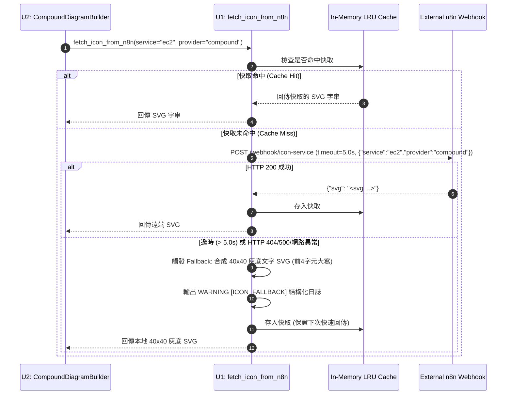
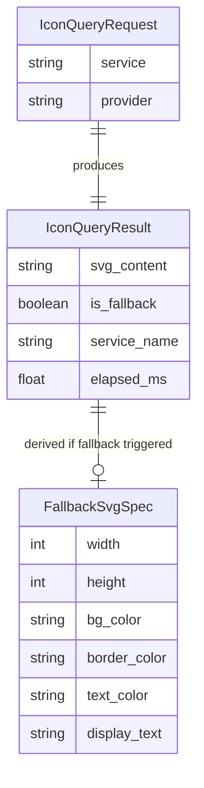

# Functional Specification — U1: u1-icon-service-gateway

> Stage: functional-design (3.1) · Phase: Construction · Scope: feature · Depth: Standard
> 建構單元: `u1-icon-service-gateway` (kind: `library`)
> 追溯上游基準：
> - [entities](entities.md)
> - [rules](rules.md)
> - [contract-summary](../../../inception/contract-design/contract-summary.md) (Contract C1, C2)

---

## 1. 行為工作流程與狀態機 (Workflows & State Transition)

### 1.1 圖示查詢標準流程 (Icon Query Workflow)

---

## 2. 領域實體關係圖 (Derived Entity-Relationship View)

---

## 3. 商業規則彙整與對映 (Derived Rules Summary View)

| Rule ID | 觸發點 | 決策邏輯 (IF...THEN) | 保證結果 |
| :--- | :--- | :--- | :--- |
| **BR1.1** | 構造上行 payload | IF 請求發起 THEN `provider="compound"` | 符合 Contract C1 外部約定 |
| **BR1.2** | 發送網路請求 | IF 呼叫超過 5.0 秒 THEN 立即 abort | 滿足 NFR3 總繪圖時限 $\le 8.0$ 秒 |
| **BR1.3** | 網路失敗 / 404 / 500 / 逾時 | IF 發生任何異常 THEN 回傳灰底 SVG | 絕不對外拋出例外，達成 C2 `no_throw: true` |
| **BR1.4** | Fallback 文字渲染 | IF 字串過長 THEN 截取前 4 碼大寫 | 確保 40x40 圖示文字對比與排版美觀 |
| **BR1.5** | 查詢入口 | IF 已在 LRU 快取中 THEN 直接回傳 | 減少跨網路延遲與外部服務負擔 |

