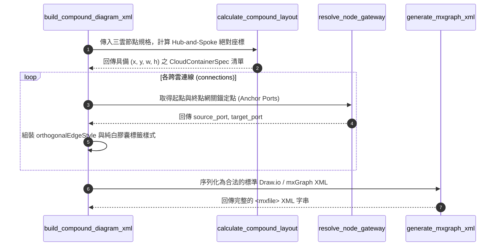
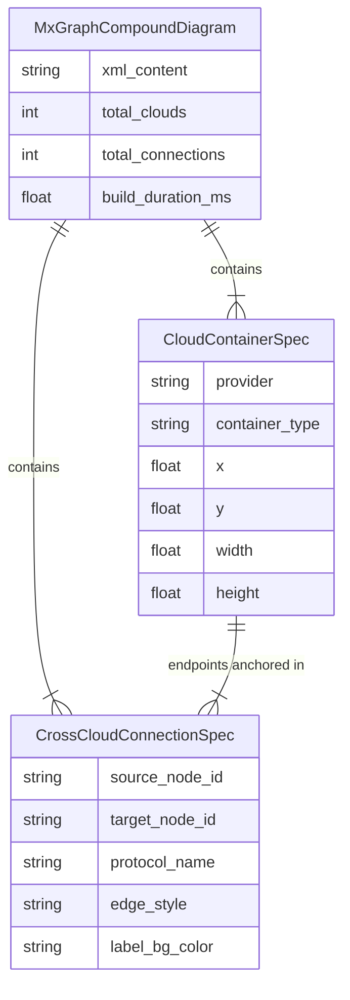

# Functional Specification — U2: u2-compound-diagram-builder

> Stage: functional-design (3.1) · Phase: Construction · Scope: feature · Depth: Standard
> 建構單元: `u2-compound-diagram-builder` (kind: `library`) · **Walking Skeleton**
> 追溯上游基準：
> - [entities](entities.md)
> - [rules](rules.md)
> - [contract-summary](../../../inception/contract-design/contract-summary.md) (Contract C2, C3)

---

## 1. 幾何座標計算演算法與狀態流轉 (Algorithms & Workflow)

### 1.1 Hub-and-Spoke 座標組裝演算法虛擬碼 (Layout Algorithm)

```python
def calculate_compound_layout(clouds: list[CloudContainerSpec]) -> list[CloudContainerSpec]:
    # 1. 排序：Azure (Left), AWS (Center), GCP (Right)
    sorted_clouds = sort_by_provider_role(clouds, left="azure", center="aws", right="gcp")
    
    current_x = 40.0
    buffer_corridor = 120.0
    
    for container in sorted_clouds:
        container.x = current_x
        container.y = 40.0
        
        # 2. 寬度約束檢查
        if container.provider == "aws":
            container.width = max(container.width, 480.0)
        else:
            container.width = max(container.width, 360.0)
            
        current_x += container.width + buffer_corridor
        
    return sorted_clouds
```

### 1.2 跨雲直角折線組裝流程 (Edge Assembly Workflow)



---

## 2. 領域實體關係圖 (Derived Entity-Relationship View)



---

## 3. 商業規則彙整與對映 (Derived Rules Summary View)

| Rule ID | 觸發點 | 決策邏輯 (IF...THEN) | 保證結果 |
| :--- | :--- | :--- | :--- |
| **BR2.1** | 容器節點建立 | IF 雲端類型為 AWS/Azure/GCP THEN 套用 `GROUP_STYLES` | 視覺風格與既有平台 100% 統一 |
| **BR2.2** | 座標計算 | 計算容器 X 座標時鄰近保留 120px 緩衝走廊 | 三雲拓撲邊界完全隔離不重疊 |
| **BR2.3** | 尺寸指派 | IF AWS THEN 寬度 $\ge 480$ ELSE 寬度 $\ge 360$ | 保證中央核心容納較多節點 |
| **BR2.4** | 連線建立 | IF 跨越不同雲容器 THEN 套用直角折線路由 | 折線穿越 120px 走廊時維持平整路徑 |
| **BR2.5** | 標籤生成 | 設置圓角白底標籤，文字對比 13.5:1 | 達成 WCAG 2.1 AA 規範，避免與底線重疊 |
| **BR2.6** | 產圖完成 | 端到端總產圖時間不超過 8.0 秒 | 滿足 NFR3 總體效能 SLA |

