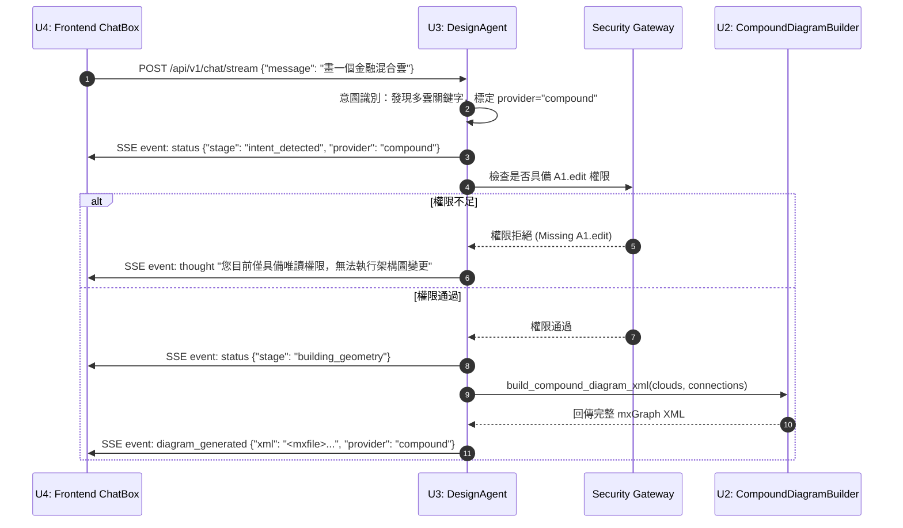
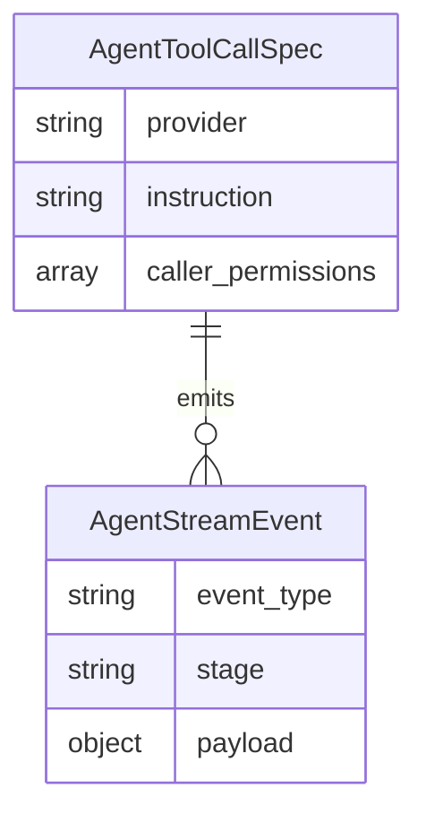

# Functional Specification — U3: u3-design-agent-compound

> Stage: functional-design (3.1) · Phase: Construction · Scope: feature · Depth: Standard
> 建構單元: `u3-design-agent-compound` (kind: `service`)
> 追溯上游基準：
> - [entities](entities.md)
> - [rules](rules.md)
> - [contract-summary](../../../inception/contract-design/contract-summary.md) (Contract C3, C4)

---

## 1. 行為工作流程與狀態機 (Workflows & State Transition)

### 1.1 Agent 意圖識別與 Tool 調用流程 (Agent Execution Workflow)

---

## 2. 領域實體關係圖 (Derived Entity-Relationship View)

---

## 3. 商業規則彙整與對映 (Derived Rules Summary View)

| Rule ID | 觸發點 | 決策邏輯 (IF...THEN) | 保證結果 |
| :--- | :--- | :--- | :--- |
| **BR3.1** | 工具調用 | 接受 `provider="compound"` | 滿足 Contract C4 API 規格 |
| **BR3.2** | 執行前防護 | IF 無 `A1.edit` THEN 阻擋調用並回覆警告 | 遵守 ADR-0006 專案基線安全約定 |
| **BR3.3** | 提示詞編譯 | 注入 Hub-and-Spoke 拓撲指引 | 引導模型輸出規範對稱之多雲結構 |
| **BR3.4** | 串流事件推送 | 階段變更時發送 SSE 訊息 | 前端即時感知繪圖狀態 |

