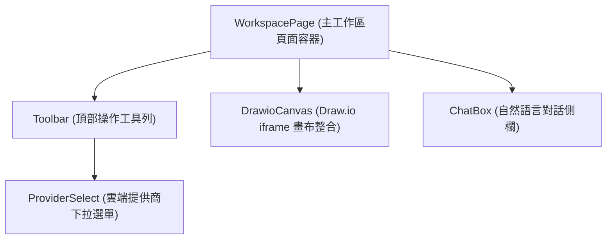

# Frontend Components Specification — U4: u4-workspace-canvas-ui

> Stage: functional-design (3.1) · Phase: Construction · Scope: feature · Depth: Standard
> 建構單元: `u4-workspace-canvas-ui` (kind: `ui`)
> 追溯上游基準：
> - [contract-summary](../../../inception/contract-design/contract-summary.md) (Contract C4)
> - [requirements](../../../inception/requirements-analysis/requirements.md) (FR1.1~FR1.3, NFR5, CON3)
> - [mockups](../../../inception/refined-mockups/mockups.md)

---

## 1. 前端元件階層與狀態流轉 (Component Hierarchy & Props/State)



### 1.1 元件屬性與狀態契約 (Props & State Signatures)

```yaml
components:
  - name: ProviderSelect
    path: frontend/src/components/Toolbar.tsx
    props:
      - name: value
        type: "string"
        description: "目前選中的 provider 代碼 ('aws' | 'azure' | 'gcp' | 'compound')"
      - name: onChange
        type: "(provider: string) => void"
        description: "切換 provider 之回調函式"
    options:
      - { value: "aws", label: "Amazon Web Services (AWS)" }
      - { value: "azure", label: "Microsoft Azure" }
      - { value: "gcp", label: "Google Cloud Platform (GCP)" }
      - { value: "compound", label: "混合雲 (Compound)" }

  - name: DrawioCanvas
    path: frontend/src/components/DrawioCanvas.tsx
    props:
      - name: xml
        type: "string"
        description: "後端回傳之 mxGraph XML 字串"
      - name: autoFit
        type: "boolean"
        default: true
        description: "收到新 XML 時是否自動觸發 fitWindow 縮放動畫"
    internal_methods:
      - name: triggerFitWindow
        signature: "triggerFitWindow(padding: number = 32): void"
        description: "透過 iframe.contentWindow.postMessage 發送 fitWindow 指令，CSS 動畫 250ms ease-out"
```

---

## 2. 互動流程與無障礙設計 (Interaction & Accessibility)

- **選中狀態回饋**: Provider 選項按鈕選中時套用 `ring-2 ring-indigo-500 bg-indigo-50 text-indigo-700`，焦點輪廓清晰可見。
- **WCAG 2.1 AA 檢驗**: 文字色與底色之對比度 $\ge 4.5:1$。

