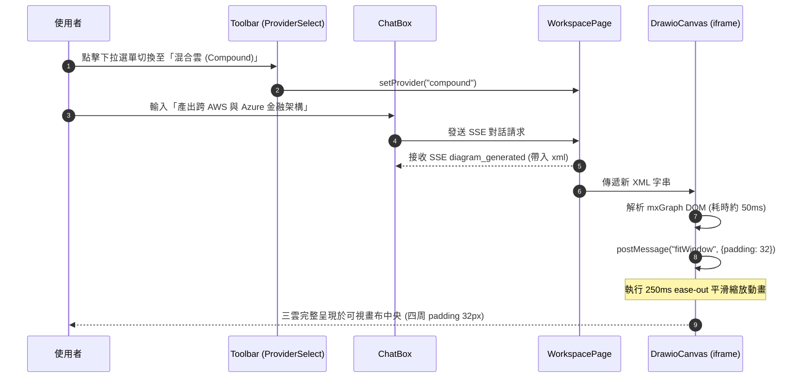

# Functional Specification — U4: u4-workspace-canvas-ui

> Stage: functional-design (3.1) · Phase: Construction · Scope: feature · Depth: Standard
> 建構單元: `u4-workspace-canvas-ui` (kind: `ui`)
> 追溯上游基準：
> - [frontend-components](frontend-components.md)
> - [rules](rules.md)
> - [contract-summary](../../../inception/contract-design/contract-summary.md) (Contract C4)

---

## 1. 互動工作流程與狀態機 (Workflows & State Transition)

### 1.1 前端使用者操作與畫布自適應流程 (UI Interaction Workflow)

---

## 2. 商業規則彙整與對映 (Derived Rules Summary View)

| Rule ID | 觸發點 | 決策邏輯 (IF...THEN) | 保證結果 |
| :--- | :--- | :--- | :--- |
| **BR4.1** | 下拉選單切換 | 選中 `compound` 時廣播狀態 | 介面提供高對比反饋，符合 WCAG 2.1 AA |
| **BR4.2** | 意圖識別事件 | 接收到 `provider="compound"` 時同步 Toolbar | 避免自然語言與頂部工具列狀態不一致 |
| **BR4.3** | 畫布渲染完成 | 50ms 後發送 fitWindow，250ms 完成動畫 | 三朵雲 100% 落在視窗內，無畫面抖動 |

