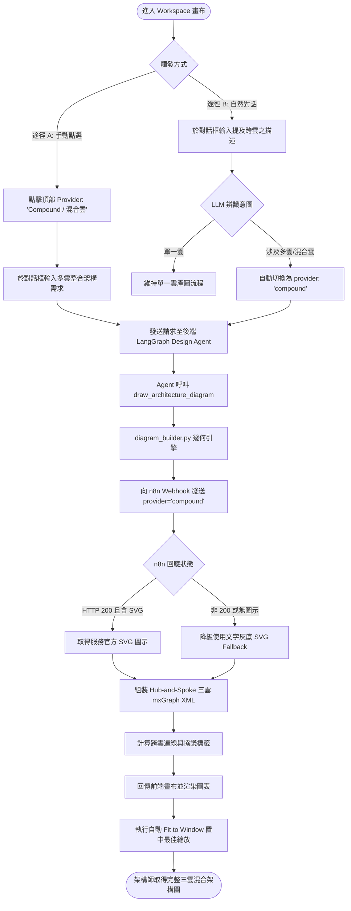

# User Flow — A1 混合雲架構繪圖

<!-- Stage: rough-mockups（Ideation 1.6）· 核心操作與系統互動流程 · 來源標籤定義見 rough-mockups-questions.md 的 ## Sources。 -->

## 上游輸入

- **intent-statement**（`../intent-capture/intent-statement.md`）：雲端架構師快速產出跨三雲整合架構圖、n8n 上行 provider = compound [intent:Q2] [intent:Q3]。
- **scope-document**（`../scope-definition/scope-document.md`）：整包交付 (All-in-One Must)、前端混合雲選單、對話自動辨識 [scope:Q1] [scope:Q4]。
- **wireframes**（`wireframes.md`）：前端 Provider 標籤、對話面版、Hub-and-Spoke 畫布佈局與 Fit to window [Q1] [Q2] [Q4]。

## 核心流程圖

<!-- Text fallback: 使用者進入 Workspace，可透過點擊頂部 Provider「Compound / 混合雲」按鈕，或直接在對話中輸入多雲需求由模型自動識別；後端 LangGraph Agent 呼叫繪圖工具，以 provider='compound' 向 n8n 查詢三雲圖示（遇異常自動降級灰底 fallback），由幾何引擎組裝 Hub-and-Spoke 三雲群組與跨雲連線標籤，回傳畫布渲染並自動置中縮放。 -->

## Flow 1 — 手動選取混合雲選單產圖（Happy Path 主流程）

1. 架構師登入進入 Cloud-360 [Workspace] 頁面。
2. 於畫布頂部 Provider 選單點選 **`[ Compound / 混合雲 ]`** [Q1]。
3. 系統將當前階段會話的預設供應商設定為 `compound`，左側對話框顯示多雲引導提示。
4. 架構師在對話框輸入：「請幫我規劃一個電商混合雲架構：核心 API 與計算部署在 AWS EKS，資料備份與大數據分析在 GCP BigQuery，而身分認證整合 Azure Active Directory 與 Azure VM。」
5. 後端 `design_agent` 接收需求並結構化為三雲群組、節點與跨雲連線，呼叫 `draw_architecture_diagram(provider="compound", ...)`。
6. `diagram_builder` 依 Hub-and-Spoke 佈局計算 AWS (中)、Azure (左)、GCP (右) 座標 [Q2]。
7. 各節點向 n8n 取得圖示，上行統一攜帶 `provider = "compound"` [feas:Q2]。
8. 組裝完成之 mxGraph XML 經 SSE 送往前端畫布渲染。
9. 畫布自動觸發 **Fit to Window**，整幅三雲架構圖居中完整呈現 [Q4]。

## Flow 2 — 對話模型自動識別切換流程

1. 架構師於預設單雲狀態下，直接在對話框描述跨雲混合需求（如「我想串接 AWS Lambda 與 GCP Cloud Run」）。
2. 對話模型識別出需求橫跨不同雲端平台，自動將繪圖參數調整為 `provider = "compound"` [scope:Q4]。
3. 頂部 Provider 標籤自動高亮顯示 `[ Compound / 混合雲 ]`，讓使用者視覺感知到已切換為混合雲模式。
4. 後續執行與 Flow 1 步驟 5~9 一致，完成圖表繪製。

## 異常與容錯路徑 (Error Paths & Degradation)

1. **n8n Webhook 暫時不可達或無回應**：
   - `fetch_icon_from_n8n` 在連線超時（5 秒）或 HTTP 狀態非 200 時，維持記錄 warning log，並自動返回該服務之灰底 SVG fallback。
   - 產圖流程不中斷，畫布依舊正常展示三雲群組與拓樸連線。
2. **跨雲節點名稱未完全命中官方圖示**：
   - 經由 `_normalise_icon_name` 清理後仍無法命中者，以 fallback 標籤呈現，架構師可後續於畫布就地手動微調。
3. **視窗寬度過小或小螢幕裝置**：
   - 畫布提供平滑平移（Pan）與滾輪縮放（Zoom），Fit to Window 依視窗可視寬高自適應縮放，避免元素破圖或溢出視窗。

## Assumptions & Open Questions

None.
