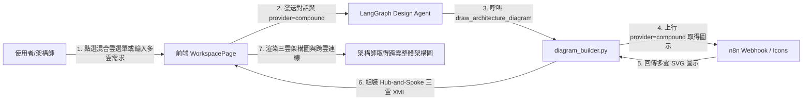

# Scope Document — A1 混合雲架構繪圖

<!-- Stage: scope-definition（Ideation 1.4）· 來源標籤定義見 scope-definition-questions.md 的 ## Sources。
     [Q<n>] 指本 stage 問題檔的已選答案；[intent:*]／[feas:*] 指上游 artifact 的已確認決定；[code:C*] 指查證事實；[memory:M*] 指 memory 層規則。 -->

## 上游輸入

- **intent-statement**（`../intent-capture/intent-statement.md`）：問題陳述（單一雲限制多雲架構展示）、目標客群（Cloud Architect）、成功指標（單圖三雲分區群組呈現、n8n 上行 provider = compound）與 feature Scope [intent:Q1] [intent:Q3] [intent:Q8]。
- **feasibility-assessment**（`../feasibility/feasibility-assessment.md`）：評估結論高度可行（GO）、中央核心＋雙翼 (Hub-and-Spoke) 空間佈局、n8n 統一傳送 `provider = "compound"`、跨雲連線支援協議標籤 [feas:Q1] [feas:Q2] [feas:Q3]。
- **constraint-register**（`../feasibility/constraint-register.md`）：三雲群組容器共存於單一 XML、跨雲 edges 避障支援、前端選單新增與對話自動識別雙支援、專屬單元測試集護欄 [feas:Q4] [feas:Q5] [code:C1]。
- market-research 已依條件判定跳過，無市場面約束輸入。

## 範圍邊界

### In scope

本次功能採**整包交付 (All-in-One Must)** 策略，一次完成前後端與測試鏈條整合 [Q1]：

| # | 能力項目 | 說明與具體規格 | 優先級 | Source |
|---|---|---|---|---|
| (a) | 後端 Prompt 與 Tool 擴充 | 擴充 `draw_architecture_diagram` tool 支援 `provider: "compound"`，更新 system prompt 指引模型生成三雲獨立頂層容器 JSON | Must | [feas:Q2] [code:C3] |
| (b) | 三雲 Hub-and-Spoke 幾何佈局 | 在 `diagram_builder.py` 實作中央核心＋雙翼幾何配置，計算 AWS、Azure、GCP 三大雲端容器之座標與間距，保證三雲並存不重疊 | Must | [feas:Q1] [code:C1] |
| (c) | n8n Webhook Compound 上行通訊 | `fetch_icon_from_n8n` 在混合雲模式下向 n8n 發送 `provider: "compound"`，維持既有灰底 fallback 容錯保護 | Must | [desc] [feas:Q2] [code:C2] |
| (d) | 跨雲連線與避障渲染 | 跨雲 edges 正確錨定跨雲節點，頂層 Cloud 容器不誤判為連線障礙，支援連線協議標籤（如 VPN / HTTPS） | Must | [feas:Q3] |
| (e) | 前端混合雲選單與畫布渲染 | 前端 Provider 下拉/按鈕選單新增「混合雲 (Compound)」選項，點選後向後端傳遞 compound 參數並順暢呈現圖表 | Must | [feas:Q4] |
| (f) | 專屬單元測試集防護 | 新增 `backend/tests/test_diagram_builder_compound.py`，完整斷言 compound 上行、三雲 XML 幾何組裝與 mock n8n 通訊 | Must | [feas:Q5] [memory:M2] |
| (g) | 對話模型多雲關鍵字自動識別 | 在使用者於聊天室提及「混合雲」、「跨 AWS 與 Azure」時，AI 主動識別並切換至 compound 模式 | Should | [feas:Q4] [Q4] |
| (h) | 畫布載入自動最佳視角縮放 | 前端在載入多雲較寬畫布時，自動呼叫 Fit to window 確保三雲全貌一眼可見 | Could | [Q4] |

### Won't Have（本次明確排除 [Q3]）

| 排除項目 | 排除理由與邊界澄清 |
|---|---|
| 雲端真實資源反向同步 (Reverse Engineering) | 本次專注於 AI 架構圖繪圖與視覺化生成，不包含從現有真實雲端帳號反向拉取實例 |
| 第四朵雲端供應商擴充 (Alibaba / OCI 等) | 本次明確聚焦於主流三雲（AWS、Azure、GCP），不擴大引入第四朵雲 |
| 混合雲架構之成本試算自動聯動 (C1 Calculator) | 成本估算屬獨立之 FinOps 模組，不與本次 A1 混合雲繪圖夾帶實作 |
| 跨雲連線之即時實體網絡延遲與頻寬遙測 | 本次聚焦於邏輯架構圖繪製，不包含底層實體網路監控與遙測功能 |

### 未承諾（不在範圍、亦未列入排除）

無。建議排除項目已全部經使用者確認列入 Won't Have [Q3]。

## MoSCoW 總表

- **Must Have**：(a) 後端 Tool/Prompt 擴充、(b) Hub-and-Spoke 幾何佈局、(c) n8n compound 上行、(d) 跨雲 edges 與標籤、(e) 前端混合雲選單、(f) 專屬單元測試集 [Q4]。
- **Should Have**：(g) 對話模型多雲關鍵字自動識別 [Q4]。
- **Could Have**：(h) 畫布 Fit to window 最佳縮放 [Q4]。
- **Won't Have**：真實資源同步、第四雲擴充、成本自動試算聯動、網絡即時遙測 [Q3]。

## 價值流

<!-- Text fallback: 使用者於前端選擇混合雲或輸入跨雲需求，前端攜帶 compound 參數呼叫 Design Agent；Agent 呼叫擴充後的繪圖工具，由 diagram_builder 以 Hub-and-Spoke 佈局向 n8n 發送 compound 請求取得三雲圖示，組裝出包含 AWS、Azure、GCP 的單一 mxGraph XML，並回傳前端畫布渲染呈現。 -->

## 排序原則

**Dependency-first（技術依賴優先）** [Q2]：
1. **第一順位 (基礎定義)**：擴充 `design_agent.py` 之 `draw_architecture_diagram` tool 參數與 system prompt [code:C3]。
2. **第二順位 (核心幾何與通訊)**：於 `diagram_builder.py` 實作 Hub-and-Spoke 空間佈局與 n8n `provider = "compound"` 上行通訊 [code:C1][code:C2]。
3. **第三順位 (跨雲連線與容錯)**：處理跨雲 edges 避障邏輯與協議標籤渲染。
4. **第四順位 (前端串接)**：前端 `WorkspacePage` 增加混合雲選單與對話串接。
5. **第五順位 (測試與驗證)**：建立 `test_diagram_builder_compound.py`，完成整體端到端與單元測試覆蓋。

## Assumptions & Open Questions

None.
