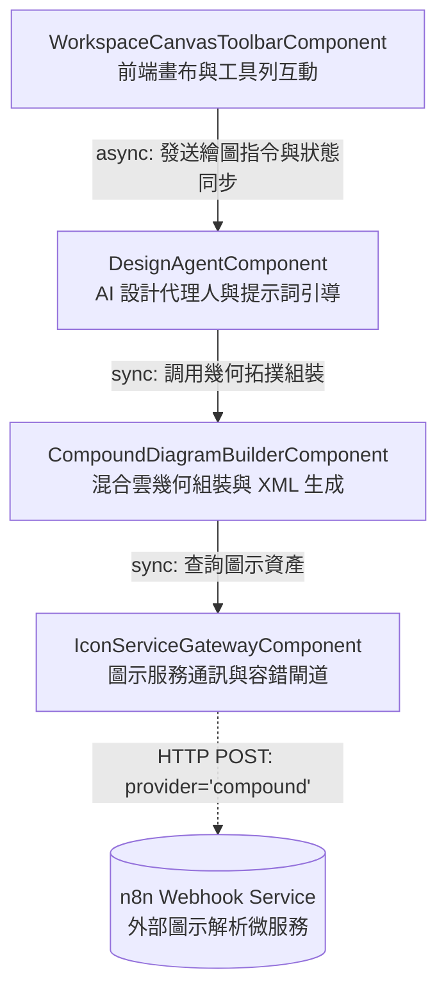

# Component Catalogue — A1 混合雲繪圖功能 (Compound Cloud Diagram)

> Stage: domain-design (2.6) · Phase: Inception · Scope: feature · Depth: Standard
> 追溯上游基準：
> - [requirements](../requirements-analysis/requirements.md)
> - [stories](../user-stories/stories.md)
> - [architecture](../../../codekb/cloud-360/architecture.md)
> - [component-inventory](../../../codekb/cloud-360/component-inventory.md)
> - [team-practices](../practices-discovery/team-practices.md)

---

## 1. 領域元件機器可讀目錄 (Machine-Readable Component Catalogue)

```yaml
components:
  - name: WorkspaceCanvasToolbarComponent
    summary: 前端畫布頂部工具列與互動控制器，管理 Provider 選單、ChatBox 多雲意圖連動及 Fit-to-Window 自動最佳縮放
    behaviour: >
      管理使用者在畫布上的操作狀態；當選中 compound 時將全域狀態更新為 compound；收到混合雲 XML 後於 250ms 內平滑執行 Fit-to-Window；與 ChatBox SSE 雙向同步。
    responsibilities:
      - Provider 下拉選單狀態管理與切換
      - ChatBox 自然語言意圖辨識反饋與 Badge 渲染
      - DrawioCanvas 縮放控制器與 Fit-to-Window 動效觸發
    depends_on:
      - component: DesignAgentComponent
        interaction: 發送架構設計請求並接收串流產圖狀態
        style: async
    dependents: []
    external_dependencies: []
    entities:
      - name: ToolbarProviderSelection
        identifier: selectionId
        attributes: [selectionId, currentProvider, activeMode, updatedAt]
      - name: CanvasViewState
        identifier: viewStateId
        attributes: [viewStateId, zoomLevel, padding, isAnimating, fitMode]

  - name: DesignAgentComponent
    summary: A1 智能設計代理人與提示詞引導引擎，負責接收自然語言架構需求、調用繪圖 Tool 並引導拓撲規則
    behaviour: >
      檢驗使用者 A1.edit 權限；支援 provider="compound" Tool 參數；引導 LLM 生成以主要業務雲（AWS）置中、雙翼分佈附屬雲之 Hub-and-Spoke 多雲架構。
    responsibilities:
      - draw_architecture_diagram tool 宣告與參數驗證
      - 系統提示詞維護與多雲拓撲置中指引
      - RBAC A1.edit 權限檢查與唯讀保護
    depends_on:
      - component: CompoundDiagramBuilderComponent
        interaction: 調用混合雲幾何組裝引擎產出 mxGraph XML
        style: sync
    dependents:
      - component: WorkspaceCanvasToolbarComponent
        interaction: 接收使用者對話與工具列操作指令
    external_dependencies: []
    entities:
      - name: AgentToolCallRequest
        identifier: requestId
        attributes: [requestId, provider, promptText, callerPermissions]
      - name: CloudTopologyDirective
        identifier: directiveId
        attributes: [directiveId, primaryCloud, secondaryClouds, layoutPattern]

  - name: CompoundDiagramBuilderComponent
    summary: 混合雲幾何組裝與 Draw.io XML 生成引擎，負責 Hub-and-Spoke 三雲座標隔離、群組樣式與直角連線
    behaviour: >
      計算三雲空間座標（中央 480px、兩翼 360px、走廊 120px）；套用 GROUP_STYLES（aws_cloud, azure_cloud, gcp_cloud）；計算直角折線與連線中點純白膠囊協議標籤；嵌入服務圖示。
    responsibilities:
      - Hub-and-Spoke 空間座標佈局演算法與 120px 緩衝走廊計算
      - 三雲頂層群組容器與子容器 (VPC/VNet/Subnet) mxGraph XML 組裝
      - 跨雲直角折線 (orthogonalEdgeStyle) 路由與端點錨定
      - 協議文字標籤 (Protocol Badges) 動態渲染
    depends_on:
      - component: IconServiceGatewayComponent
        interaction: 查詢與取得各雲服務之圖示 (provider="compound")
        style: sync
    dependents:
      - component: DesignAgentComponent
        interaction: 產出完整 mxGraph XML 字串回傳給 Agent
    external_dependencies: []
    entities:
      - name: CompoundCanvasModel
        identifier: modelId
        attributes: [modelId, totalWidth, totalHeight, corridorWidth, xmlOutput]
      - name: CloudGroupBox
        identifier: boxId
        attributes: [boxId, provider, posX, posY, width, height, styleName]
        references:
          - entity: CompoundCanvasModel
            owned_by: CompoundDiagramBuilderComponent
            relationship: 每個 CloudGroupBox 屬於一個 CompoundCanvasModel
      - name: CrossCloudEdge
        identifier: edgeId
        attributes: [edgeId, sourceBoxId, targetBoxId, protocolName, edgeStyle]
        references:
          - entity: CloudGroupBox
            owned_by: CompoundDiagramBuilderComponent
            relationship: 跨雲連線連接兩個不同的 CloudGroupBox

  - name: IconServiceGatewayComponent
    summary: 外部圖示服務通訊與容錯降級閘道，負責向 n8n Webhook 發送 compound 請求並提供 5.0 秒逾時保護
    behaviour: >
      向 N8N_WEBHOOK_URL 發送 POST {"service": name, "provider": "compound"}；嚴格限時 5.0 秒；超時或非 200 時自動生成 40x40 灰底文字向量 SVG，絕不中斷產圖。
    responsibilities:
      - n8n compound 上行 Payload 組裝與 HTTP 通訊
      - 5.0 秒逾時中斷保護與異常捕獲
      - 40x40 灰底文字向量 SVG Fallback 本地生成
    depends_on: []
    dependents:
      - component: CompoundDiagramBuilderComponent
        interaction: 為各雲節點提供圖示資產或 Fallback SVG
    external_dependencies:
      - name: n8n Webhook Service
        kind: third-party-api
        purpose: 依據 service 名稱與 compound 提供商解析官方服務向量圖示
    entities:
      - name: IconFetchRequest
        identifier: fetchId
        attributes: [fetchId, serviceName, provider, timeoutSeconds]
      - name: IconFetchResult
        identifier: resultId
        attributes: [resultId, iconSvgData, isFallback, durationMs]
        references:
          - entity: IconFetchRequest
            owned_by: IconServiceGatewayComponent
            relationship: 每次圖示擷取結果對應一個擷取請求
```

---

## 2. 元件架構圖 (Component Diagram)



---

## 3. 元件摘要清單 (Component Summary Table)

| 元件名稱 (Component) | 核心職責 (Purpose) | 依賴元件 (Depends On) | 被依賴元件 (Dependents) | 擁有實體 (Entities Owned) |
| :--- | :--- | :--- | :--- | :--- |
| **`WorkspaceCanvasToolbarComponent`** | 前端工具列 Provider 切換、對話意圖同步、Fit-to-Window 自動縮放 | `DesignAgentComponent` | (無) | `ToolbarProviderSelection`, `CanvasViewState` |
| **`DesignAgentComponent`** | `draw_architecture_diagram` tool 宣告、多雲拓撲 Prompt 引導、RBAC 檢核 | `CompoundDiagramBuilderComponent` | `WorkspaceCanvasToolbarComponent` | `AgentToolCallRequest`, `CloudTopologyDirective` |
| **`CompoundDiagramBuilderComponent`** | Hub-and-Spoke 幾何空間計算、三雲邊界隔離、直角折線與協議標籤組裝 | `IconServiceGatewayComponent` | `DesignAgentComponent` | `CompoundCanvasModel`, `CloudGroupBox`, `CrossCloudEdge` |
| **`IconServiceGatewayComponent`** | n8n 上行 compound 通訊、5.0 秒逾時保護、40x40 灰底文字向量 SVG 降級 | (無) | `CompoundDiagramBuilderComponent` | `IconFetchRequest`, `IconFetchResult` |

---

## 4. 實體所有權清單 (Entity Ownership Table)

| 實體名稱 (Entity) | 擁有元件 (Owning Component) | 唯一識別字 (Identifier) | 屬性清單 (Attributes) | 參照關聯 (References) |
| :--- | :--- | :--- | :--- | :--- |
| **`ToolbarProviderSelection`** | `WorkspaceCanvasToolbarComponent` | `selectionId` | `selectionId, currentProvider, activeMode, updatedAt` | (無) |
| **`CanvasViewState`** | `WorkspaceCanvasToolbarComponent` | `viewStateId` | `viewStateId, zoomLevel, padding, isAnimating, fitMode` | (無) |
| **`AgentToolCallRequest`** | `DesignAgentComponent` | `requestId` | `requestId, provider, promptText, callerPermissions` | (無) |
| **`CloudTopologyDirective`** | `DesignAgentComponent` | `directiveId` | `directiveId, primaryCloud, secondaryClouds, layoutPattern` | (無) |
| **`CompoundCanvasModel`** | `CompoundDiagramBuilderComponent` | `modelId` | `modelId, totalWidth, totalHeight, corridorWidth, xmlOutput` | (無) |
| **`CloudGroupBox`** | `CompoundDiagramBuilderComponent` | `boxId` | `boxId, provider, posX, posY, width, height, styleName` | 屬於 `CompoundCanvasModel` |
| **`CrossCloudEdge`** | `CompoundDiagramBuilderComponent` | `edgeId` | `edgeId, sourceBoxId, targetBoxId, protocolName, edgeStyle` | 連接兩個 `CloudGroupBox` |
| **`IconFetchRequest`** | `IconServiceGatewayComponent` | `fetchId` | `fetchId, serviceName, provider, timeoutSeconds` | (無) |
| **`IconFetchResult`** | `IconServiceGatewayComponent` | `resultId` | `resultId, iconSvgData, isFallback, durationMs` | 對應一個 `IconFetchRequest` |

---

## 5. 外部依賴清單 (External Dependencies Table)

| 元件名稱 (Component) | 外部依賴 (Dependency) | 類別 (Kind) | 目的與通訊協定 (Purpose & Protocol) |
| :--- | :--- | :--- | :--- |
| **`IconServiceGatewayComponent`** | `n8n Webhook Service` | `third-party-api` | 透過 HTTP POST `${N8N_WEBHOOK_URL}` 傳遞 `{"service": name, "provider": "compound"}`，取得三雲服務官方向量圖示。具備 5.0 秒逾時熔斷保護。 |

---

## 6. 元件切分理由與邊界分析 (Rationale)

| 元件名稱 (Component) | 切分理由 (Rationale for Decomposition) | 替代方案與排除原因 (Alternatives Rejected) |
| :--- | :--- | :--- |
| **`WorkspaceCanvasToolbarComponent`** | **關注點分離 (Distinct Concern)**：負責瀏覽器端 UI 狀態與視角動畫（React 體系），與後端繪圖計算完全隔離。 | 排除直接在後端回傳視角座標由前端強制重整之方案；前端保有本地縮放靈活性。 |
| **`DesignAgentComponent`** | **變更頻率獨立 (Distinct Change Rate)**：Prompt 調優與 Tool 參數更新頻率遠高於底層幾何演算法，獨立可避免互相干擾。 | 排除將 Prompt 邏輯內嵌於幾何組裝之方案，以符合 AI Agent 與渲染引擎分層原則。 |
| **`CompoundDiagramBuilderComponent`** | **純函式與核心業務邏輯 (Core Business Logic)**：純無狀態之幾何計算與 XML 組裝，具備 100% 可單元測試性。 | 排除將圖示 HTTP 呼叫與幾何計算混寫之方案，確保幾何測試不需啟動真實網路。 |
| **`IconServiceGatewayComponent`** | **外部 I/O 隔離與容錯防禦 (External I/O & Resilience)**：專門封裝不穩定之外部網路呼叫與 Fallback 生成，保護核心幾何不受網路抖動衝擊。 | 排除由前端直接向 n8n 查詢之方案，避免暴露 Webhook URL 與遭遇瀏覽器 CORS 限制。 |

