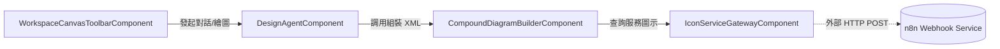

# Domain Design Planning & Architecture Questionnaire — A1 混合雲繪圖功能

> Stage: domain-design (2.6) · Phase: Inception · Scope: feature · Depth: Standard
> 追溯上游基準：
> - [requirements](../requirements-analysis/requirements.md)
> - [stories](../user-stories/stories.md)
> - [architecture](../../../codekb/cloud-360/architecture.md)
> - [component-inventory](../../../codekb/cloud-360/component-inventory.md)
> - [team-practices](../practices-discovery/team-practices.md)

---

## 1. 領域元件切分規劃 (Component Boundary Approach)

為使混合雲繪圖架構具備高內聚、低耦合、職責明確且易於單元測試之特性，本專案將系統邏輯程式碼切分為 4 個核心領域元件 (Logical Building Blocks)：

1. **`WorkspaceCanvasToolbarComponent` (前端畫布與工具列互動元件)**
   - **程式碼範疇**: `frontend/src/pages/WorkspacePage.tsx`、`frontend/src/components/`
   - **職責**: 負責 Provider 下拉選單切換、ChatBox 自然語言多雲意圖狀態同步、DrawioCanvas 自動 Fit-to-Window (250ms ease-out) 與視角管理。
   - **擁有實體**: `ToolbarProviderSelection`, `CanvasViewState`

2. **`DesignAgentComponent` (AI 代理人與提示詞引導元件)**
   - **程式碼範疇**: `backend/services/design_agent.py`、`backend/prompts/`
   - **職責**: 負責 A1 Agent Tool 宣告（容許 `provider="compound"`）、System Prompt 多雲拓撲規則引導（業務核心雲置中、外圍雲分佈兩翼）、RBAC `A1.edit` 權限校驗。
   - **擁有實體**: `AgentToolCallRequest`, `CloudTopologyDirective`

3. **`CompoundDiagramBuilderComponent` (混合雲幾何佈局與 XML 組裝元件)**
   - **程式碼範疇**: `backend/services/diagram_builder.py`
   - **職責**: 負責 Hub-and-Spoke 幾何空間計算（中央 480px、兩翼 360px、緩衝走廊 120px）、`GROUP_STYLES` 三雲頂層樣式套用、跨雲直角折線 (`orthogonalEdgeStyle`) 路由計算與協議標籤渲染。
   - **擁有實體**: `CompoundCanvasModel`, `CloudGroupBox`, `CrossCloudEdge`

4. **`IconServiceGatewayComponent` (圖示服務通訊與容錯閘道元件)**
   - **程式碼範疇**: `backend/services/diagram_builder.py` 之 `fetch_icon_from_n8n()`
   - **職責**: 負責向 `${N8N_WEBHOOK_URL}` 發送上行 `provider="compound"` POST 請求、嚴格 5.0 秒逾時中斷控管、HTTP 非 200 或逾時自動降級回傳標準 40x40 灰底文字向量 SVG。
   - **擁有實體**: `IconFetchRequest`, `IconFetchResult`

---

## 2. 元件交互與依賴圖 (Component Interaction Graph)

- **依賴特性**: 單向、無環依賴 (Acyclic)。
- **外部依賴**: 僅 `IconServiceGatewayComponent` 具備外部依賴 `n8n Webhook Service`，其餘元件均為純函式或前端 React 本地狀態。

---

## 3. 領域設計問卷 (Architecture Questions)

### Q1. 元件邊界與責任劃分 (Component Boundaries)
將混合雲功能劃分為 4 個領域元件（前端 UI 互動、Agent 引導、幾何 XML 組裝、n8n 通訊閘道），邊界是否足夠清晰獨立？
- [A] 認同，職責分離且易於獨立單元測試與後續 Unit Generation。（推薦）
- [B] 建議將 Icon Gateway 合併至 Diagram Builder 不另行獨立。
- [C] 尚未確定。

[Answer]: [A]

### Q2. 實體唯一歸屬性 (Entity Ownership)
每個實體（如 `CompoundCanvasModel` 由 Builder 擁有、`IconFetchRequest` 由 Gateway 擁有）皆具備單一且明確的歸屬元件，是否符合無歧義原則？
- [A] 認同，無跨元件實體歸屬模糊或雙重擁有之壞味道。（推薦）
- [B] 建議調整實體歸屬。

[Answer]: [A]

### Q3. 常數模組化收斂 (依據 Refined Mockups 建議 R-02)
三雲顏色、尺寸與邊距常數是否於後端收斂為專屬常數定義（如 `GROUP_STYLES` 與幾何常數定義於 `diagram_builder.py` 頂部或 `constants/`）？
- [A] 認同，落實審查建議，將 480px、360px、120px、色彩 Hex 與協議字串模組化收斂。（推薦）
- [B] 維持散落在各函式中。

[Answer]: [A]

---

## Consolidated Summary Confirmation

在依據上述答案產出 components.md、decisions.md 與 traceability.json 前，請確認以下彙整摘要正確無誤：

- **元件邊界 (Q1)**: [A] 劃分為 4 大領域元件（UI 畫布、Agent 引導、幾何組裝、圖示閘道），單向無環。
- **實體歸屬 (Q2)**: [A] 每個實體具備唯一歸屬元件，無共享所有權。
- **常數收斂 (Q3)**: [A] 落實 R-02 建議，三雲色彩、Hub-and-Spoke 尺寸與協議清單全數模組化常數宣告。

Does this all look correct before I generate the domain design artifacts?
- Looks correct
- Request changes

[Answer]: Looks correct
