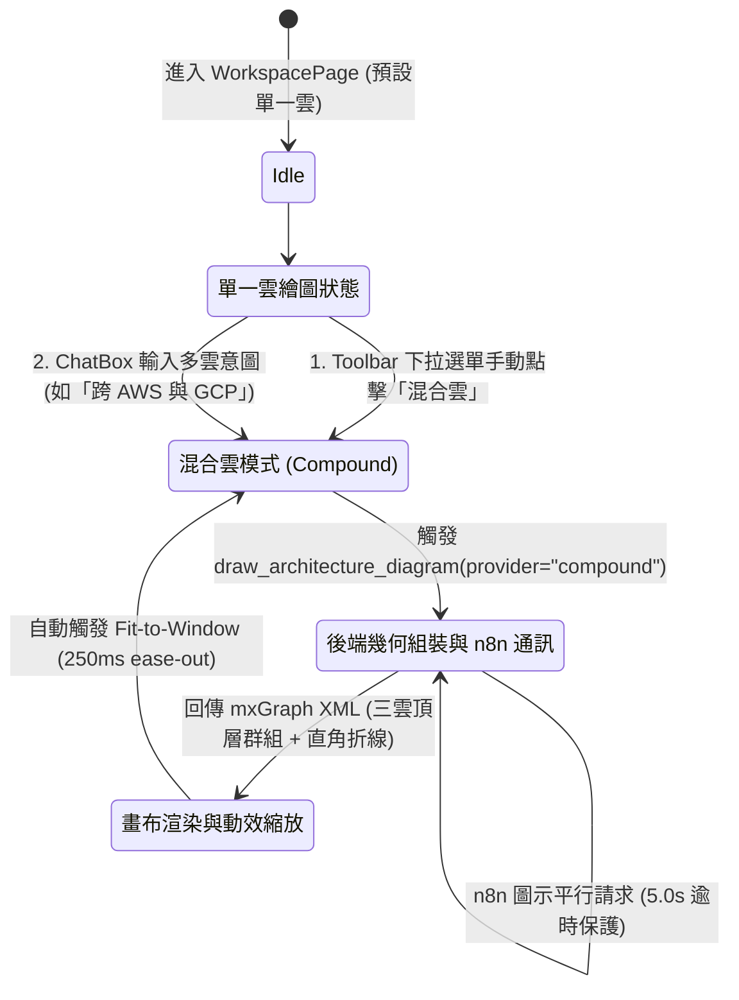

# Interaction Specification — A1 混合雲繪圖功能 (Compound Cloud Diagram)

> Stage: refined-mockups (2.5) · Phase: Inception · Scope: feature · Depth: Standard
> 追溯上游基準：
> - [wireframes](../../ideation/rough-mockups/wireframes.md)
> - [user-flow](../../ideation/rough-mockups/user-flow.md)
> - [stories](../user-stories/stories.md)
> - [requirements](../requirements-analysis/requirements.md)
> - [team-practices](../practices-discovery/team-practices.md)

---

## 1. 互動架構與狀態轉移規格 (Interaction Architecture & State Transitions)

本功能提供「Toolbar 手動切換」與「ChatBox 自然語言智能識別」之雙重觸發途徑。兩者透過集中式狀態與後端 SSE 串流事件保持雙向同步：



---

## 2. 元件層次互動規格 (Component-Level Interaction Specs)

### 2.1 Provider 下拉選單元件 (`ProviderSelector`)
- **位置**: WorkspacePage 頂部次工具列左側第 1 個控制項。
- **Props**:
  - `selectedProvider: "AWS" | "GCP" | "Azure" | "compound"`
  - `onChange: (provider: string) => void`
  - `disabled: boolean` (產圖渲染中為 true)
- **互動行為**:
  - **Click**: 點擊展開下拉選單，選單淡入 (150ms)，背景陰影 `shadow-md`。
  - **Select Option**: 點擊「混合雲 (Compound)」時：
    1. 關閉下拉選單。
    2. 更新全域狀態 `setProvider("compound")`。
    3. 工具列按鈕標籤更新為 `Compound (混合雲)`，左側顯示藍色標記圓點。
  - **Keyboard Access**: 支援 `ArrowDown`、`ArrowUp`、`Enter` 選擇，支援 `Escape` 鍵關閉選單。

### 2.2 對話式智能辨識反饋元件 (`ChatAssistant`)
- **多雲關鍵字命中**:
  - 當正規表達式比對命中跨雲模式（如 `/(AWS|Azure|GCP).+(AWS|Azure|GCP)|混合雲|多雲|compound/i`）：
  - Agent 在回覆文字首行顯示提示 Badge：
    ```html
    <span class="badge badge-info">☁️ 混合雲 (Compound) 模式</span>
    ```
  - 同步呼叫前端控制器將 `ProviderSelector` 切換至 `compound`。

### 2.3 畫布縮放與視角控制器 (`CanvasZoomController`)
- **動效參數 (依據 R-01 審查建議)**:
  - **Method**: `drawioCanvas.fitWindow({ animate: true, duration: 250, easing: 'ease-out', padding: 32 })`
  - **時機點**: 在收到後端 XML 且 mxGraph 完成 DOM 樹組裝後之 `requestAnimationFrame` 觸發。
  - **平滑性**: 視角中心點平滑移動至三雲群組的整體邊界中心，縮放比率自動限制在 `0.2 <= zoom <= 1.5`，避免極端圖形過大或過小。

---

## 3. 跨雲連線與協議標籤渲染規格 (Cross-Cloud Edge & Label Specs)

### 3.1 直角折線路由 (Orthogonal Routing)
- **邊緣樣式**: `edgeStyle=orthogonalEdgeStyle;rounded=1;strokeColor=#475569;strokeWidth=2;`
- **錨定規則**:
  - 來源端點錨定於來源雲網關之 exit 連接點（例如右側中點 `exitX=1;exitY=0.5`）。
  - 目標端點錨定於目的雲網關之 entry 連接點（例如左側中點 `entryX=0;entryY=0.5`）。
  - 折線穿過 120px 緩衝走廊時保持水平直線，垂直位移僅在雲內部走廊發生。

### 3.2 協議文字標籤 (Protocol Badges, 依據 R-02 審查建議)
- **渲染規範**:
  - **Style**: `labelBackgroundColor=#FFFFFF;labelBorderColor=#CBD5E1;fontColor=#1E293B;fontSize=11;fontStyle=1;spacing=4;`
  - **文字標準清單**:
    - `"Direct Connect (10 Gbps)"`
    - `"ExpressRoute Dedicated"`
    - `"Cloud Interconnect"`
    - `"IPSec VPN Tunnel"`
    - `"Mutual TLS HTTPS API"`
  - **對比度校驗**: `#1E293B` 在 `#FFFFFF` 底色上之對比度為 **13.5:1**（大幅超越 WCAG 2.1 AA 規定的 4.5:1）。

---

## 4. 異常與降級互動規格 (Error Handling & Fallback Spec)

### 4.1 n8n 服務逾時或連線異常
- **逾時門檻**: 5.0 秒 (`timeout = 5.0`)。
- **前端視覺反饋**:
  - 不跳出任何阻斷式錯誤彈窗 (Modal/Alert)。
  - 圖示替換為向量 SVG，格式如下：
    ```xml
    <svg xmlns="http://www.w3.org/2000/svg" width="40" height="40" viewBox="0 0 40 40">
      <rect width="40" height="40" rx="4" fill="#F1F5F9" stroke="#94A3B8" stroke-width="1"/>
      <text x="20" y="24" font-family="sans-serif" font-size="10" font-weight="bold" fill="#475569" text-anchor="middle">
        [SERVICE]
      </text>
    </svg>
    ```
  - 後端記錄 Warning 日誌，產圖全流程維持在 8.0 秒內完成，保證架構師工作流連續性。

