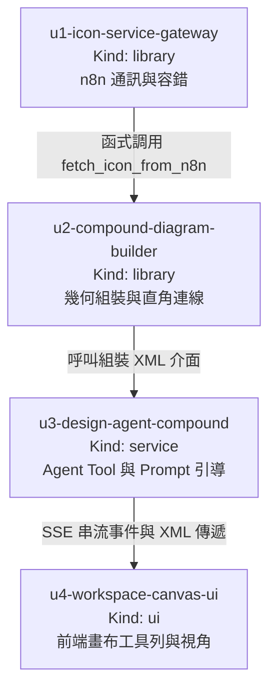

# Unit Dependencies & DAG Specification — A1 混合雲繪圖功能

> Stage: units-generation (2.7) · Phase: Inception · Scope: feature · Depth: Standard
> 追溯上游基準：
> - [components](../domain-design/components.md)
> - [decisions](../domain-design/decisions.md)
> - [requirements](../requirements-analysis/requirements.md)
> - [stories](../user-stories/stories.md)

---

## 1. 機器可讀相依有向無環圖 (Machine-Readable Dependency DAG)

```yaml
units:
  - name: u1-icon-service-gateway
    kind: library
    depends_on: []
  - name: u2-compound-diagram-builder
    kind: library
    depends_on: [u1-icon-service-gateway]
  - name: u3-design-agent-compound
    kind: service
    depends_on: [u2-compound-diagram-builder]
  - name: u4-workspace-canvas-ui
    kind: ui
    depends_on: [u3-design-agent-compound]
```

---

## 2. 拓撲相依關係圖與分析 (Dependency Topology Analysis)

本階段依據代碼相依性建立嚴格無環之有向無環圖 (Acyclic DAG)：



- **拓撲特性說明**:
  - `u1-icon-service-gateway` 為整個混合雲繪圖體系之最底層基礎設施閘道，無任何下游內部依賴。
  - `u2-compound-diagram-builder` 依賴 U1 提供之圖示取得能力（含容錯 fallback SVG），進行純記憶體幾何座標計算與 mxGraph XML 組裝。
  - `u3-design-agent-compound` 依賴 U2 產出之 XML，對外暴露為 Agent 可呼叫之 Tool。
  - `u4-workspace-canvas-ui` 依賴 U3 暴露之對話與產圖服務，完成前端使用者操作與畫布自動 Fit-to-Window。

---

## 3. 單元間整合合約與通訊介面 (Integration Points & Contracts)

| 上游單元 (Provider) | 下游單元 (Consumer) | 整合點與資料介面 (Integration Interface) | 通訊型態 (Style) | 契約約制 (Contract Constraints) |
| :--- | :--- | :--- | :--- | :--- |
| **U1** | **U2** | `fetch_icon_from_n8n(service: str, provider: str = "compound") -> str` | In-process Sync | 逾時 5.0 秒，回傳值保證為合法之 SVG 字串，絕不回傳 None 或拋出未處理異常。 |
| **U2** | **U3** | `draw_architecture_diagram(provider="compound", ...)` 內部組裝函式 | In-process Sync | 回傳標準 UTF-8 編碼之 mxGraph XML 字串，三雲群組 X 軸間距保證 $\ge 120\text{px}$。 |
| **U3** | **U4** | FastAPI SSE `/api/v1/chat/stream` 與 WebSocket 訊息傳遞 | Async Network | 回傳包含 `event: "diagram_generated"` 與 `xml: "<mxGraphModel>..."`，帶有 `provider: "compound"` 標記。 |

---

## 4. 平行開發與批次分析 (Parallelism & Batch Feasibility)

- **拓撲批次劃分**:
  - **Batch 1**: `u1-icon-service-gateway` (獨立底層)
  - **Batch 2**: `u2-compound-diagram-builder`
  - **Batch 3**: `u3-design-agent-compound`
  - **Batch 4**: `u4-workspace-canvas-ui`
- **說明**: 因 4 個單元構成線型依賴鏈，Stage 2.9 (Delivery Planning) 將依據經濟效益與風險優先級規劃各單元之實際 Bolt 執行順序與整合驗收時機。

