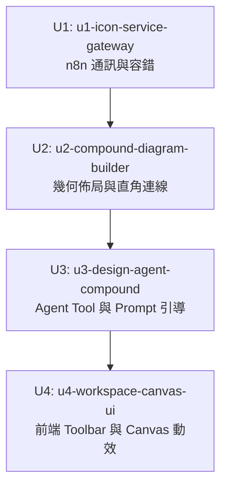

# Units Generation Planning & Questionnaire — A1 混合雲繪圖功能

> Stage: units-generation (2.7) · Phase: Inception · Scope: feature · Depth: Standard
> 追溯上游基準：
> - [components](../domain-design/components.md)
> - [decisions](../domain-design/decisions.md)
> - [requirements](../requirements-analysis/requirements.md)
> - [stories](../user-stories/stories.md)

---

## 1. 建構單元劃分規劃 (Unit Boundary Strategy)

依據 Stage 2.6 Domain Design 確立的 4 大領域邏輯元件，我們將 Construction 實作階段的工作拆解為 4 個標準建構單元 (Units of Work, U1 ~ U4)：

1. **U1: `u1-icon-service-gateway` (kind: `library`)**
   - 封裝 `fetch_icon_from_n8n()`，實作 `provider="compound"` 上行通訊、5.0 秒逾時保護與 40x40 灰底文字向量 SVG Fallback。
   - 對應故事：US4.1, US4.2
   - 依賴：無 (拓撲底層)

2. **U2: `u2-compound-diagram-builder` (kind: `library`)**
   - 實作 Hub-and-Spoke 幾何空間座標計算（480px / 360px / 120px）、`GROUP_STYLES` 樣式套用、跨雲直角折線與協議標籤渲染，並建立專屬測試檔 `test_diagram_builder_compound.py`。
   - 對應故事：US3.1, US3.2, US3.3, US3.4
   - 依賴：U1

3. **U3: `u3-design-agent-compound` (kind: `service`)**
   - 擴充 `draw_architecture_diagram` tool 介面（支援 `provider="compound"`）、更新系統提示詞多雲置中規則、校驗 RBAC 權限。
   - 對應故事：US2.1, US2.2
   - 依賴：U2

4. **U4: `u4-workspace-canvas-ui` (kind: `ui`)**
   - 前端 Toolbar Provider 下拉選單擴充、ChatBox 多雲意圖連動反饋、DrawioCanvas 自動 Fit-to-Window (250ms 平滑縮放)。
   - 對應故事：US1.1, US1.2, US1.3
   - 依賴：U3

---

## 2. 單元拓撲相依關係 (Topology Dependency DAG)

---

## 3. 單元切分問卷 (Decomposition Questions)

### Q1. 單元粒度與邊界策略 (Granularity & Boundaries)
將混合雲建構工作切分為 4 個單元（U1 圖示閘道、U2 幾何組裝、U3 Agent 介面、U4 前端 UI），粒度是否合適？
- [A] 認同，此切分使每個單元對應清晰的代碼檔案，且具備明確的單元測試防護邊界。（推薦）
- [B] 建議將 U1 與 U2 合併為單一後端繪圖核心單元。
- [C] 尚未確定。

[Answer]: [A]

### Q2. 依賴拓撲結構 (Topology Ordering)
拓撲相依鏈採嚴格單向 `U1 -> U2 -> U3 -> U4`（無環依賴），是否符合開發依賴關係？
- [A] 認同，底層 I/O 與幾何先就緒，Agent 與前端才能基於穩定合約進行呼叫與渲染。（推薦）
- [B] 建議允許前端 U4 與後端 U1 平行開發。

[Answer]: [A]

### Q3. 單元類型標籤 (Unit Kind)
將 U1、U2 標定為 `library`，U3 標定為 `service`，U4 標定為 `ui`，這是否能正確驅動後續 Construction 階段的設計產出（免除不必要的非關產物）？
- [A] 認同，此標定能精確對齊各單元本質，避免純前端或函式庫單元承擔無效的後端設計負擔。（推薦）
- [B] 建議全部標記為通用單元。

[Answer]: [A]

---

## Consolidated Summary Confirmation

在依據上述答案產出 unit-of-work.md、unit-of-work-dependency.md、unit-of-work-story-map.md 與 traceability.json 前，請確認以下彙整摘要正確無誤：

- **單元邊界 (Q1)**: [A] 劃分為 4 個建構單元（U1 圖示閘道、U2 幾何組裝、U3 Agent 介面、U4 前端 UI）。
- **拓撲結構 (Q2)**: [A] 單向無環 DAG（`U1 -> U2 -> U3 -> U4`），依賴邊界清晰。
- **單元類型 (Q3)**: [A] U1/U2 設為 `library`，U3 設為 `service`，U4 設為 `ui`，精準收斂建構文件矩陣。

Does this all look correct before I generate the units generation artifacts?
- Looks correct
- Request changes

[Answer]: Looks correct
