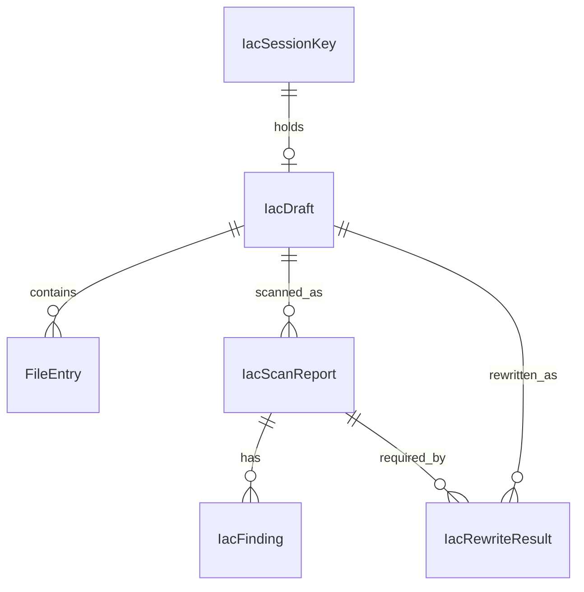
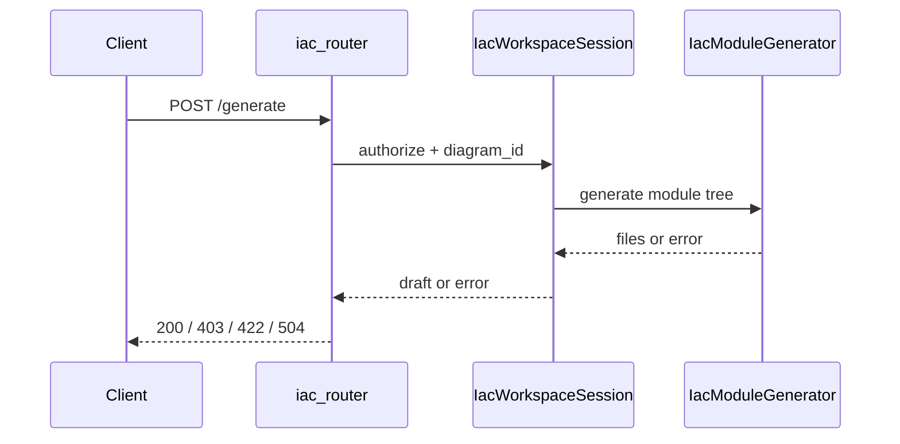
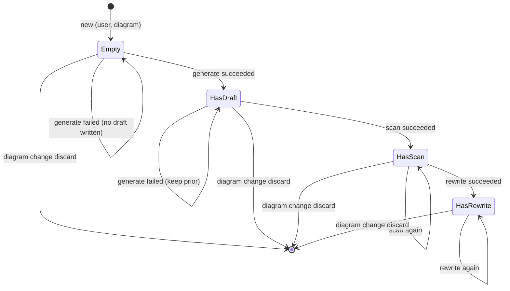

# 功能規格：U1 `u1-iac-api`

本檔為 **IaC HTTP 與 Session 閘**工作流／狀態機的真實來源。實體見 `entities.md`，規則見 `rules.md`。

## 範圍

依 Q1–Q5=A：

1. 套件 `backend/iac/`；掛載 `/api/iac`（Q1）
2. 行程內 store，鍵 `(userId, diagramId)`（Q5）
3. 關閉 R-01／R-02：download＝D1 edit；scan／rewrite 必填 `diagram_id`（Q2／Q3）
4. US6.1 錨點 `POST /generate`（Q4）
5. 同步編排 Generator／Scanner／Redactor（可 stub agent）；PBT 邊界於核心

**不含：** React UI（U2）、Postgres 新表、CI IaC scan job、雲端 apply／SM 寫入。

---

## 衍生 ER（自 entities.md）

**文字：** Session 鍵持有可選草稿；草稿含檔案與多份掃描／改寫結果；改寫依賴先前成功報告。

---

## 規則摘要（自 rules.md）

| 群組 | IDs |
|---|---|
| 授權／測試 | BR1.1、BR1.12 |
| 驗證／閘 | BR1.2–BR1.5、BR1.13 |
| 安全產物 | BR1.6–BR1.7 |
| 生成語意 | BR1.8–BR1.9 |
| 下載／重試 | BR1.10–BR1.11 |

---

## 工作流 W1 — Generate（D1）

| 步驟 | 動作 | 規則 |
|---|---|---|
| 1 | JWT＋D1 edit | BR1.1、BR1.12 |
| 2 | 驗證 `diagram_id` | BR1.2 |
| 3 | 讀圖公開 API（僅 id；內容不擁有） | ADR-005 |
| 4 | 呼叫 Generator（agent 可 stub）→ 模組樹 | BR1.8 |
| 5 | 成功：寫入／覆寫該鍵之 IacDraft；失敗：保留舊成功草稿＋錯誤 | BR1.9 |
| 6 | 200 GenerateResponse | — |

---

## 工作流 W2 — Scan（D2）

| 步驟 | 動作 | 規則 |
|---|---|---|
| 1 | D2 edit＋必填 diagram_id | BR1.1、BR1.2 |
| 2 | 需 succeeded draft | BR1.3 |
| 3 | Scanner → IacScanReport（可零 finding） | — |
| 4 | 200 ScanResponse | — |

---

## 工作流 W3 — Secrets rewrite（D3）

| 步驟 | 動作 | 規則 |
|---|---|---|
| 1 | D3 edit＋必填 diagram_id | BR1.1、BR1.2 |
| 2 | 閘：draft ∧ succeeded scan；校驗 report_id | BR1.4 |
| 3 | Redactor 更新 draft；寫 IacRewriteResult | BR1.6、BR1.7 |
| 4 | 200 RewriteResponse（無明文） | BR1.6 |

---

## 工作流 W4 — Session 讀取

| 步驟 | 動作 | 規則 |
|---|---|---|
| 1 | D1 view＋diagram_id | BR1.1、BR1.2 |
| 2 | 回 SessionSnapshot；無產物時欄位 null（非 404） | — |

---

## 工作流 W5 — Download zip

| 步驟 | 動作 | 規則 |
|---|---|---|
| 1 | D1 edit＋diagram_id | BR1.1、BR1.2、R-01 |
| 2 | 需 succeeded draft | BR1.3 |
| 3 | 組 application/zip＋Content-Disposition | BR1.6、BR1.10 |
| 4 | 不因 HIGH／CRITICAL 拒下 | BR1.10 |

---

## 狀態機 — Session 產物槽

**文字：** 空槽→草稿→（可）掃描→（可）改寫；任一 diagram 變更丟棄回空。自 Empty generate 失敗仍留 Empty（不寫草稿）；自 HasDraft generate 失敗保留既有成功草稿。

---

## 整合點

| 對向 | 契約 |
|---|---|
| U2 UI | 消費 OpenAPI C1（contract-summary） |
| 圖公開 API | list／get／upload；僅存 diagram_id |
| RBAC | `require_story_action("D1"|"D2"|"D3", view|edit)` |
| langgraph_runtime／OpenRouter | 可 stub；不擋合閘 |

---

## 明確非目標

- frontend-components
- 持久化草稿表（已由文末「後續實作補記」取代：按儲存會寫入 `iac_saved_drafts`）
- API 層 HIGH／CRITICAL modal
- apply／destroy／SM PutSecret

---

## 後續實作補記（2026-11-08）

本節補的是程式後來的行為。與上文衝突時，以本節為準。BR1.7 仍然有效：沒有 apply、destroy，也沒有雲端 Secret Manager 寫入。

### 雲別判斷

產生器不看架構圖標題。每個節點的雲別依序決定：

1. 標籤若寫出供應商（`azure`／`microsoft`、`aws`／`amazon`、`gcp`／`google`），以標籤為準。
2. 略過 `image=data:` 後面的圖示編碼。編碼裡偶然出現的 `aws`、`s3`、`ec2` 不算雲別。
3. `shape=mxgraph.aws4.group` 這類外框是容器，不是 AWS 資源。Azure 圖沿用這個外框時，仍依標籤與外層群組。
4. 節點自己看不出雲別時，沿用父群組；仍沒有時，跟著這張圖已辨認節點裡數量最多的雲。
5. 只有節點雲別不同於主要雲時，才在該資源上加 `# experimental: non-primary cloud {該節點的雲}`。認不出來的節點不再預設成 `aws_instance`。

### Terraform 可用程度

使用者把可用 Terraform 分成四層。本產生器目前的位置：

| 層級 | 條件 | 現況 |
|---|---|---|
| Level 1 | `terraform fmt`、`terraform validate` 通過 | 已用 Terraform 1.9.8、AzureRM 4.81.0 對「Azure電商」產出的三個 `.tf` 驗證通過。有 `provider "azurerm" { features {} }`，子網路引用同一個虛擬網路，沒有 `vnet-placeholder`、`nic-placeholder`。 |
| Level 2 | `terraform plan`／`apply` 能建立資源 | 未對雲端執行。設定在語法上可被接受。真正 plan 前要提供沒有預設值的 `subscription_id`，並以有權限的 Azure 身分登入。 |
| Level 3 | 資源類型、依賴、網路、HA、流量路徑符合架構圖 | 部分做到。服務名稱對到真實類型（資源群組、虛擬網路、子網路、WAF 原則、Application Gateway、AKS、Cosmos DB、儲存體、CDN、Log Analytics）。子網路與 AKS 跟著父群組。流量路徑與完整雙可用區高可用還沒有寫進路由與後端池。 |
| Level 4 | 最小權限、Secret、遠端 state、備份、監控、成本 | 未做。需要由外部提供的值是變數，沒有預設值。 |

對不上已知服務的節點寫成「無法轉換」，不產生 GCE 虛擬機器、EC2 或 Azure 虛擬機器來充數。已經認得、但架構圖沒有部署必要欄位的元件（例如 Apigee 缺 analytics region）寫成「待補充」，並註明原本要對應的 Terraform 類型，同樣不產生資源。服務名稱沿用畫圖 prompt 的清單。GKE、Cloud Run、VPC、Cloud SQL、Cloud Storage、Pub/Sub、Cloud KMS、Compute Engine，以及 AWS 的 S3、EC2、Secrets Manager、Internet Gateway 等欄位足夠的服務才產生對應資源。Cloud NAT、Spanner、Route 53、Azure DNS 這類清單內但缺部署欄位的服務標成待補充。雲端外框、Zone、Region、名稱裡帶 layer 的框，以及其他群組框，產生時略過。名稱後面還有說明也一樣略過，例如 Zone A — multi-agent orchestration、Ingress & API Layer。VPC、subnet、resource group 同時是框也是資源，仍會產生。User、Client 這類畫在圖上的角色會標成無法轉換。

### 儲存與掃描建議

行程內 session 仍在。使用者按儲存時，草稿、產生建議、掃描建議與成功的掃描報告寫入 `iac_saved_drafts`（`files_json`、`advice_text`、`scan_advice_text`、`scan_json`）。掃描本身不呼叫模型。掃描成功後，另一條 `POST /api/iac/scan-advice` 才依檢查結果產生建議，不覆蓋產生草稿那則 `advice_text`。`POST /api/iac/files` 可替換三個 `.tf`，並使舊掃描失效。
