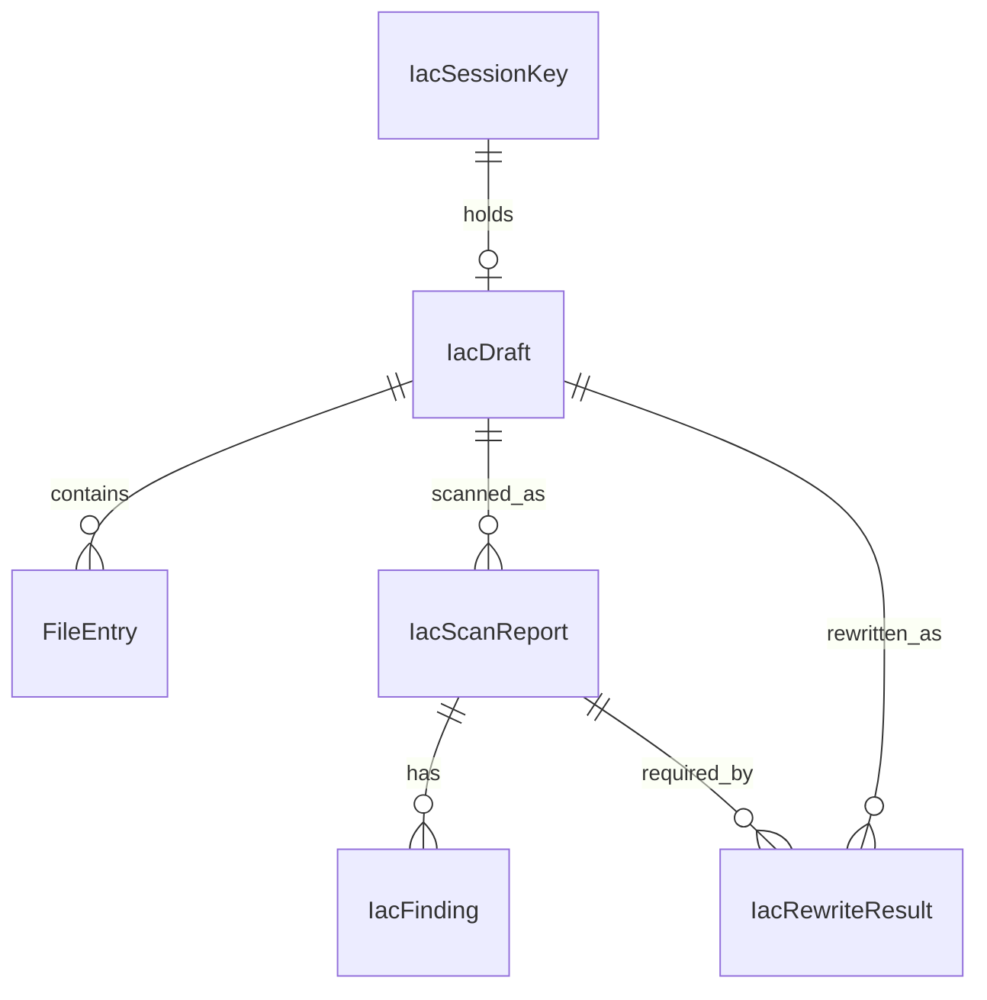
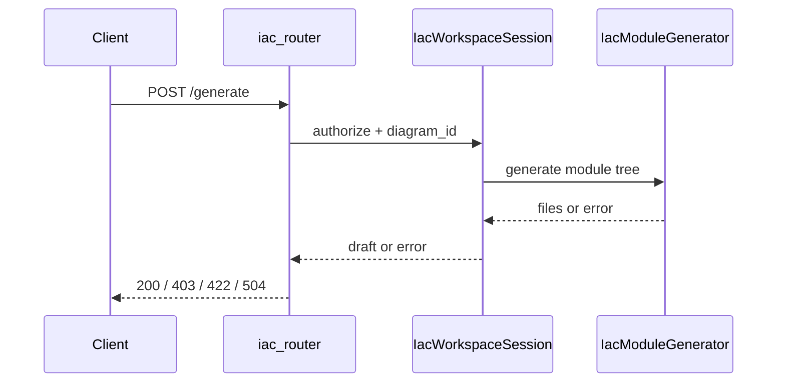
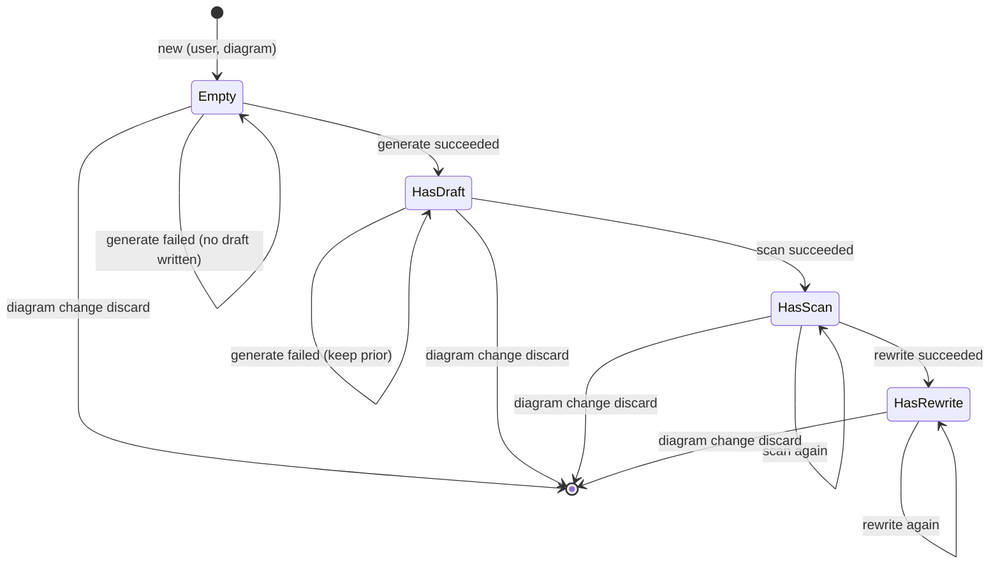

# 功能規格：U1 `u1-iac-api`

本檔為 **IaC HTTP 與 Session 閘**工作流／狀態機的真實來源。實體見 `entities.md`，規則見 `rules.md`。

## 範圍

依 Q1–Q5=A：

1. 套件 `backend/iac/`；掛載 `/api/iac`（Q1）
2. 行程內 store，鍵 `(userId, diagramId)`（Q5）
3. 關閉 R-01／R-02：download＝D1 edit；scan／rewrite 必填 `diagram_id`（Q2／Q3）
4. US6.1 錨點 `POST /generate`（Q4）
5. 同步編排 Generator／Scanner／Redactor（可 stub agent）；PBT 邊界於核心

**不含：** React UI（U2）、Postgres 新表、CI IaC scan job、雲端 apply／SM 寫入。

---

## 衍生 ER（自 entities.md）

**文字：** Session 鍵持有可選草稿；草稿含檔案與多份掃描／改寫結果；改寫依賴先前成功報告。

---

## 規則摘要（自 rules.md）

| 群組 | IDs |
|---|---|
| 授權／測試 | BR1.1、BR1.12 |
| 驗證／閘 | BR1.2–BR1.5、BR1.13 |
| 安全產物 | BR1.6–BR1.7 |
| 生成語意 | BR1.8–BR1.9 |
| 下載／重試 | BR1.10–BR1.11 |

---

## 工作流 W1 — Generate（D1）

| 步驟 | 動作 | 規則 |
|---|---|---|
| 1 | JWT＋D1 edit | BR1.1、BR1.12 |
| 2 | 驗證 `diagram_id` | BR1.2 |
| 3 | 讀圖公開 API（僅 id；內容不擁有） | ADR-005 |
| 4 | 呼叫 Generator（agent 可 stub）→ 模組樹 | BR1.8 |
| 5 | 成功：寫入／覆寫該鍵之 IacDraft；失敗：保留舊成功草稿＋錯誤 | BR1.9 |
| 6 | 200 GenerateResponse | — |

---

## 工作流 W2 — Scan（D2）

| 步驟 | 動作 | 規則 |
|---|---|---|
| 1 | D2 edit＋必填 diagram_id | BR1.1、BR1.2 |
| 2 | 需 succeeded draft | BR1.3 |
| 3 | Scanner → IacScanReport（可零 finding） | — |
| 4 | 200 ScanResponse | — |

---

## 工作流 W3 — Secrets rewrite（D3）

| 步驟 | 動作 | 規則 |
|---|---|---|
| 1 | D3 edit＋必填 diagram_id | BR1.1、BR1.2 |
| 2 | 閘：draft ∧ succeeded scan；校驗 report_id | BR1.4 |
| 3 | Redactor 更新 draft；寫 IacRewriteResult | BR1.6、BR1.7 |
| 4 | 200 RewriteResponse（無明文） | BR1.6 |

---

## 工作流 W4 — Session 讀取

| 步驟 | 動作 | 規則 |
|---|---|---|
| 1 | D1 view＋diagram_id | BR1.1、BR1.2 |
| 2 | 回 SessionSnapshot；無產物時欄位 null（非 404） | — |

---

## 工作流 W5 — Download zip

| 步驟 | 動作 | 規則 |
|---|---|---|
| 1 | D1 edit＋diagram_id | BR1.1、BR1.2、R-01 |
| 2 | 需 succeeded draft | BR1.3 |
| 3 | 組 application/zip＋Content-Disposition | BR1.6、BR1.10 |
| 4 | 不因 HIGH／CRITICAL 拒下 | BR1.10 |

---

## 狀態機 — Session 產物槽

**文字：** 空槽→草稿→（可）掃描→（可）改寫；任一 diagram 變更丟棄回空。自 Empty generate 失敗仍留 Empty（不寫草稿）；自 HasDraft generate 失敗保留既有成功草稿。

---

## 整合點

| 對向 | 契約 |
|---|---|
| U2 UI | 消費 OpenAPI C1（contract-summary） |
| 圖公開 API | list／get／upload；僅存 diagram_id |
| RBAC | `require_story_action("D1"|"D2"|"D3", view|edit)` |
| langgraph_runtime／OpenRouter | 可 stub；不擋合閘 |

---

## 明確非目標

- frontend-components
- 持久化草稿表
- API 層 HIGH／CRITICAL modal
- apply／destroy／SM PutSecret
