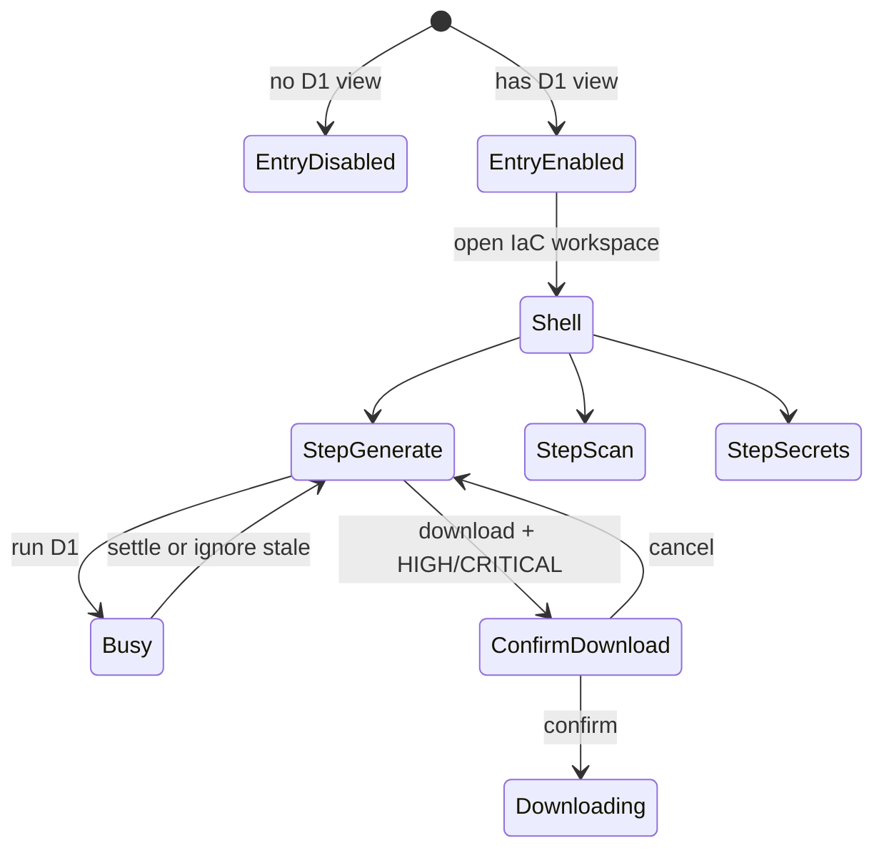

# 功能規格：U2 `u2-iac-ui`

本檔為 **IaC 工作區 UI** 互動工作流與畫面狀態的真實來源（UI unit；無 entities／rules 檔）。  
行為對齊 refined-mockups test-id 與契約 C1；閘的權威在 U1。

## 範圍

依 Q1–Q4=A：

1. Workspace 路由下取代 Coming Soon（Q1）；不另開獨立 `/iac` 主路徑
2. 三步驟殼＋aside 選圖；自由點步驟；footer 僅導覽
3. 切圖提示清空；in-flight 忽略回寫；執行鈕 busy（Q2）
4. 錯誤依 `error.code`；403 缺權說明（Q3）
5. 允許 MSW／stub 平行開發（Q4）
6. HIGH／CRITICAL 下載 modal；無 apply UI

**不含：** Session 閘實作、PBT 核心、OpenAPI 義務（U1）。

---

## 畫面狀態

**文字：** 無權停在 disabled 入口；有權進入三步驟殼；執行中 busy；下載前可能經確認 modal。

---

## 工作流 W1 — 進入與選圖

| 步驟 | 動作 | 驗收 |
|---|---|---|
| 1 | 渲染 `iac-entry`；無權 disabled＋說明 | US1.1 |
| 2 | 進入殼；aside 帶活躍圖／`iac-diagram-select`／`iac-diagram-upload` | US1.2 |
| 3 | 無圖：主區阻擋＋回 Workspace CTA；不可觸發 D1 | US1.2 |
| 4 | 切圖：可見清空提示；清空本機檢視態；in-flight 結果不寫入 | US1.3／Q2 |

---

## 工作流 W2 — 生成步驟

| 步驟 | 動作 | 驗收 |
|---|---|---|
| 1 | 顯示檔案樹／預覽（`iac-file-tree`／`iac-hcl-preview`） | US2.1 |
| 2 | `iac-run-d1`：有 D1 edit 且有圖才可點；busy＋`iac-agent-status` | US2.1 |
| 3 | POST `/api/iac/generate`（必填 diagram_id）；成功刷新樹 | 契約 |
| 4 | 失敗：錯誤＋重試；保留先前成功預覽（若有） | US2.3 |
| 5 | 依 `error.code` 顯示文案；403 缺權 | Q3 |

---

## 工作流 W3 — 掃描步驟

| 步驟 | 動作 | 驗收 |
|---|---|---|
| 1 | 可自由打開；無草稿時空態＋`iac-run-d2` disabled | US3.1／US3.2 |
| 2 | 執行 POST `/scan`；findings 嚴重度文字（`iac-findings`） | US3.1 |
| 3 | HIGH／CRITICAL **不**擋進入 Secrets | US3.2 |

---

## 工作流 W4 — Secrets 步驟

| 步驟 | 動作 | 驗收 |
|---|---|---|
| 1 | 可自由打開；無 D2 報告時執行 disabled＋說明 | US4.2 |
| 2 | `iac-run-d3` → POST `/secrets/rewrite`；清單 `iac-rewrite-list` | US4.1 |
| 3 | 不展示明文密文 | US4.1 |

---

## 工作流 W5 — 下載／複製

| 步驟 | 動作 | 驗收 |
|---|---|---|
| 1 | 無草稿：`iac-download` disabled | US5.1 |
| 2 | 若最新成功 scan 含 HIGH／CRITICAL → 先 `iac-download-confirm` | US5.1 |
| 3 | 確認後才 GET `/download`；取消／Esc 不下載 | US5.1 |
| 4 | 複製目前檔至剪貼簿（`iac-copy`） | US5.1 |
| 5 | **無** apply／destroy 控制 | US5.1 |

---

## 整合

| 對向 | 說明 |
|---|---|
| U1 `/api/iac` | 唯一後端；stub 須符契約形狀（Q4） |
| Workspace chrome | 同 layout／brand tokens |
| RBAC | 入口與執行鈕依 view／edit 能力；權威仍在 API |

## 明確非目標

- 實作閘／PBT／OpenAPI drift
- 獨立頂層 `/iac` 為主路徑（Q1=A）
