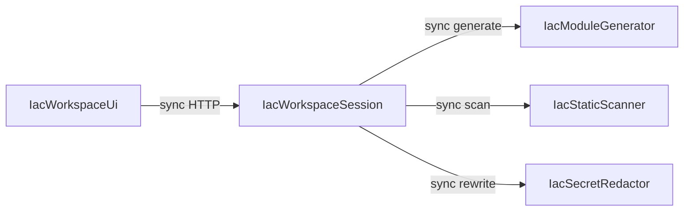

# 元件目錄 — Story D IaC 生成與安全交付

<!-- Stage: domain-design · Q1–Q6／Q6b=A。yaml 區塊為真實來源；下表與圖由它衍生。
     元件＝要寫的邏輯構件；DB／CLI／OpenRouter／既有圖 API 為 external_dependencies。 -->

## 上游輸入

- **requirements**／**stories**／**refined-mockups**／**team-practices**／**codekb**
- **定案**：四後端＋一前端；行程內產物；同步 HTTP；Agent 不另列元件；圖走公開 API

## Part A — 機器可讀目錄

```yaml
components:
  - name: IacWorkspaceUi
    summary: Workspace 內 IaC 三步驟工作區的唯一前端 Domain 元件
    behaviour: >
      取代 Coming Soon：有 D1 view 時入口可點，無則 disabled＋說明。固定殼左步驟／中草稿／
      右欄依步驟切換。選圖 aside（活躍圖／下拉／上傳）；切圖清空提示；無圖阻擋。步驟可自由
      點開；footer 下一步僅導覽。呼叫 /api/iac/* 同步執行；aside Agent 狀態樂觀進行中；
      執行鈕 busy。掃描 findings 嚴重度文字；Secrets 警告不展示明文；HIGH／CRITICAL 下載前
      modal（確認／取消／Esc）。不提供 apply／destroy。視覺子塊為內部模組，不另列元件。
    responsibilities:
      - 步驟狀態機與自由檢視／執行閘的 UI 呈現
      - 選圖脈絡、上傳失敗提示、切圖清空提示
      - 呼叫 IaC HTTP、下載／複製、風險摘要 dialog
      - 對齊 Workspace／Cost 既有 Tailwind 語彙
    depends_on:
      - component: IacWorkspaceSession
        interaction: 經 /api/iac 執行生成／掃描／改寫、讀取草稿與報告、下載 zip
        style: sync
    dependents: []
    external_dependencies: []
    entities: []

  - name: IacWorkspaceSession
    summary: IaC 工作階段、產物鍵、執行閘與 HTTP 編排
    behaviour: >
      擁有行程內 IacDraft／IacScanReport／IacRewriteResult，鍵為 (user|session, diagram_id)。
      切圖或 diagram_id 變更時清空產物並作廢舊 report_id。執行 D2／下載需成功草稿；執行 D3
      需 D1∧至少一次 D2 succeeded（補強 FR6.2）。HTTP 掛 /api/iac，require_story_action
      view／edit；不塞 agent_router／user_router。同步 JSON 編排呼叫三核心；不持久化新
      Postgres 表（本輪）。圖內容不擁有——只存 diagram_id，讀寫走既有公開圖契約。
    responsibilities:
      - 工作階段產物生命週期與切圖清空
      - D2／D3／下載執行前置閘（含 R-01）
      - /api/iac HTTP 邊界與 RBAC 掛鉤
      - 編排呼叫 Generator／Scanner／Redactor（含可插入跨步順序）
    depends_on:
      - component: IacModuleGenerator
        interaction: 對脈絡圖產生模組樹草稿
        style: sync
      - component: IacStaticScanner
        interaction: 對草稿產出掃描報告
        style: sync
      - component: IacSecretRedactor
        interaction: 在已有 D2 成功報告後改寫疑似密文
        style: sync
    dependents:
      - component: IacWorkspaceUi
        interaction: UI 經 HTTP 消費工作階段與產物
    external_dependencies:
      - name: Existing diagram public API
        kind: other
        purpose: list／get／upload 架構圖；不擁有 Diagram 實體
      - name: RBAC require_story_action
        kind: other
        purpose: D1／D2／D3 view 與 edit 授權
    entities:
      - name: IacDraft
        identifier: draftId
        attributes: [draftId, diagramId, userId, moduleTree, status, createdAt]
        references: []
      - name: IacScanReport
        identifier: reportId
        attributes: [reportId, draftId, diagramId, findings, maxSeverity, status, createdAt]
        references:
          - entity: IacDraft
            owned_by: IacWorkspaceSession
            relationship: each report belongs to one draft revision in the session
      - name: IacRewriteResult
        identifier: rewriteId
        attributes: [rewriteId, draftId, reportId, rewrittenPaths, status, createdAt]
        references:
          - entity: IacDraft
            owned_by: IacWorkspaceSession
            relationship: rewrite updates the session draft
          - entity: IacScanReport
            owned_by: IacWorkspaceSession
            relationship: rewrite requires a prior succeeded scan report

  - name: IacModuleGenerator
    summary: 決定性 IaC generator 核心與 D1 LangGraph 編排
    behaviour: >
      純函式核心將架構圖摘要轉為多檔 HCL 模組樹（至少 main／variables／outputs 或等價）；
      多雲資源不靜默丟棄（實驗性以 HCL comment／標記表達，無需獨立 UI 元件）。PBT／離線
      可斷言。D1 agent 編排經 langgraph_runtime＋OpenRouter，可 stub。不直接呼叫 Scanner／
      Redactor；不代 apply。
    responsibilities:
      - 決定性模組樹生成與序列化
      - D1 agent 編排（行為內含，非獨立元件）
      - 多雲實驗性標記策略（產物內）
    depends_on: []
    dependents:
      - component: IacWorkspaceSession
        interaction: Session 請求生成草稿
    external_dependencies:
      - name: langgraph_runtime
        kind: other
        purpose: D1 agent graph 執行底座
      - name: OpenRouter
        kind: third-party-api
        purpose: LLM 推理（可 stub）
    entities: []

  - name: IacStaticScanner
    summary: 掃描報告形狀與 D2 LangGraph 編排（CLI 可 stub）
    behaviour: >
      對草稿產出 findings 報告（含零 finding）；嚴重度可讀文字。報告形狀可 unittest／PBT。
      不新增 CI IaC scan job；外部 CLI 為 stub 友善依賴。D2 agent 編排經 langgraph_runtime。
      不執行 D3、不擁有 Session 閘。
    responsibilities:
      - 掃描編排與報告形狀
      - D2 agent 編排（行為內含）
    depends_on: []
    dependents:
      - component: IacWorkspaceSession
        interaction: Session 在有草稿時請求掃描
    external_dependencies:
      - name: langgraph_runtime
        kind: other
        purpose: D2 agent graph 執行底座
      - name: OpenRouter
        kind: third-party-api
        purpose: LLM 推理（可 stub）
      - name: External IaC scan CLI
        kind: other
        purpose: 靜態掃描工具（品牌未釘；可 stub）
    entities: []

  - name: IacSecretRedactor
    summary: 密文改寫核心與 D3 LangGraph 編排
    behaviour: >
      將疑似密文賦值改為 Secret Manager 參考語法；回應／log／下載物不得回洩明文（PBT＋突變）。
      不寫入雲端 SM、不代 apply。D3 agent 經 langgraph_runtime。執行前置由 Session 強制
      （有 D2 成功報告）；本元件假設呼叫端已通過閘。
    responsibilities:
      - 決定性／可測的 redaction
      - D3 agent 編排（行為內含）
      - 禁 SM 雲端寫入與禁 apply
    depends_on: []
    dependents:
      - component: IacWorkspaceSession
        interaction: Session 在閘通過後請求改寫
    external_dependencies:
      - name: langgraph_runtime
        kind: other
        purpose: D3 agent graph 執行底座
      - name: OpenRouter
        kind: third-party-api
        purpose: LLM 推理（可 stub）
    entities: []
```

## Part B — 人類可讀視圖

### Component Diagram



<!-- Text fallback: Ui → Session；Session → Generator／Scanner／Redactor；三核心互不直連。 -->

### Component Summary

| Component | Purpose | Depends On | Dependents | Entities Owned |
|---|---|---|---|---|
| IacWorkspaceUi | IaC 工作區 UI | IacWorkspaceSession | — | — |
| IacWorkspaceSession | 產物／閘／HTTP 編排 | Generator, Scanner, Redactor | Ui | IacDraft, IacScanReport, IacRewriteResult |
| IacModuleGenerator | D1 核心＋agent | — | Session | — |
| IacStaticScanner | D2 核心＋agent | — | Session | — |
| IacSecretRedactor | D3 核心＋agent | — | Session | — |

### Entity Ownership

| Entity | Owning Component | Identifier | Attributes | References |
|---|---|---|---|---|
| IacDraft | IacWorkspaceSession | draftId | draftId, diagramId, userId, moduleTree, status, createdAt | — |
| IacScanReport | IacWorkspaceSession | reportId | reportId, draftId, diagramId, findings, maxSeverity, status, createdAt | IacDraft |
| IacRewriteResult | IacWorkspaceSession | rewriteId | rewriteId, draftId, reportId, rewrittenPaths, status, createdAt | IacDraft, IacScanReport |

### External Dependencies

| Component | Dependency | Kind | Purpose |
|---|---|---|---|
| IacWorkspaceSession | Existing diagram public API | other | 圖 list／get／upload |
| IacWorkspaceSession | RBAC require_story_action | other | D1／D2／D3 授權 |
| IacModuleGenerator | langgraph_runtime / OpenRouter | other / third-party-api | D1 agent |
| IacStaticScanner | langgraph_runtime / OpenRouter / scan CLI | other / third-party-api | D2 agent＋工具 |
| IacSecretRedactor | langgraph_runtime / OpenRouter | other / third-party-api | D3 agent |

### Rationale

| Component | Why separate |
|---|---|
| IacWorkspaceSession | 獨特生命週期（切圖清空）與跨步閘；變更率高於純函式核心 |
| IacModuleGenerator | 獨立 PBT 核心＋D1 agent；與掃描／改寫失敗模式不同 |
| IacStaticScanner | 報告形狀／CLI stub／禁 CI job；獨立測試面 |
| IacSecretRedactor | 明文負向／突變；禁 SM 寫入；與生成解耦 |
| IacWorkspaceUi | 單工作區 UI 狀態機；對齊 Cost「一頁一域」 |

**Alternatives Rejected（摘要）**：三後端無 Session（閘分散）；雙元件 Orchestrator＋大 Core（邊界糊）；前端三 Panel（跨步協定重）；圖自建表或挖 collab 私函；SSE／Job（本輪過重）；三獨立 Agent 元件（Q6b=A 否決）。詳見 `decisions.md`。

### 與既有系統

| 既有 | 關係 |
|---|---|
| `backend/iac/` 套件（practices） | 上列後端元件的實作家園 |
| `langgraph-runtime`（inventory） | 外部依賴，非本目錄元件 |
| `iac-d-pillar-surface`（Coming Soon／RBAC 種子） | 由 Ui＋Session 取代／接上真路徑 |
| Workspace／collab 圖 API | Session／Ui 的外部依賴；Diagram 非 IaC 擁有 |
