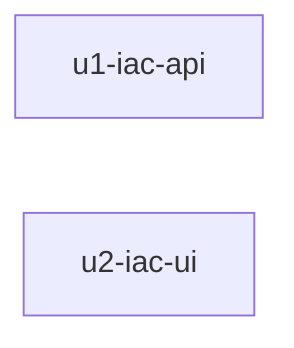

# Unit Dependency DAG — Story D IaC

> Stage: units-generation · **只描述拓樸**，不定出貨／施工順序（Delivery Planning）。  
> Q5=A：兩 unit 互不 `depends_on`，可平行開發（ui 可對 stub／契約）。

## 機器可讀邊區塊

```yaml
units:
  - name: u1-iac-api
    kind: service
    depends_on: []
  - name: u2-iac-ui
    kind: ui
    depends_on: []
```

## 人類可讀 DAG



<!-- Text fallback: u1-iac-api 與 u2-iac-ui 無向依賴邊；整合靠 /api/iac 契約，非 unit depends_on。 -->

## 整合點

| 整合 | 風格 | 說明 |
|---|---|---|
| UI ↔ API | sync HTTP JSON | `/api/iac`；OpenAPI 屬 U1 |
| API ↔ 圖域 | sync HTTP／既有服務 | 公開圖 API；非本 DAG 節點 |
| API ↔ RBAC | in-process | `require_story_action` |

## 平行開發機會

| 集合 | 說明 |
|---|---|
| `{u1-iac-api, u2-iac-ui}` | 拓樸無依賴；ui 可先對 OpenAPI stub／契約草稿。**不**表示必須同時開工（順序交 2.9）。 |

## 非邊（刻意不畫）

- **不**畫 `u2-iac-ui → u1-iac-api`：避免把「需要契約」誤建成強制串列拓樸（Q5≠B）。
- **不**把三核心拆成 library units（Q2=A）。
